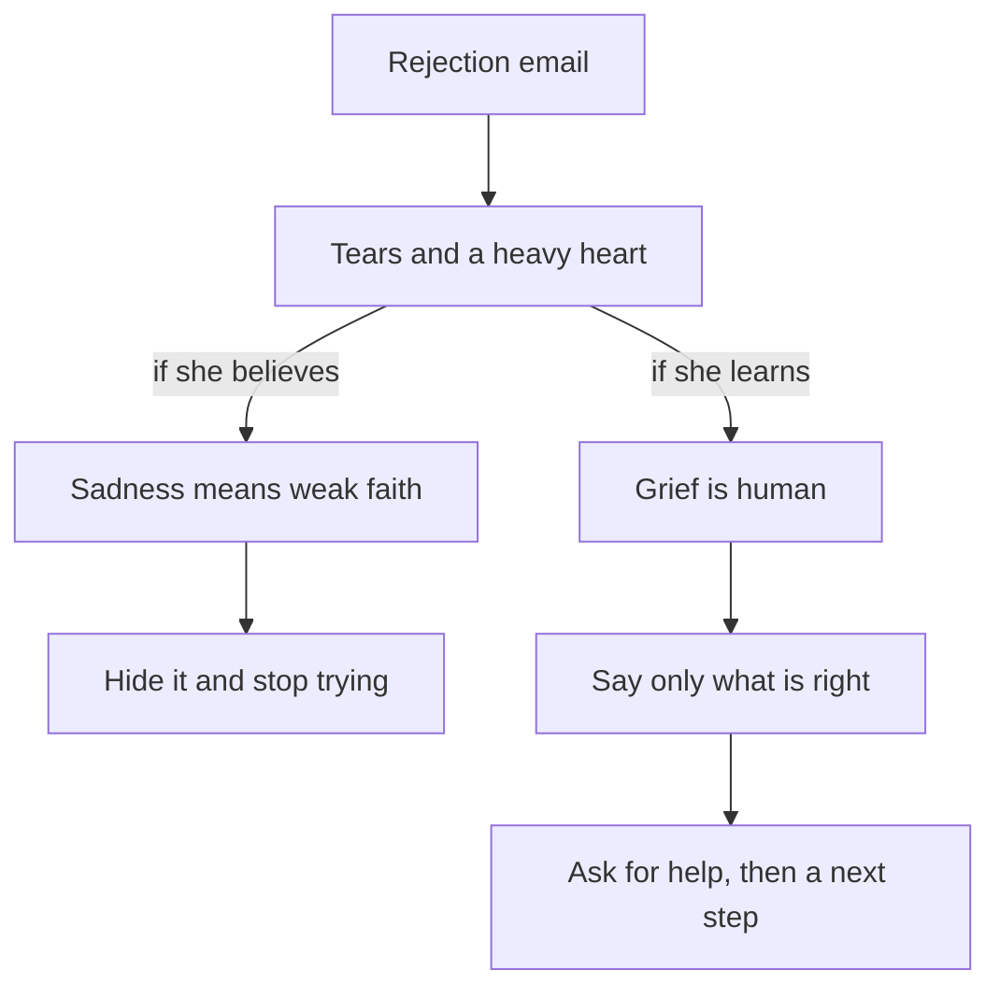

## The email on Tuesday

Mariam is 24. She graduated in English literature two years ago. She lives with her mother and her younger brother, Qusai, who is in his last year of school. Three evenings a week she teaches English online to three secondary school students, and the small fees help at home.

For a whole year, Mariam worked on one application: a study scholarship for a master's degree in teaching English. She wrote her personal statement eleven times. She asked two of her old lecturers for reference letters, and she reminded them politely until both letters arrived. She studied for the English test in the evenings, when the grid power came on, and she passed with a good score. She wrote a short research proposal about teaching reading to young learners. Her mentor, Reem, read it twice and gave her notes.

The result came on a Tuesday afternoon, in an email of four lines. The committee thanked her. They had received many strong applications. They regretted that they could not offer her a place this year. The next round would open in eight months.

Mariam read the email twice on her phone. Then she put the phone face down on the mattress. Her mother was in the kitchen, and Qusai was doing homework by the window. For a few minutes nobody noticed anything. Then her mother came in to ask about dinner, saw her face, and sat down beside her without a word. Mariam cried. She had not cried in front of her mother for a long time.

Her mother said quietly, "Inna lillahi wa inna ilayhi raji'un", the words she says whenever something is lost, a glass that breaks or a job that ends. Mariam said the words too. That evening Qusai made tea and put a glass beside her. Nobody tried to explain the email. They just stayed near her.

## A second, heavier thought

Later that night, a second thought came, and it hurt more than the email. Mariam remembered something she had heard years ago at a family gathering: a strong believer does not cry over worldly things. She thought: if my faith were stronger, I would not feel like this. I would thank Allah, smile and move on. Maybe my tears show that my faith is weak.

This thought is common, and many sincere people carry it. It is worth looking at closely, because it can do real harm. If Mariam believes that sadness means weak faith, she now has two problems instead of one. She has lost the scholarship, and she also feels guilty for being sad about it. Guilt like this often makes people hide. They stop talking, they stop asking for help, and sometimes they stop trying.

Before you read on, make a guess about what the Sunnah says.

```predict
prompt: "Mariam thinks her tears show weak faith. When the Prophet's baby son was dying, what did the Prophet do?"
options:
  - id: wept
    label: "His eyes filled with tears, and he called it mercy"
  - id: held-back
    label: "He held back his tears, to show the people patience"
correctOptionId: wept
explanation: "The Prophet's eyes filled with tears, and when a companion was surprised, he said it was mercy (Sahih al-Bukhari 1303). Tears and a grieving heart fit with strong faith. What the believer guards is the tongue: saying only what pleases Allah."
```

## What the Prophet did

The Prophet, peace be upon him, had a baby son named Ibrahim. When the child was dying, the Prophet's eyes filled with tears. One of his companions, Abdur-Rahman ibn Awf, may Allah be pleased with him, was surprised and asked: even you, Messenger of Allah? The Prophet said that this was mercy. Then he said that the eye sheds tears and the heart grieves, and we say only what pleases our Lord, and that they were saddened by Ibrahim's parting (Sahih al-Bukhari 1303).

> إِنَّ الْعَيْنَ تَدْمَعُ، وَالْقَلْبَ يَحْزَنُ، وَلاَ نَقُولُ إِلاَّ مَا يَرْضَى رَبُّنَا، وَإِنَّا بِفِرَاقِكَ يَا إِبْرَاهِيمُ لَمَحْزُونُونَ

Meaning: The eye sheds tears and the heart grieves, and we say only what pleases our Lord. O Ibrahim, we are saddened by your parting (Sahih al-Bukhari 1303).

Notice three things in this hadith. First, the tears were real, and they came from the best of people. Second, he did not hide them or apologise for them; he called them mercy. Third, there is a limit, and the limit is the tongue: "we say only what pleases our Lord." Grief is allowed. What the believer avoids is words of objection against Allah.

A child's death is a far heavier loss than a scholarship, and Mariam knows that. But the hadith teaches something about sadness itself. Sadness is not a sign of weak faith. It is part of being human, and the Prophet showed it openly. Mariam's tears on Tuesday were not a failure. They were the honest response of a person who worked hard for something and did not get it.

## A prophet who wept and still had patience

The Quran tells of another father who grieved. Yaqub, peace be upon him, was separated from his son Yusuf. The Quran tells us that he turned away and said, "Alas for Yusuf", and that his eyes turned white from grief (Quran 12:84). His sons worried that he would ruin his health (Quran 12:85). He answered that he complained of his grief and sorrow only to Allah, and that he knew from Allah what they did not know (Quran 12:86).

> قَالَ إِنَّمَا أَشْكُو بَثِّي وَحُزْنِي إِلَى اللَّهِ

Meaning: He said: I only complain of my grief and sorrow to Allah (Quran 12:86).

Then, in the very next verse, Yaqub did something. He told his sons to go and search for Yusuf and his brother, and not to despair of Allah's relief and mercy (Quran 12:87). So in four verses we see three things in one person: deep grief, honest complaint to Allah, and action. He did not pretend. He did not complain against Allah to people. And he did not sit still: he sent his sons out to look.

Chapter 3.2 shows that this same prophet is the one whose words "beautiful patience" are recorded in the Quran. That is the surprise at the centre of this module. The patience that the Quran praises is not a patience without tears. It is a patience that grieves, turns to Allah, and keeps moving.

<BigWordAlert term="Sabr" plainEnglish="Patience: holding yourself steady in hardship, keeping your tongue and actions right, and keeping going." whyItMatters="Many people think sabr means silence or never crying. The sources show a sabr that grieves honestly, turns to Allah, asks for help and keeps acting." />

## Why this matters for your work and study

Losses like Mariam's are part of building a career. An application is turned down. A client ends a contract. An exam result is lower than you hoped. An internship goes to someone else. Each one is small next to the big losses of life, but each one can still hurt, and several in a row can wear a person down.

*Sabr* (patience) decides what happens after the loss. If sabr means "be silent and feel nothing", then a person who feels something will think they have failed, and they will hide. But sabr can also mean something else: steady yourself, say what is right, ask for help and take the next step. With that meaning, a person can feel sad and still be patient on the same day. That second kind of sabr is the one the sources teach, and it is the one that keeps people moving.

The diagram shows the two roads Mariam could take from Tuesday evening. Both start with the same email and the same tears.



Look first at what the two roads share: the tears are on both. The difference is not whether Mariam feels sad. The difference is what she believes about her sadness. On the left, a wrong belief turns grief into guilt, and guilt into hiding. On the right, the Sunnah turns grief into right words, and right words into help and a next step. So you do not have to stop feeling in order to be patient. You have to choose what you say and do with what you feel.

## What this module covers

This module stays with Mariam over the weeks after the email. In chapter 3.2 you will see what sabr is and what it is not, starting from the first shock. You will also see four common ideas that only look like sabr. In chapter 3.3 you will learn the words the Quran and Sunnah give for hard moments. Some are for the moment the news comes, some are for a night of distress, and some are for worry about tomorrow.

In chapter 3.4, Mariam faces eight months until the next round. You will see how Yusuf and Yunus, peace be upon them, waited. You will also see what it means to wait well, so that a long wait is not an empty one. Chapter 3.5 is a short graded quiz. In chapter 3.6 you will write a plan for waiting well through one wait, your own or a provided case.

This module talks about loss, and some readers carry losses much heavier than a scholarship. Go gently with yourself as you read. Nothing in this module asks you to share your own hardship. Every task offers a provided case that counts just as much.

<Callout type="info" title="If it feels too heavy">
If you feel overwhelmed for a long time, or you have thoughts of harming yourself, talk to your mentor or the fellowship coordinator today. If you can, talk to a doctor or counsellor too. This course does not replace professional care.
</Callout>

<LearningObjectives items={["Explain why sadness and tears are not weak faith, using the Prophet's tears and Yaqub's grief", "Describe sabr as steadiness at the first shock that keeps acting, and tell it apart from silence, hiding need and giving up", "Use the istirja and the duas the Sunnah teaches for a loss, a night of distress and worry about tomorrow", "Know the Sunnah's way of consoling a friend: presence, a few true words and practical help", "Wait well for a result you cannot control, as Yusuf and Yunus did, with a plan for what you keep doing"]} />

## Key words

| Word | Plain English |
|---|---|
| ***Sabr jamil*** | Beautiful patience: patience without complaint against Allah, which can still include tears and complaint to Allah |
| ***Istirja*** | Saying "inna lillahi wa inna ilayhi raji'un" (we belong to Allah and to Him we return) when any loss happens |
| **Dua of distress** | Words the Prophet used to say at times of distress, praising Allah as the Lord of the heavens and the earth |
| **Consoling** | Being with someone after a loss: being present, listening, saying gentle words and helping with practical needs |
| **Waiting well** | Keeping on doing good, using the means and asking Allah while a result is out of your hands |

## What is in this module

| Chapter | You will practise |
|---|---|
| 3.2 | Telling sabr apart from silence, hiding need and giving up |
| 3.3 | Words for hard moments, and how to console a friend |
| 3.4 | Waiting well, with Yusuf and Yunus |
| 3.5 | A graded quiz with five short cases |
| 3.6 | A plan for waiting well through one real or provided wait |

**Next:** What sabr is, and what it is not, starting from the first moment of a loss.
