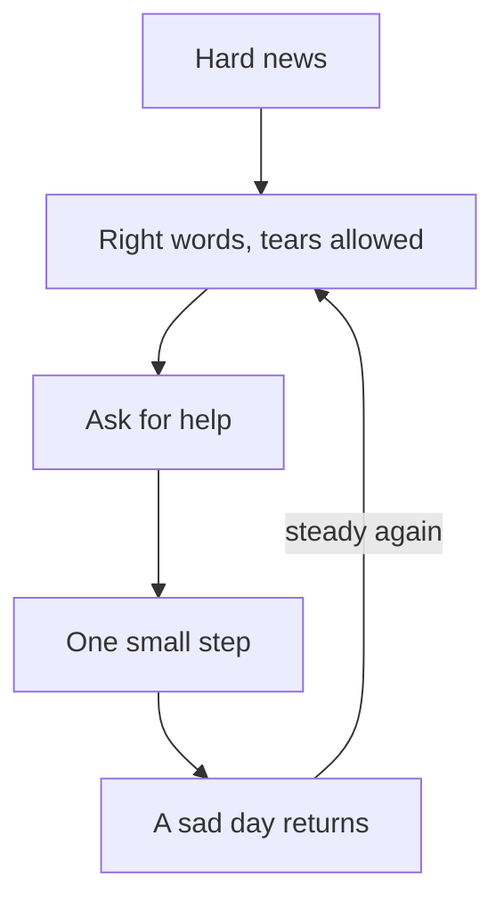

## "I am being patient"

Three days after the email, Mariam tells everyone she is fine. She has cancelled her online lessons for the week. She told the students' parents that she is busy. She has not opened her laptop. When her mentor, Reem, sends a message to ask how she is, Mariam answers with one line: "Alhamdulillah, I am being patient."

Her mother notices that she eats little and sleeps late. Her brother Qusai notices that she has stopped helping him with his English homework. Mariam is not lying on purpose. She truly believes that this is what patience looks like. Say nothing, show nothing, ask for nothing, and wait for the feeling to go away.

There is a second belief under the first one. On Friday she tells her mother: "Some people are patient by nature. I am not one of them." Before you read on, make a guess about that.

```predict
prompt: "Mariam says some people are patient by nature, and she is not one of them. Can patience grow in a person who keeps trying?"
options:
  - id: grows
    label: "Yes, it grows as a person keeps trying"
  - id: nature
    label: "Mostly not, it is fixed in a person's nature"
correctOptionId: grows
explanation: "The Prophet said that whoever tries to be patient, Allah makes him patient (Sahih al-Bukhari 1469). Patience is practised and grows with effort, and Allah helps it grow. Mariam does not need to be patient by nature before she can act patiently."
```

Step through the canvas below. It follows Mariam from the first shock to her first small step, through a sad day that comes back, and it shows the road that is not sabr.

<InteractiveCanvas slug="sabr-keeps-moving" />

The canvas showed patience as something Mariam does again and again, not something she has or lacks. Tears, right words and a request for help all sit inside sabr. When a sad day returned, she steadied herself again. The road that looks calm, hiding and stopping, is the one that leaves sabr behind.

## Patience is at the first shock

The Prophet, peace be upon him, once passed a woman who was weeping at a grave. He told her to fear Allah and be patient. She did not recognise him, and she answered harshly. She said: leave me, you have not been struck by a loss like mine. Later she was told who he was. She went to his house, where there was no guard at the door, and said she had not recognised him. He said that patience is at the first shock (Sahih al-Bukhari 1283).

> إِنَّمَا الصَّبْرُ عِنْدَ الصَّدْمَةِ الأُولَى

Meaning: Patience is only at the first shock (Sahih al-Bukhari 1283).

Look at what the Prophet did not do. He did not rebuke her for weeping. He did not answer her harsh words with harsh words. His door was open to her, with no guard to send her away. He told her one short truth: the moment that counts most is the first one. In that first moment, a person either holds steady or lets the pain push them into words and actions they regret.

This hadith is about the first moment. It is not a ban on sadness later. Mariam held steady on Tuesday evening. She cried, she said the istirja with her mother, and she said nothing against Allah. That was sabr, at the first shock, with tears on her face.

## Patience is a skill that grows

The Prophet also said that whoever tries to be patient, Allah makes him patient. He said that no one is given a gift better and wider than patience (Sahih al-Bukhari 1469). The word for "tries to be patient" describes effort. You practise patience, often badly at first, and Allah helps it grow.

This matters for Mariam. She does not need to feel patient before she can act patiently. She can take one patient step while her heart is still heavy, and then another. The feeling often comes after the steps, not before them.

## Help through patience and prayer

Allah tells the believers to seek help through patience and prayer, and that Allah is with the patient (Quran 2:153).

> يَا أَيُّهَا الَّذِينَ آمَنُوا اسْتَعِينُوا بِالصَّبْرِ وَالصَّلَاةِ ۚ إِنَّ اللَّهَ مَعَ الصَّابِرِينَ

Meaning: Believers, seek help through patience and prayer; Allah is with the patient (Quran 2:153).

Notice the verb: seek help. Patience is something you lean on, together with prayer, to carry what you have to carry. It is not a wall you build so that nobody sees you. Seeking help from Allah through prayer fits inside it. So does taking the help Allah sends through people.

## Beautiful patience, with tears

In chapter 3.1 you met Yaqub, peace be upon him, who wept until his eyes turned white. His sons once brought Yusuf's shirt with false blood on it. Yaqub said that patience is most fitting, and that Allah is the One whose help is sought against what they described (Quran 12:18). He said "beautiful patience" again later (Quran 12:83).

This is the sabr jamil from the key words of 3.1. The prophet who said it also wept, and he poured out his grief to Allah. So beautiful patience cannot mean dry eyes. What it leaves out is complaint against Allah.

## Three kinds of patience

The scholar Ibn al-Qayyim divided sabr into three kinds by what it relates to. In plain words: patience to keep doing good, patience to keep away from wrong, and patience with what happens to you. Mariam's loss is mostly the third kind. But the first kind matters too. Losses often tempt people to stop the good they were doing: lessons, prayers on time, kindness at home.

## What sabr is not

Put the sources together, and four common ideas fall away.

Sabr is not silence: Yaqub complained to Allah, and the woman at the grave was treated gently. Sabr is not hiding need: seeking help is in the verse itself. Sabr is not giving up: "whoever tries to be patient" is about effort, and Yaqub sent his sons to search. And sabr is not accepting a wrong without speaking. If a client refuses to pay for finished work, you can stay steady and still ask for what you are owed.

## Worked example: Hamza's exam

Here is the same teaching in a different life. Hamza is 23 and works part-time at a phone repair shop. For three months he studied for a networking certificate. He failed it by four points. Follow his first two weeks, with the reasoning at each step.

**Step 1: the first shock.** The result appears on the screen at the exam centre. Hamza says the istirja quietly, and he says nothing against Allah. On the bus home he feels heavy and close to tears. This is already sabr at the first shock. The heaviness does not cancel it.

**Step 2: the quiet week.** At home he tells his family "the results come later". He stops studying, and he tells himself he is being patient. Looking back, he can name it: this was silence and hiding, not sabr. Naming it matters, because the fix is a change of shape, not more effort.

**Step 3: ask for help.** He tells his older sister the truth. He also messages his study partner and asks which topics she found hardest. She sends him her notes on the two topics he failed. He has taken help from a person, which the verse on patience and prayer makes room for.

**Step 4: the three kinds.** Patience to keep doing good: he keeps his shifts at the shop and his prayers on time. Patience to keep away from wrong: he deletes an angry comment about the exam centre before posting it. Patience with what happened: when "if only I had studied one more week" comes back, he uses module 1. He says that Allah decreed, and He did what He willed (Sahih Muslim 2664).

**Step 5: a small step.** He books the retake for six weeks later. He studies the two weakest topics for 30 minutes each evening, when the power is on.

**Step 6: a sad day.** In week two a classmate posts his new certificate. Hamza feels low all evening. He prays, studies his 30 minutes anyway, and goes to bed early. He does not decide that his sabr has failed.

The diagram draws Hamza's two weeks as a loop, not a straight line.



Follow the arrow from the bottom back up to the right words. A sad day does not send Hamza back to the start, and it does not prove he failed. It sends him back to the same practice: right words, then help, then a step. That loop is what Bukhari 1469 describes. Each time round, the practice is a little easier, because patience grows with trying.

## Where people misunderstand it

The first misunderstanding is "real sabr means not crying." The Prophet wept at his son's death, and Yaqub wept until his eyes turned white. You can spot this mistake when someone feels guilty about tears and then hides them.

The second is "sabr means not asking anyone for anything." The verse says to seek help. You can spot this mistake when a person says "I am being patient" and also refuses every offer of help.

The third is "sabr means waiting without doing anything." Yaqub sent his sons to search. You can spot this mistake when "patience" becomes the reason a plan never starts.

The fourth is using sabr against someone else. It means telling a person who has been wronged to "be patient" so that they stay quiet. Sabr steadies your own heart and tongue. It does not ask you to accept a wrong without speaking.

<Callout type="tip" title="A quick test">
Ask yourself: am I still doing the good I was doing, and have I let at least one person help me? If both answers are yes, your sabr is moving, even on a sad day.
</Callout>

## Check your understanding

```quiz
type: mcq
question: "Dina failed her interpreting exam and must repeat the course next term. She says she is 'being patient', but she has stopped going to her study group and has not told her parents she needs help with the fee. What fits sabr best now?"
options:
  - "Give herself a few quiet weeks before she tells her parents anything"
  - "Tell her parents about the fee this week, and go back to the group"
  - "Take the term off from study, and apply again when she feels ready"
  - "Keep going to the group, and find the fee herself without asking"
correct: 1
explanations:
  - "Some quiet can help, but weeks of keeping it from her parents is hiding need. Allah tells believers to seek help through patience and prayer (Quran 2:153)."
  - "Right. Telling her parents is seeking help, and going back to the group is patience to keep doing good. Her sadness can stay for a while; her steps keep moving."
  - "A rest can be wise, but here it would stop the one thing she has to do. Sabr keeps trying, even slowly."
  - "Going back to the group is good. Carrying the fee alone is still hiding need, which sabr does not ask of her."
```

```quiz
type: mcq
question: "Jamal builds websites from home. A client received the finished site two weeks ago and now ignores his messages about the last payment of $150. Jamal's cousin tells him: 'Be patient. Sabr means you let it go.' What does this chapter's teaching suggest?"
options:
  - "Let the payment go, since chasing money is a sign of weak sabr"
  - "Wait a few more weeks in silence, in case the client feels shame"
  - "Ask again, calmly and clearly, for the $150 he is owed"
  - "Ask again, and warn the client he will tell others about him"
correct: 2
explanations:
  - "Asking politely for what you are owed is not impatience. Sabr is not accepting a wrong without speaking."
  - "A short wait can be fine, but silence is not the same as sabr. He can be patient in his words and still raise it."
  - "Right. Sabr guards how he speaks: calm and clear. It does not ask him to stay silent about a fair claim for finished work."
  - "Speaking up is right, but a threat is not steady speech. Sabr guards the tongue even when he is in the right."
```

## This week

Choose one good thing you were doing before a recent hard moment and have since let slip. It might be a lesson, a prayer on time, a call to a relative or an hour of study. Restart it this week, even in a small form. If something heavy is on your heart, tell one person you trust. You do not need to share anything here.

If you feel overwhelmed for a long time, or you have thoughts of harming yourself, talk to your mentor or the fellowship coordinator today. If you can, talk to a doctor or counsellor too. This course does not replace professional care.

**Next:** The words the Quran and Sunnah give for hard moments.
