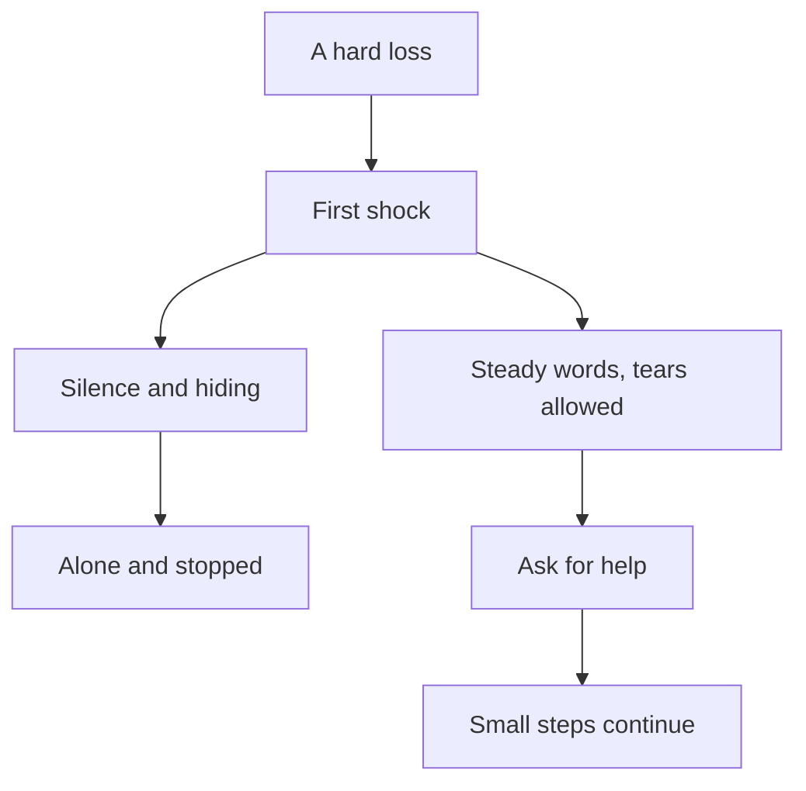

## "I am being patient"

Three days after the email, Mariam tells everyone she is fine. She has cancelled her online lessons for the week and told the students' parents that she is busy. She has not opened her laptop. When her mentor, Reem, sends a message to ask how she is, Mariam answers with one line: "Alhamdulillah, I am being patient."

Her mother notices that she eats little and sleeps late. Qusai notices that she has stopped helping him with his English homework. Mariam is not lying on purpose. She truly believes that this is what patience looks like: say nothing, show nothing, ask for nothing, and wait for the feeling to go away.

Chapter 3.1 showed that sadness is not weak faith. This chapter asks the next question. If tears are allowed, what is sabr, the patience you met in 3.1? And is Mariam's quiet week sabr, or something else that only looks like it?

## Patience is at the first shock

The Prophet, peace be upon him, once passed a woman who was weeping at a grave. He told her to fear Allah and be patient. She did not recognise him, and she answered harshly: leave me, you have not been struck by a loss like mine. Later she was told who he was. She went to his house, where there was no guard at the door, and said she had not recognised him. He said that patience is at the first shock (Sahih al-Bukhari 1283).

> إِنَّمَا الصَّبْرُ عِنْدَ الصَّدْمَةِ الأُولَى

Meaning: Patience is only at the first shock (Sahih al-Bukhari 1283).

Look at what the Prophet did not do. He did not rebuke her for weeping. He did not answer her harsh words with harsh words. His door was open to her, with no guard to send her away. He told her one short truth: the moment that counts most is the first one. In that first moment, a person either holds steady or lets the pain push them into words and actions they regret.

This hadith is about the first moment. It is not a ban on sadness later. Mariam held steady on Tuesday evening: she cried, she said the istirja with her mother, and she said nothing against Allah. That was sabr, at the first shock, with tears on her face.

## Patience is a skill that grows

The Prophet also said that whoever tries to be patient, Allah makes him patient, and that no one is given a gift better and wider than patience (Sahih al-Bukhari 1469). The word for "tries to be patient" describes effort. Patience is not something you either have or lack. You practise it, often badly at first, and Allah helps it grow.

This matters for Mariam. She does not need to feel patient before she can act patiently. She can take one patient step while her heart is still heavy, and then another. The feeling often comes after the steps, not before them.

## Help through patience and prayer

Allah tells the believers to seek help through patience and prayer, and that Allah is with the patient (Quran 2:153).

> يَا أَيُّهَا الَّذِينَ آمَنُوا اسْتَعِينُوا بِالصَّبْرِ وَالصَّلَاةِ ۚ إِنَّ اللَّهَ مَعَ الصَّابِرِينَ

Meaning: Believers, seek help through patience and prayer; Allah is with the patient (Quran 2:153).

Notice the verb: seek help. Patience is something you lean on, together with prayer, in order to carry what you have to carry. It is not a wall you build around yourself so that nobody sees you. Seeking help from Allah through prayer, and taking the help Allah sends through people, both fit inside it.

## Beautiful patience, with tears

In chapter 3.1 you met Yaqub, peace be upon him, who wept until his eyes turned white. When his sons first brought Yusuf's shirt with false blood on it, Yaqub said: so patience is most fitting, beautiful patience, and Allah is the One whose help is sought against what you describe (Quran 12:18). He said the same words, "beautiful patience", again later (Quran 12:83).

This is the surprise. The prophet whose words "beautiful patience" are in the Quran is the same prophet who wept and said that he complained of his grief only to Allah. So sabr jamil (beautiful patience) does not mean dry eyes. It means no complaint against Allah, while you may still weep and still pour out your heart to Him.

## Three kinds of patience

The scholar Ibn al-Qayyim divided sabr into three kinds by what it relates to. In plain words: patience to keep doing good, patience to keep away from wrong, and patience with what happens to you. Mariam's loss is mostly the third kind. But the first kind matters too. Losses often tempt people to stop the good they were doing: lessons, prayers on time, kindness at home.

## What sabr is not

Put the sources together, and four common ideas fall away.

Sabr is not silence. Yaqub complained to Allah, and the woman at the grave was treated gently, not told to be quiet. Sabr is not hiding need. Seeking help is in the verse itself. Sabr is not giving up. "Whoever tries to be patient" is about effort, and Yaqub sent his sons to search. And sabr is not accepting a wrong without speaking. If a client refuses to pay for finished work, you can stay steady and still ask clearly and politely for what you are owed.

Now test this on Mariam's week.

```predict
prompt: "Mariam cries for two days, then tells her mother and her mentor that she needs help. Is this still sabr?"
options:
  - id: alone
    label: "No, sabr would mean coping quietly alone"
  - id: help
    label: "Yes, asking for help can be part of sabr"
correctOptionId: help
explanation: "Sabr is steadiness, not silence. Allah tells believers to seek help through patience and prayer (Quran 2:153), and Yaqub wept and complained to Allah while keeping beautiful patience. Asking her mother and mentor for help is part of Mariam's sabr, not a break from it."
```

Step through the canvas below. It follows Mariam from the email to her first small step, and shows the road that is not sabr.

<InteractiveCanvas slug="sabr-keeps-moving" />

The canvas showed that the tears and the request for help sit inside sabr, not outside it. Sabr is on the road that keeps moving: right words at the first shock, help, then a small step, and steadying yourself again when a sad day returns. The road that looks calm, hiding and stopping, is the one that leaves sabr behind.

## Worked example: Mariam's next two weeks

Here is how Mariam turns her quiet week into sabr, one step at a time, with the reasoning for each step.

**Step 1: notice what already went right.** On Tuesday evening she cried, said the istirja and said nothing against Allah. Reem helps her see that this was sabr at the first shock. Mariam had been counting her tears as failure. Now she counts her words as success.

**Step 2: name the misunderstanding.** Her week of "I am being patient" was really silence and hiding. She was not being impatient. She was being patient in the wrong shape. Naming it takes away some of the guilt, because the fix is a change of shape, not more effort.

**Step 3: tell someone the truth.** She tells her mother that she feels heavy and has not opened her laptop. She writes to Reem: "I am sad, and I have stopped my lessons. Can we talk on Saturday?" Reem answers within the hour. This is seeking help, which the verse asks for.

**Step 4: use the three kinds.** Patience to keep doing good: she tells the three students' parents that lessons restart next week, at the usual times. Patience to keep away from wrong: she deletes an angry reply she had drafted to the scholarship committee. Patience with what happened: when "if only I had written a better proposal" comes back, she uses what you learned in module 1. She says that Allah decreed and did what He willed, and she turns to the next step (Sahih Muslim 2664).

**Step 5: take one small step toward the goal.** She emails the scholarship office to ask whether feedback on her application is available. It is a small step, and it is a means: if feedback comes, the next application will be stronger.

**Step 6: expect sad days.** On Thursday the sadness comes back when a friend posts about her own scholarship. Mariam does not decide that her sabr has failed. She cries a little, makes dua, and teaches her evening lesson. Sabr is not a feeling that stays. It is what she does each time the feeling returns.

The diagram puts the two shapes of "patience" side by side.



What to notice: both roads start at the first shock, and both can look calm from outside. The left road is quiet because it has stopped. The right road is steady because it keeps going, with help. The takeaway: you can tell sabr from silence by asking one question. Is this person still moving, even slowly, and are they willing to be helped?

## Where people misunderstand it

The first misunderstanding is "real sabr means not crying." The Prophet wept at his son's death, and Yaqub wept until his eyes turned white. You can spot this mistake when someone feels guilty about tears and then hides them.

The second is "sabr means not asking anyone for anything." The verse says to seek help. You can spot this mistake when a person says "I am being patient" and also refuses every offer of help.

The third is "sabr means waiting without doing anything." Yaqub sent his sons to search. You can spot this mistake when "patience" becomes the reason a plan never starts.

The fourth is using sabr against someone else: telling a person who has been wronged to "be patient" so that they stay quiet. Sabr steadies your own heart and tongue. It does not ask you to accept a wrong without speaking.

<Callout type="tip" title="A quick test">
Ask yourself: am I still doing the good I was doing, and have I let at least one person help me? If both answers are yes, your sabr is moving, even on a sad day.
</Callout>

## Check your understanding

```quiz
type: mcq
question: "Dina, a translation student, failed her final interpreting exam and must repeat the course next term. A week later she tells her friends she is 'being patient', but she has stopped going to her study group and has not told her parents she needs help with the fee for the repeat course. Which step fits sabr as this chapter teaches it?"
options:
  - "Keep the news to herself until she feels completely fine again"
  - "Tell her parents about the fee, and go back to the study group"
  - "Drop the course, since the result shows it was not written for her"
  - "Stop feeling sad, since sadness over an exam shows weak faith"
correct: 1
explanations:
  - "Keeping it to herself is silence and hiding need. Sabr can include telling people and asking for help, as Allah tells believers to seek help (Quran 2:153)."
  - "Right. Telling her parents is seeking help, and going back to the group is patience to keep doing good. Her sadness can stay for a while; her steps keep moving."
  - "This turns one hard result into giving up. Belief in qadr is a reason to act, not to stop, and sabr keeps trying."
  - "Sadness is human. The Prophet's eyes filled with tears at a loss and he called it mercy (Sahih al-Bukhari 1303). Sabr guards the tongue and actions, not the feeling."
```

```quiz
type: mcq
question: "Jamal builds websites from home. A client received the finished site two weeks ago and now ignores his messages about the last payment of $150. Jamal's cousin tells him: 'Be patient. Sabr means you never raise it again.' What does this chapter's teaching say?"
options:
  - "His cousin is right, as asking again would show he lacks sabr"
  - "Sabr means he should forget the money and let the client decide"
  - "He can stay calm and still ask clearly and politely for payment"
  - "He should wait in silence, because speaking up cancels his sabr"
correct: 2
explanations:
  - "Asking for what you are owed, politely, is not impatience. Sabr is not accepting a wrong without speaking."
  - "Sabr steadies Jamal's heart and tongue. It does not ask him to give up a fair claim for finished work."
  - "Right. Sabr guards how he speaks: calm, clear and polite. It does not require him to stay silent about a wrong."
  - "Silence is not the same as sabr. He can be patient in his words and still raise the payment again."
```

## This week

Choose one good thing you were doing before a recent hard moment and have since let slip: a lesson, a prayer on time, a call to a relative, an hour of study. Restart it this week, even in a small form. If something heavy is on your heart, tell one person you trust. You do not need to share anything here.

If you feel overwhelmed for a long time, or you have thoughts of harming yourself, talk to your mentor or the fellowship coordinator today, and to a doctor or counsellor if you can. This course does not replace professional care.

**Next:** The words the Quran and Sunnah give for hard moments, and how to sit with a friend after a loss.
