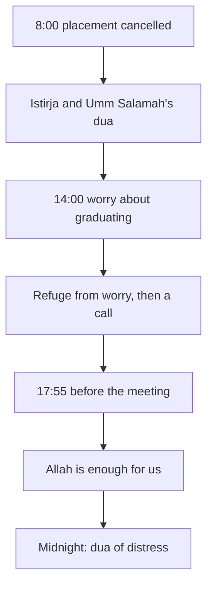

## The moments without words

Two weeks after the email, Mariam is teaching again. Reem has helped her see that her tears were not a failure. But some moments still catch her without words.

There is the memory of the moment the news came. There are nights when she lies awake after the power goes off, with a tight feeling in her chest. There are mornings when her mind runs ahead to the next round: what if she is turned down again, after another year of work? And on Sunday she has an online interview for a part-time teaching post, and she is afraid.

Mariam prays, and she makes dua in her own words, which is always open to her. But she wants to know what the Prophet, peace be upon him, said in moments like these. She hopes to find one dua she can say at all of them. Before you read on, make a guess.

```predict
prompt: "Mariam hopes to find one dua for every hard moment. Did the Prophet use the same words at every hard moment?"
options:
  - id: same
    label: "Yes, one set of words served them all"
  - id: different
    label: "No, each moment had its own words"
correctOptionId: different
explanation: "The Sunnah gives words for each kind of moment. When a loss strikes, there is the istirja and Umm Salamah's dua (Sahih Muslim 918). For times of distress, there is the dua of distress (Sahih al-Bukhari 6346). For worry, there is refuge from worry and grief (Sahih al-Bukhari 6369)."
```

Step through the canvas below. It follows Mariam through four hard moments in one week, and the words she uses at each.

<InteractiveCanvas slug="words-for-the-day" />

The canvas showed one person using different words at different moments. She said the istirja when the news came, and the dua of distress on a sleepless night. She asked for refuge from worry when her mind ran ahead, and she said "Allah is enough for us" before the interview. In each case the words came with something she then did.

## At the news: the istirja

Allah tells us that people will be tested with some fear, hunger and loss of wealth, lives and crops. He gives good news to the patient. When a calamity strikes them, they say: we belong to Allah and to Him we return. On them are blessings and mercy from their Lord, and they are the guided (Quran 2:155 to 157).

These words are the istirja you met in the key words of 3.1. The verse speaks of any calamity, which is why Mariam's mother says it when a glass breaks or a job ends. The words do not deny the loss. They place it: what we had belonged to Allah, and we ourselves are going back to Him.

The Prophet taught a longer form. Umm Salamah, may Allah be pleased with her, reported what he said. Any Muslim who is struck by a loss and says these words, Allah gives him something better in its place (Sahih Muslim 918).

> إِنَّا لِلَّهِ وَإِنَّا إِلَيْهِ رَاجِعُونَ اللَّهُمَّ أْجُرْنِي فِي مُصِيبَتِي وَأَخْلِفْ لِي خَيْرًا مِنْهَا

Meaning: We belong to Allah and to Him we return. O Allah, reward me in my loss and give me something better than it in its place (Sahih Muslim 918).

Inside the same hadith is Umm Salamah's own story. When her husband Abu Salamah died, she thought: who could be better than Abu Salamah? She said the dua anyway. Later she married the Prophet. Her story shows that this dua is said even when the heart cannot yet imagine anything better.

Notice what the dua does not tell you. It does not say what the better thing will be, or when it will come. That is Allah's to choose, and it may look nothing like what was lost. So never use this dua to promise someone a particular replacement. Say it, mean it, and leave the shape of the answer with Allah.

## At night, in distress: the dua of distress

Ibn Abbas, may Allah be pleased with him, reported that the Prophet used to say certain words at times of distress. In meaning: there is no god but Allah, the Mighty, the Forbearing. There is no god but Allah, Lord of the mighty Throne. There is no god but Allah, Lord of the heavens, Lord of the earth, and Lord of the noble Throne (Sahih al-Bukhari 6346).

Notice that this dua asks for nothing. It names who Allah is, three times. On a night when Mariam's worries feel enormous, these words put them in their place. The worries are real, and Allah is greater, and He is the Lord of everything that worries her. If you do not know the Arabic of this dua by heart, learn it from a teacher you trust. Until then, the meaning in your own language is a good start.

## About tomorrow: refuge from worry and grief

Anas ibn Malik, may Allah be pleased with him, reported that the Prophet used to ask Allah for refuge from worry and grief, and from other burdens (Sahih al-Bukhari 6369).

> اللَّهُمَّ إِنِّي أَعُوذُ بِكَ مِنَ الْهَمِّ وَالْحَزَنِ، وَالْعَجْزِ وَالْكَسَلِ، وَالْجُبْنِ وَالْبُخْلِ، وَضَلَعِ الدَّيْنِ، وَغَلَبَةِ الرِّجَالِ

Meaning: O Allah, I seek refuge in You from worry and grief, from helplessness and laziness, and from cowardice and miserliness. I seek refuge from the burden of debt and from being overpowered by people (Sahih al-Bukhari 6369).

Two words in this dua deserve attention. *Hamm* (worry) looks forward, at what might happen. *Hazan* (grief) looks back, at what already happened. The Prophet himself asked Allah for protection from both. So worry is not a sin to hide. It is something to bring to Allah. The next pair, helplessness and laziness, fits the hadith from module 1. Be keen on what benefits you, seek Allah's help, and do not give up (Sahih Muslim 2664).

## In a frightening moment: Allah is enough for us

Some moments are not sad but frightening: the minute before an interview, or the morning you press "submit" on a second application. For such moments there are the words "hasbuna Allah wa ni'ma al-wakil". They mean: Allah is enough for us, and He is the best One to rely on. Ibrahim, peace be upon him, said them when he was thrown into the fire (Sahih al-Bukhari 4563). They fit the tawakkul you met in module 2: you have taken the means, and now you rely on Allah.

None of these words come with a promise of a particular result. The Prophet taught them, and Allah hears every dua. How and when He answers is His.

## Worked example: Shahd's Tuesday

Here is the same teaching on a different day, in a different life. Shahd is a final-year pharmacy student. To graduate, she needs 200 hours of practice at a pharmacy. Follow her Tuesday, with the reasoning at each moment.

**Morning: the news.** At 8:00 a message arrives: the pharmacy where she was to start her hours next week has cancelled the placement. Shahd says the istirja, and then Umm Salamah's dua. She cannot imagine what could be better than this placement, which took two months to arrange. She says it anyway, and she does not decide what the "better" must be.

**Afternoon: worry about tomorrow.** By 14:00 her mind is running ahead. Will she graduate late? Will her family have to wait another year for her salary? She asks Allah for refuge from worry and grief, and from helplessness and laziness. Then she does one thing: she phones the university's placement office and books a meeting with the head of department for 18:00.

**Evening: a frightening meeting.** At 17:55, outside the office, her hands are cold. She has her list of three other pharmacies ready. She says "hasbuna Allah wa ni'ma al-wakil" and knocks. The means are taken; the trust is said.

**Night: distress.** The meeting went well, but nothing is certain yet. At midnight she cannot sleep. She says the meaning of the dua of distress in her own language, slowly, three times. She does not need it to fix anything tonight. It reminds her who is Lord of everything that worries her.

The diagram lays Shahd's day out in order, from top to bottom.



Read it as a clock. Each hard moment has its own words, and most of the words come with a next action: a phone call, a list of pharmacies, a knock on a door. Only the last one, at midnight, has no task attached, because a sleepless night is not the time for one. Words and actions take turns through the day.

## When a friend is the one in loss

Sometimes the hard moment belongs to someone else. The Sunnah's way of consoling is simple: be present, say a few true words, help with a practical need, and do not explain the loss (Sahih al-Bukhari 1284). "Everything happens for a reason" is a popular saying, not a verse or a hadith, and it often hurts more than it helps. Chapter 7.2 comes back to consoling as a form of service.

## Where people misunderstand it

The first misunderstanding is that a dua is a formula with a guaranteed result. The sources teach the words; they do not promise what the answer will look like or when it will come.

The second is "duas replace action." Shahd made dua and also phoned the placement office. The words steady the heart; the hands still work.

The third is that worry or grief is a sin. The Prophet asked for refuge from both. That means he treated them as burdens to bring to Allah, not as faults to hide.

## Check your understanding

```quiz
type: mcq
question: "Rahaf's online clothes shop was closed when the platform shut her account by mistake. She cannot imagine anything better. Her aunt says she should not say Umm Salamah's dua until she knows what she wants in its place. What does that hadith suggest?"
options:
  - "Say it now, and leave what the better thing is, and when, with Allah"
  - "Wait, as her aunt says, until she can name the better thing she wants"
  - "Say it now, and expect a new shop within the year, as the dua promises"
  - "Say the istirja now, but keep the dua for the loss of a person"
correct: 0
explanations:
  - "Right. Umm Salamah, may Allah be pleased with her, could not imagine anyone better than her husband, and she said the dua anyway (Sahih Muslim 918). The dua leaves the shape of the answer with Allah."
  - "Umm Salamah said the dua while she could not imagine anything better. The dua does not wait for the heart to name a replacement."
  - "The hadith promises something better in its place, but not a particular thing or a date. Expecting a new shop by a deadline turns the dua into a contract."
  - "The hadith speaks of any loss that strikes a Muslim, not only the death of a person. A closed shop is a loss."
```

```quiz
type: mcq
question: "Mohannad is a freelance developer. His contract ends next month, and he lies awake worrying every night but has not looked for new work. A friend suggests the dua the Prophet used for worry and grief. Which plan fits this chapter?"
options:
  - "Say it at night, and rest from the search until the worry eases"
  - "Wait to say it until he is calmer, so his heart is present in it"
  - "Ask Allah for a new contract instead, since that is the real need"
  - "Say it at night, and take one step toward new work each morning"
correct: 3
explanations:
  - "Rest is good, but the same dua asks for refuge from helplessness and laziness. Pausing the search until the worry goes would keep him stuck."
  - "This dua is for the moment of worry itself. A worried heart is the right time to say it."
  - "He can ask Allah for work too. But the dua for worry fits his nights, and it does not replace looking for work."
  - "Right. The dua brings the worry to Allah and asks for refuge from helplessness. Taking one step each morning is how he lives what he asked for."
```

## This week

Choose one of the words in this chapter that you do not yet say. It could be the full istirja with Umm Salamah's dua, the dua of distress, or the refuge from worry and grief. Learn its meaning, and say it once at the moment it fits. Then notice what you did next.

If you feel overwhelmed for a long time, or you have thoughts of harming yourself, talk to your mentor or the fellowship coordinator today. If you can, talk to a doctor or counsellor too. This course does not replace professional care.

**Next:** Waiting well for eight months, with Yusuf and Yunus, peace be upon them.
