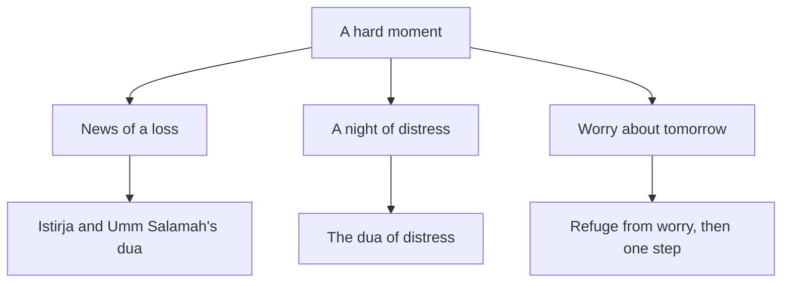

## The moments without words

Two weeks after the email, Mariam is teaching again. Reem has helped her see that her tears were not a failure, and that sabr is steadiness that keeps moving. But some moments still catch her without words.

There is the memory of the moment the news came. There are nights when she lies awake after the power goes off, with a tight feeling in her chest. There are mornings when her mind runs ahead to the next round: what if she is turned down again, after another year of work? And on Wednesday her friend Lamees calls with her own news, and Mariam does not know what to say to her.

Mariam prays, and she makes dua in her own words, which is always open to her. But she wants to know what the Prophet, peace be upon him, said in moments like these. The Sunnah is generous here. It gives different words for different moments, and each one fits its moment closely.

## At the news: the istirja

Allah tells us that people will be tested with some fear, hunger and loss of wealth, lives and crops. He gives good news to the patient: those who, when a calamity strikes them, say "We belong to Allah and to Him we return." On them are blessings and mercy from their Lord, and they are the guided (Quran 2:155 to 157).

Saying these words at a loss is called the istirja, the word you met in the key words of 3.1. It is not only for a death. The verse speaks of any calamity, and Mariam's mother says it when a glass breaks or a job ends. The words do not deny the loss. They place it: what we had belonged to Allah, and we ourselves are going back to Him.

The Prophet taught a longer form. Umm Salamah, may Allah be pleased with her, reported that he said: any Muslim who is struck by a loss and says these words, Allah gives him something better in its place (Sahih Muslim 918).

> إِنَّا لِلَّهِ وَإِنَّا إِلَيْهِ رَاجِعُونَ اللَّهُمَّ أْجُرْنِي فِي مُصِيبَتِي وَأَخْلِفْ لِي خَيْرًا مِنْهَا

Meaning: We belong to Allah and to Him we return. O Allah, reward me in my loss and give me something better than it in its place (Sahih Muslim 918).

Inside the same hadith is Umm Salamah's own story. When her husband Abu Salamah died, she thought: who could be better than Abu Salamah? She said the dua anyway. Later she married the Prophet. Her story shows that this dua is said even when the heart cannot yet imagine anything better.

Notice what the dua does not tell you. It does not say what the better thing will be, or when it will come. That is Allah's to choose, and it may look nothing like what was lost. So never use this dua to promise someone a particular replacement. Say it, mean it, and leave the shape of the answer with Allah.

## At night, in distress: the dua of distress

Ibn Abbas, may Allah be pleased with him, reported that the Prophet used to say these words at times of distress: there is no god but Allah, the Mighty, the Forbearing; there is no god but Allah, Lord of the mighty Throne; there is no god but Allah, Lord of the heavens, Lord of the earth, and Lord of the noble Throne (Sahih al-Bukhari 6346).

Notice that this dua asks for nothing. It names who Allah is, three times. On a night when Mariam's worries feel enormous, these words put them in their place: they are real, and Allah is greater, and He is the Lord of everything that worries her. If you do not know the Arabic of this dua by heart, learn it from a teacher you trust. Until then, the meaning in your own language is a good start.

## About tomorrow: refuge from worry and grief

Anas ibn Malik, may Allah be pleased with him, reported that the Prophet used to ask Allah for refuge from worry and grief, and from other burdens (Sahih al-Bukhari 6369).

> اللَّهُمَّ إِنِّي أَعُوذُ بِكَ مِنَ الْهَمِّ وَالْحَزَنِ، وَالْعَجْزِ وَالْكَسَلِ، وَالْجُبْنِ وَالْبُخْلِ، وَضَلَعِ الدَّيْنِ، وَغَلَبَةِ الرِّجَالِ

Meaning: O Allah, I seek refuge in You from worry and grief, from helplessness and laziness, from cowardice and miserliness, from the burden of debt and from being overpowered by people (Sahih al-Bukhari 6369).

Two words in this dua deserve attention. *Hamm* (worry) looks forward, at what might happen. *Hazan* (grief) looks back, at what already happened. The Prophet himself asked Allah for protection from both. So worry is not a sin to hide. It is something to bring to Allah. The next pair, helplessness and laziness, fits closely with the hadith from module 1: be keen on what benefits you, seek Allah's help, and do not give up (Sahih Muslim 2664).

## In a frightening moment: Allah is enough for us

Some moments are not sad but frightening: the minute before a remote interview, or the morning you press "submit" on a second application. For such moments there are the words "hasbuna Allah wa ni'ma al-wakil": Allah is enough for us, and He is the best One to rely on. Ibrahim, peace be upon him, said them when he was thrown into the fire (Sahih al-Bukhari 4563). They fit with the tawakkul you met in module 2: you have taken the means, and now you rely on Allah.

None of these words come with a promise of a particular result. The Prophet taught them, and Allah hears every dua. How and when He answers is His.

## When a friend is the one who is hurting

On Wednesday, Lamees calls. She and Mariam studied together at university. For two years Lamees has taught English at a small language centre, and the centre has now closed. Her job has ended, and she helps her parents with her salary. Before you read what Mariam does, make a guess.

```predict
prompt: "Lamees tells Mariam her job has ended. What do you expect helps Lamees more in the first days?"
options:
  - id: present
    label: "Being there, plus practical help"
  - id: explain
    label: "An explanation of why it happened"
correctOptionId: present
explanation: "When the Prophet's daughter was in grief, he sent her short words about Allah's ownership and patience, and then went to her when she asked again, and wept (Sahih al-Bukhari 1284). He did not explain her loss. Presence, gentle words and practical help are the Sunnah of consoling."
```

Step through the canvas below. It follows Mariam's words through her own hard moments, and then through Lamees's call.

<InteractiveCanvas slug="words-for-the-day" />

The canvas showed one person using different words at different moments: the istirja when the news came, the dua of distress on a sleepless night, and refuge from worry when her mind ran ahead. Then it showed her turning outward: being with her friend, saying gentle words and passing on one real lead. None of it explained the loss.

## How the Prophet consoled

Usama ibn Zayd, may Allah be pleased with him, reported that the Prophet's daughter asked him to come, because her child was dying. He sent her these words: to Allah belongs what He took and what He gave, and everything with Him has an appointed term, so let her be patient and hope for reward. She asked again, and he went to her. He wept, and when he was asked about his tears, he said this is mercy that Allah has put in the hearts of His servants, and Allah shows mercy to the merciful among His servants (Sahih al-Bukhari 1284).

From this hadith, the course takes four simple practices for consoling. Be present: he went when she asked. Say few, true words: Allah's ownership and patience, or the istirja, said gently. Help with practical needs. And do not explain the loss. "Everything happens for a reason" is a popular saying, not a verse or a hadith, and it often hurts more than it helps.

## Worked example: Mariam visits Lamees

**Step 1: go, and listen first.** Mariam visits Lamees on Thursday afternoon. For most of an hour she listens. Lamees talks about her students, her parents and how sudden it was. Mariam does not hurry her toward feeling better.

**Step 2: say few words, gently.** When Lamees goes quiet, Mariam says softly, "Inna lillahi wa inna ilayhi raji'un. To Allah belongs what He took and what He gave." She does not add a theory about why the centre closed or what Allah intends by it. She does not say "at least you still have your health", which compares one pain with another.

**Step 3: help with one real need.** Lamees's biggest worry is income. Mariam knows a parent who asked her last week for an English tutor for two children. Mariam is full, so she passes the lead to Lamees, with the parent's permission. She also offers to read Lamees's CV on Saturday.

**Step 4: check again later.** On Sunday, Mariam sends Lamees a short message to ask how the call with the parent went. Consoling is not one visit. The Prophet went back when his daughter asked again.

Look at how the pieces fit. Each hard moment had its own words, and each set of words led to something Mariam did. The diagram shows the match.



What to notice: each kind of moment has its own words in the Sunnah, and none of the words is a way of escaping the moment. The istirja names the loss. The dua of distress names Allah's greatness over it. The refuge from worry hands tomorrow to Allah and leaves you free to take one step today. The takeaway: you do not have to find the right words alone at the worst moment. They are already given to you.

## Where people misunderstand it

The first misunderstanding is that a dua is a formula with a guaranteed result. The sources teach the words; they do not promise what the answer will look like or when it will come.

The second is "duas replace action." Mariam made dua at night and also wrote down tomorrow's step in the morning. The words steady the heart; the hands still work.

The third is that consoling means explaining. You can spot this mistake when someone starts with "maybe Allah wanted..." or "everything happens for a reason." The Prophet consoled with presence, short words, tears and help.

The fourth is that worry or grief is a sin. The Prophet asked for refuge from both, which means he treated them as burdens to bring to Allah, not as faults to hide.

## Check your understanding

```quiz
type: mcq
question: "Raneem's neighbour, Umm Nabil, has just heard that her son's work contract abroad was cancelled and he is coming home without a job. Raneem visits that evening. Which approach follows the Sunnah of consoling?"
options:
  - "Explain that this must be for the best, so Umm Nabil can feel at peace"
  - "Tell her that other families have lost far more, so she should be grateful"
  - "Advise her to keep busy, so she does not have to talk about it at all"
  - "Sit with her, say a few gentle words, and offer help with one real need"
correct: 3
explanations:
  - "Explaining a loss is not the Sunnah of consoling. The Prophet gave short words about Allah's ownership and patience, and then he came and stayed."
  - "Comparing pains often adds hurt. Consoling is presence and help, not a reminder that others have it worse."
  - "Keeping busy can help later, but pushing someone away from talking leaves them alone with it. Presence and listening come first."
  - "Right. This matches what the Prophet did: he came, said few true words, and his tears were mercy. Practical help, such as asking about job leads for her son, completes it."
```

```quiz
type: mcq
question: "Mohannad is a freelance developer. Every night this week he has lain awake thinking about his contract, which ends next month, and he has not looked for new work. A friend suggests the dua the Prophet used for worry and grief. What is the best way to use it?"
options:
  - "Say it at night, and in the morning take one step toward new work"
  - "Say it every night, and wait for new work to come without searching"
  - "Say it only after he has stopped worrying, so it is said with a calm heart"
  - "Say it once, and if the worry stays, accept that it did not work for him"
correct: 0
explanations:
  - "Right. The dua brings the worry to Allah, and it also asks for refuge from helplessness and laziness. Taking one step in the morning is how he lives what he asked for."
  - "A dua does not replace taking the means. The same dua asks for refuge from helplessness and laziness."
  - "This dua is for the moment of worry itself. The Prophet asked for refuge from worry, so a worried heart is the right time to say it."
  - "No dua comes with a promised timing or shape of answer. Worry returning does not mean the dua failed; he can keep saying it and keep acting."
```

## This week

Choose one of the words in this chapter that you do not yet say: the full istirja with Umm Salamah's dua, the dua of distress, or the refuge from worry and grief. Learn its meaning, and say it once at the moment it fits. If a friend of yours is going through a loss, send one message this week, and offer one piece of practical help.

If you feel overwhelmed for a long time, or you have thoughts of harming yourself, talk to your mentor or the fellowship coordinator today, and to a doctor or counsellor if you can. This course does not replace professional care.

**Next:** Waiting well for eight months, with Yusuf and Yunus, peace be upon them.
