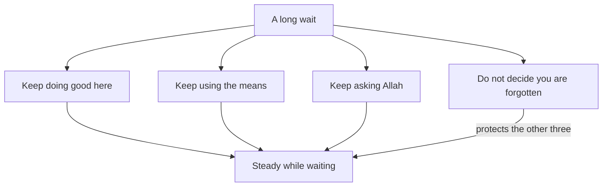

## Eight months

Two weeks after the email, Mariam sits with Reem on their Saturday call. Her lessons have restarted, and her heart is lighter than it was. But a new question has arrived. The next round opens in a little under eight months. "What do I do for eight months?" she asks. "Just wait?"

There is a quieter question under it, one she finds hard to say aloud. She worked for a year, she prayed, and she did everything she could. The answer was still no. Sometimes, late at night, a thought comes: maybe Allah has forgotten me.

Both questions matter. The first is about time: what to do with a long wait. The second is about the heart: what to believe while you wait. The Quran answers both through two prophets who waited, Yusuf and Yunus, peace be upon them.

## Yusuf in prison

The Prophet, peace be upon him, is not the only one whose patience the Quran shows. Yusuf spent time in prison. There he asked a man who was about to be freed to mention him to the king. The man forgot, and Yusuf stayed in prison for several years (Quran 12:42). The Quran does not give a number, so this course does not either.

Scholars read this verse in more than one way; ask a scholar you trust. What the verse states plainly is enough for this chapter: Yusuf asked, and his wait was long.

A wait like that can feel endless. Before you see how the story ends, make a guess about Yusuf's words at the end of it.

```predict
prompt: "After several years in prison, Yusuf was at last with his family again. What do you expect he spoke about then?"
options:
  - id: years
    label: "The years that were taken from him"
  - id: kindness
    label: "His Lord's kindness to him"
correctOptionId: kindness
explanation: "Yusuf said that his Lord had been good to him. He took him out of prison and brought his family, and his Lord is subtle in what He wills (Quran 12:100). He named Allah's kindness, not the years he lost."
```

Step through the canvas below. It follows the waiting in Surah Yusuf, from the father to the son, and back to the family together.

<InteractiveCanvas slug="yusuf-waiting-well" />

The canvas showed waiting as a series of places. Yaqub waited with beautiful patience, complained only to Allah, and sent his sons to search. Yusuf asked to be remembered, and then waited several years. At the end he forgave his brothers and named Allah's kindness. In every place, someone was doing something: asking, searching, praying, forgiving.

## What Yusuf said at the end

When his brothers finally recognised him, Yusuf said that Allah had been gracious to them. Then he named two things: whoever is mindful of Allah and patient, Allah does not let the reward of those who do good be lost (Quran 12:90). He forgave his brothers: no blame on you today; may Allah forgive you (Quran 12:92).

His parents and family were brought to him. He said that his Lord had been good to him when He took him out of prison and brought his family. And he said that his Lord is subtle in what He wills (Quran 12:100).

> إِنَّ رَبِّي لَطِيفٌ لِّمَا يَشَاءُ

Meaning: My Lord is subtle in what He wills (Quran 12:100).

Look at what Yusuf chose to say. He did not list the years he lost. He named Allah's kindness, and he described his family as people Allah had been good to. This is not a claim that prison was a good thing that happened to him. It is a statement that Allah brought good out of it, in ways that only became clear later.

## Yunus in the darkness

Yunus, peace be upon him, faced a different kind of wait. He went off angry, and he ended up in darkness, in the belly of the whale. There he called out: there is no god but You, glory be to You, I have been among the wrongdoers. Allah answered him and saved him from distress, and that is how He saves the believers (Quran 21:87 to 88).

The Prophet said that no Muslim calls on Allah with the dua of Yunus for anything without Allah answering him (Jami' at-Tirmidhi 3505, graded sahih).

> لاَ إِلَهَ إِلاَّ أَنْتَ سُبْحَانَكَ إِنِّي كُنْتُ مِنَ الظَّالِمِينَ

Meaning: There is no god but You, glory be to You; I have been among the wrongdoers (Jami' at-Tirmidhi 3505).

Saying these words is not a statement that your wait is a punishment. It is a humble turning to Allah. You declare His greatness, admit your own weakness, and ask. The hadith says it is for "anything", and how Allah answers is His.

What happened next is worth noticing too. Had Yunus not been one who glorified Allah, he would have stayed in the whale's belly until the Day people are raised (Quran 37:143 to 144). Allah cast him onto open land, and he was sick. Allah made a gourd plant grow over him (Quran 37:145 to 146). Then he was sent to a hundred thousand people or more, and they believed (Quran 37:147 to 148). His recovery took time. A plant was grown to shelter him first, and only then was he sent to his people and his work.

## What waiting well means

Put the two stories together, and waiting well has four parts.

The first part is to keep doing good where you are. Yusuf named what carried him: being mindful of Allah and patient, which the Quran calls doing good (Quran 12:90). A wait is not an empty space before life starts again. It is part of life.

The second part is to keep using the means. Yaqub did not sit still: he sent his sons out to search (Quran 12:87). A means that fails once, or for a long time, is not proof that means are useless.

The third part is to keep asking Allah. Yaqub complained of his grief to Allah. Yunus called out in the darkness. Asking again and again is not impatience.

The fourth part is the hardest: do not decide that Allah has forgotten you. The Quran says Allah does not let the reward of those who do good be lost, and that He is subtle in what He wills. A long wait cannot be read as being forgotten.

## Worked example: Mariam's eight months

Reem helps Mariam turn the four parts into a plan. Here is the plan, with the reasoning.

**Keep doing good where she is.** Mariam keeps her three students, three evenings a week. She also helps Qusai prepare for his English exam at the end of the school year. These are good deeds in themselves. They also keep her English sharp, and they give her days a shape, so the wait is not empty.

**Keep using the means, month by month.** The scholarship office replied that it cannot give individual feedback. So she asks one of her old lecturers to read her proposal instead. Her plan for the eight months:

- Months 1 and 2: rest a little, keep her lessons, and read her old statement with fresh eyes.
- Months 3 and 4: rewrite the statement and the proposal; Reem and the lecturer each read them once.
- Month 5: ask her two referees for updated letters, giving them two months.
- Month 6: check that her English test result will still be accepted for the next round.
- Month 7: find one more scholarship with a different deadline, as a backup.
- Month 8: submit a week before the deadline, with copies saved in two places in case of a power cut.

That is eight months, with no month left empty and no month overloaded. The backup scholarship in month 7 is the means plan with a backup you met in module 2.

**Keep asking Allah.** After the dawn prayer she makes dua in her own words for the application. When the night feels heavy, she says the dua of Yunus. When her mind runs ahead to another rejection, she uses the refuge from worry and grief from chapter 3.3.

**Do not decide that Allah has forgotten her.** When that thought comes back, she does two things. She reminds herself that Yusuf waited several years and still said his Lord is subtle in what He wills. And she writes down one good thing from the week: a student's progress, Qusai's better essay, a kind word from her mother.

The plan does not promise that Mariam will get the scholarship next time. Nobody can promise that. What it promises is that the eight months will not be wasted, whatever the result.

The diagram shows the four parts feeding one result.



All four arrows reach the same box, but the fourth works differently. Once a person decides that Allah has forgotten them, they usually stop doing good, stop using means and stop asking. So guarding that one belief keeps the other three going. That is why its arrow is labelled "protects the other three".

## Where people misunderstand waiting

The first misunderstanding is that waiting means doing nothing until the answer comes. You can spot it when someone says that their life starts after the result. Yaqub and Yunus both kept turning to Allah while they waited, and Yaqub kept searching.

The second is "if I keep using means, it shows I do not trust Allah." Yaqub trusted Allah deeply, and he still sent his sons to search. Trust and means go together, as module 2 taught.

The third is "a long wait means Allah has forgotten me." The Quran answers this directly: Allah does not let the reward of those who do good be lost.

The fourth is telling someone else that their hardship is "a good thing that happened to you." Yusuf did not say prison was good. He said Allah was kind to him and brought good out of it. Leave that kind of reading to the person, and to later.

## Check your understanding

```quiz
type: mcq
question: "Thaer applied four months ago for a job on a water project. Since then he has stopped volunteering at the homework club and sent no other applications. He says his life will start when the answer comes. Which plan fits waiting well?"
options:
  - "Keep his evenings free, so he is ready the day the answer comes"
  - "Make dua for this job each day, and keep the rest of his plans on hold"
  - "Go back to the club, and send two other applications this month"
  - "Send other applications, and leave the club until his future is clear"
correct: 2
explanations:
  - "Being ready is sensible, but empty evenings are not waiting well. The club is good he can keep doing where he is."
  - "Dua each day is part of waiting well. But putting his good work and other means on hold leaves the wait empty."
  - "Right. Going back to the club is doing good where he is, and other applications are using the means. Both fit waiting well."
  - "Other applications are a good means. The club is also part of waiting well: doing good where you are, now."
```

```quiz
type: mcq
question: "Mutaz lost his job when the company he worked for closed. A friend suggests the dua of Yunus. Mutaz refuses: 'It says I was among the wrongdoers. I did nothing wrong to lose my job.' Which reply fits this chapter?"
options:
  - "Say it humbly to Allah, as it is not a verdict on his loss"
  - "Say it, because losing the job shows he did wrong somewhere"
  - "Leave it, since it was Yunus's dua for Yunus's own situation"
  - "First find the wrong that cost him the job, and then say it"
correct: 0
explanations:
  - "Right. The Prophet said that no Muslim calls with this dua for anything without Allah answering him (Jami' at-Tirmidhi 3505). Its words are humility before Allah, not a reading of why the company closed."
  - "A job loss cannot be read as proof of a sin. Saying the dua does not mean agreeing that the loss is a punishment."
  - "The dua was Yunus's, and the Prophet said any Muslim may call with it, for anything (Jami' at-Tirmidhi 3505)."
  - "This treats the loss as a punishment to explain. The dua is a turning to Allah, not a search for the cause of a hardship."
```

## This week

Think of one thing you are waiting for, or use Mariam's wait. Write the four parts in one line each. Name one good thing you will keep doing and one means you will use. Name one dua you will make. Then write one sentence you will tell yourself when the thought "I am forgotten" comes. Do one item from the list this week. You do not need to share it with anyone.

If you feel overwhelmed for a long time, or you have thoughts of harming yourself, talk to your mentor or the fellowship coordinator today. If you can, talk to a doctor or counsellor too. This course does not replace professional care.

**Next:** Five short cases to check what you have learned about sabr.
