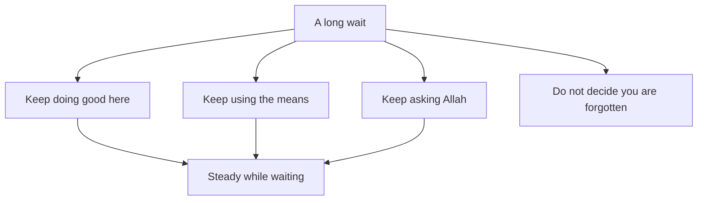

## Eight months

Two weeks after the email, Mariam sits with Reem on their Saturday call. Her lessons have restarted, and her heart is lighter than it was. But a new question has arrived. The next round opens in a little under eight months. "What do I do for eight months?" she asks. "Just wait?"

There is a quieter question under it, one she finds hard to say aloud. She worked for a year, she prayed, she did everything she could, and the answer was no. Sometimes, late at night, a thought comes: maybe Allah has forgotten me.

Both questions matter. The first is about time: what to do with a long wait. The second is about the heart: what to believe while you wait. The Quran answers both through two prophets who waited, Yusuf and Yunus, peace be upon them.

## Yusuf asks for help

The Prophet, peace be upon him, is not the only one whose patience the Quran shows. Yusuf, peace be upon him, spent time in prison. While he was there, a man who was about to be freed was with him. Yusuf asked this man to mention him to the king (Quran 12:42). In other words, he asked a person to help him get out.

Before you read what happened next, make a guess about that request.

```predict
prompt: "In prison, Yusuf asked a man who was being freed to mention him to the king. What was that request?"
options:
  - id: lapse
    label: "A lapse in his trust in Allah"
  - id: means
    label: "A means he used, with trust"
correctOptionId: means
explanation: "Asking a person for help was a means, like the means you planned in module 2. Yusuf trusted Allah and also used the one means he had. The means then failed for a long time, but that does not make it wrong to have used it."
```

## Forgotten, for several years

Then Satan made the man forget to mention Yusuf to the king, so Yusuf stayed in prison for several years (Quran 12:42). The Quran does not give a number, so this course does not either. What it tells us is enough: the one means Yusuf had did not work, and the wait was long.

Later, when his brothers finally recognised him, Yusuf said that Allah had been gracious to them. Then he named the two things that carry a person: whoever is mindful of Allah and patient, Allah does not let the reward of those who do good be lost (Quran 12:90). He forgave his brothers: no blame on you today; may Allah forgive you (Quran 12:92). And when his parents and family were brought to him, he said that his Lord had been good to him when He took him out of prison and brought his family, and that his Lord is subtle in what He wills (Quran 12:100).

> إِنَّ رَبِّي لَطِيفٌ لِّمَا يَشَاءُ

Meaning: My Lord is subtle in what He wills (Quran 12:100).

Look at what Yusuf chose to say at the end. He did not list the years he lost. He named Allah's kindness, and he described himself and his family as people Allah had been good to. This is not a claim that prison was a good thing that happened to him. It is a statement that Allah brought good out of it, in ways that only became clear later.

Step through the canvas below. It follows the waiting in Surah Yusuf, from the father to the son, and back to the family together.

<InteractiveCanvas slug="yusuf-waiting-well" />

The canvas showed waiting as a series of places, each with something done in it. Yaqub waited with beautiful patience, complained only to Allah, and sent his sons to search. Yusuf used the means he had, and kept being mindful of Allah and patient when it failed. At the end he forgave and named Allah's kindness. Nobody in the story waited by doing nothing.

## Yunus in the darkness

Yunus, peace be upon him, faced a different kind of wait. He went off angry, and he ended up in darkness, in the belly of the whale. There he called out: there is no god but You, glory be to You, I have been among the wrongdoers. Allah answered him and saved him from distress, and that is how He saves the believers (Quran 21:87 to 88).

The Prophet said that no Muslim calls on Allah with the dua of Yunus for anything without Allah answering him (Jami' at-Tirmidhi 3505, graded sahih).

> لاَ إِلَهَ إِلاَّ أَنْتَ سُبْحَانَكَ إِنِّي كُنْتُ مِنَ الظَّالِمِينَ

Meaning: There is no god but You, glory be to You; I have been among the wrongdoers (Jami' at-Tirmidhi 3505).

Saying these words is not a statement that your wait is a punishment. It is a humble turning to Allah: you declare His greatness, admit your own weakness, and ask. The hadith says it is for "anything", and how Allah answers is His.

What happened after is worth noticing too. Had Yunus not been one who glorified Allah, he would have stayed in the whale's belly until the Day people are raised (Quran 37:143 to 144). Allah cast him onto open land, and he was sick. Allah made a gourd plant grow over him (Quran 37:145 to 146). Then he was sent to a hundred thousand people or more, and they believed (Quran 37:147 to 148). His recovery took time. He was not rescued and then instantly well. A plant was grown to shelter him first, and only then was he sent back to his people and his work.

## What waiting well means

Put the two stories together, and waiting well has four parts.

The first part is to keep doing good where you are. Yusuf described what carried him as being mindful of Allah and patient, which the Quran calls doing good. A wait is not an empty space before life starts again. It is part of life.

The second part is to keep using the means. Yusuf asked for help. Yaqub sent his sons to search. A means that fails once, or for a long time, is not proof that means are useless.

The third part is to keep asking Allah. Yaqub complained of his grief to Allah. Yunus called out in the darkness. Asking again and again is not impatience.

The fourth part is the hardest: do not decide that Allah has forgotten you. The Quran says Allah does not let the reward of those who do good be lost, and that He is subtle in what He wills. A long wait is not a sign of being forgotten.

## Worked example: Mariam's eight months

Reem helps Mariam turn the four parts into a plan. Here is the plan, with the reasoning.

**Keep doing good where she is.** Mariam keeps her three students, three evenings a week. She also helps Qusai prepare for his English exam at the end of the school year. The reasoning: these are good deeds in themselves, they keep her English sharp, and they give her days a shape, so the wait is not empty.

**Keep using the means, month by month.** The scholarship office replied that it cannot give individual feedback, so she asks one of her old lecturers to read her proposal instead. Her plan for the eight months:

- Months 1 and 2: rest a little, keep her lessons, and read her old statement with fresh eyes.
- Months 3 and 4: rewrite the statement and the proposal; Reem and the lecturer each read them once.
- Month 5: ask her two referees for updated letters, giving them two months.
- Month 6: check that her English test result will still be accepted for the next round.
- Month 7: find one more scholarship with a different deadline, as a backup.
- Month 8: submit a week before the deadline, with copies saved in two places in case of a power cut.

That is eight months, with no month left empty and no month overloaded. The backup scholarship in month 7 is the means plan with a backup you met in module 2.

**Keep asking Allah.** After the dawn prayer she makes dua in her own words for the application. When the night feels heavy, she says the dua of Yunus. When her mind runs ahead to another rejection, she uses the refuge from worry and grief from chapter 3.3.

**Do not decide that Allah has forgotten her.** When that thought comes back, she does two things. She reminds herself that Yusuf waited several years and still said that his Lord is subtle in what He wills. And she writes down one good thing from the week: a student's progress, Qusai's improved essay, a kind word from her mother.

The plan does not promise that Mariam will get the scholarship next time. Nobody can promise that. What it promises is that the eight months will not be wasted, whatever the result.

The diagram shows how the four parts hold a person steady through a wait.



What to notice: the fourth part, "do not decide you are forgotten", has no arrow of its own to the result. It works by protecting the other three. Once a person decides that Allah has forgotten them, they usually stop doing good, stop using means and stop asking. The takeaway: guard the belief, and the actions have room to continue.

## Where people misunderstand waiting

The first misunderstanding is "waiting means doing nothing until the answer comes." You can spot it when someone says "my life starts after the result." Yusuf and Yaqub both acted while they waited.

The second is "if I keep using means, it shows I do not trust Allah." Yusuf asked a person for help, and the Quran tells it without blame. Trust and means go together.

The third is "a long wait means Allah has forgotten me." The Quran answers this directly: Allah does not let the reward of those who do good be lost.

The fourth is telling someone else that their hardship is "a good thing that happened to you." Yusuf did not say prison was good. He said Allah was kind to him and brought good out of it. Leave that kind of reading to the person, and to later.

## Check your understanding

```quiz
type: mcq
question: "Thaer, a civil engineering graduate, is waiting four months to hear about a job on a water project. Since he applied, he has stopped volunteering at the homework club near his home and has sent no other applications. He says his life will start again when the answer comes. Which plan fits waiting well?"
options:
  - "Pause his good work so all his attention stays on the result"
  - "Stop asking Allah about it, since asking again shows impatience"
  - "Go back to the club, and keep applying for other jobs as well"
  - "Apply nowhere else, since a backup plan would show weak trust"
correct: 2
explanations:
  - "Waiting well keeps doing good where you are. The result is out of his hands, and the club is in them."
  - "Asking Allah again and again is part of waiting well. Yaqub complained to Allah and Yunus called out in the darkness."
  - "Right. Going back to the club is doing good where he is, and other applications are using the means. Both fit waiting well."
  - "A backup is a means, not a lack of trust. Yusuf used the means he had and trusted Allah at the same time."
```

```quiz
type: mcq
question: "Three months ago, Bayan asked a former teacher to recommend her for a teaching post at a school in her town. The teacher forgot, and the post was filled. Bayan says: 'Asking him was my mistake. I should have only trusted Allah.' What does Yusuf's story suggest?"
options:
  - "She is right that asking a person was where her trust went wrong"
  - "Asking was a means; she can keep trusting and keep asking people"
  - "The forgetting shows she was never meant to work as a teacher"
  - "She should not remind people in future, so her trust stays pure"
correct: 1
explanations:
  - "Yusuf asked the freed man to mention him to the king, and the Quran tells it as a means, not as a failure of trust."
  - "Right. Yusuf's means failed for several years, and asking was still not wrong. Bayan can keep trusting Allah and keep using people as a means."
  - "One forgotten request is not a sign about her whole future. Do not decide what Allah intends from one closed door."
  - "Reminding someone kindly is another means. Trust in Allah does not ask her to stop using means."
```

## This week

Think of one thing you are waiting for, or use Mariam's wait. Write the four parts in one line each: one good thing you will keep doing, one means you will use, one dua you will make, and one sentence you will tell yourself when the thought "I am forgotten" comes. Do one item from the list this week. You do not need to share it with anyone.

If you feel overwhelmed for a long time, or you have thoughts of harming yourself, talk to your mentor or the fellowship coordinator today, and to a doctor or counsellor if you can. This course does not replace professional care.

**Next:** Five short cases to check what you have learned about sabr.
