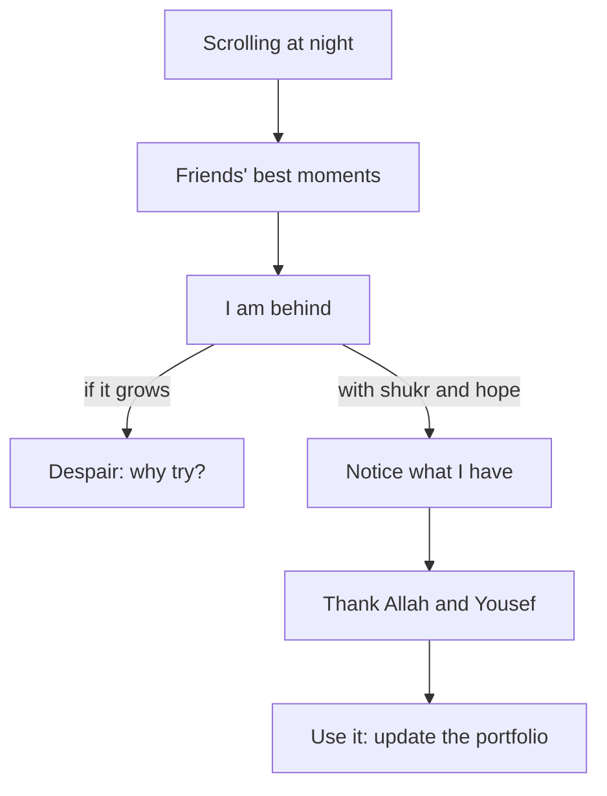

## Eleven at night

Ahmad is 25 and works as a freelance graphic designer. He makes logos, menus and social media designs for small clients. He lives with his parents and his older brother, Yousef. The grid power is off most evenings, so Yousef shares his phone's data with Ahmad for an hour after dinner. In that hour Ahmad uploads his work and answers clients. Once a week Yousef also looks through Ahmad's online portfolio and tells him honestly what looks good and what does not.

Tonight the data hour is over, but Ahmad is still scrolling on what is left of his phone's battery. His university friend Obada has posted a new job title: designer at a studio abroad. Another friend, Leen, has posted a photo from her master's graduation, holding her certificate and smiling. A third has moved into a bright new flat. Each post has dozens of happy comments.

Ahmad looks at his own month. He finished two small logo jobs, one for $60 and one for $45, so $105 in total. He designed a new menu for his cousin's falafel shop, for free. His portfolio has eight pieces in it, and he has not added anything for four months. He closes the phone and lies in the dark. A thought comes, quietly at first and then louder: I am 25 and still doing small jobs. Everyone is moving except me.

## The morning after

At breakfast Yousef notices that Ahmad is quiet. When he asks, Ahmad tells him about the posts. "I know I should be grateful," he says. "I have my family, I have work, I have you lending me data every night. But I just feel behind. And then I feel bad for not feeling grateful."

Yousef does not tell him that other people have it worse, and he does not tell him to stop complaining. He asks one question: "What did you make this month that you are proud of?" Ahmad thinks, and then shows him the falafel menu. Their cousin told him last week that customers keep asking about the new pictures. Ahmad had not counted it, because it was unpaid.

Notice what Ahmad said. He should be grateful, and he feels bad for not feeling it. This is close to the feeling Mariam had in module 3, when she thought her tears showed weak faith. Ahmad thinks his feeling of being behind shows weak gratitude. Both of them have mixed up a feeling with a failure. This module untangles that.

## Grateful in ease, patient in hardship

The Prophet, peace be upon him, said that the affair of the believer is wonderful, because all of it is good for him. This is for no one except the believer. If something good happens to him, he is grateful, and that is good for him. If harm reaches him, he is patient, and that is good for him (Sahih Muslim 2999).

> عَجَبًا لأَمْرِ الْمُؤْمِنِ إِنَّ أَمْرَهُ كُلَّهُ خَيْرٌ وَلَيْسَ ذَاكَ لأَحَدٍ إِلاَّ لِلْمُؤْمِنِ إِنْ أَصَابَتْهُ سَرَّاءُ شَكَرَ فَكَانَ خَيْرًا لَهُ وَإِنْ أَصَابَتْهُ ضَرَّاءُ صَبَرَ فَكَانَ خَيْرًا لَهُ

Meaning: How wonderful is the affair of the believer; all of it is good, and that is for no one but the believer. If something good happens to him, he is grateful, and that is good for him. If harm reaches him, he is patient, and that is good for him (Sahih Muslim 2999).

This hadith is the bridge between module 3 and this one. Module 3 was about patience when harm comes. This module is about gratitude when good comes, and about hope that keeps both of them going.

Here is the part that helps Ahmad most. His life, like most lives, has both at the same time. There are good things: a brother who shares, two paying clients, a skill that made a shop's menu better. There are hard things: small and uncertain income, power cuts, friends who seem far ahead. The hadith does not ask him to pretend the hard things away so that he can be grateful. It gives him two responses for one life: gratitude for the good parts and patience with the hard parts, on the same day.

Before you read on, think about the photo Ahmad saw last night.

```predict
prompt: "Ahmad thinks Leen's graduation photo means her years of study were easy. Before you read on: could Leen have had months as hard as his?"
options:
  - id: hidden-months
    label: "Yes: a photo shows a moment, not the road"
  - id: easy-road
    label: "No: a smile like that means an easy road"
correctOptionId: hidden-months
explanation: "A post shows the moment a person chose to share, usually a good one. It does not show the months of waiting, the rejections or the hard days before it. Ahmad was putting his whole month, including his worst night, next to other people's best moments."
```

## What comparison does

Comparison is not always harmful. Looking at someone's work can teach you something, and seeing a friend succeed can give you hope. But comparison late at night, on a small screen, after a long day, usually works against a person. It shows the best moment of someone else's life next to the worst moment of your own. It makes what you lack look enormous and what you have look invisible.

For Ahmad, comparison pulls in two directions. The first pull is away from *shukr* (gratitude). He stops seeing what he has: the brother, the clients, the menu that worked. The second pull is toward despair: it is too late for me, so why try? If he follows that second pull, he will stop updating his portfolio and stop applying. Then the thought that everyone is moving except him will become true, because he stopped.

<BigWordAlert term="Shukr" plainEnglish="Gratitude: noticing a blessing, thanking Allah for it with heart and tongue, and using it well." whyItMatters="Comparison makes you see only what you lack. Shukr trains you to see what you have and to use it, without pretending the hard parts are not there." />

This module also shows a quieter mistake that runs the other way. Some people answer despair with a hope that has no care in it: "Allah is merciful, so nothing I do really matters." That is not hope; it is carelessness. Hope and fear belong together, and chapter 4.3 shows how to keep them in balance.

The diagram shows Ahmad's night and the two ways it could go on.



Start where the two roads split. The feeling "I am behind" is on both of them, just as the tears were on both roads in module 3. The feeling is not the problem. The problem is where it leads. On the left, it grows into despair and stops Ahmad. On the right, it meets gratitude and hope: he notices what he has, thanks the One who gave it and the person who helped, and uses it. Gratitude is not the opposite of feeling behind. It is what keeps the feeling from deciding your next step.

## Why this matters for your work

Almost everyone building a career online sees other people's successes every day. For fellows who work with power cuts and expensive data, the gap can feel wider. Gratitude here is not a nice extra. It is a practical skill. A designer who notices that the falafel menu worked will put it in his portfolio. A designer who only sees what he lacks will not. Hope is practical too. A person who expects good from Allah sends the next application. A person in despair does not.

There is one more reason this matters. Ahmad's feeling of being behind will not disappear in a week, and the posts will keep coming. So whatever gratitude is, it has to work on ordinary evenings, with the power off and the phone at 30 percent. The next chapter looks at what the sources say it is, and whether a person can practise it on a day when the feeling is missing.

## What this module covers

In chapter 4.2 you will practise shukr in three places: the heart, the tongue and action. You will see how the Prophet showed his gratitude, and why thanking people matters. You will also learn to use "look at those below you" as a tool you choose for yourself, never as a reply to someone else's pain. In chapter 4.3 you will learn to keep hope and fear in balance, with a picture of two wings. You will also spot the two ways the balance breaks: despair and carelessness. Chapter 4.4 is a short graded quiz. In chapter 4.5 you will plan and keep a one-week gratitude and hope practice, your own or for a provided case.

<LearningObjectives items={["Explain how gratitude in ease and patience in hardship fit in one life, using Sahih Muslim 2999", "Practise shukr in the heart, on the tongue and in action, including thanking the people who help you", "Use 'look at those below you' as a tool you choose, never as a reply to someone's pain", "Keep hope in Allah's mercy and care about your own choices together, and spot despair and carelessness", "Plan a one-week practice of gratitude and hope with concrete actions"]} />

## Key words

| Word | Plain English |
|---|---|
| ***Raja'*** | Hope in Allah's mercy |
| ***Khawf*** | Fear of Allah: the awareness that keeps you careful about doing wrong |
| **Two wings** | A picture from the scholar Ibn al-Qayyim: hope and fear are like two wings that keep the heart flying straight |
| **Despair** | Losing hope in Allah's mercy, so that you stop asking and stop trying |
| **Carelessness** | Hope with no fear in it, so that your own wrong choices seem not to matter |

## What is in this module

| Chapter | You will practise |
|---|---|
| 4.2 | Gratitude in the heart, the tongue and action, and thanking people |
| 4.3 | Keeping hope and fear in balance, and spotting despair and carelessness |
| 4.4 | A graded quiz with five short cases |
| 4.5 | A one-week gratitude and hope practice for yourself or a provided case |

**Next:** Gratitude you can practise, in the heart, on the tongue and in what you do.
