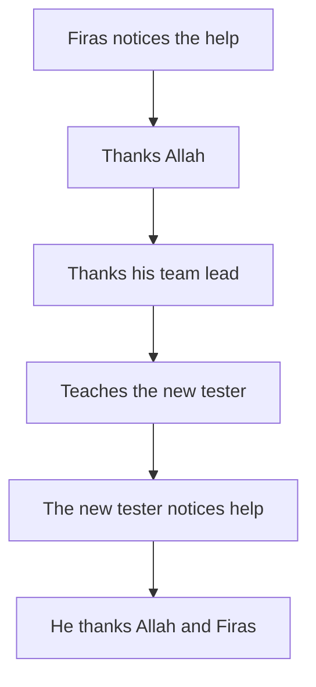

## "It would be pretending"

On Saturday evening, Yousef asks Ahmad to try something. "Name three things you are grateful for this week." Ahmad laughs, and then he says something honest. "When I get a real job, I will feel grateful. Right now, saying I am grateful would be pretending."

Many sincere people think like this. They believe gratitude is a feeling that arrives when life is good. To them, saying thank you before the feeling comes is a kind of lie. If that were true, Ahmad would have to wait for a better job before he could be grateful. And the waiting itself would make him less grateful every week. Before you read on, make a guess.

```predict
prompt: "Ahmad thinks thanking Allah before he feels grateful would be pretending. Can shukr start before the feeling comes?"
options:
  - id: empty
    label: "No, thanks without the feeling are empty"
  - id: start
    label: "Yes, by noticing and saying it first"
correctOptionId: start
explanation: "The sources describe gratitude in the heart, on the tongue and in action. Noticing a blessing and saying thanks are things a person can do on a flat day, and the feeling often follows. The Prophet, peace be upon him, showed his gratitude by what he did (Sahih al-Bukhari 4836)."
```

Step through the canvas below. It follows one evening of Ahmad's gratitude through his heart, his tongue and his hands, and to his brother.

<InteractiveCanvas slug="gratitude-three-ways" />

The canvas showed gratitude that did not wait for a feeling. Ahmad started by noticing three blessings on an evening when he felt flat. He thanked Allah, thanked Yousef by name and used the data hour well. In the last step, when the comparing thought came back at 23:00, he used "look at those below you" on himself and closed the app. Nothing in the evening needed him to feel grateful first.

## In the heart: noticing

Allah tells us that He gave Luqman wisdom, and told him to be grateful to Allah. Whoever is grateful is grateful for his own good (Quran 31:12). Gratitude in the heart begins with noticing: seeing a good thing as a gift from Allah, not as luck or as something you were owed.

This is exactly what Ahmad could not do on the night he scrolled. The blessings were there: a brother who shares his data, two clients who paid, a menu that brought a shop new customers. He had stopped seeing them. Notice also what the verse says about who benefits. Gratitude is for the grateful person's own good. Allah does not need it. Ahmad needs it.

## On the tongue: saying it

Allah says: remember Me and I will remember you; be grateful to Me and do not be ungrateful (Quran 2:152). Gratitude on the tongue is saying it: praising Allah, thanking Him in your own words, and remembering Him.

Allah also tells us that He declared: if you are grateful, I will surely give you more (Quran 14:7).

> لَئِن شَكَرْتُمْ لَأَزِيدَنَّكُمْ

Meaning: If you are grateful, I will surely give you more (Quran 14:7).

This is Allah's promise. It does not say what the "more" will be, or when it will come. It could be more provision, more peace, or more ability to see what you already have. That is Allah's to choose. What the verse asks of Ahmad is simple: to say it.

## In action: using the blessing well

Al-Mughirah ibn Shu'bah, may Allah be pleased with him, reported that the Prophet, peace be upon him, used to pray at night until his feet swelled. He was told that Allah had already forgiven him. He answered: should I not be a grateful servant? (Sahih al-Bukhari 4836).

The Prophet did not only feel grateful or only say it. He showed it in what he did. Gratitude in action means using a blessing well, in the way that pleases the One who gave it. For a designer, that might mean using a skill to help someone. It might mean using a precious hour of data for work instead of scrolling.

Put the three places together, and Ahmad's question has an answer. Noticing and saying are acts, and acts can come before a feeling. Often the feeling follows them, a little later.

## Thanking people is part of thanking Allah

The Prophet said that whoever does not thank people does not thank Allah (Sunan Abi Dawud 4811, graded sahih).

> لاَ يَشْكُرُ اللَّهَ مَنْ لاَ يَشْكُرُ النَّاسَ

Meaning: Whoever does not thank people does not thank Allah (Sunan Abi Dawud 4811).

This hadith makes gratitude practical. The blessings Allah sends often arrive through people: a brother's data, a mentor's notes, a client who pays on time. Thanking them is part of thanking Allah. A specific thank you does more than a general one. "Thank you for the data every night; it is how I reach my clients" tells Yousef what his help made possible.

## Looking at those below you, as a tool you choose

Abu Hurairah, may Allah be pleased with him, reported a saying of the Prophet. When one of you looks at someone given more wealth or a better form, let him look at someone below him (Sahih Muslim 2963).

This is a tool for your own heart, to use when you catch yourself comparing upward. When Ahmad sees Obada's new job, he can also choose to remember people who have less than he does. That helps him notice what he has. It is not a way to shrink his own sadness, and it is not a reply to anyone else's pain. Do not say to someone who is hurting, "others have it worse, so be grateful." That is not how this hadith is used, and it usually adds to the hurt. Use it on yourself, by choice, and only when it helps you see.

## Worked example: Firas and his team lead

Here is the same practice in a different job. Firas is 24 and works remotely as a junior software tester. For two evenings, his team lead stayed late on a call to teach him how to automate his tests. On Thursday, Firas finished his first automated test suite. Follow his next week, with the reasoning at each step.

**Heart.** On Friday morning he writes down three blessings: the team lead's two evenings, the new skill, and his mother keeping a lamp charged so he can work after dark. He does not feel especially grateful. He writes them anyway, because noticing is something he can do without the feeling.

**Tongue.** He says "alhamdulillah" for each one and makes a short dua for his team lead. Then he sends her a message. "Thank you for the two evenings. Because of them, I finished the test suite a week early, and I can now help with the next release."

**Action.** On Monday a new tester joins the team. Firas offers him an hour to show him the automated tests. Using a gift to help someone else is gratitude in action.

**Passing on.** At the end of the hour, the new tester thanks Firas, and says he will make dua for him. Firas notices that his own gratitude has become a blessing someone else can notice.

The diagram follows one blessing as it moves from person to person.



The chain starts in one heart and ends in another. Firas's gratitude did not stay a private feeling. Through his thanks and his action, it reached two more people. The last box is the first box again, in a different person.

## Where people misunderstand it

The first misunderstanding is "gratitude means pretending everything is fine." Gratitude sits next to patience, not in place of it (Sahih Muslim 2999). Ahmad can thank Allah for his brother and still feel the weight of a small, uncertain income.

The second is "gratitude must wait until I feel it." Firas wrote his blessings down on a flat morning, and the Prophet showed gratitude in action.

The third is that thanking Allah makes thanking people unnecessary. The hadith in Sunan Abi Dawud 4811 says the opposite.

The fourth is using "look at those below you" on other people. You can spot this mistake when the hadith is said to someone in pain. It is a tool you choose for your own heart.

<Callout type="tip" title="A small daily habit">
Before you sleep, name one blessing from the day, say "alhamdulillah" for it, and name one person you could thank tomorrow.
</Callout>

## Check your understanding

```quiz
type: mcq
question: "Tasneem, a nursing student, gets a lift to her hospital placement from her neighbour, Abu Khaled, three mornings a week. She thanks Allah for it in her prayers. She has never thanked Abu Khaled, because she thinks he does it for Allah's sake anyway. What does this chapter suggest?"
options:
  - "Her thanks to Allah covers it, as the lift is His gift"
  - "Thank him at the end of term, so the thanks are complete"
  - "Offer to pay for fuel, so the help is fair between them"
  - "Tell him specifically what the lifts make possible for her"
correct: 3
explanations:
  - "The lift is from Allah, and it comes through Abu Khaled. Whoever does not thank people does not thank Allah (Sunan Abi Dawud 4811)."
  - "Thanks at the end are kind, but a whole term without a word is a long gap. A specific thank you now does more."
  - "Paying may be kind, but it does not replace thanks. Gratitude to the people who help is part of gratitude to Allah."
  - "Right. Thanking people is tied to thanking Allah (Sunan Abi Dawud 4811). Telling him what the lifts make possible is a specific thank you."
```

```quiz
type: mcq
question: "Karam's friend Anwar has just lost his main freelance contract and is upset. Karam remembers the hadith about looking at those below you. What is the right use of it here?"
options:
  - "Remind Anwar gently that many people have no work, to lift his mood"
  - "Use it on himself when he compares, and help Anwar look for work"
  - "Share the hadith with Anwar later, once the first shock has passed"
  - "Leave the hadith aside, since it fits people with more money"
correct: 1
explanations:
  - "Said to someone in pain, this sounds like 'others have it worse, so stop being sad'. That is not how the hadith is used."
  - "Right. The hadith is a tool Karam chooses for his own heart (Sahih Muslim 2963). For Anwar, the Sunnah is presence and practical help."
  - "Waiting is kinder than saying it now, but it still turns a tool for one's own heart into advice for someone else's grief."
  - "The hadith speaks of anyone who looks at someone given more. It is useful for everyone, when used on yourself and by choice."
```

## This week

Practise shukr in all three places once this week. Write down one blessing you had stopped noticing. Thank Allah for it in your own words. Then thank one person who helped you, specifically, and say what their help made possible. If you can, use one blessing to help someone else.

**Next:** Hope and fear in balance, and the two ways the balance breaks.
