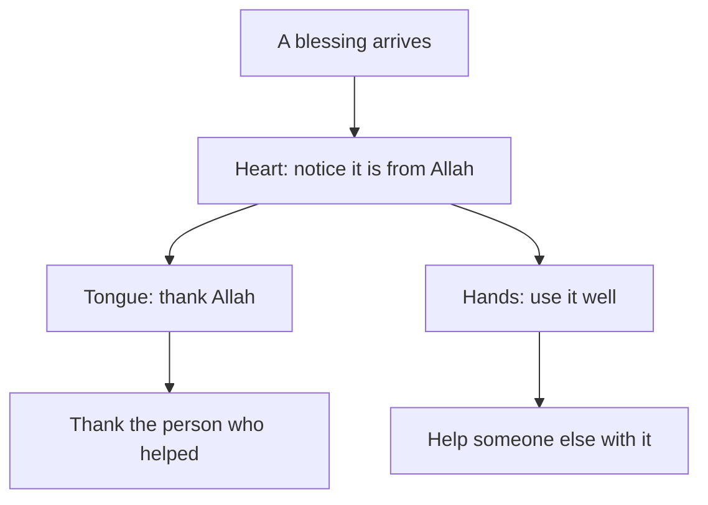

## "It would be pretending"

On Saturday evening, Yousef asks Ahmad to try something. "Name three things you are grateful for this week." Ahmad laughs, and then he says something honest. "When I get a real job, I will feel grateful. Right now, saying I am grateful would be pretending."

Many sincere people think like this. They believe gratitude is a feeling that arrives when life is good, and that saying thank you before the feeling comes is a kind of lie. If that were true, Ahmad would have to wait for a better job before he could be grateful, and the waiting itself would make him less grateful every week.

The sources describe shukr, the gratitude you met in 4.1, differently. It is something a person practises in three places: the heart, the tongue and action. A feeling may come with it, and often comes after it. But the practice does not have to wait for the feeling.

## In the heart: noticing

Allah tells us that He gave Luqman wisdom, and told him to be grateful to Allah, and that whoever is grateful is grateful for his own good (Quran 31:12). Gratitude in the heart begins with noticing: seeing a good thing as a gift from Allah, not as luck or as something you were owed.

This is exactly what Ahmad could not do on the night he scrolled. The blessings were there: a brother who shares his data, two clients who paid, a menu that brought a shop new customers. He had stopped seeing them. Notice also what the verse says about who benefits. Gratitude is for the grateful person's own good. Allah does not need it. Ahmad needs it.

## On the tongue: saying it

Allah says: remember Me and I will remember you; be grateful to Me and do not be ungrateful (Quran 2:152). Gratitude on the tongue is saying it: praising Allah, thanking Him in your own words, and remembering Him.

Allah also tells us that He declared: if you are grateful, I will surely give you more (Quran 14:7).

> لَئِن شَكَرْتُمْ لَأَزِيدَنَّكُمْ

Meaning: If you are grateful, I will surely give you more (Quran 14:7).

This is Allah's promise. It does not say what the "more" will be, or when it will come. It could be more provision, more peace, more ability to see what you already have. That is Allah's to choose. What the verse asks of Ahmad is simple: to say it.

## In action: using the blessing well

Al-Mughirah ibn Shu'bah, may Allah be pleased with him, reported that the Prophet, peace be upon him, used to pray at night until his feet swelled. He was told that Allah had already forgiven him. He answered: should I not be a grateful servant? (Sahih al-Bukhari 4836).

This is one of the clearest teachings on gratitude in the Sunnah. The Prophet did not only feel grateful or only say it. He showed it in what he did. Gratitude in action means using a blessing well, in the way that pleases the One who gave it. For a designer, that might mean using a skill to help someone, or using a precious hour of data for work instead of scrolling.

Now look at one person who helps Ahmad every night, and make a guess.

```predict
prompt: "Ahmad says 'alhamdulillah' many times a day, but he has not thanked Yousef for the data in months. Is his gratitude complete?"
options:
  - id: covered
    label: "Yes, his thanks to Allah already covers it"
  - id: not-yet
    label: "Not yet, thanking people is part of it"
correctOptionId: not-yet
explanation: "The Prophet said that whoever does not thank people does not thank Allah (Sunan Abi Dawud 4811, graded sahih). Thanking Yousef is not separate from thanking Allah; it is part of it."
```

Step through the canvas below. It follows one evening of Ahmad's gratitude through his heart, his tongue and his hands, and to his brother.

<InteractiveCanvas slug="gratitude-three-ways" />

The canvas showed gratitude moving outward. It started as noticing in the heart, became words on the tongue, reached Yousef as a specific thank you, and ended in action: an updated portfolio and a CV for Yousef. Each step was small. Together they changed what Ahmad did with his evening.

## Thanking people is part of thanking Allah

The Prophet said that whoever does not thank people does not thank Allah (Sunan Abi Dawud 4811, graded sahih).

> لاَ يَشْكُرُ اللَّهَ مَنْ لاَ يَشْكُرُ النَّاسَ

Meaning: Whoever does not thank people does not thank Allah (Sunan Abi Dawud 4811).

This hadith makes gratitude practical. The blessings Allah sends often arrive through people: a brother's data, a mentor's notes, a client who pays on time, a mother who keeps the house running through power cuts. Thanking them is part of thanking Allah. And a specific thank you ("thank you for the data every night; it is how I reach my clients") does more than a general one.

## Looking at those below you, as a tool you choose

Abu Hurairah, may Allah be pleased with him, reported that the Prophet said: when one of you looks at someone who has been given more wealth or a better form, let him look at someone below him (Sahih Muslim 2963).

This is a tool for your own heart, to use when you catch yourself comparing upward. When Ahmad sees Obada's new job, he can also choose to remember people who have less than he does, so that he notices what he has. It is not a way to shrink his own sadness, and it is not a reply to anyone else's pain. Never say to someone who is hurting, "others have it worse, so be grateful." That is not how this hadith is used, and it usually adds to the hurt. Use it on yourself, by choice, and only when it helps you see.

## Worked example: Ahmad's gratitude, one evening

Here is how Ahmad practises shukr in three places on one ordinary evening, with the reasoning for each step.

**Heart.** Before the data hour, he writes three blessings from this week in his notebook: Yousef's data, two clients who paid $105 in total, and the falafel menu that customers ask about. The reasoning: writing makes the noticing concrete, and he is noticing on purpose, not waiting to feel it.

**Tongue.** He says "alhamdulillah" for each one, and he makes a short dua in his own words for his work. Then, at dinner, he thanks Yousef specifically for the data and for checking his portfolio every week. Yousef is surprised and pleased.

**Action.** He uses the data hour to add the falafel menu and the two new logos to his portfolio. Eight pieces become eleven. Then he notices that Yousef is applying for a teaching post, and offers to design a clean one-page CV for him. Using a skill to help the person who helped you is gratitude in action.

**The comparing thought.** At 23:00 he opens the app and sees another friend's news. He feels the old pull. This time he closes the app, and he uses the Prophet's advice on himself: he remembers that many people have less than he does, and he reads his three blessings again. The sadness is still there, a little. It no longer decides his evening.

Notice what changed and what did not. Ahmad still wants a better job. Gratitude did not make him stop wanting more. It gave him something to build on: an updated portfolio, a closer brother and a calmer night.

The diagram shows how gratitude moves from the heart outward.



What to notice: the heart is where gratitude starts, but it does not stay there. One road goes to words, for Allah and for the person who helped. The other road goes to action: using the blessing well and passing some of it on. The takeaway: if your gratitude stays only in the heart, it is easy to lose on a bad night. When it reaches the tongue and the hands, it becomes a habit you can keep.

## Where people misunderstand it

The first misunderstanding is "gratitude means pretending everything is fine." Gratitude sits next to patience, not in place of it (Sahih Muslim 2999). Ahmad can thank Allah for his brother and still feel the weight of small, uncertain income.

The second is "gratitude must wait until I feel it." The Prophet showed gratitude in action. You can notice, say and do before the feeling comes.

The third is "thanking Allah is enough, so thanking people does not matter." The hadith in Sunan Abi Dawud 4811 says the opposite.

The fourth is using "look at those below you" on other people. You can spot this mistake when the hadith is said to someone in pain. It is a tool you choose for your own heart.

<Callout type="tip" title="A small daily habit">
Before you sleep, name one blessing from the day, say "alhamdulillah" for it, and name one person you could thank tomorrow.
</Callout>

## Check your understanding

```quiz
type: mcq
question: "Tasneem, a nursing student, gets a lift to her hospital placement from her neighbour, Abu Khaled, three mornings a week. She thanks Allah for it in her prayers, but she has never thanked Abu Khaled, because she thinks he does it for Allah anyway. What does this chapter teach?"
options:
  - "Her thanks to Allah is enough, since the lift really comes from Allah"
  - "She should thank him only if he ever seems to expect her thanks"
  - "Thanking him is part of thanking Allah, so she should tell him"
  - "She should pay him for fuel instead, so that no thanks are owed"
correct: 2
explanations:
  - "The lift is from Allah, and it comes through Abu Khaled. Whoever does not thank people does not thank Allah (Sunan Abi Dawud 4811)."
  - "Thanks are not only for people who expect them. Thanking the person who helps is part of gratitude itself."
  - "Right. The Prophet tied thanking people to thanking Allah (Sunan Abi Dawud 4811). A specific thank you to Abu Khaled is part of Tasneem's shukr."
  - "Paying may be kind, but it does not replace thanks. Gratitude to the people who help is part of gratitude to Allah."
```

```quiz
type: mcq
question: "Karam's friend Anwar has just lost his main freelance contract and is upset. Karam remembers the hadith about looking at those below you. What is the right use of it here?"
options:
  - "Remind Anwar that many people have no work at all, to cheer him up"
  - "Use it on himself when he compares, and support Anwar with help"
  - "Tell Anwar to look at people below him before he feels sad again"
  - "Avoid the hadith completely, since it is only for wealthy people"
correct: 1
explanations:
  - "Said to someone in pain, this sounds like 'others have it worse, so stop being sad'. That is not how the hadith is used, and it can add to Anwar's hurt."
  - "Right. The hadith is a tool Karam chooses for his own heart (Sahih Muslim 2963). For Anwar, the Sunnah is presence and practical help, such as sharing a job lead."
  - "This turns a tool for your own heart into an instruction for someone else's grief. Anwar's sadness is human, not a failure of gratitude."
  - "The hadith speaks of anyone who looks at someone given more. It is useful for everyone, when used on yourself and by choice."
```

## This week

Practise shukr in all three places once this week. Write down one blessing you had stopped noticing. Thank Allah for it in your own words. Then thank one person who helped you, specifically, and say what their help made possible. If you can, use one blessing to help someone else.

**Next:** Hope and fear in balance, and the two ways the balance breaks.
