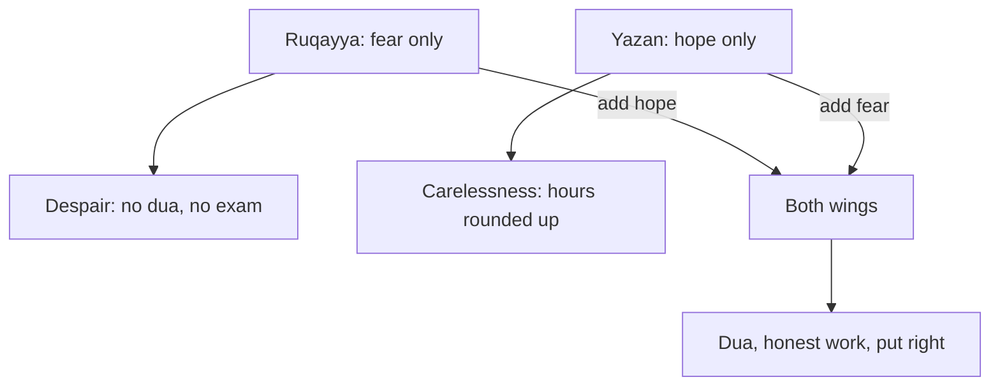

## Two evenings in one week

On Monday, a bakery abroad tells Ahmad that they have chosen another designer for their new logo. He had sent them two rounds of designs. That night the old thought from 4.1 comes back, but heavier. He thinks of the years he feels he has wasted and the mistakes he has made in his life. Then he thinks: Allah will not open a door for someone like me. He does not make dua that night. He does not send the pitch he had planned for a new client on Tuesday.

On Thursday, something very different happens. Ahmad promised a cafe owner, Umm Tamer, the first designs for her menu by Thursday. He has not started. When she messages to ask, he writes back: "Almost finished, you will have it soon." Then he tells himself: Allah is merciful; a small untruth to a client is nothing.

Yousef sees both evenings. He asks Ahmad one question about Monday night: what was missing? Before you read on, make your own guess.

```predict
prompt: "On Monday night, Ahmad decides that Allah will not open a door for someone with his mistakes. What would steady his heart more?"
options:
  - id: more-hope
    label: "More hope, since mercy is wider than his mistakes"
  - id: more-fear
    label: "More fear, so he takes his mistakes seriously"
correctOptionId: more-hope
explanation: "Ahmad already has fear; what he has lost is hope. Allah tells those who have wronged themselves not to despair of His mercy (Quran 39:53). Adding more fear to a heart that is already despairing breaks the balance further."
```

Step through the canvas below. It follows Ahmad's two evenings, one broken wing at a time, and then shows each one mended.

<InteractiveCanvas slug="two-wings-balance" />

The canvas showed that despair and carelessness are not opposites to choose between. They are the same kind of failure: flying on one wing. On Monday the missing wing was hope, so Ahmad stopped asking and stopped working. On Thursday the missing wing was fear, so he stopped caring about his own wrong choice. With both wings, he did two concrete things. He made dua and sent the pitch, and he told Umm Tamer the truth.

## Two wings

The scholar Ibn al-Qayyim gave a picture for this. He said that the heart on its way to Allah is like a bird. Love is its head, and fear and hope are its two wings. When the head and the wings are sound, the bird flies well. If the head is cut off, it dies. If it loses its wings, it is open to every hunter.

The picture is from a scholar, not from the Quran or a hadith. But the balance it describes is in the Quran itself. Allah tells us to call on Him with fear and hope, and that His mercy is near to those who do good (Quran 7:56).

> وَادْعُوهُ خَوْفًا وَطَمَعًا

Meaning: Call on Him with fear and hope (Quran 7:56).

Allah also describes those who are closest to Him as hoping for His mercy and fearing His punishment (Quran 17:57). Even the best people hold both at once. These are the raja' and khawf from the key words of 4.1. Ahmad's Monday was one of them without the other, and so was his Thursday.

## When fear has no hope: despair

Allah says to His servants who have wronged themselves: do not despair of Allah's mercy, for Allah forgives all sins (Quran 39:53). This verse speaks directly to Ahmad's Monday. He was not wrong to remember his mistakes. He was wrong to decide that they were bigger than Allah's mercy.

The Quran treats despair seriously. Ibrahim, peace be upon him, said: who despairs of his Lord's mercy except those who are astray? (Quran 15:56). And the Prophet, peace be upon him, reported in a hadith qudsi what Allah says. I am as My servant thinks of Me, and I am with him when he remembers Me. If he comes near to Me a hand's span, I come near to him an arm's length. If he comes walking, I come to him running (Sahih al-Bukhari 7405).

> أَنَا عِنْدَ ظَنِّ عَبْدِي بِي

Meaning: I am as My servant thinks of Me (Sahih al-Bukhari 7405).

This hadith changes the question Ahmad asks on Monday night. The question is no longer how big his mistakes are. It is what he thinks of Allah. Thinking well of Allah, and taking one step toward Him, is how hope is practised.

One important line: feeling low is not the same as despair. Sadness is human, as module 3 showed. Despair, in the sense the Quran warns against, is giving up on Allah's mercy, so that a person stops asking Him and stops trying. Ahmad can feel sad about the bakery and still hope.

## When hope has no fear: carelessness

The Prophet spoke of both sides at once. If the believer knew the punishment that is with Allah, no one would hope for His Paradise. If the disbeliever knew the mercy that is with Allah, no one would despair of His Paradise (Sahih Muslim 2755). Neither side alone tells the whole truth.

Carelessness is the hope wing alone. On Thursday Ahmad used Allah's mercy as a reason not to care about a wrong choice. But the verse that tells us to call on Allah with hope also says His mercy is near to those who do good (Quran 7:56). Hope is not a reason to stop doing good. It is the reason to keep doing it.

## Fear is about your choices, never about events

This course uses fear in one way only: awareness of your own choices. It is the kind of care that would have stopped Ahmad leaving an untruth with a client. It does not use fear to read events.

So "maybe the bakery chose someone else because Allah is punishing me" is not what fear means here. Module 1 taught that hardship cannot be read as proof that Allah is angry with you. The prophets were tested most of all (Jami' at-Tirmidhi 2398, graded hasan sahih). A lost client, a rejected application or a power cut is not a message about your sins. Do not say that to yourself, and do not say it to anyone else.

## Worked example: Ruqayya and Yazan

Here are two people in one office, each missing a different wing. Ruqayya and Yazan are junior accountants at a small firm.

**Ruqayya: fear with no hope.** Ruqayya has failed her professional accounting exam twice. After the second result she thinks of mistakes she regrets from years ago. She decides that Allah will not help someone like her, so she stops making dua about the exam. She has not booked a third attempt. Her exam result is not a punishment, and nothing in this course reads it as one. What is wrong is her conclusion about Allah's mercy.

**Adding hope to Ruqayya's heart.** A friend reads her the meaning of Quran 39:53 and Sahih al-Bukhari 7405. Ruqayya starts with one step toward Allah: dua after the dawn prayer, in her own words. Then she takes one step in her work: she books the third attempt for March and studies for 40 minutes each evening. Hope did not wait for confidence. It began with what she thought of Allah, and then it moved her hands.

**Yazan: hope with no fear.** Yazan has been rounding up his hours for one client, writing 6 hours for days when he worked 5. He tells himself that Allah is forgiving, and that an hour here and there is nothing. Each time he submits the timesheet, he feels a small unease.

**Adding fear to Yazan's heart.** The unease is the fear wing working. Yazan listens to it. He corrects the last month's timesheet, tells his manager plainly what he did, and asks Allah's forgiveness. From now on he logs his hours each evening, not from memory at the end of the week. His fear is about his own choice, and it leads him to put it right with the people involved.

The diagram shows where each of them started, and where the missing wing took them.



Each person needed the wing they lacked, never more of the wing they had. Telling Ruqayya to fear Allah more would have pushed her deeper into despair. Telling Yazan that Allah is merciful would have confirmed his carelessness. When you feel stuck, ask which wing is missing, and add that one.

## Where people misunderstand it

The first misunderstanding is "fear means expecting bad things to happen." In this course fear is about your own choices. Worry about events is something to bring to Allah, as module 3 taught, not a kind of fear to grow.

The second is "hope means everything will turn out the way I want." Hope is hope in Allah's mercy, not a promise of a particular result. Ruqayya may not pass in March. She can still think well of Allah.

The third is "balance means measuring exactly half hope and half fear." The two wings are not a calculation. The question is simpler: is either wing missing right now?

The fourth is "my mistakes are too big for mercy." Quran 39:53 is addressed to people who have wronged themselves, and it says do not despair.

If you feel overwhelmed for a long time, or you have thoughts of harming yourself, talk to your mentor or the fellowship coordinator today. If you can, talk to a doctor or counsellor too. This course does not replace professional care.

## Check your understanding

```quiz
type: mcq
question: "Haya told a client that a report was 'checked' when she had only read it quickly. That night she feels uneasy. Her friend says: 'Do not dwell on it. Allah is merciful, and worry is something to hand to Allah.' What keeps both wings in this case?"
options:
  - "Let the unease lead her to put it right with the client, and hope too"
  - "Hand the unease to Allah, as her friend says, and let the report stand"
  - "Keep the unease, and take it as proof that she cannot be trusted"
  - "Ask Allah for forgiveness tonight, and leave the client out of it"
correct: 0
explanations:
  - "Right. Her unease is the fear wing: care about her own choice. It leads her to put it right with the client, while she hopes in Allah's mercy (Quran 7:56)."
  - "Worry about events is something to bring to Allah. This unease is about her own wrong choice, so it calls for her to correct it."
  - "This is fear with no hope. Allah tells those who have wronged themselves not to despair of His mercy (Quran 39:53)."
  - "Asking forgiveness is right, but the client still holds a report she called checked. Fear of her own choice leads her to put it right with him too."
```

```quiz
type: mcq
question: "Yahya has sent 30 job applications in two months and had no replies. He still prays and makes dua. Tonight he feels very low and tells his sister he is sad. His sister worries that he has fallen into despair. Is she right?"
options:
  - "Yes, feeling this low means he has given up on Allah's mercy"
  - "Partly, since sadness this deep is the start of despair"
  - "No, he is sad but still asking Allah, which is hope at work"
  - "No, but he should keep the sadness to himself so it does not grow"
correct: 2
explanations:
  - "Feeling low is not the same as giving up on mercy. Yahya still prays and makes dua."
  - "Deep sadness after a hard stretch is human. Despair, as the Quran warns against it, means giving up on Allah's mercy."
  - "Right. Despair is losing hope in Allah's mercy, so that a person stops asking and trying (Quran 39:53, 15:56). Yahya is sad and still asking."
  - "Telling his sister is healthy, and the Prophet himself showed his sadness openly. Hiding it is not needed."
```

## This week

Once this week, when you feel stuck, ask yourself one question: which wing is missing right now? If it is hope, read the meaning of Quran 39:53 and take one small step toward Allah and one in your work. If it is fear, find one choice of your own to put right, and put it right with the person involved.

**Next:** Five short cases to check your gratitude and hope.
