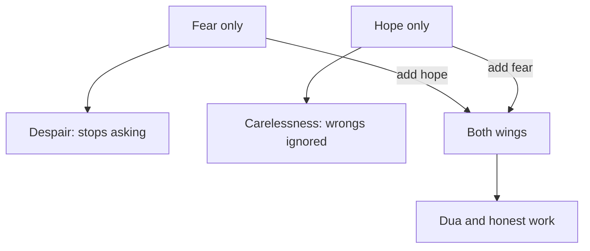

## Two evenings in one week

On Monday, a bakery abroad tells Ahmad that they have chosen another designer for their new logo. He had sent them two rounds of designs. That night the old thought from 4.1 comes back, but heavier. He thinks of the years he feels he has wasted and the mistakes he has made in his life. Then he thinks: Allah will not open a door for someone like me. He does not make dua that night. He does not send the pitch he had planned for a new client on Tuesday.

On Thursday, something very different happens. Ahmad promised a cafe owner, Umm Tamer, the first designs for her menu by Thursday. He has not started. When she messages to ask, he writes back: "Almost finished, you will have it soon." Then he tells himself: Allah is merciful; a small untruth to a client is nothing.

Yousef sees both evenings, and he says something that surprises Ahmad. "On Monday you had no hope. On Thursday you had no fear. I think it is the same problem."

## Two wings

The scholar Ibn al-Qayyim gave a picture for this. He said that the heart on its way to Allah is like a bird. Love is its head, and fear and hope are its two wings. When the head and the wings are sound, the bird flies well. If the head is cut off, it dies. If it loses its wings, it is open to every hunter.

The picture is from a scholar, not from the Quran or a hadith, but the balance it describes is in the Quran itself. Allah tells us to call on Him with fear and hope, and that His mercy is near to those who do good (Quran 7:56).

> وَادْعُوهُ خَوْفًا وَطَمَعًا

Meaning: Call on Him with fear and hope (Quran 7:56).

Allah also describes those who are closest to Him as hoping for His mercy and fearing His punishment (Quran 17:57). Even the best people hold both at once.

In this course, raja' (hope) means hope in Allah's mercy, and khawf (fear) means the awareness that keeps you careful about your own wrong choices. Both words were in the key words of 4.1. Ahmad's Monday was fear with no hope. His Thursday was hope with no fear. One wing each time.

Before you step through the canvas, make a guess about Monday night.

```predict
prompt: "On Monday night, Ahmad decides that Allah will not open a door for someone with his mistakes. What would steady his heart more?"
options:
  - id: more-hope
    label: "More hope: mercy is wider than his mistakes"
  - id: more-fear
    label: "More fear, so he takes his mistakes seriously"
correctOptionId: more-hope
explanation: "Ahmad already has fear; what he has lost is hope. Allah tells those who have wronged themselves not to despair of His mercy (Quran 39:53). Adding more fear to a heart that is already despairing breaks the balance further."
```

Step through the canvas below. It follows Ahmad's two evenings, one broken wing at a time, and then shows each one mended.

<InteractiveCanvas slug="two-wings-balance" />

The canvas showed that despair and carelessness are not opposites to choose between. They are the same kind of failure: flying on one wing. On Monday the missing wing was hope, so Ahmad stopped asking and stopped working. On Thursday the missing wing was fear, so he stopped caring about his own wrong choice. With both wings, he did two concrete things: made dua and sent the pitch, and told Umm Tamer the truth.

## When fear has no hope: despair

Allah says to His servants who have wronged themselves: do not despair of Allah's mercy, for Allah forgives all sins (Quran 39:53). This verse speaks directly to Ahmad's Monday. He was not wrong to remember his mistakes. He was wrong to decide that they were bigger than Allah's mercy.

The Quran treats despair seriously. Ibrahim, peace be upon him, said: who despairs of his Lord's mercy except those who are astray? (Quran 15:56). And in a hadith qudsi, the Prophet, peace be upon him, reported that Allah says: I am as My servant thinks of Me, and I am with him when he remembers Me. If he comes near to Me a hand's span, I come near to him an arm's length, and if he comes walking, I come to him running (Sahih al-Bukhari 7405).

> أَنَا عِنْدَ ظَنِّ عَبْدِي بِي

Meaning: I am as My servant thinks of Me (Sahih al-Bukhari 7405).

This hadith changes the question Ahmad asks on Monday night. The question is not "how big are my mistakes?" It is "what do I think of Allah?" Thinking well of Allah, and taking one step toward Him, is how hope is practised.

One important line: feeling low is not the same as despair. Sadness is human, as module 3 showed. Despair, in the sense the Quran warns against, is giving up on Allah's mercy, so that a person stops asking Him and stops trying. Ahmad can feel sad about the bakery and still hope.

## When hope has no fear: carelessness

The Prophet said that if the believer knew the punishment that is with Allah, no one would hope for His Paradise, and if the disbeliever knew the mercy that is with Allah, no one would despair of His Paradise (Sahih Muslim 2755). The hadith holds both sides at once: neither side alone tells the whole truth.

Carelessness is the hope wing alone. On Thursday Ahmad used Allah's mercy as a reason not to care about a wrong choice. But the verse that tells us to call on Allah with hope and fear ends by saying His mercy is near to those who do good (Quran 7:56). Hope is not a reason to stop doing good. It is the reason to keep doing it.

## Fear is about your choices, never about events

This course uses fear in one way only: awareness of your own choices, the kind that stopped Ahmad, once he had both wings, from leaving an untruth with a client. It does not use fear to read events.

So "maybe the bakery chose someone else because Allah is punishing me" is not what fear means here. Module 1 taught that hardship is not a sign of Allah's anger: the prophets were tested most of all (Jami' at-Tirmidhi 2398, graded hasan sahih). A lost client, a rejected application or a power cut is not a message about your sins. Never say that to yourself, and never say it to anyone else.

## Worked example: Ahmad mends both wings

**Monday, add hope.** Yousef asks Ahmad what he thinks of Allah. Ahmad admits that he has been thinking that Allah has given up on him. They read the meaning of Quran 39:53 together. Ahmad makes dua that night, in his own words, for his work and for forgiveness for the mistakes on his mind. On Tuesday he sends the pitch he had planned. The reasoning: hope is not a feeling he waits for. It is a step toward Allah and a step in his work.

**Thursday, add fear.** That evening, Ahmad feels uneasy about his message to Umm Tamer. This unease is the fear wing working. He writes to her again: "I am sorry, I wrote 'almost finished' but I have only just started. You will have the first designs by Sunday at noon." He works on the menu on Friday and Saturday and sends it on Sunday at 11:00, an hour early. The reasoning: fear here is about his own choice, an untruth, and it leads him to put it right with the person he wronged.

**Both wings together.** By the end of the week, Ahmad has done four concrete things: one dua, one pitch, one honest correction and one delivered menu. None of them needed him to feel confident. Each needed both wings.

The diagram shows what happens to a heart with one wing or two.



What to notice: each broken balance has a cure, and the cure is always the missing wing, never more of the wing you already have. A despairing heart does not need more warnings. A careless heart does not need more reassurance. The takeaway: when you feel stuck, ask which wing is missing, and add that one.

## Where people misunderstand it

The first misunderstanding is "fear means expecting bad things to happen." In this course fear is about your own choices. Worry about events is something to bring to Allah, as module 3 taught, not a kind of fear to grow.

The second is "hope means everything will turn out the way I want." Hope is hope in Allah's mercy, not a promise of a particular result. Ahmad may not win the next client. He can still think well of Allah.

The third is "balance means measuring exactly half hope and half fear." The two wings are not a calculation. The question is simpler: is either wing missing right now?

The fourth is "my mistakes are too big for mercy." Quran 39:53 is addressed to people who have wronged themselves, and it says do not despair.

If you feel overwhelmed for a long time, or you have thoughts of harming yourself, talk to your mentor or the fellowship coordinator today, and to a doctor or counsellor if you can. This course does not replace professional care.

## Check your understanding

```quiz
type: mcq
question: "Yara's laptop stopped working the week before a client deadline, and she had to borrow her cousin's. Her aunt tells her: 'Maybe this is a punishment. You should fear Allah more.' What is the better understanding of fear in this chapter?"
options:
  - "Fear is about her choices, not reading this as a punishment"
  - "Fear means checking each hardship to find which sin caused it"
  - "Fear means she should expect more things to go wrong this month"
  - "Fear is not needed at all, since hope in Allah is enough alone"
correct: 0
explanations:
  - "Right. In this course, fear keeps you careful about your own choices. A broken laptop is not a sign of Allah's anger; even the prophets were tested most (Jami' at-Tirmidhi 2398)."
  - "Searching hardships for hidden sins reads events as punishment, which the course does not do. Hardship is not a sign of anger."
  - "Expecting bad events is worry, not the fear of Allah taught here. Worry is something to bring to Allah in dua."
  - "Hope alone is carelessness. Allah tells us to call on Him with fear and hope together (Quran 7:56)."
```

```quiz
type: mcq
question: "Yahya has sent 30 job applications in two months and had no replies. He still prays and makes dua, but tonight he feels very low and tells his sister he is sad. His sister worries that he has fallen into despair. Is she right?"
options:
  - "Yes, feeling this low means he has given up on Allah's mercy"
  - "Yes, any sadness after so many applications is a kind of despair"
  - "No, but he should hide the sadness, so that it does not grow"
  - "No, sadness is human; despair would be giving up asking Allah"
correct: 3
explanations:
  - "Feeling low is not the same as giving up on mercy. Yahya still prays and makes dua, which is hope at work."
  - "Sadness after a hard stretch is human. Despair, as the Quran warns against it, means giving up on Allah's mercy."
  - "Hiding sadness is not needed. Telling his sister is healthy, and the Prophet himself showed his sadness openly."
  - "Right. Despair is losing hope in Allah's mercy, so that a person stops asking and trying (Quran 39:53, 15:56). Yahya is sad and still asking."
```

## This week

Once this week, when you feel stuck, ask yourself one question: which wing is missing right now? If it is hope, read the meaning of Quran 39:53 and take one small step toward Allah and one in your work. If it is fear, find one choice of your own to put right, and put it right with the person involved.

**Next:** Five short cases to check your gratitude and hope.
