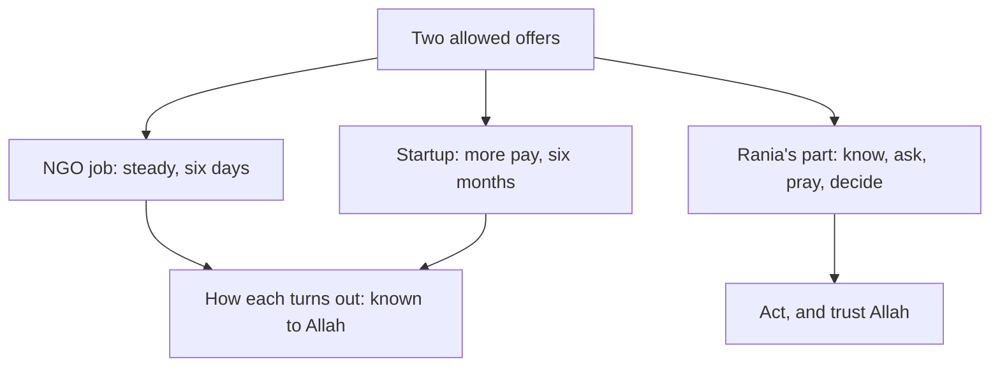

<BigWordAlert term="Shura" plainEnglish="Consultation: asking people who know and who care before you decide." whyItMatters="The Quran praises believers who run their affairs by consultation. Asking well brings you facts you could not see alone, and it is not a sign of weakness." />

## Two offers in one morning

Rania is 25. She studied statistics, and for two years she cleaned and checked survey data for a university project. Last month the project ended. She sent out her CV and waited. Then, on one Saturday morning, two offers came within an hour of each other.

The first offer is from a local NGO that runs community health programmes. They want a data assistant to enter and check survey data and write monthly reports in spreadsheets. The salary is 2,400 shekels a month. The work is in person, six days a week, from 8:00 to 15:00, in an office about 40 minutes away by shared taxi. The contract is for one year, and the NGO says most of its staff are renewed each year. The work is steady, but Rania would learn little that is new.

The second offer is from a small startup abroad that builds tools for online shops. They want a data analyst on a six-month remote contract, for about 30 hours a week. The pay is $850 a month. A senior analyst would review her work every week, and she would learn to build dashboards and write code for data. The team has calls three evenings a week at 19:00 her time. Renewal after six months is possible, but nobody has promised it.

Both offers are ordinary, honest work. Neither asks her to do anything wrong. That is part of why choosing is hard: there is no bad option to cross off. The NGO wants an answer by Wednesday. The startup wants one by Thursday.

## A long Saturday

Rania writes down what she knows. At the rate the exchange shop gives her this month, the startup pays about 3,100 shekels, which is about 700 more than the NGO. But she would need steady power and internet for the calls, so she would rent a desk at a shared workspace near her home, for 150 shekels a month in this example. The NGO office has solar panels and power for most of the day.

Then she thinks of her family. Her father drives a taxi, and his income goes up and down from month to month. Her younger sister Jana is in her last year of school, and Rania helps her with maths most evenings. Her brother Muath is at university. Her mother has said only one thing so far: "Choose what is good for you, and think about what happens after six months."

By the evening, Rania keeps thinking the same thoughts again and again. If she takes the startup contract and it ends after six months, the NGO job will be gone. If she takes the NGO job, she may lose her best chance to grow. She imagines one future, then the other. Each one looks bright for a minute and then frightening. She feels that she must find out which choice will turn out well before she can say yes to anything.

```predict
prompt: "Rania wants to be sure, before she answers, which offer will turn out well. Before you read on: can any amount of research give her that certainty?"
options:
  - id: no-certainty
    label: "No: she can know facts, not the end"
  - id: yes-certainty
    label: "Yes: enough research removes the doubt"
correctOptionId: no-certainty
explanation: "Research can tell Rania the pay, the hours and what the work is. It cannot tell her whether the startup will renew her contract, or what the next year holds for either job. Only Allah knows what anyone will earn tomorrow (Quran 31:34). Her part is to know what can be known, ask well, ask Allah, and then decide."
```

## The study circle

On Saturday evening, the online study circle meets as usual. Reem, their mentor, asks how everyone's week went. Rania tells them about the two offers. She says she has not slept well, and that she is afraid of choosing wrong. One friend says, "Take the one with more money." Another says, "Take the safe one. Six months is nothing." A third says, "Just pray istikhara and see."

Reem listens to all of it. Then she asks Rania three questions. "What do you know, and what can you still find out? Who knows more than you about each part of this? And have you asked Allah to choose for you?" Rania answers the first question with a long list, the second with a short one, and the third with silence. She has made dua, but she has not prayed istikhara, and she is not sure how it works.

Reem then says something Rania writes down. "You are trying to see the end. Nobody can. Only Allah knows what tomorrow brings. Your part is the steps you can take today: know what can be known, ask people who know, ask Allah, then decide, and trust Him with the rest."

The diagram shows Rania's situation the way Reem sees it. Read it from the top.



What to notice: both offers lead to the same box, "How each turns out", and that box is not Rania's to fill in. The other branch, "Rania's part", is full of things she can do this week. Her worry has kept her thinking about the box she cannot fill in. The takeaway: put your effort where your part is, and leave the end with Allah.

## What the Quran says about deciding together

The Quran describes the believers with a short list of qualities. They respond to their Lord, they keep up the prayer, they run their affairs by consultation among themselves, and they give from what Allah has provided for them (Quran 42:38). Consultation sits in that list beside prayer and giving. It is part of how believers live, not a last resort for when they are lost.

> وَأَمْرُهُمْ شُورَىٰ بَيْنَهُمْ

Meaning: their affairs are run by consultation among them (Quran 42:38).

This is *shura*. In a family, it might mean sitting with your parents and listening to what worries them. At work, it might mean asking a mentor, or someone who has done the job. Shura does not mean that someone else decides for you. It means you bring more knowledge, and more care, into a choice that is still yours to make.

## Why decisions feel so heavy

Rania's fear is common. When the outcome is unclear, a decision can feel like a test with one right answer hidden somewhere, where one wrong step will spoil everything. Three things often happen next. Some people delay until the offers expire, and then the choice is made for them. Some hand the decision to someone else, so that they do not have to carry it. Some choose in a hurry, just to make the bad feeling stop.

There is a better way to see it, and it comes from what you studied in module 1. You cannot know how a choice will turn out. Only Allah knows that (Quran 31:34). So a good decision is not one that you can promise will end well. A good decision is one made with the means you have: the facts you could gather, the people you could ask, the dua and the istikhara you could make. If you do your part with care and the result is hard, you did not fail. You did what was yours to do, and the rest was never in your hands.

This frees you from an impossible task. Rania does not have to know the future. She has to do four things well, and each of them is within her reach this week.

## What this module covers

The module follows Rania through the next four days, one step at a time. Each step has its roots in the Quran and the Sunnah, and each one is a step you can use for your own decisions.

First, she takes the means of knowing. She checks that both options are allowed, gathers the facts she is missing, and works out what matters most to her. You will meet the advice of the Prophet, peace be upon him, to be keen on what benefits you, and see why knowing your own priorities comes before asking anyone else.

Second, she consults the right people in the right way. The Quran tells the Prophet to consult people, to decide, and then to put his trust in Allah (Quran 3:159). You will see how the Prophet told his wife what he feared and went with her to someone who knew more, and how Rania asks each person about what they know best.

Third, she prays *istikhara*, the prayer in which a believer asks Allah to choose the good for them. You will learn what the Sunnah teaches about it, what it is not, and what to do after it. Fourth, she decides, acts, and trusts Allah with the outcome, with a backup plan in case things change.

At the end of the module you will write a decision record for one real choice in your life, or for a provided case if you prefer. Nobody has to share their personal situation to pass.

## Why this matters for your work

Fellows make decisions like Rania's often. Which client to accept when two arrive in the same week. Whether to take a short course or keep freelancing. Whether to apply for a scholarship abroad or a job at home. Whether to say yes to a contract with no promise of renewal. These are not small choices, and many of them come with a deadline and too little information.

The steps in this module will not make those choices easy. They will make them clearer. You will know what you are deciding about, and why. You will have asked the people who could help. You will have asked Allah to choose for you. And when you finally say yes or no, you can act with a calmer heart, because you did what was yours to do.

<LearningObjectives items={["Check that each option is allowed, gather the facts you are missing, and name what matters most to you", "Consult the right people in the right way: each person about what they know best, and you still decide", "Pray istikhara as the Sunnah teaches, and say what it is and what it is not", "Decide, act and trust Allah with the outcome, with a backup plan and without 'if only'", "Write a decision record for one real or provided choice"]} />

## Key words

| Word | Plain English |
|---|---|
| ***Istikhara*** | Asking Allah to choose the good for you in a decision between allowed things, with a short prayer and a dua |
| **Permissible** | Allowed in Islam. Both of Rania's offers are ordinary, allowed work |
| **Priority** | What matters most to you in one decision |
| **Means of knowing** | The facts you can find out before you decide: pay, hours, what the work is, what your family needs |
| **Decision record** | A short note of your options, the facts, who you asked, your decision and your first step |

## What is in this module

| Chapter | You will practise |
|---|---|
| 5.2 | Checking options, gathering facts and naming what matters most, with Rania's two offers |
| 5.3 | Shura: who to ask, what to ask, how to listen, and why you still decide |
| 5.4 | Istikhara as the Sunnah teaches it, and what to do after it |
| 5.5 | A graded quiz with five short cases |
| 5.6 | A decision record for a real or provided choice |

**Next:** Before Rania asks anyone, she needs to know what she is choosing between. Take the means of knowing.
