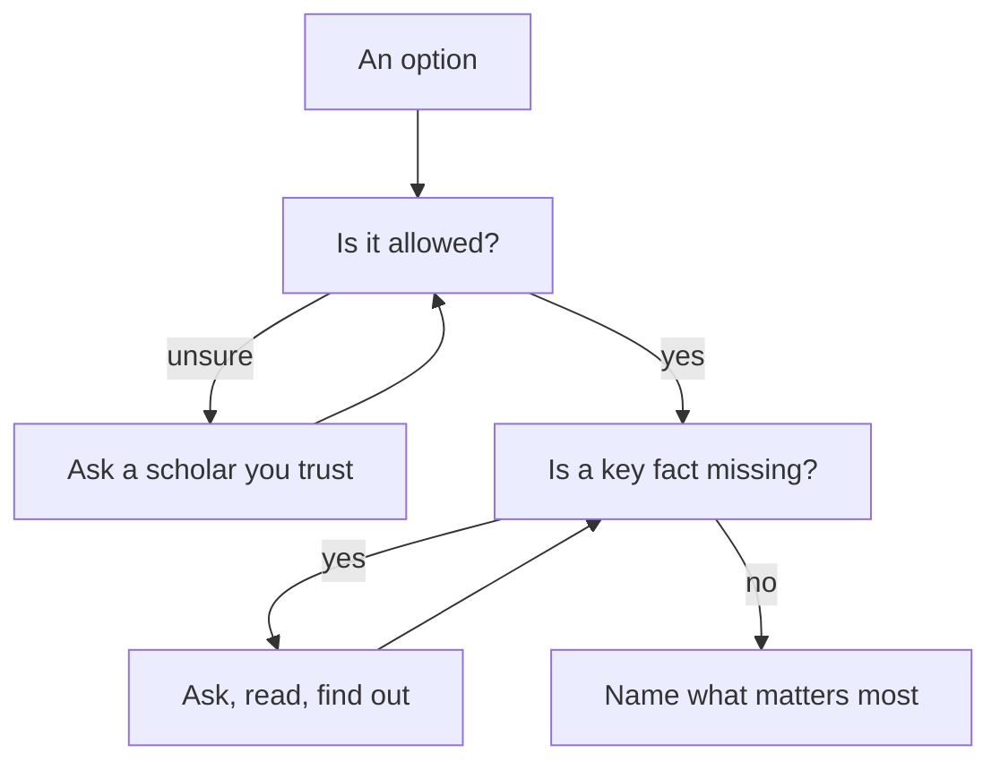

## A page full of worries

On Sunday morning, Rania opens her notebook. On the left she writes "NGO", and on the right "Startup". Within ten minutes the page is full, and she feels more confused than before. Under the startup she has written "more money", "dashboards", "evening calls", "what if it ends?", "Jana's exams" and "Mama is worried". Under the NGO she has "safe", "boring?", "six days", "40 minutes each way" and "solar power". Facts, fears and guesses sit side by side, and she cannot tell which is which.

Her cousin phones and gives quick advice: "Pray istikhara tonight. Whatever you feel in the morning, do that." Rania does want to pray istikhara. But something tells her she is not ready yet. She does not know some basic facts about either job. She is not even sure exactly what she is choosing between.

This chapter is about the work that comes first: taking the means of knowing. It is the lesson of module 2, applied to a decision. Tawakkul, the trust you met in chapter 2.2, never means skipping the means. When you have to choose, the first means are the facts.

## Be keen on what benefits you

The Prophet, peace be upon him, gave believers a short instruction that fits this moment closely. The strong believer is better and more beloved to Allah than the weak believer, and there is good in both. Be keen on what benefits you, seek Allah's help, and do not give up (Sahih Muslim 2664).

> الْمُؤْمِنُ الْقَوِيُّ خَيْرٌ وَأَحَبُّ إِلَى اللَّهِ مِنَ الْمُؤْمِنِ الضَّعِيفِ وَفِي كُلٍّ خَيْرٌ احْرِصْ عَلَى مَا يَنْفَعُكَ وَاسْتَعِنْ بِاللَّهِ وَلاَ تَعْجِزْ

Meaning: the strong believer is better and more beloved to Allah than the weak believer, and there is good in both. Be keen on what benefits you, seek Allah's help, and do not give up (Sahih Muslim 2664).

You met this hadith in chapter 1.4, as the answer to "if only". Here, look at its first instruction. Being keen on what benefits you is active. It means you go and find out. It means you ask the questions that matter before you sign anything. Seeking Allah's help comes in the same sentence, so finding out and asking Allah go together. Neither one replaces the other.

The Quran also gives an order for decisions. Allah told the Prophet to consult people in the matter. Once he had decided, he was to put his trust in Allah (Quran 3:159). Consulting and trusting both need something to work on. You cannot ask good questions about a choice you do not understand yourself. So the first step is to understand your own choice: what the options are, whether each one is allowed, what the facts are, and what matters most to you.

## Four parts of knowing

**List the real options.** Two offers do not always mean only two options. Rania could ask the NGO whether the job could be five days a week. She could ask the startup whether the evening calls could be earlier. She could ask either one for a few more days to decide. Sometimes the best option is one you shape yourself by asking. Write down every option you could really take, and nothing you could not.

**Check that each option is allowed.** A believer's first question about any option is whether it is permissible. Most choices fellows face are between ordinary, allowed things: two jobs, two courses, two clients. Sometimes you are not sure. A client's product may be something you have doubts about, or a contract may include a condition you do not understand. This course does not give rulings. If you are unsure whether something is allowed, ask a scholar you trust before you go further. Both of Rania's offers are ordinary data work, so she can move on.

**Gather the facts.** Write what you know, and next to it, what you still do not know. For a job, the facts usually include the pay, the hours, the place and how long the contract lasts. They also include how likely it is to be renewed, what you will learn, what it will cost you (travel, a workspace, internet), and what your family needs from you. Then go and find the missing facts. Ask the employer. Read the contract. Ask someone who has done the work. A fact you could find out with one message should not be left to guessing.

**Know what matters most to you.** Facts tell you what each option is. They do not tell you how much each fact weighs for you. Before you ask anyone for advice, try to say in one sentence what matters most to you in this choice, and what you must have. A must-have is a fact that rules an option out on its own, for example: "I must be able to give my family 1,500 shekels every month."

## Rania separates facts from fears

Rania starts a new page with three columns: "What I know", "What I must find out" and "What I feel". Under "What I know" she writes only facts from the two offers. The NGO pays 2,400 shekels a month, for six days a week from 8:00 to 15:00, 40 minutes away, on a one-year contract. The startup pays $850 a month, about 3,100 shekels at this month's rate, for about 30 hours a week on a six-month contract. It has a weekly review and calls three evenings a week at 19:00. A desk at the shared workspace would cost 150 shekels a month.

Under "What I must find out" she writes four questions. Could the startup's calls be earlier? What decides whether a startup contract is renewed? Is there any training in the NGO job? Could she speak to someone who has done each job? Under "What I feel" she writes: "Worried about month six. Guilty about Jana's evenings. Excited about learning." Feelings are not facts. But they are not nothing either: they often point to what matters most.

Then she sends two short messages. To the startup she writes: "Could the team calls be earlier in the evening? What decides whether a contract is renewed? Could I speak with someone who has worked with you?" To the NGO she writes: "Is there any training in the first year? Could I speak with your current data officer?" By Monday morning she has answers. The startup says renewal depends on new funding they expect in the fourth month. They will ask the team about the call times, and they give her the number of Jumana, a data analyst who worked with them last year. The NGO says there is no training budget this year, and gives her the number of Samah, their data officer.

Rania also checks her must-have. Her family needs her to give 1,500 shekels a month. The NGO's 2,400 shekels meets it. The startup's 3,100 shekels, less 150 for the workspace, leaves 2,950, which also meets it. Both offers pass, so neither is crossed off.

Last, she scores each offer from 1 to 5 on the five things that matter in her choice. The scores are her own judgement, not measurements. The NGO gets 5 for steady income, 3 for pay, 2 for learning, 5 for free evenings and 2 for days and travel. The startup gets 2 for steady income, 5 for pay, 4 for learning, 2 for free evenings and 4 for days and travel. It gets the 4 because she would work five days, a short walk from home.

```predict
prompt: "Rania and her friend Suha look at the same two offers, with the same facts and the same scores. Rania cares most about a steady income. Suha cares most about learning and pay. Will the same offer come out ahead for both of them?"
options:
  - id: same-winner
    label: "Yes: the same facts give the same winner"
  - id: depends
    label: "No: it changes with what matters most"
correctOptionId: depends
explanation: "The facts and the scores are the same for both of them, but how much each thing matters is not. When steady income matters most, the NGO job comes out ahead. When learning and pay matter most, the startup contract does. Neither result is the 'right answer' for everyone."
```

Now try it. Change how much each thing matters, and watch which offer comes out ahead. Start by checking your prediction.

<InteractiveCanvas slug="rania-two-offers" />

At the start, every weight is "Matters", and the two offers tie at 34 points each. The facts alone do not choose. Raise Steady income to "Matters a lot", and the NGO job leads, 39 to 36. Put it back and raise Learning instead, and the startup contract leads, 38 to 36. Now try Suha's priorities. Set Learning and Monthly pay to "Matters a lot", Days and travel to "Matters", and the other two to "Matters a little". The startup leads by 10 points, 39 to 29. Two careful people looked at the same facts, and different offers came out ahead. The canvas does not tell anyone which offer to take. It shows that the answer depends on what matters most to the person choosing.

## What matters most to Rania

Rania thinks about her own priorities slowly, one at a time. Her father's income goes up and down, so a steady income matters a lot to her family. She is two years into her career, and she knows that what she learns now will shape the next ten years, so learning also matters a lot. Pay matters, and so do her evenings with Jana, but less than those two. The days and the travel matter only a little: she does not mind a shared taxi.

So she sets her weights: Steady income 3, Learning 3, Monthly pay 2, Free evenings 2, Days and travel 1. The NGO job gets 15, 6, 6, 10 and 2, which is 39 points. The startup contract gets 6, 12, 10, 4 and 4, which is 36 points. The NGO job leads by 3 points.

What does that mean? Not that she must take the NGO job. A gap of 3 points, on scores she chose herself, means both offers are reasonable for her. What it does give her is clarity. She can now say in one sentence what she is weighing: "A steady income for my family against learning for my career." Her evenings with Jana sit in between. That sentence is worth more than the number. It tells her what to ask the people she will consult in chapter 5.3. It also tells her what she is asking Allah about when she prays istikhara in chapter 5.4.

Real decisions rarely move in a straight line. The diagram shows the two places where Rania, or anyone, may have to go back before going on.



Read the two loops. When you are unsure whether an option is allowed, you do not guess or score your way past the question: you ask a scholar and come back to it. When a key fact is missing, you go and find it, then ask again whether anything else is missing. Only when both questions are settled does the arrow reach "what matters most". So the loops are not wasted time. They are the means of knowing.

## Where it goes wrong

The first mistake is mixing facts, fears and guesses on one page. "What if it ends?" is a real worry, but it is not a fact. "Renewal depends on funding in month four" is a fact. Write them apart, and then find out what you can.

The second mistake is asking for advice before you know your own choice. If Rania had asked her family on Saturday night, she would have heard opinions about a job nobody understood yet. People can only help you with a question you can state clearly.

The third mistake is letting a score decide. The numbers on the canvas are Rania's own judgements, so they carry her own uncertainty. A gap of a few points means both options are reasonable. The score is a way to see your priorities, not a judge.

The fourth mistake is gathering facts forever. Research can become a way to delay, and delay can become a decision: the offer expires and the choice is made for you. Being keen on what benefits you includes not giving up and not freezing (Sahih Muslim 2664). Rania has a deadline of Wednesday, so she gives herself until Monday night for facts.

## Check your understanding

```quiz
type: mcq
question: "Saeed keeps the accounts in his family's shop. He scores two allowed offers, and Offer A comes out 4 points ahead. But Offer A pays 1,100 shekels a month, and his family needs at least 1,300 from him each month. What should he do with the score?"
options:
  - "Take Offer A, since the score has already weighed its pay against the rest"
  - "Raise the weight of pay until Offer B comes out ahead, and then take B"
  - "Set Offer A aside, because a must-have rules it out whatever the score"
  - "Pray istikhara about Offer A, since the score shows it is the stronger one"
correct: 2
explanations:
  - "A score adds things up, so a strong point can hide a weak one. A must-have is different: an option that fails it is out, however many points it has."
  - "Changing the weights until the answer you want comes out turns the score into a show. The real reason Offer A is out is the must-have, so say that plainly."
  - "Right. A must-have rules an option out on its own. The 4 points cannot give his family the 200 shekels Offer A is missing each month."
  - "Istikhara is for choosing between options that are allowed and possible for you. Offer A fails his family's must-have, so he sets it aside before the scores matter."
```

```quiz
type: mcq
question: "Rihab, a junior translator working from her family's home, is choosing between two remote contracts. One contract says renewal 'depends on results', and she does not know what that means. She has three days before she must answer. What is the best next step?"
options:
  - "Ask the employer which results decide whether it is renewed"
  - "Assume renewal is unlikely and refuse that contract today"
  - "Leave renewal to qadr, since the future is with Allah"
  - "Wait to see how she feels about the renewal in a few days"
correct: 0
explanations:
  - "Right. This is a fact she can find out with one message. Being keen on what benefits you means finding out what can be known before you decide."
  - "Assuming the worst is a guess, not a fact. One message could tell her what 'results' means and how often contracts are renewed."
  - "The future is with Allah, but the meaning of a contract clause is a fact she can ask about. Qadr does not cancel taking the means."
  - "Feelings can point to what matters, but they cannot tell her what the employer means by 'results'. She should ask."
```

## This week

Choose one decision in front of you, big or small: a course, a client, a way to spend your savings. Write the options. Mark which ones you are sure are allowed, and note any you need to ask a scholar about. List two facts you still need, and send one message this week to find one of them. Then write one sentence: "What matters most to me in this choice is...". If no decision is in front of you now, do this for Rania: what one more fact would you want before choosing?

**Next:** Rania takes her facts and her one sentence to the right people. Shura: ask people who know.
