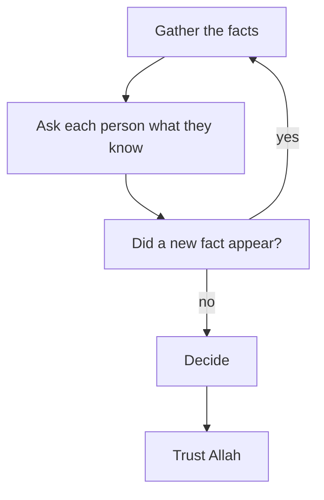

## Fourteen replies

On Sunday night, Rania posts her two offers in the big family group chat. Within an hour there are fourteen replies. An aunt writes, "Take the safe one, a job is a job". A cousin writes, "Money is money, take the startup". An uncle sends a long voice note about a company abroad that closed. Two people send only a heart. Nobody asks what the work is. Nobody asks what Rania wants.

She closes the phone more tired than before. She did ask people. She did consult. Why does she feel she knows less than before she asked?

This chapter answers that question. It is about how to consult: who to ask, what to ask, how to listen, and why, at the end, the decision is still yours.

## Shura in the Quran and the Sunnah

You met the verse in chapter 5.1: the believers run their affairs by consultation among themselves (Quran 42:38). The shura you met there is praised in the same verse as prayer and giving. A believer who asks for advice is not weak. She is doing what the Quran describes.

The Quran also gives the order of a good decision. Allah told the Prophet, peace be upon him, to consult people in the matter. Once he had decided, he was to put his trust in Allah, for Allah loves those who trust Him (Quran 3:159).

> وَشَاوِرْهُمْ فِي الْأَمْرِ ۖ فَإِذَا عَزَمْتَ فَتَوَكَّلْ عَلَى اللَّهِ

Meaning: consult them in the matter, and once you have decided, put your trust in Allah (Quran 3:159). Notice the order: consult, decide, trust. Consulting comes before deciding, so you are not deciding alone. Trusting comes after deciding, so you do not go on consulting forever.

The Prophet himself asked the people closest to him for help. After the first revelation came to him, he went home trembling. He told his wife Khadijah, may Allah be pleased with her, that he feared for himself (Sahih al-Bukhari 3).

> لَقَدْ خَشِيتُ عَلَى نَفْسِي

Meaning: I feared for myself (Sahih al-Bukhari 3). Khadijah comforted him. She reminded him that Allah would never disgrace him. She named his good deeds: he kept family ties, carried the burden of the weak, helped the poor, honoured guests and helped people in real hardship. Then she took him to her cousin Waraqa ibn Nawfal, a man who knew the earlier scriptures.

Look at what happened there, step by step. The Prophet told the person closest to him honestly how he felt. She listened, comforted him and reminded him of the good he did. Then they went together to someone who had knowledge that neither of them had. Care came from his wife; knowledge came from someone who knew the matter. Both were part of the help.

There is a second example. While travelling, his companions were upset and did not act on his instruction. The Prophet asked his wife Umm Salamah, may Allah be pleased with her, for advice, followed it, and it worked (Sahih al-Bukhari 2731). The best of people asked for advice, listened to it and acted on it. Asking was part of how he led.

```predict
prompt: "Rania decides to ask her mother, her mentor Reem, and two people who know the jobs from the inside. Before you step through: will each of them add something the others could not?"
options:
  - id: one-enough
    label: "No: one wise adviser would tell her as much"
  - id: each-adds
    label: "Yes: each knows a part the others do not"
correctOptionId: each-adds
explanation: "Her mother knows the family's needs, Reem knows careers, and the people inside know what the days are really like. No single person, however wise, holds all three. Each answer in the canvas brings a fact or a kind of care that only that person could give."
```

Step through Rania's consultation below, one person at a time. At each answer, ask yourself what that person knew that nobody else did.

<InteractiveCanvas slug="rania-asks-the-right-people" />

The fourteen replies in the group chat gave Rania opinions. Her mother gave her care and two new facts: a worry about the months after a contract ends, and Muath's offer to help Jana on two evenings. Reem gave her better questions, not an answer. Samah and Jumana gave her facts that nobody outside the work could know. The startup now holds calls on two evenings at 18:00, and last year it renewed two of its three contractors. With those facts, the startup's score for free evenings rises from 2 to 3. Her totals are now 39 for the NGO job and 38 for the startup. The two offers are almost level, and the decision is still hers.

## Who to ask: knowledge, care and honesty

A good adviser has three qualities, and few people have all three for every question. The first is knowledge: they know the matter you are asking about, such as the job, the field, the family or the course. The second is care: they want good for you, not for themselves. The third is honesty: they will tell you what they really think, even when you hoped to hear something else.

So different people help with different parts of one decision. Your family knows your family's needs and cares deeply, but may not know your field. A mentor knows careers and wants you to grow, but does not live in your house. Someone who has done the work knows what the days are really like, but may not know you well. The skill is to ask each person about the part they know best.

When a question is about whether something is allowed in Islam, the person to ask is a scholar you trust, for the same reason: the knowledge is theirs.

## What to ask, and how to listen

**Ask a clear question, not "what should I do?".** "What should I do?" invites the other person to make your decision with less information than you have. A better question names the part they know: "What does the family need from me this year?" or "What is the work really like, day to day?". Share the facts you gathered first, so they are answering the real question.

**Listen to learn, not to win.** Write down what each person says. Do not defend your current favourite. Ask "why do you say that?" when you do not understand. Notice what each person knows that you did not. And thank them: the Prophet taught that whoever does not thank people does not thank Allah (Sunan Abi Dawud 4811, graded sahih).

**Then you decide.** Advisers help you see. They do not carry your decision, and they should not be asked to. The verse says "once you have decided": the deciding is yours. If you follow someone's advice, follow it because you understood it and agree. Do not follow it only so that the choice belongs to someone else.

## Worked example: Nuha asks about a course

Nuha is 24 and works as a pharmacy assistant. Her manager has offered her extra evening shifts, which would bring 600 shekels a month more. At the same time, a training centre near her home is starting a two-month evening course in accounting software. It costs 400 shekels and meets three evenings a week. She cannot do both. Both options are ordinary and allowed. She has one week to tell her manager.

First she writes what she is weighing, in one sentence: "Money for the family now, against a skill that might bring a better job later". Then she writes one question for each person, about what that person knows.

**Her father** knows the family's money. She asks how much the family needs the extra 600 shekels in the next two months. He tells her the rent is covered, but her brother's university fees are due in three months. He adds that he would rather she grew in her work. Nuha learns a date she did not have: the fees, in three months.

**An accountant**, a friend of her aunt, knows the field. She asks: "Do employers here care about this certificate?" His answer is not what she hoped. "The certificate alone rarely gets anyone a job," he says. "What gets jobs is practice on real accounts." She wants to argue. Instead she asks, "Why do you say that?" He explains what employers test in interviews. She writes it down and thanks him.

**A former student of the course** knows what it is really like. She asks: "How much practice on real accounts does the course give?" The student says the second month is almost all practice, with real files from a local shop. That answers the accountant's worry. Without his honest answer, Nuha would never have known to check it.

**Her manager** knows the shifts. She asks: "Could the extra shifts start in two months instead of now?" He says yes, for the same hours.

Now Nuha weighs what each person knew. The course gives practice, not only a certificate. The extra money can start in two months, before the fees are due. Nobody told her what to choose, and she did not ask them to. She decides to take the course now and the shifts afterwards, and she pays the 400 shekels that day. She thanks all four people, and she puts her trust in Allah.

Notice what made her consultation work. Each question went to the person who knew that part. One honest answer she did not like led her to the most useful question of all. And a new fact from her manager created an option she had not seen at the start.

The diagram shows how consulting can send you back to your facts before you decide.



Start at the loop. Nuha's manager gave her a new fact, shifts in two months, and that sent her back to her facts with a new option. Consulting is not only collecting opinions; it often changes what you know. Once no new fact appears, the arrow goes one way: decide, then trust, in the order of the verse.

## Where it goes wrong

The first mistake is asking only people who will agree with you. If Rania had called only the friend who loves startups, she would have heard what she already wanted to hear. She would have learned nothing new. Ask at least one person who might see it differently.

The second mistake is asking people who care but do not know, about things they do not know. Rania's aunts love her, and their love is real. But a question about a data career needs someone who knows data careers. Love and knowledge are both needed, often from different people.

The third mistake is letting the adviser decide. Some people ask so that the choice will belong to someone else: "I only did what you said". But the verse says "once you have decided", and the decision belongs to the one who will live it. Follow advice because you understood it, not to escape the choice.

The fourth mistake is never stopping. After consulting, some people keep asking more and more people, hoping someone will make the doubt go away. The doubt about the future will not go away, because only Allah knows the future. Consult, decide, then trust.

The fifth mistake is not asking at all, out of pride or because "asking shows weakness". The Prophet told Khadijah about his fear, and he asked Umm Salamah for advice. There is no weakness in that.

## Check your understanding

```quiz
type: mcq
question: "Basma, a junior web developer who works from her family's home, wants advice on a contract before she signs it. Two developers she knows could look at it. Both know the work well. One always praises her plans. The other gives honest feedback that is sometimes hard to hear. Whose view will help her more?"
options:
  - "The one who praises her plans, since confidence matters before signing"
  - "The honest one, because she needs to hear what could go wrong"
  - "Both of them, and she signs if their two views come out level"
  - "Neither, since another developer may want the work for himself"
correct: 1
explanations:
  - "Encouragement feels good, but praise she would hear anyway adds little. Before signing, she needs to learn what she cannot see herself."
  - "Right. A good adviser has knowledge, care and honesty. Both know the work, but the honest view is the one that will show her the risks before she signs."
  - "Asking both is not wrong, but treating their views as votes misses the point. What helps is the honest view of the risks, which she then weighs herself."
  - "A careful person can be wary of interests, but these two know the work and know her. Refusing their advice throws away the help she needs."
```

```quiz
type: mcq
question: "Murad, who helps in his uncle's shop, asks his uncle, a respected engineer, about two job offers. His uncle says, 'Take the second one.' Murad has gathered facts that point the other way. He understands his uncle's reasons, but he still does not agree with them. What does shura mean here?"
options:
  - "He should follow his uncle, since shura means doing what the adviser says"
  - "Asking was a mistake, since he now feels more unsure than before"
  - "He should keep asking people until someone agrees with his own view"
  - "His uncle's view is advice to weigh with his facts, and Murad decides"
correct: 3
explanations:
  - "Shura means asking for knowledge and care. The verse says 'once you have decided', so the decision stays with the one who will live it."
  - "Hearing a different view is part of good consultation. It may show him something he missed, even if he decides the other way."
  - "Asking until someone agrees is looking for comfort, not knowledge. It also has no end. Consult, decide, then trust."
  - "Right. Murad listened, understood the reasons and weighed them with his facts. Consult, decide, then trust Allah (Quran 3:159): the deciding is his."
```

## This week

Pick one decision you face. Write one clear question for each of two people: someone who cares about you, and someone who knows the matter well. Ask at least one of them this week. Write down what you learned, and thank them. If no decision is in front of you now, write the questions you would ask in Rania's place, and say which person each question is for.

**Next:** Rania has her facts and her advice, and the two offers are almost level. Istikhara: ask Allah to choose for you.
