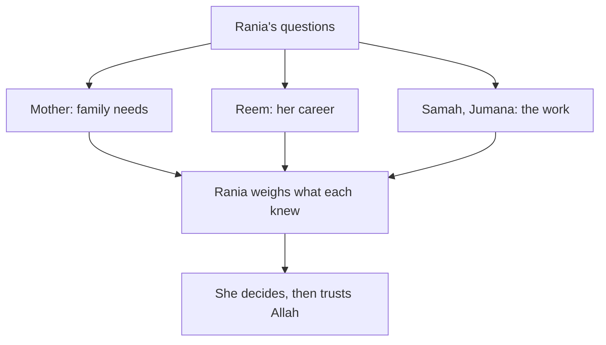

## Fourteen replies

On Sunday night, Rania posts her two offers in the big family group chat. Within an hour there are fourteen replies. An aunt writes, "Take the safe one, a job is a job." A cousin writes, "Money is money, take the startup." An uncle sends a long voice note about a man he knew who once worked for a company abroad that closed. Two people send only a heart. Nobody asks what the work is. Nobody asks what Rania wants.

She closes the phone more tired than before. She did ask people. She did consult. Why does she feel she knows less?

The answer is that she asked for votes, not for knowledge. Fourteen opinions from people who care about her, but who do not know data work, startups or her career, do not add much knowledge. This chapter is about *how* to consult: who to ask, what to ask, how to listen, and why, at the end, the decision is still yours.

## Shura in the Quran and the Sunnah

You met the verse in chapter 5.1: the believers run their affairs by consultation among themselves (Quran 42:38). The shura you met there is praised in the same verse as prayer and giving. A believer who asks for advice is not weak. She is doing what the Quran describes.

The Quran also gives the order of a good decision. Allah told the Prophet, peace be upon him, to consult people in the matter, and once he had decided, to put his trust in Allah, for Allah loves those who trust Him (Quran 3:159).

> وَشَاوِرْهُمْ فِي الْأَمْرِ ۖ فَإِذَا عَزَمْتَ فَتَوَكَّلْ عَلَى اللَّهِ

Meaning: consult them in the matter, and once you have decided, put your trust in Allah (Quran 3:159). Notice the order: consult, decide, trust. Consulting comes before deciding, so you are not deciding alone. Trusting comes after deciding, so you do not go on consulting forever.

The Prophet himself asked the people closest to him for help. After the first revelation came to him, he went home trembling and told his wife Khadijah, may Allah be pleased with her, that he feared for himself (Sahih al-Bukhari 3).

> لَقَدْ خَشِيتُ عَلَى نَفْسِي

Meaning: I feared for myself (Sahih al-Bukhari 3). Khadijah comforted him. She reminded him that Allah would never disgrace him, because he kept family ties, carried the burden of the weak, helped the poor, honoured guests and helped people in real hardship. Then she took him to her cousin Waraqa ibn Nawfal, a man who knew the earlier scriptures.

Look at what happened there, step by step. The Prophet told the person closest to him honestly how he felt. She listened, comforted him and reminded him of the good he did. Then they went together to someone who had knowledge that neither of them had. Care came from his wife; knowledge came from someone who knew the matter. Both were part of the help.

There is a second example. While travelling, when his companions were upset and did not act on his instruction, the Prophet asked his wife Umm Salamah, may Allah be pleased with her, for advice, followed it, and it worked (Sahih al-Bukhari 2731). The best of people asked for advice, listened to it and acted on it. Asking was part of how he led.

## Who to ask: knowledge, care and honesty

A good adviser has three qualities, and few people have all three for every question. **Knowledge** means they know the matter you are asking about: the job, the field, the family, the course. **Care** means they want good for you, not for themselves. **Honesty** means they will tell you what they really think, even when it is not what you hoped to hear.

So different people help with different parts of one decision. Your family knows your family's needs and cares deeply, but may not know your field. A mentor knows careers and wants you to grow, but does not live in your house. Someone who has done the work knows what the days are really like, but may not know you well. Rania needs all three kinds of help. The skill is to ask each person about the part they know best.

When a question is about whether something is allowed in Islam, the person to ask is a scholar you trust. That is also shura: asking the person who has the knowledge.

## What to ask, and how to listen

**Ask a clear question, not "what should I do?".** "What should I do?" invites the other person to make your decision with less information than you have. A better question names the part they know: "What does the family need from me this year?" or "What is the work really like, day to day?". Share the facts you gathered in chapter 5.2, so they are answering the real question.

**Listen to learn, not to win.** Write down what each person says. Do not defend your current favourite. Ask "why do you say that?" when you do not understand. Notice what each person knows that you did not. And thank them: the Prophet taught that whoever does not thank people does not thank Allah (Sunan Abi Dawud 4811, graded sahih).

**Then you decide.** Advisers help you see. They do not carry your decision, and they should not be asked to. The verse says "once you have decided": the deciding is yours. If you follow someone's advice, follow it because you understood it and agree, not to hand the weight to someone else.

```predict
prompt: "Rania can keep asking the family group chat until most people agree, or ask three people one question each about what they know best. Which will give her more useful advice?"
options:
  - id: vote
    label: "The group vote: more voices, more wisdom"
  - id: three
    label: "Three people, each on what they know"
correctOptionId: three
explanation: "A vote counts opinions, and most people in the group chat know neither data work nor startups. Three people asked about what they know best bring facts and care that a vote cannot: the family's needs, the career, and what the work is really like."
```

Step through Rania's consultation below, one person at a time. At each answer, ask yourself what that person knew that nobody else did.

<InteractiveCanvas slug="rania-asks-the-right-people" />

The canvas showed the difference between counting voices and asking for knowledge. The fourteen replies in the group chat gave Rania opinions. Her mother gave her care and two new facts: a worry about the months after a contract ends, and Muath's offer to help Jana. Reem gave her better questions, not an answer. Samah and Jumana gave her facts that no one outside the work could know. And at the last step, the decision stayed with Rania.

## Worked example: Rania's three conversations

**Her mother.** Rania sits with her mother on Monday morning, while Jana is at school. She does not ask "which one should I take?". She asks, "What worries you most, and what does the family need from me this year?". Her mother says her worry is not the startup itself. It is the months after a contract ends, if it is not renewed. "Whatever you choose, save something every month," she says. Then she adds something Rania had not thought of: Muath has a lighter timetable this year and could help Jana with maths on two evenings a week. "I want you to grow too," she says at the end. Rania writes down two new facts and one wish.

**Reem.** On Monday afternoon Rania sends her mentor a short message with the facts from chapter 5.2 and asks, "Which offer will help my career more in three years, and what am I not seeing?". Reem does not answer the first question directly. She asks her own: "What will you be able to do after six months in each job? What is your plan for month six?". She shares what she has seen: a weekly review by a senior analyst is rare and valuable early in a career, and a contract's renewal is never promised, so plan for the end from the first day. Then she writes, "This is your decision. Make it, and trust Allah." Reem gave knowledge and care, and she was honest enough not to choose for Rania.

**Inside the work.** Rania calls Samah, the NGO's data officer, and Jumana, who worked with the startup last year, and asks each the same question: "What is the work really like, day to day?". Samah says the work is steady monthly reports, the team is kind, and nearly everyone is renewed each year, but there is little new to learn. Jumana says the startup now holds team calls on two evenings at 18:00 for people in their region, that they pay on time, and that last year they renewed two of their three contractors. Both are honest about the downsides of their own workplace. That is why their answers are worth so much.

**What changed.** Rania goes back to her page from chapter 5.2. The new call times and Muath's help change one score: free evenings for the startup rise from 2 to 3. With her own weights, the NGO job now has 39 points and the startup 38. The two offers are almost level. She also has a new idea from her mother, saving part of the extra pay, which could make the startup's weak point, steady income, less weak. She now knows exactly what she is weighing. She is ready for the last step before deciding: asking Allah to choose for her.

The diagram shows Rania's consultation as a whole. Each person is asked about a different part of the same decision.



What to notice: the arrows all come back to one box, "Rania weighs what each knew", and only after that does the decision happen. No adviser's arrow goes straight to the decision. The takeaway: shura brings knowledge and care into your decision; it does not move the decision to someone else.

## Where it goes wrong

The first mistake is asking only people who will agree with you. If Rania had called only the friend who loves startups, she would have heard what she already half-wanted, and learned nothing new. Ask at least one person who might see it differently.

The second mistake is asking people who care but do not know, about things they do not know. Rania's aunts love her, and their love is real. But a question about a data career needs someone who knows data careers. Love and knowledge are both needed, often from different people.

The third mistake is letting the adviser decide. Some people ask so that someone else will carry the weight: "I only did what you said." But the verse says "once you have decided", and the decision belongs to the one who will live it. Follow advice because you understood it, not to escape the choice.

The fourth mistake is never stopping. After consulting, some people keep asking more and more people, hoping someone will make the doubt go away. The doubt about the future will not go away, because only Allah knows the future. Consult, decide, then trust.

The fifth mistake is not asking at all, out of pride or because "asking shows weakness". The Prophet told Khadijah about his fear, and he asked Umm Salamah for advice. There is no weakness in that.

## Check your understanding

```quiz
type: mcq
question: "Basma, a junior web developer who works from her family's home, is offered a three-month contract that needs a programming language she has never used. She has two days to answer. Who should she ask, and about what?"
options:
  - "Her whole class group chat, asking whether most of them think she should accept"
  - "A developer who uses that language, about how long it takes to learn it well"
  - "Only her best friend, since a friend who cares is the best adviser for everything"
  - "Nobody at all, since asking others shows she does not trust Allah enough"
correct: 1
explanations:
  - "A vote counts opinions, and most of her classmates may not know the language either. She needs someone with knowledge of this exact question."
  - "Right. This question is about the language and the work, so the best person to ask is someone who knows it. She might also ask her family about the hours, each person about what they know."
  - "Care matters, but her friend may not know the language. Good shura asks each person about what they know best."
  - "The Quran praises believers who run their affairs by consultation (Quran 42:38). Asking people who know is part of taking the means, not a lack of trust."
```

```quiz
type: mcq
question: "Murad, who helps in his uncle's shop, asks his uncle, a respected engineer, about two job offers. His uncle says, 'Take the second one.' Murad has gathered facts that point the other way, and he understands his uncle's reasons but does not agree with them. What does shura mean here?"
options:
  - "He must follow his uncle, since shura means doing what the adviser says"
  - "Asking was a mistake, since he now feels even more unsure than before"
  - "His uncle's view is advice to weigh with his facts; Murad still decides"
  - "He should keep asking people until someone agrees with his own view"
correct: 2
explanations:
  - "Shura means asking for knowledge and care. The verse says 'once you have decided', so the decision stays with the one who will live it."
  - "Hearing a different view is part of good consultation. It may show him something he missed, even if he decides the other way."
  - "Right. Murad listened, understood the reasons and weighed them. Consult, decide, then trust Allah (Quran 3:159): the deciding is his."
  - "Asking until someone agrees is looking for comfort, not knowledge. It also never ends. Consult, decide, then trust."
```

## This week

Pick one decision you face. Write one clear question for each of two people: someone who cares about you, and someone who knows the matter well. Ask at least one of them this week, write down what you learned, and thank them. If no decision is in front of you now, write the questions you would ask in Rania's place, and say which person each question is for.

**Next:** Rania has her facts and her advice, and the two offers are almost level. Istikhara: ask Allah to choose for you.
