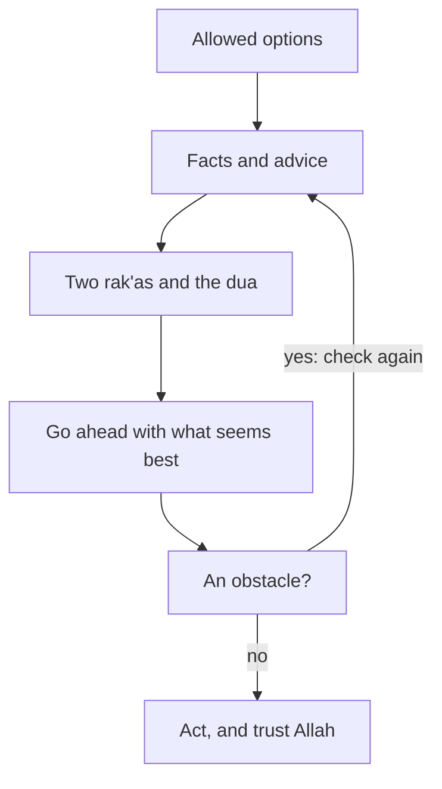

## A green dream

It is Monday evening. Rania has her facts, her advice and her notes. The two offers are almost level: 39 points to 38. She still has to choose, and the NGO wants an answer by Wednesday.

Her friends have plenty to say about istikhara. One tells her, "Pray it and go to sleep. If you dream of something green, take the startup". Another says, "I prayed istikhara once and felt nothing, so it did not work for me". Her cousin says, "Once you pray istikhara, you do not need anyone's advice. Allah will choose". Rania realises she has heard many things about istikhara over the years. She has never checked any of them.

## What the Sunnah teaches

You met the word istikhara in chapter 5.1. Here is what the Sunnah says about it. The companion Jabir ibn Abdullah, may Allah be pleased with him, reported how the Prophet, peace be upon him, taught it. The Prophet used to teach them istikhara for all their matters, the way he taught them a surah of the Quran. He said: when one of you intends to do something, let him pray two <GlossaryTerm term="rak'as" definition="Units of the prayer. Each rak'a has standing, bowing and prostration." /> that are not obligatory, and then say the dua, naming the matter (Sahih al-Bukhari 1166).

So the practice has two parts. First, two rak'as that are not obligatory. Second, the dua the Prophet taught, in which you name the matter you are deciding about. This is the dua, as narrated in Sahih al-Bukhari:

> اللَّهُمَّ إِنِّي أَسْتَخِيرُكَ بِعِلْمِكَ وَأَسْتَقْدِرُكَ بِقُدْرَتِكَ، وَأَسْأَلُكَ مِنْ فَضْلِكَ الْعَظِيمِ، فَإِنَّكَ تَقْدِرُ وَلاَ أَقْدِرُ وَتَعْلَمُ وَلاَ أَعْلَمُ وَأَنْتَ عَلاَّمُ الْغُيُوبِ، اللَّهُمَّ إِنْ كُنْتَ تَعْلَمُ أَنَّ هَذَا الأَمْرَ خَيْرٌ لِي فِي دِينِي وَمَعَاشِي وَعَاقِبَةِ أَمْرِي ـ أَوْ قَالَ عَاجِلِ أَمْرِي وَآجِلِهِ ـ فَاقْدُرْهُ لِي وَيَسِّرْهُ لِي ثُمَّ بَارِكْ لِي فِيهِ، وَإِنْ كُنْتَ تَعْلَمُ أَنَّ هَذَا الأَمْرَ شَرٌّ لِي فِي دِينِي وَمَعَاشِي وَعَاقِبَةِ أَمْرِي ـ أَوْ قَالَ فِي عَاجِلِ أَمْرِي وَآجِلِهِ ـ فَاصْرِفْهُ عَنِّي وَاصْرِفْنِي عَنْهُ، وَاقْدُرْ لِي الْخَيْرَ حَيْثُ كَانَ ثُمَّ أَرْضِنِي بِهِ

Meaning: O Allah, I ask You to choose for me by Your knowledge, and to give me ability by Your power, and I ask from Your great favour. You are able and I am not; You know and I do not; You are the Knower of the unseen. O Allah, if You know this matter is good for me in my religion, my living and my outcome, decree it for me. Make it easy for me, and bless it for me. And if You know it is bad for me in my religion, my living and my outcome, turn it away from me and turn me away from it. Decree the good for me wherever it is, and make me content with it (Sahih al-Bukhari 1166). Where the dua says "this matter", you name your own choice.

## What the dua asks for

Read the dua slowly and you will see that it already answers many of Rania's worries.

It begins by asking Allah to choose "by Your knowledge" and to give ability "by Your power". You are not asking for a sign. You are asking the One who knows to choose, and the One who is able to make it happen.

Then it says plainly: You know and I do not; You are the Knower of the unseen. This is the same truth you met in module 1. Only Allah knows what tomorrow brings (Quran 31:34). Rania cannot see whether the startup will renew her contract. The dua puts that unknown with Allah.

It asks about three areas, not one: "my religion, my living and my outcome". A good choice is not only the one that pays more. It is good for your faith, for your daily life, and for where it leads.

It asks Allah to turn the bad option away from you, and to turn you away from it. That second part matters. You are asking not only for the bad option to be taken away, but for a heart that does not keep looking back at it.

And it ends by asking Allah to decree the good wherever it is, and to make you content with it. That is the answer to the "if only" you met in chapter 1.4. Before the decision is even made, you have asked to be content with what comes.

```predict
prompt: "On Monday night Rania prays istikhara about the startup contract. She sleeps, and she does not dream about either job. Before you step through: does she need a dream before she can decide?"
options:
  - id: no-dream
    label: "No: she can decide well without a dream"
  - id: dream
    label: "Yes: a dream would show her the answer"
correctOptionId: no-dream
explanation: "No sound text requires a dream or a sign after istikhara, and the hadith itself has no dream in it. Rania has done her part: the facts, the advice and the prayer. She can go ahead with what seems best."
```

Step through the whole order below, from checking that the options are allowed to acting on the decision.

<InteractiveCanvas slug="istikhara-in-order" />

The canvas placed istikhara inside the decision, not on its own. Facts and advice came first, then the prayer and the dua, then going ahead and watching whether the way opens. Two moves were refused: istikhara about something that is not allowed, and waiting for a dream. When no dream came, Rania did not wait. On Tuesday she read her notes again. Her biggest worry about the startup was a steady income. So she planned to save 500 shekels of the startup's higher pay every month, and Samah agreed to keep her CV for the NGO's next opening. With that backup, the startup seemed best to her, and she accepted. She asked for the 18:00 calls in writing and thanked the NGO the same day. By Wednesday the startup had agreed and sent the contract, and she signed it.

## What istikhara is, and what it is not

**It is for choosing between allowed things.** Istikhara is for choosing between things that are allowed, such as two job offers. You do not make istikhara about whether to pray, or whether to do something wrong. Those questions already have answers. If you are not sure whether an option is allowed, ask a scholar you trust first, as you saw in chapter 5.2.

**It does not need a dream.** No dream or sign is required. The hadith has no dream in it, and every source this course checked agrees on this point. If you sleep and dream of nothing, nothing is missing.

**It goes with research and advice, not instead of them.** You study the matter and you consult people as well. Rania's facts and her conversations were not a lack of trust. They were her part. Istikhara brings the choice to Allah after she has done that part.

## After istikhara

What do you do next? This is the course's wording, built on the sources it checked. First learn about the choice and ask people who know. Then pray istikhara and ask Allah to choose. You do not need a dream. Then go ahead with what seems best, and watch whether the way opens: whether the steps become easy, or keep meeting obstacles. An obstacle is a reason to check the facts and the plan again. It is not a verdict from Allah.

<Callout type="info" title="Where scholars differ">
Scholars differ on how much weight to give a feeling in the heart after istikhara. Ask a scholar you trust if you are unsure. You may repeat istikhara; this course does not give a number of times.
</Callout>

Once you have decided, the Quran tells you what comes next: put your trust in Allah (Quran 3:159). Istikhara does not promise that no hard days will come. It asks Allah to choose the good and to make you content with it. If a hard day comes later, it does not mean your istikhara went wrong. As you saw in chapter 1.3, hardship cannot be read as proof that Allah is angry with you.

## Worked example: Najwa meets an obstacle

Najwa is 26 and teaches English at a girls' school. For the summer she has two allowed offers. A language centre in her town offers her two months of morning classes for 1,800 shekels. An online tutoring company offers her evening lessons with students abroad, which would pay about 2,600 shekels for the same two months. The online work needs a steady internet connection for four evening hours, five days a week.

She takes the means first. She checks the facts with both employers and asks a friend who tutored for the same company last year. The friend says the students are kind and the pay arrives on time. Her mother tells her that the family can manage either way. Then Najwa prays two rak'as and says the istikhara dua, naming the online tutoring. She does not dream of anything, and she does not wait. The online work seems best, because of the pay, so she goes ahead and accepts.

Then the steps stop being easy. The company asks for a recorded test lesson. During the test, her home connection drops twice. Najwa remembers that an obstacle is a reason to check the facts and the plan again, not a verdict. So she checks. She asks her neighbours how often the connection drops in the evenings. She learns it drops on most evenings, for ten to twenty minutes at a time. She asks the company whether lessons can be moved when that happens. They say no: lessons must start on time, every time.

Now she has a new fact that she did not have before. The online work needs something her area cannot give her this summer. That is not a sign that Allah is displeased with her, or that her istikhara failed. It is a fact about her internet connection. She writes to the company, thanks them and withdraws. Then she asks the language centre whether its offer is still open, and it is. She takes the morning classes, and she asks Allah to bless them and to make her content.

Look at what Najwa did and did not do. She did not wait for a dream. She did not treat the first obstacle as a verdict from Allah. She also did not carry on as if it were not there. She treated it as a question about her facts, found the answer, and acted on it. That is going ahead with what seems best, and watching whether the way opens, done with a clear head.

The diagram shows the order both Rania and Najwa followed, with the place where an obstacle sends you back.



Follow the arrow back from "An obstacle?". It does not lead to "Allah has said no", and it does not lead to "ignore it". It leads back to the facts and advice, which is where Najwa went. For Rania there was no obstacle, so her arrow went straight on to acting and trusting. The same order fits both stories.

## Where it goes wrong

The first mistake is waiting for a dream or a strong sign before doing anything. Days pass, the deadline passes, and the choice is made by the deadline passing instead of by the person. No dream is required.

The second mistake is using istikhara to skip the work. "I prayed istikhara, so I did not need to read the contract" mixes up two things that belong together. You study and consult as well.

The third mistake is making istikhara about something that is not allowed, hoping for permission. Another form is making it about a clear duty, hoping to be excused. Istikhara is for choosing between allowed things.

The fourth mistake is reading every later difficulty as proof that the istikhara failed. If Rania's contract is not renewed in six months, that does not mean she chose wrong. The dua asked for the good wherever it is, and for contentment with it. Her savings and the NGO's open offer to keep her CV are her backup. "Allah decreed, and He did what He willed" is her answer to "if only" (Sahih Muslim 2664).

## Check your understanding

```quiz
type: mcq
question: "Odai, a final-year student who lives with his family, must choose between two allowed internships. He prays istikhara on Sunday night. Afterwards he decides he does not need to read the two internship plans or ask his tutor, because Allah will now choose for him. What fits the teaching?"
options:
  - "He reads the plans and asks his tutor, as well as praying"
  - "He waits for a sign before he reads anything about the two places"
  - "He is right, since the choosing is now with Allah and not with him"
  - "He reads the plans, but asking his tutor would show weak trust"
correct: 0
explanations:
  - "Right. Every source this course uses agrees that a person studies the matter and consults people as well as praying istikhara. Taking the means is his part."
  - "No dream or sign is required for istikhara. Reading the plans is his part, whether or not anything comes to him."
  - "He asked Allah to choose, and that is good. But the Quran's order is to consult, decide and then trust (Quran 3:159). His part does not stop when he prays."
  - "Reading is half of the means. Asking people who know is the other half, and the Quran praises consultation (Quran 42:38). It is not weak trust."
```

```quiz
type: mcq
question: "Sundus, who writes posts for small businesses from her home, is offered well-paid work by a company. She is not sure whether the company's main product is allowed. She plans to pray istikhara so that the answer will show her whether it is allowed. What fits the teaching?"
options:
  - "Pray istikhara, and if she feels at ease afterwards, take the work"
  - "Accept at once, since an offer that reaches her is her provision"
  - "Ask a scholar she trusts first; istikhara is for allowed choices"
  - "Refuse this offer and others like it, to stay clear of doubt"
correct: 2
explanations:
  - "Istikhara is for choosing between allowed things. Whether something is allowed is a question for a scholar, not for a feeling after prayer."
  - "Provision comes from Allah, but that does not make each offer allowed. When she is unsure, she asks someone with knowledge."
  - "Right. When she is unsure whether an option is allowed, she asks a scholar she trusts. If it is allowed, she can then weigh it and pray istikhara about the choice."
  - "Most writing work is ordinary and allowed. One doubtful offer is a reason to ask a scholar about that offer, not to give up a kind of work."
```

## This week

Read the meaning of the istikhara dua once a day this week, slowly, and notice one phrase that speaks to you. Is a decision in front of you, with options you have checked, facts you have gathered and people you have asked? Then pray istikhara this week, and go ahead with what seems best. If no decision is in front of you, write down one choice you expect in the coming months. Next to it, write the people you would ask before praying about it.

**Next:** Five short cases to check how you decide: facts, shura, istikhara, and acting with trust.
