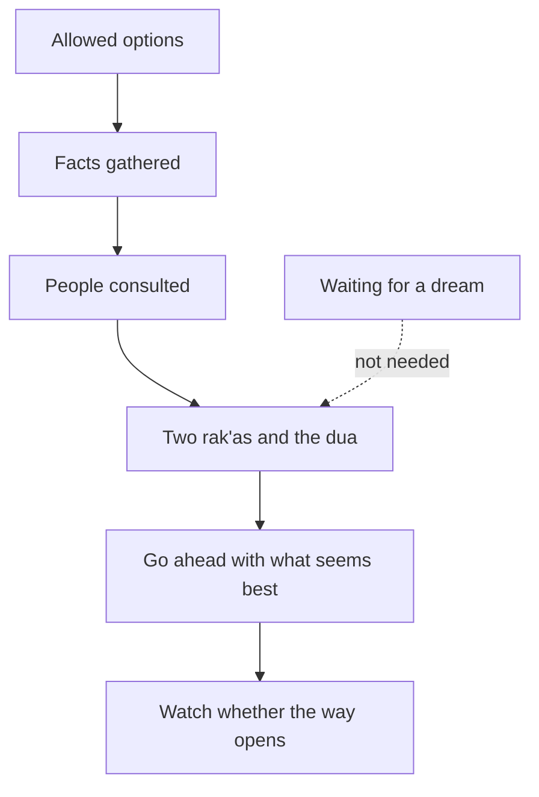

## A green dream

It is Monday evening. Rania has her facts, her advice and her notes. The two offers are almost level: 39 points to 38. She still has to choose, and the NGO wants an answer by Wednesday.

Her friends have plenty to say about istikhara. One tells her, "Pray it and go to sleep. If you dream of something green, take the startup." Another says, "I prayed istikhara once and felt nothing, so it did not work for me." Her cousin says, "Once you pray istikhara, you do not need anyone's advice. Allah will choose." Rania realises she has heard many things about istikhara over the years, and she has never checked any of them.

```predict
prompt: "Rania's cousin says that once she prays istikhara, she will not need the facts she gathered or the people she asked: 'Allah will choose, so why ask anyone?' Is that what the Sunnah teaches?"
options:
  - id: still-ask
    label: "No: she still studies it and asks people"
  - id: replaces
    label: "Yes: istikhara takes the place of advice"
correctOptionId: still-ask
explanation: "Every source this course uses agrees that a person studies the matter and consults people as well as praying istikhara. Istikhara asks Allah to choose; it does not replace the means of knowing or shura. The Quran's order is to consult, decide, and then trust Allah (Quran 3:159)."
```

## What the Sunnah teaches

The companion Jabir ibn Abdullah, may Allah be pleased with him, said that the Prophet, peace be upon him, used to teach them istikhara for all their matters, the way he taught them a surah of the Quran. He said: when one of you intends to do something, let him pray two <GlossaryTerm term="rak'as" definition="Units of the prayer. Each rak'a has standing, bowing and prostration." /> that are not obligatory, and then say the dua, naming the matter (Sahih al-Bukhari 1166).

So the practice has two parts. First, two rak'as that are not obligatory. Second, the dua the Prophet taught, in which you name the matter you are deciding about. This is the dua, as narrated in Sahih al-Bukhari:

> اللَّهُمَّ إِنِّي أَسْتَخِيرُكَ بِعِلْمِكَ وَأَسْتَقْدِرُكَ بِقُدْرَتِكَ، وَأَسْأَلُكَ مِنْ فَضْلِكَ الْعَظِيمِ، فَإِنَّكَ تَقْدِرُ وَلاَ أَقْدِرُ وَتَعْلَمُ وَلاَ أَعْلَمُ وَأَنْتَ عَلاَّمُ الْغُيُوبِ، اللَّهُمَّ إِنْ كُنْتَ تَعْلَمُ أَنَّ هَذَا الأَمْرَ خَيْرٌ لِي فِي دِينِي وَمَعَاشِي وَعَاقِبَةِ أَمْرِي ـ أَوْ قَالَ عَاجِلِ أَمْرِي وَآجِلِهِ ـ فَاقْدُرْهُ لِي وَيَسِّرْهُ لِي ثُمَّ بَارِكْ لِي فِيهِ، وَإِنْ كُنْتَ تَعْلَمُ أَنَّ هَذَا الأَمْرَ شَرٌّ لِي فِي دِينِي وَمَعَاشِي وَعَاقِبَةِ أَمْرِي ـ أَوْ قَالَ فِي عَاجِلِ أَمْرِي وَآجِلِهِ ـ فَاصْرِفْهُ عَنِّي وَاصْرِفْنِي عَنْهُ، وَاقْدُرْ لِي الْخَيْرَ حَيْثُ كَانَ ثُمَّ أَرْضِنِي بِهِ

Meaning: O Allah, I ask You to choose for me by Your knowledge, and to give me ability by Your power, and I ask from Your great favour. You are able and I am not; You know and I do not; You are the Knower of the unseen. O Allah, if You know this matter is good for me in my religion, my living and my outcome, decree it for me, make it easy, and bless it for me. And if You know it is bad for me in my religion, my living and my outcome, turn it away from me and turn me away from it, decree the good for me wherever it is, and make me content with it (Sahih al-Bukhari 1166). Where the dua says "this matter", you name your own choice.

## What the dua asks for

Read the dua slowly and you will see that it already answers many of Rania's worries.

It begins by asking Allah to choose "by Your knowledge" and to give ability "by Your power". You are not asking for a sign. You are asking the One who knows to choose, and the One who is able to make it happen.

Then it says plainly: You know and I do not; You are the Knower of the unseen. This is the same truth you met in module 1. Only Allah knows what tomorrow brings (Quran 31:34). Rania cannot see whether the startup will renew her contract. The dua puts that unknown where it belongs.

It asks about three areas, not one: "my religion, my living and my outcome". A good choice is not only the one that pays more. It is good for your faith, for your daily life, and for where it leads.

It asks Allah to turn the bad option away from you, and to turn you away from it. That second part matters. You are asking not only for the bad option to be taken away, but for a heart that does not keep looking back at it.

And it ends by asking Allah to decree the good wherever it is, and to make you content with it. That is the answer to the "if only" you met in chapter 1.4. Before the decision is even made, you have asked to be content with what comes.

## What istikhara is, and what it is not

**It is for choosing between allowed things.** Istikhara is for choosing between things that are allowed, such as two job offers. You do not make istikhara about whether to pray, or whether to do something wrong. Those questions already have answers. If you are not sure whether an option is allowed, ask a scholar you trust first, as you saw in chapter 5.2.

**It does not need a dream.** No dream or sign is required. The hadith has no dream in it, and every source this course checked agrees on this point. If you sleep and dream of nothing, nothing is missing.

**It goes with research and advice, not instead of them.** You study the matter and you consult people as well. Rania's facts and her three conversations were not a lack of trust. They were her part. Istikhara brings the choice to Allah after she has done that part.

## After istikhara

What do you do next? This is the course's wording, built on the sources it checked: first learn about the choice and ask people who know. Then pray istikhara and ask Allah to choose. You do not need a dream. Then go ahead with what seems best and watch whether the way opens: whether the steps become easy, or keep meeting obstacles.

<Callout type="info" title="Where scholars differ">
Scholars differ on how much weight to give a feeling in the heart after istikhara. Ask a scholar you trust if you are unsure. You may repeat istikhara; this course does not give a number of times.
</Callout>

Once you have decided, the Quran tells you what comes next: put your trust in Allah (Quran 3:159). Istikhara does not promise that the road will have no hard days. It asks Allah to choose the good and to make you content with it. If a hard day comes later, it does not mean your istikhara went wrong. Hardship is not a sign of Allah's anger, as you saw in chapter 1.3.

Step through the whole order below, from checking that the options are allowed to acting on the decision. Before you start, check your prediction.

<InteractiveCanvas slug="istikhara-in-order" />

The canvas placed istikhara inside the decision, not on its own. Facts and advice came first, then the prayer and the dua, then going ahead and watching whether the way opens. Two moves were refused: istikhara about something that is not allowed, and waiting for a dream. When no dream came, Rania did not wait, and she still met both deadlines.

## Worked example: Rania decides

**Monday night.** After her other prayers, Rania prays two rak'as that are not obligatory. Then she says the dua slowly, reading from her phone, and where the dua says "this matter", she names it: "taking the six-month contract with the startup". She asks with the whole of what she has learned in her mind: the facts, her mother's worry, Reem's questions, Samah's and Jumana's answers. Then she sleeps.

**Tuesday morning.** She does not dream about either job. She remembers what she learned: nothing is missing. She reads her notes again and asks what seems best now. Her biggest worry about the startup was steady income. Her mother's idea of saving changes that. The startup pays about 3,100 shekels at this month's rate. After 150 shekels for the workspace, that leaves 2,950, which is 550 more than the NGO's 2,400. If she saves 500 shekels of that every month, she will have 3,000 shekels after six months. That is more than one month of the NGO's salary, set aside for the months after the contract if it is not renewed.

She also messages Samah to ask whether she could apply again at the NGO's next opening. Samah says yes, and that she will keep Rania's CV. Muath agrees to help Jana with maths on the two evenings of team calls. With these steps, the startup's weak point is less weak. Learning, which matters a lot to her, is where the startup is strongest. So the startup contract seems best to her, and she goes ahead.

**Tuesday afternoon.** She writes to the startup to accept, and asks for the calls on two evenings at 18:00, as Jumana described, to be written into the contract. She writes to the NGO the same day, thanks them warmly, and tells them her decision a day before their deadline.

**Wednesday.** The startup agrees to the call times and sends the contract. The steps are easy, and she signs. The way has opened. She makes dua that Allah blesses it, and she puts her trust in Him. She does not know how the six months will end. She does know that she did her part.

Two more things are worth seeing. If the startup had refused the call times, or sent a contract with terms she could not accept, the way would not have opened in the same way, and the NGO's offer was still there until Wednesday. Either way, she would not have needed a dream to see it. And if Rania had chosen the NGO job with the same care, that would have been a good decision too. A careful decision is not measured by which option it picks.

The diagram shows the order Rania followed. The dotted line is the step she did not take.



What to notice: istikhara sits in the middle of the chain, with Rania's own work before it and her own action after it. Nothing points from istikhara back to "wait". The dream box is outside the chain, joined only by a dotted line marked "not needed". The takeaway: istikhara is part of deciding well, between taking the means and acting with trust.

## Where it goes wrong

The first mistake is waiting for a dream or a strong sign before doing anything. Days pass, the deadline passes, and the choice is made by the deadline passing instead of by the person. No dream is required.

The second mistake is using istikhara to skip the work. "I prayed istikhara, so I did not need to read the contract" mixes up two things that belong together. You study and consult as well.

The third mistake is making istikhara about something that is not allowed, hoping for permission, or about a clear duty, hoping to be excused. Istikhara is for choosing between allowed things.

The fourth mistake is reading every later difficulty as proof that the istikhara failed. If Rania's contract is not renewed in six months, that does not mean she chose wrong or that Allah turned away from her. The dua asked for the good wherever it is and for contentment with it. Her savings and the NGO's open door are her backup, and "Allah decreed, and He did what He willed" is her answer to "if only" (Sahih Muslim 2664).

## Check your understanding

```quiz
type: mcq
question: "Odai, a final-year student who lives with his family in a small flat, prays istikhara about two allowed internships: one at a design studio and one at a software company. He has gathered facts and asked two people. Three days later he has had no dream and feels about the same about both. What fits the teaching?"
options:
  - "Wait for a dream, since that is how the answer to istikhara comes"
  - "Go ahead with what seems best from his facts; no dream is needed"
  - "Decide that istikhara did not work for him, and stop praying it"
  - "Let his friends vote, since no clear answer came to him in sleep"
correct: 1
explanations:
  - "No sound text requires a dream or a sign after istikhara. Waiting for one may cost him both internships."
  - "Right. He has done his part and prayed istikhara. He can go ahead with what seems best and watch whether the way opens. Nothing is missing because he had no dream."
  - "Istikhara asks Allah to choose; it is not a test that 'works' only with a sign. Feeling the same about both is common, and he may repeat it if he wishes."
  - "A vote does not add knowledge, and the decision is his. He already has facts and advice; now he goes ahead with what seems best."
```

```quiz
type: mcq
question: "Sundus, who writes posts for small businesses from her home in a busy neighbourhood, is offered well-paid work by a company. She is not sure whether the company's main product is allowed. She plans to pray istikhara so that the answer will show her whether it is allowed. What fits the teaching?"
options:
  - "Pray istikhara: if she feels at ease afterwards, the work is allowed"
  - "Accept at once, since any offer that reaches her is her provision"
  - "Refuse every writing job from now on, so she is never in doubt again"
  - "Ask a scholar she trusts first; istikhara is for allowed choices"
correct: 3
explanations:
  - "Istikhara is for choosing between allowed things. Whether something is allowed is a question for a scholar, not for a feeling after prayer."
  - "Provision comes from Allah, but that does not make every offer allowed. When she is unsure, she asks someone with knowledge."
  - "Most writing work is ordinary and allowed. One doubtful offer is a reason to ask a scholar about that offer, not to give up her work."
  - "Right. When she is unsure whether an option is allowed, she asks a scholar she trusts. If it is allowed, she can then weigh it and pray istikhara about the choice."
```

## This week

Read the meaning of the istikhara dua once a day this week, slowly, and notice one phrase that speaks to you. If a decision is in front of you, and you have checked that the options are allowed, gathered the facts and asked people, pray istikhara this week, and then go ahead with what seems best. If no decision is in front of you, write down one choice you expect in the coming months, and the people you would ask before praying about it.

**Next:** Five short cases to check how you decide: facts, shura, istikhara, and acting with trust.
