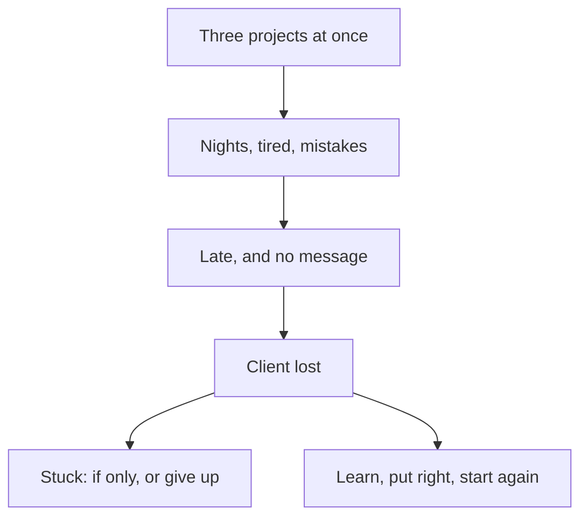

<BigWordAlert term="Niyyah" plainEnglish="Intention: what you are aiming for in your heart when you act." whyItMatters="The Prophet, peace be upon him, taught that actions are by their intentions. With a good intention, ordinary work and study can become worship, and a setback does not wipe out the good you aimed for." />

## Three yeses in one week

Tariq is 26. He has worked as a freelance web developer for four years, and he helps support his mother and his two younger brothers. Most months he has two or three regular clients. Last month, two of them went quiet at the same time. No new work, no replies. Tariq began to worry about the rent.

Then, in one week, three new projects arrived, and he said yes to all of them. The first was a booking website for a small travel agency abroad: $1,200, paid in two halves, due on the 20th of the month. The second was fixing the checkout of an online clothing shop: $400, due in three weeks. The third was a landing page for a language school abroad: $300, due at the end of the month. Together they were more money than he had earned in the last two months.

```predict
prompt: "Tariq has said yes to all three projects, and they fall due in the same month. Before you read on: if he works hard every night, could he still fall behind?"
options:
  - id: can-fall-behind
    label: "Yes: a plan with no spare room can fail"
  - id: hard-work-covers
    label: "No: hard work every night will cover it"
correctOptionId: can-fall-behind
explanation: "Hard work cannot make more hours. Tariq's plan counted only the hours each project takes if nothing goes wrong, and power came for only a few hours a day. One bug that takes two days to find would use up the room he had left, and there was none. The next section shows what happened."
```

When he planned the work, Tariq counted the hours each project would take if everything went well. Nothing in his plan allowed for a bug that takes two days to find, or a client who changes their mind. And power at home came for only a few hours a day, at different times. He worked whenever it came, often late at night.

## Falling behind

By the 12th, Tariq knew the booking website was behind. The booking form did not save dates correctly, and he could not find out why. The clothing shop owner was calling every day. He slept four hours a night, made mistakes, fixed them, and made new ones. He was tired in a way that made simple things hard.

He did not tell the travel agency's owner. He told himself he would catch up at the weekend, and that there was no need to worry anyone. If he is honest, he was ashamed to admit he was late. The 20th came and went without a message from him.

On the 23rd, the owner wrote: "Is everything all right?" Tariq replied, "Almost done". On the 29th, he delivered the website, nine days late, and the booking form still had two bugs. The owner had paid the first $600 at the start. He did not pay the second half. He thanked Tariq politely, ended the contract, and hired another developer to finish the site. His last message said: "The delay was hard for us. The silence was harder".

## Two voices

In the days after, Tariq hears two voices in his head. The first says, "If only I had said no to the language school. If only I had started the booking form first. If only I had slept more." It repeats itself again and again, and it never ends in a plan.

The second voice is quieter and heavier. It says, "Maybe I am not made for this work. Maybe I should stop freelancing." He avoids opening his laptop. His mother notices that he is not eating well, and asks what is wrong. He says, "Nothing, just tired."

Both voices are common after a failure, and both feel like the truth. But neither one helps Tariq do anything better tomorrow. The first keeps him stuck in the past. The second tells him there is no tomorrow worth trying for. This module is about a third way, the one the Quran and the Sunnah teach.

## The study circle

On Saturday evening, Tariq tells the study circle what happened. He tells it plainly, including the silence. When he finishes, Reem thanks him for being honest. "That took courage," she says. Then she asks him three questions. "Why do you do this work? What would doing it well have looked like this month? And what will you do differently, starting tomorrow?"

Tariq answers the first question quickly: "To pay the rent." Reem says that is a real and good reason, and asks if there is more. He thinks for a while. "To look after my mother and my brothers. To build things that help people. And I want Allah to be pleased with how I earn." Reem says, "Then you have more reasons than you thought."

She also says something that surprises him. "Losing a client is not a sin. Clients come and go for many reasons. But staying silent when you knew you were late was a wrong to the client, and a wrong is something you put right. Those are two different things. Do not mix them up."

The diagram shows what happened to Tariq, and the two ways he can go from here.



Read the top half first. The failure did not start on the 20th. It started in the first week, with three yeses, and grew through tired nights and a silence. So the way forward is not only about the lost client. It is about how Tariq takes on work, how he works each day, and how he speaks to clients when things go wrong. The two boxes at the bottom are the choice in front of him now: stay stuck, or learn and start again.

## Why do you work?

The Prophet, peace be upon him, taught that actions are judged by their intentions, and each person will have what he intended (Sahih al-Bukhari 1).

> إِنَّمَا الأَعْمَالُ بِالنِّيَّاتِ، وَإِنَّمَا لِكُلِّ امْرِئٍ مَا نَوَى

Meaning: actions are only by intentions, and each person will have only what he intended (Sahih al-Bukhari 1).

This is *niyyah*. Tariq's first answer, "to pay the rent", is not wrong. Providing for your family is a good aim, and chapter 6.2 shows that the Sunnah honours it. But look at how his month went. It was driven by one aim only: do not run out of money. That fear said yes to three projects at once. That fear stayed silent when he fell behind.

His fuller answer, to look after his family, to build things that help people, and to please Allah in how he earns, would have asked different questions. Can I do all three well? Am I serving these clients, or only their money? What would honest work look like when I fall behind? The work would be the same kind of work. The aim would change how he does it.

## What this module covers

Chapter 6.2 is about intention: why you do the work. You will see how a sincere intention can turn daily work and study into worship, and how the Sunnah honours spending on your family. You will also see why a good intention still counts when something outside your control stops you. You will also see why intention is never a test you can fail.

Chapter 6.3 is about doing good work a little and often. You will meet *ihsan*, doing a thing well, which Allah has prescribed in everything. You will also meet the teaching that the deeds most beloved to Allah are the ones kept up, even if small. You will see why taking on too much is a trap, and why a small daily habit survives bad days that a big weekly plan does not.

Chapter 6.4 is about what to do after a failure. You will learn to keep a failure and a wrong apart, and to put right what you can with the people affected. You will learn so it does not happen twice, leave "if only", and turn back to Allah where you did wrong, which is *tawbah*. Then you start again.

At the end of the module you will write a fresh start plan for one real or provided setback.

## Why this matters for your work

Almost everyone who works or studies will miss a deadline, fail an exam, lose a client or let someone down at some point. That is not a sign that you are unfit for the work. What matters is what happens next. Some people quit. Some carry on in the same way and fail again in the same place. Some carry the failure for years as shame. The Sunnah teaches a different response: honest, practical and full of hope.

If a failure leaves you feeling low for a long time, you are not alone, and you do not have to carry it by yourself. If you feel overwhelmed for a long time, or you have thoughts of harming yourself, talk to your mentor or the fellowship coordinator today. Talk to a doctor or counsellor too, if you can. This course does not replace professional care.

<LearningObjectives items={["Set a sincere intention for your work and study, and explain how it changes what success and failure mean", "Do work with ihsan, and keep small, consistent habits that survive bad days instead of taking on too much", "Keep a failure and a wrong apart, put right what you can, and learn so it does not happen twice", "Leave 'if only', turn back to Allah where you did wrong, and start again", "Write a fresh start plan for one real or provided setback"]} />

## Key words

| Word | Plain English |
|---|---|
| ***Ihsan*** | Doing a thing well and beautifully, as well as you can, in everything |
| **Consistency** | Keeping a good deed or habit going over time, even if it is small |
| **Overload** | Taking on more than your time, energy and power can carry |
| **Setback** | A failure in your work or study, such as a lost client or a failed exam. A setback is not a sin |
| ***Tawbah*** | Turning back to Allah after a wrong: stopping, regretting, asking forgiveness and not persisting |

## What is in this module

| Chapter | You will practise |
|---|---|
| 6.2 | Setting a sincere intention, and seeing how it changes the same day of work |
| 6.3 | Ihsan, and small daily habits that survive bad days |
| 6.4 | Starting again after a failure: honest, put right, learned, no "if only" |
| 6.5 | A graded quiz with five short cases |
| 6.6 | A fresh start plan for a real or provided setback |

**Next:** Tariq's first question: why does he do this work at all? Intention: why you do the work.
