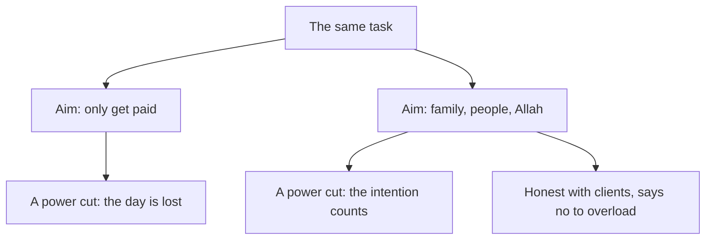

## What was it all for?

A few days after the study circle, Tariq sits with his notebook and adds up his month. Three weeks of late nights. One client lost. $600 he was counting on, gone. Two projects still to finish. "What was all that work for?" he writes at the bottom of the page. The month feels wasted, with nothing to show for it.

His question is a real one, and it has two meanings. The first is "what did I get?". The answer to that is painful: less money than he hoped and a lost client. The second is "what was I doing it for?". Reem asked him that at the circle, and his answer grew from "to pay the rent" into something larger. This chapter is about the second meaning, and about how the answer to it changes the first.

```predict
prompt: "Two freelancers in the same shared office do exactly the same work today: the same tasks, the same hours, the same pay. One works only to get paid. The other also aims to provide for his family and to please Allah in how he earns. Is the day the same for both of them?"
options:
  - id: same-day
    label: "Yes: the same work makes the same day"
  - id: aim-changes
    label: "No: the aim changes what the day is"
correctOptionId: aim-changes
explanation: "The Prophet, peace be upon him, taught that actions are by intentions, and each person will have what he intended (Sahih al-Bukhari 1). The tasks are the same, but for the second freelancer the same day is also worship. Nothing about the work has to look different from the outside."
```

## Actions are by intentions

The companion Umar ibn al-Khattab, may Allah be pleased with him, reported that the Prophet, peace be upon him, said: actions are only by intentions, and each person will have what he intended (Sahih al-Bukhari 1). You met this hadith in chapter 6.1, as the source of niyyah.

It is a short sentence with a large meaning. Two people can do the same outward act and have different deeds, because they aimed at different things. The hadith goes on to give an example: a person who moved to another land for something of this world, or to marry someone, has what he moved for. The act was the same as other people's. The aim decided what it was.

The Quran tells us why we were created: Allah created jinn and humans only to worship Him (Quran 51:56). Worship here is not only the prayer and the fast. When your intention is good, your daily work and study can be worship too: building a website, writing a report, studying for an exam, serving a customer. This is one of the most hopeful teachings in the whole course for people who work long hours. Your hours are not lost to your faith. They can be part of it.

## Providing for your family is a good deed

Some people feel that work for money is separate from their religion: the prayer is for Allah, the job is for the bills. The Sunnah does not divide life that way. The Prophet told the companion Sa'd ibn Abi Waqqas, may Allah be pleased with him, that whatever he spent seeking Allah's pleasure would be rewarded, even the food he put in his wife's mouth (Sahih al-Bukhari 56).

> إِنَّكَ لَنْ تُنْفِقَ نَفَقَةً تَبْتَغِي بِهَا وَجْهَ اللَّهِ إِلَّا أُجِرْتَ عَلَيْهَا حَتَّى مَا تَجْعَلُ فِي فَمِ امْرَأَتِكَ

Meaning: you will not spend anything seeking Allah's pleasure except that you are rewarded for it, even the food you put in your wife's mouth (Sahih al-Bukhari 56).

So Tariq's first answer, "to pay the rent", was never small. When he earns to look after his mother and brothers, and spends on them seeking Allah's pleasure, that spending is a good deed. The money is the same money. The intention makes it worship.

## When something stops you

Fellows know this situation well. You plan a good thing, and something outside your control stops it: a power cut, a closed road, an illness in the family. The Prophet taught that whoever intends a good deed and does not do it, a good deed is written for him (Sahih Muslim 130).

> مَنْ هَمَّ بِحَسَنَةٍ فَلَمْ يَعْمَلْهَا كُتِبَتْ لَهُ حَسَنَةً

Meaning: whoever intends a good deed and does not do it, it is written for him as a good deed (Sahih Muslim 130).

This does not mean that intending is enough when you could act and choose not to. It means that when a good plan is stopped by something you could not control, the good you intended is not wasted. When the power goes in the middle of your work, the afternoon is not wasted. The intention still counts.

## Intention is not a test you can fail

Some people hear "actions are by intentions" and become afraid. "What if my intention is not pure? What if I also want the money, or want people to think well of me?" They start to doubt every piece of work, or wait to begin until their heart feels perfectly clean. That is not what these hadith teach. They are given to encourage believers, not to frighten them.

Wanting to earn is not wrong. Wanting your work to be good enough that people notice is human. You do not have to remove every other wish before your work can be worship. You add the good intention, you renew it when you remember, and you begin. If you notice your aim slipping, you set it again. That is all. Never tell yourself, or anyone else, that work is worthless because the intention was not perfect.

Now step through one ordinary working day for Tariq, read under two different aims. Start by checking your prediction.

<InteractiveCanvas slug="same-work-two-intentions" />

The canvas kept every task the same: the same form, the same honest message, the same power cut, the same $150, the same money given to his mother. Under the aim "finish the list and get paid", those are just tasks, and the afternoon lost to the power cut is simply lost. Under the aim "provide for my family, serve this client well and please Allah", the same steps are worship, and the stopped afternoon still counts. The work did not change. The aim did.

## Worked example: Tariq writes his intention

Tariq turns to a new page and writes one line at the top: "I work to provide for my family, to build things that help people, and to please Allah in how I earn." He keeps it short so that he can read it in a few seconds before he opens his laptop each morning.

Then he notices how the line changes his next decisions, one by one.

**The fourth project.** That week, a fourth client offers him a small project starting at once. Last month, fear of running out of money would have said yes. Now he asks his intention line: can I serve this client well while I finish the other two? The honest answer is no. He replies that he can start in two weeks, and the client agrees to wait.

**The delay.** On Tuesday, the language school's contact form needs one more day. Last month, he stayed silent until it was too late. Now honesty is part of his aim, so he tells the school at noon and gives them a new time. They thank him for telling them early.

**The power cut.** On Wednesday the power goes at 15:00 and does not come back. Last month, a lost afternoon would have meant panic and a sleepless night. Now he remembers that a good deed he intended and could not do is still written for him (Sahih Muslim 130). He reads the next day's tasks, sleeps, and starts early when the power returns.

**The money.** On Thursday the school pays $150. He gives most of it to his mother for the household, and he says quietly to himself that he is doing it for Allah. The same money he would have given anyway is now also a good deed (Sahih al-Bukhari 56).

The same works for study. Marah, a nursing student, writes her own intention before her anatomy exam: "I study so that I can care for patients well, and to please Allah." When she does badly in one practice test, she is disappointed, but the hours were not wasted. Her intention gave them their worth, and her next step is to find which topics to review. Whatever her mark, she has what she intended.

The diagram shows how one task can lead to two very different days, depending on the aim behind it.



What to notice: the task at the top is the same for both. Under the first aim, a power cut leaves nothing. Under the second, the intended good still counts, and the same aim also leads to honest messages and to saying no to too much work. The takeaway: intention changes what your work is for, and it quietly changes how you do it.

## Where it goes wrong

The first mistake is treating intention as a test you can fail. Waiting for a perfectly pure heart before starting, or deciding your work is worthless because you also wanted money, is not what the Sunnah teaches. Set the intention and begin.

The second mistake is using a good intention as an excuse for poor work or broken promises. "My intention was good" does not fix a missed deadline or a careless bug. A good intention asks for good work, which is what chapter 6.3 is about.

The third mistake is thinking that intention matters only in prayer. Spending on your family, serving a client honestly, and studying to help people can all be worship with a good intention (Sahih al-Bukhari 56).

The fourth mistake is setting the intention once and forgetting it. Long days push it out of your mind. Renew it in the morning, and again when work gets hard.

## Check your understanding

```quiz
type: mcq
question: "Samar works afternoons at her family's grocery shop so that her parents can rest and the family has an income. She tells a friend at the shop counter that this work 'does not count', because it is not prayer or reading the Quran. What does this chapter teach?"
options:
  - "Only acts like prayer and fasting can be rewarded, so she is right"
  - "With a good intention, this work for her family can be worship"
  - "It counts only if she gives away all of the money she earns there"
  - "She should stop until her intention feels completely pure to her"
correct: 1
explanations:
  - "Worship is wider than prayer and fasting. Spending on your family seeking Allah's pleasure is rewarded (Sahih al-Bukhari 56), and actions are by intentions (Sahih al-Bukhari 1)."
  - "Right. Actions are by intentions. When she works to help her parents and provide for her family, seeking Allah's pleasure, her afternoons at the shop can be worship."
  - "Nothing in these hadith asks her to give the money away. Providing for her family with it is itself a good deed."
  - "Intention is not a test she must pass before she can act. She sets a good intention, renews it, and keeps working."
```

```quiz
type: mcq
question: "Imad planned to spend Thursday evening at home helping a friend fix her CV before a job deadline. A power cut lasted all evening, his phone battery died, and the deadline passed. He feels the evening was wasted and that he let his friend down. What fits the teaching?"
options:
  - "Nothing counts unless a good deed is actually finished in the end"
  - "He should feel guilty, since the deadline passed and she missed it"
  - "His good intention still counts, though the plan was stopped"
  - "He should have stayed awake all night to finish, whatever the cost"
correct: 2
explanations:
  - "The Prophet taught that whoever intends a good deed and does not do it, a good deed is written for him (Sahih Muslim 130). Something outside his control stopped it."
  - "A power cut is not his fault. He can tell his friend what happened and offer help with the next application, without carrying guilt for this."
  - "Right. When a good plan is stopped by something he could not control, the good he intended is not lost (Sahih Muslim 130). He can still help his friend next time."
  - "Without power or a charged phone, he could not do the work. The good he intended is not lost, and overloading himself is not what the Sunnah asks."
```

## This week

Write one line of intention for your work or study, in your own words, and put it where you will see it before you start each day: the first page of your notebook, or the top of your task list. Read it every morning this week, and once more when the work gets hard. At the end of the week, write down one decision that the line changed, even a small one.

**Next:** A good intention asks for good work. Good work, a little and often.
