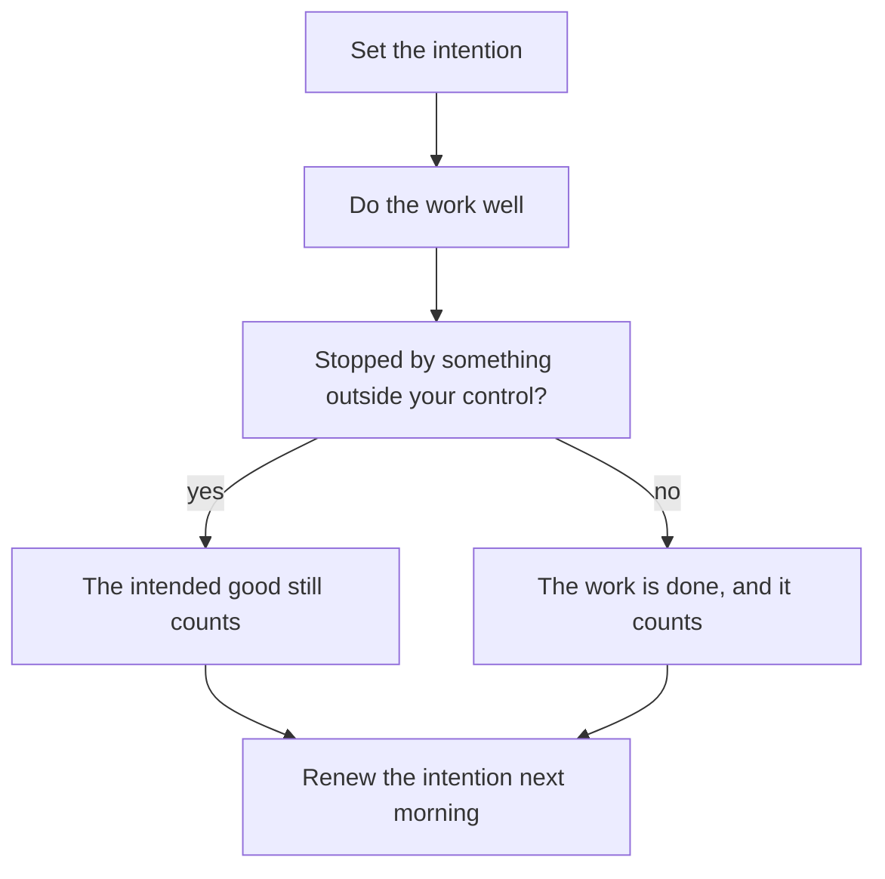

## What was it all for?

A few days after the study circle, Tariq sits with his notebook and adds up his month. Three weeks of late nights. One client lost. $600 he was counting on, gone. Two projects still to finish. "What was all that work for?" he writes at the bottom of the page. The month feels wasted, and he cannot see what he gained from it.

His question is a real one, and it has two meanings. The first is "what did I get?". The answer to that is painful: less money than he hoped and a lost client. The second is "what was I doing it for?". Reem asked him that at the circle, and his answer grew from "to pay the rent" into something larger. This chapter is about the second meaning, and about how the answer to it changes the first.

## Actions are by intentions

The companion Umar ibn al-Khattab, may Allah be pleased with him, reported a saying of the Prophet, peace be upon him. Actions are only by intentions, and each person will have what he intended (Sahih al-Bukhari 1). You met this hadith in chapter 6.1, as the source of niyyah.

It is a short sentence with a large meaning. Two people can do the same outward act and have different deeds, because they aimed at different things. The hadith goes on to give an example: a person who moved to another land for something of this world, or to marry someone, has what he moved for. The act was the same as other people's. The aim decided what it was.

The Quran tells us why we were created: Allah created jinn and humans only to worship Him (Quran 51:56). Worship here is not only the prayer and the fast. When your intention is good, your daily work and study can be worship too: building a website, writing a report, studying for an exam, serving a customer. This is one of the most hopeful teachings in the course for people who work long hours. Your hours are not lost to your faith. They can be part of it.

## Providing for your family is a good deed

Some people feel that work for money is separate from their religion: the prayer is for Allah, the job is for the bills. The Sunnah does not divide life that way. The Prophet spoke to the companion Sa'd ibn Abi Waqqas, may Allah be pleased with him. He told Sa'd that whatever he spent seeking Allah's pleasure would be rewarded, even the food he put in his wife's mouth (Sahih al-Bukhari 56).

> إِنَّكَ لَنْ تُنْفِقَ نَفَقَةً تَبْتَغِي بِهَا وَجْهَ اللَّهِ إِلَّا أُجِرْتَ عَلَيْهَا حَتَّى مَا تَجْعَلُ فِي فَمِ امْرَأَتِكَ

Meaning: you will not spend anything seeking Allah's pleasure except that you are rewarded for it, even the food you put in your wife's mouth (Sahih al-Bukhari 56).

So Tariq's first answer, "to pay the rent", was never small. When he earns to look after his mother and brothers, and spends on them seeking Allah's pleasure, that spending is a good deed. The money is the same money. The intention makes it worship.

```predict
prompt: "In the canvas below, Tariq plans an afternoon of work on a client's page, with a good intention. At 15:00 the power goes and does not come back that day, and the work stops. Before you step through: is the good he intended for that afternoon lost?"
options:
  - id: lost
    label: "Yes: only work he finishes can count"
  - id: still-counts
    label: "No: the good he intended still counts"
correctOptionId: still-counts
explanation: "The Prophet taught that whoever intends a good deed and does not do it, a good deed is written for him (Sahih Muslim 130). Tariq could not control the power cut. The work stopped, but the good he intended is not lost."
```

Now step through one ordinary working day for Tariq, read under two different aims.

<InteractiveCanvas slug="same-work-two-intentions" />

The canvas kept every task the same: the same form, the same honest message, the same power cut, the same $150, the same money given to his mother. Under the aim "finish the list and get paid", those are just tasks, and the afternoon lost to the power cut is simply lost. Under the aim "provide for my family, serve this client well and please Allah", the same steps are worship, and the stopped afternoon still counts. The work did not change. The aim did.

## When something stops you

Fellows know the situation in the canvas well. You plan a good thing, and something outside your control stops it: a power cut, a closed road, an illness in the family. The Prophet taught that whoever intends a good deed and does not do it, a good deed is written for him (Sahih Muslim 130).

> مَنْ هَمَّ بِحَسَنَةٍ فَلَمْ يَعْمَلْهَا كُتِبَتْ لَهُ حَسَنَةً

Meaning: whoever intends a good deed and does not do it, it is written for him as a good deed (Sahih Muslim 130).

This does not mean that intending is enough when you could act and choose not to. It means that when a good plan is stopped by something you could not control, the good you intended is not wasted. When the power goes in the middle of your work, the afternoon is not wasted. The intention still counts.

## Intention is not a test you can fail

Some people hear "actions are by intentions" and become afraid. "What if my intention is not pure? What if I also want the money, or want people to think well of me?" They start to doubt each piece of work. Some wait to begin until their heart feels perfectly clean. That is not what these hadith teach. They are given to encourage believers, not to frighten them.

Wanting to earn is not wrong. Wanting your work to be good enough that people notice is human. You do not have to remove every other wish before your work can be worship. You add the good intention, you renew it when you remember, and you begin. If you notice your aim slipping, you set it again. Never tell yourself, or anyone else, that work is worthless because the intention was not perfect.

## Worked example: Alaa's evening lessons

Alaa is 27 and teaches maths at a primary school. After school she gives private lessons at home. This term, six families have asked her to teach their children. Six students would bring good money, and her younger sister needs books for university.

Before she answers anyone, Alaa writes one line in her diary: "I teach so that children understand, to help my family, and to please Allah". Then she lets the line ask its questions.

**How many students?** If her aim were only money, she would take all six. But her line says "so that children understand". With six, each lesson would be short and rushed, and she knows she would teach badly by the end of the week. She takes three, and gives the other three families the name of a colleague she trusts.

**An honest word to a parent.** After a month, one boy is still far behind. A father asks if his son is doing well. The easy answer is "yes", which keeps the family paying. Her intention makes the honest answer part of the work. She tells the father the truth, and suggests one extra session a week on the basics.

**The money.** At the end of the month, she buys her sister's books with part of what she earned. She says quietly to herself that she is spending it for Allah. It is the same money she would have spent anyway. With that intention, it is also a good deed (Sahih al-Bukhari 56).

**The work itself.** One evening she is tired and tempted to skip preparing. Her line reminds her that a good intention asks for good work, not only a good feeling. She prepares a short lesson, smaller than usual, but done properly.

The same works for study. Marah, a nursing student, writes her own intention before an anatomy exam. "I study so that I can care for patients well, and to please Allah." She does badly in one practice test and is disappointed, but the hours were not wasted. Her intention gave them their worth. Her next step is to find which topics to review.

The diagram shows how an intention runs through a day, and what happens when the day is interrupted.



Both branches end in the same box: renew the intention. Whether the day is finished or cut short, it counts when the aim is good, and the next morning starts with the aim again. Notice also the second box: the intention comes before the work and asks for the work to be done well.

## Where it goes wrong

The first mistake is treating intention as a test you can fail. Waiting for a perfectly pure heart before starting is not what the Sunnah teaches. So is deciding your work is worthless because you also wanted money. Set the intention and begin.

The second mistake is using a good intention as an excuse for poor work or broken promises. "My intention was good" does not fix a missed deadline or a careless bug. A good intention asks for good work, which is what chapter 6.3 is about.

The third mistake is thinking that intention matters only in prayer. Spending on your family, serving a client honestly and studying to help people can all be worship with a good intention (Sahih al-Bukhari 56).

The fourth mistake is setting the intention once and forgetting it. Long days push it out of your mind. Renew it in the morning, and again when work gets hard.

## Check your understanding

```quiz
type: mcq
question: "Imad repairs phones at his uncle's stall to support his family, and his intention is good. A customer comes back because a screen Imad fitted came loose after two days. Imad had skipped a step to finish faster. He says, 'My intention was good, so Allah will accept it.' What fits this module?"
options:
  - "His intention was good, so the loose screen matters much less"
  - "His work no longer counts, because the result let the customer down"
  - "He should stop doing repairs until he is sure he will make no mistakes"
  - "A good intention asks for careful work, so he fixes it and the step"
correct: 3
explanations:
  - "A good intention does not cover a careless shortcut. The customer still has a loose screen, and a good intention asks for good work."
  - "His intention still matters, and the work can still be put right. Intention is not a test he has now failed."
  - "Waiting to be sure of never erring would stop him working at all. He sets right this mistake and keeps working with care."
  - "Right. Intention and good work belong together. He fixes the screen for the customer, and he stops skipping that step."
```

```quiz
type: mcq
question: "Samar works afternoons at her family's grocery shop so that her parents can rest and the family has an income. Standing at the shop counter, she tells a friend that this work is outside her worship, because it is not prayer or reading the Quran. What does this chapter teach?"
options:
  - "She is right, since worship means the acts like prayer and fasting"
  - "With a good intention, this work can be part of her worship"
  - "It becomes worship when she gives her wages to charity"
  - "It becomes worship once she has stopped wanting the money"
correct: 1
explanations:
  - "Allah created us to worship Him (Quran 51:56), and worship is wider than prayer and fasting. Actions are by intentions (Sahih al-Bukhari 1)."
  - "Right. Actions are by intentions, and spending on your family seeking Allah's pleasure is rewarded (Sahih al-Bukhari 56). Her afternoons at the shop can be part of the worship she was created for."
  - "Nothing in these hadith asks her to give the money away. Providing for her family with it is itself a good deed."
  - "Wanting to earn is not wrong. She adds a good intention; she does not have to remove every other wish first."
```

## This week

Write one line of intention for your work or study, in your own words. Put it where you will see it before you start each day: the first page of your notebook, or the top of your task list. Read it every morning this week, and once more when the work gets hard. At the end of the week, write down one decision that the line changed, even a small one.

**Next:** A good intention asks for good work. Good work, a little and often.
