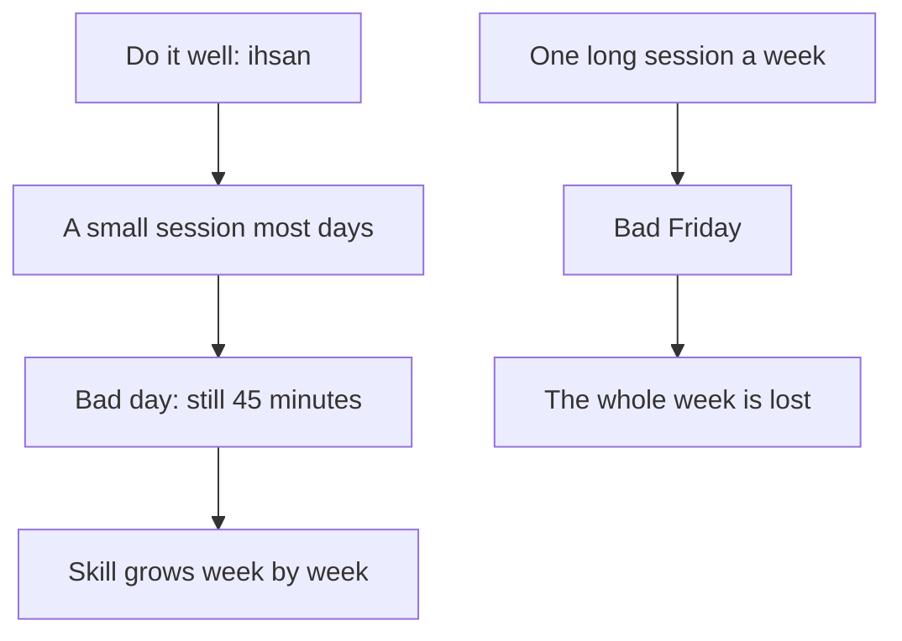

## Five hours every Friday

Tariq knows he needs a new skill. Two of the bugs that cost him the travel agency would have been caught by automated tests: small programs that check your code works before a client ever sees it. He has never learned to write them properly. So he makes a plan. "Every Friday, I will study testing for five hours. In four weeks, I will be good at it."

It sounds strong. It is also exactly how Tariq has always worked: nothing for days, then one huge effort. Last month that pattern gave him nights of fourteen hours, tired mistakes and a missed deadline. Reem, reading his plan, asks one question: "What happens to your five hours on a Friday when the power does not come?"

This chapter is about two things that belong together. The first is doing work well. The second is doing it a little and often, in a way you can keep up, instead of in rare, heavy bursts.

```predict
prompt: "Tariq can study testing for 45 minutes on 6 days a week, or for 5 hours every Friday. Over 4 weeks, one Friday is lost to a bad day. Which plan gives him more hours of practice?"
options:
  - id: small
    label: "The 45 minutes on six days"
  - id: long
    label: "The five hours every Friday"
correctOptionId: small
explanation: "Forty-five minutes on 6 days is 4 and a half hours a week, 18 hours over 4 weeks. Five hours every Friday would be 20 hours, but with one Friday lost it is 15. A long plan puts a whole week on one day, so one bad day takes the whole week's session with it."
```

## Do it well: ihsan

The companion Shaddad ibn Aws, may Allah be pleased with him, reported that the Prophet, peace be upon him, said: Allah has prescribed ihsan in everything (Sahih Muslim 1955).

> إِنَّ اللَّهَ كَتَبَ الإِحْسَانَ عَلَى كُلِّ شَىْءٍ

Meaning: Allah has prescribed excellence (ihsan) in everything (Sahih Muslim 1955).

You met the word ihsan in chapter 6.1: doing a thing well and beautifully, as well as you can. The hadith says "in everything". That includes the prayer, and it also includes the website, the report, the spreadsheet and the message to a client. In chapter 1.3 you met the verse that says Allah created death and life to test which of us is best in deeds (Quran 67:2). Best in deeds, not most in deeds. Doing a thing well matters.

What does ihsan look like in a freelancer's day? Testing your work before you send it. Checking the page on a phone, because that is where most people will see it. Writing code that the next developer can read. Giving an honest estimate instead of a hopeful one. Telling a client early when something will be late. None of these is dramatic. All of them are excellence in small things.

## A little, kept up

The Prophet's wife Aisha, may Allah be pleased with her, reported that he said: the deeds most beloved to Allah are those done consistently, even if they are small (Sahih al-Bukhari 6464 and Sahih Muslim 783).

> أَحَبُّ الأَعْمَالِ إِلَى اللَّهِ تَعَالَى أَدْوَمُهَا وَإِنْ قَلَّ

Meaning: the most beloved of deeds to Allah are the most consistent of them, even if they are small (Sahih Muslim 783).

In another narration he added: take on only the deeds you are able to manage (Sahih Muslim 782). Aisha said that when she began a good deed, she kept it up. Notice what this teaching praises: not the size of a deed but how steadily it is kept. A small deed done every day is more beloved than a large one done once and dropped.

With the intention you set in chapter 6.2, your work and study are good deeds too. So this teaching speaks to your learning, your projects and your habits. Forty-five minutes of practice every day is the kind of deed the hadith praises. Five hours on one Friday, done once and then dropped, is not.

## Do not overload yourself

The Prophet also said that the religion is ease, and that no one overburdens himself in it without being overcome. So aim for what is right, come as close to it as you can, and be glad. And seek help from the morning, the evening and part of the night (Sahih al-Bukhari 39).

This hadith is about the religion itself, and it gives a pattern for any good effort: aim well, come close, be glad, and do not pile on more than you can carry. Tariq's three projects at once were the opposite of this. He overburdened himself, and the load overcame him. Notice also the end of the hadith: the morning, the evening and part of the night. Part of the night, not all of it. Rest is part of the plan.

## Keep planting

Fellows often ask: why learn a new skill when I do not know if any work will come? Why build a portfolio when the future is so unclear? The Prophet answered a question like this in the strongest way. He said that if the Hour comes while one of you has a palm seedling in his hand, and he can plant it before it comes, let him plant it (Al-Adab al-Mufrad 479, graded sahih by al-Albani).

A palm takes years to bear fruit. Even at the end of the world, the Prophet told the believer to plant it. Effort does not wait for certainty. You plant the seedling, you take the course, you practise the skill, and you leave the harvest with Allah.

And there is honour in the work itself. The Prophet said that no one has ever eaten better food than what he earned by the work of his own hands, and that the Prophet Dawud, peace be upon him, ate from the work of his hands (Sahih al-Bukhari 2072). Tariq, ashamed after losing a client, was close to giving up freelancing. Honest work with your own hands is honoured in the Sunnah. A failure in it is a reason to improve the work, not to leave it.

Now try the two plans yourself. Change the size of each plan and the number of bad Fridays, and watch which one adds up to more over 4 weeks. Start by checking your prediction.

<InteractiveCanvas slug="little-and-often" />

At the start, the small plan gives 18 hours in 24 sessions, and the long plan gives 15 hours in 3 sessions, because one Friday was lost. The small plan is ahead by 3 hours. The canvas is honest about the limits, too. If you lower the small plan to 20 minutes a day, the long plan has more hours, 15 to 8, but it still touches the work on only 3 days out of 28. If no Friday is ever lost, the long plan leads, 20 hours to 18. A rare long plan only wins when no bad day lands on it, and for fellows, bad days come often.

## Worked example: Tariq's new rhythm

Tariq rewrites his plan with Reem's question in mind. He makes four changes, and each one comes from a source in this chapter.

**At most two projects at once.** Before he accepts any project, he checks how many he already has. Two is his limit for now. For every estimate, he adds three days for the problems he cannot see yet. This is "do not overburden yourself" (Sahih al-Bukhari 39), turned into a rule he can follow on a busy day.

**A short ihsan check before every delivery.** Before he sends work to a client, he does three things: he tests the main path a user will take, he checks the page on his phone, and he writes a short note of what he changed. It takes about twenty minutes. It is how he does his work well (Sahih Muslim 1955).

**Forty-five minutes of testing practice, six days a week.** He studies first thing in the morning, or in the first hour the power comes. On a power-cut day he still does his 45 minutes on the laptop battery, reading and writing small examples offline. On Fridays he rests. It is small enough to survive a bad day, which is why it lasts (Sahih al-Bukhari 6464).

**Sleep.** He stops work by midnight. The hadith says part of the night, not all of it.

After four weeks, Tariq has 24 sessions behind him, 18 hours in all. Using what he learned, he writes tests for the clothing shop's checkout, and one test catches a bug before the client sees it. It is not dramatic. It is a skill he did not have a month ago, built from small pieces he could keep.

The diagram shows the two patterns side by side, and what one bad day does to each.



What to notice: in both patterns a bad day comes. In the small pattern it costs one short session, or nothing, because 45 minutes can fit around a power cut. In the long pattern the same bad day takes the whole week. The takeaway: plan your good work in pieces small enough to survive the days you cannot control, and do each piece well.

## Where it goes wrong

The first mistake is waiting for a big free day. "When I have a whole day, I will start properly." For most fellows that day rarely comes, and when it does, a power cut or a family need often takes it. Start with the small piece today.

The second mistake is making the habit too small to matter. Five minutes a day is easy to keep, but it may not move you. Choose a size that is small enough to keep on a bad day and large enough to build something, and adjust it after a week.

The third mistake is reading ihsan as perfection. Ihsan is doing your best within your capacity: aim for what is right and come as close as you can (Sahih al-Bukhari 39). A page that is never finished because it is never perfect is not excellence. It is another kind of overload.

The fourth mistake is saying yes to everything. More projects at once can feel like more provision, but last month it gave Tariq less money, less sleep and a lost client.

The fifth mistake is dropping the habit after one missed day. You will miss days. When you do, start again the next morning with the same small piece. Consistency is not never missing; it is always coming back.

## Check your understanding

```quiz
type: mcq
question: "Wafa, who lives with her grandmother and helps her in the afternoons, wants to be ready for English job interviews in two months. She plans to study for six hours every Saturday. Power cuts and family visits often fill her Saturdays. Which plan fits this chapter best?"
options:
  - "Keep the six-hour Saturdays and simply try harder to protect them"
  - "Study twenty minutes on most days, and keep it up on bad days too"
  - "Wait for a calmer month, and then start studying more properly"
  - "Study late every night until she is ready, to finish much sooner"
correct: 1
explanations:
  - "Trying harder does not stop power cuts or visits. One bad Saturday would cost her a whole week of practice."
  - "Right. A small session on most days survives bad days, and the deeds most beloved to Allah are the consistent ones, even if small (Sahih al-Bukhari 6464)."
  - "A calmer month may not come. Effort does not wait for certainty: plant the seedling now (Al-Adab al-Mufrad 479, graded sahih)."
  - "Overloading herself is the pattern the Sunnah warns against: no one overburdens himself without being overcome (Sahih al-Bukhari 39). Rest is part of the plan."
```

```quiz
type: mcq
question: "Sami is building a website for a small charity from his family's living room. The charity's staff will only look at the pages, never the code. He is tempted to leave messy code that works today but will be hard for anyone to fix later. What fits ihsan?"
options:
  - "Leave it messy, since nobody at the charity will ever see the code"
  - "Ihsan is for acts of worship, so it does not apply to his paid work"
  - "Write it clearly, since doing a thing well includes the unseen parts"
  - "Rewrite the whole site from the start, even if he misses the deadline"
correct: 2
explanations:
  - "Allah has prescribed ihsan in everything (Sahih Muslim 1955), including the parts nobody checks. The next person who fixes the site will feel the difference."
  - "The hadith says 'in everything'. With a good intention, his work for the charity is a good deed, and doing it well is part of it."
  - "Right. Ihsan means doing the work well, as well as he can, including what nobody sees. Clear code serves the charity long after he is gone."
  - "Ihsan is not perfection at any cost. Missing the deadline would harm the client. Aim for what is right and come as close as you can (Sahih al-Bukhari 39)."
```

## This week

Choose one small daily piece of good work: a skill to practise, a part of a project, a page of study. Make it small enough to keep on a bad day, for example 20 to 45 minutes. Do it on at least five days this week, and mark each day on paper. Before you send any piece of work this week, do one short check that makes it better: test it, read it again, or look at it on a phone.

**Next:** Tariq still has the lost client to face. After a failure.
