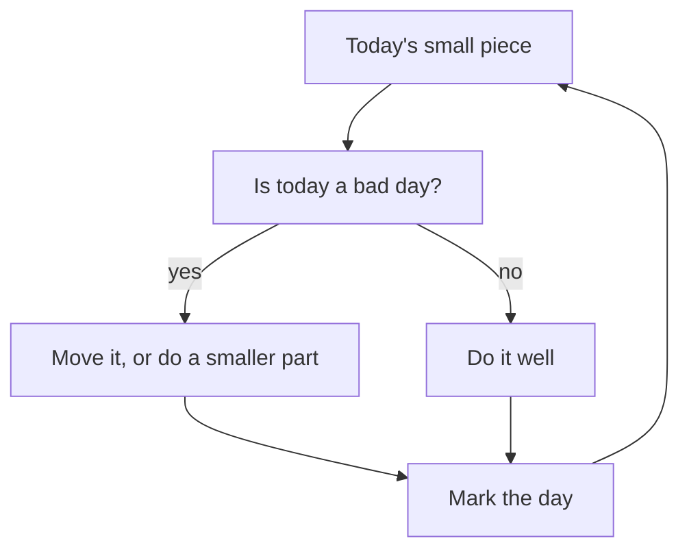

## Five hours every Friday

Tariq knows he needs a new skill. Two of the bugs that cost him the travel agency would have been caught by automated tests: small programs that check your code works before a client ever sees it. He has never learned to write them properly. So he makes a plan. "Every Friday, I will study testing for five hours. In four weeks, I will be good at it."

It sounds strong. It is also exactly how Tariq has always worked: nothing for days, then one huge effort. Last month that pattern gave him nights of fourteen hours, tired mistakes and a missed deadline. Reem, reading his plan, asks one question: "What happens to your five hours on a Friday when the power does not come?"

This chapter is about two things that belong together. The first is doing work well. The second is doing it a little and often, in a way you can keep up, instead of in rare, heavy bursts.

## Do it well: ihsan

The companion Shaddad ibn Aws, may Allah be pleased with him, reported that the Prophet, peace be upon him, said: Allah has prescribed ihsan in everything (Sahih Muslim 1955).

> إِنَّ اللَّهَ كَتَبَ الإِحْسَانَ عَلَى كُلِّ شَىْءٍ

Meaning: Allah has prescribed excellence (ihsan) in everything (Sahih Muslim 1955).

You met the word ihsan in chapter 6.1. The hadith says "in everything". That includes the prayer, and it also includes the website, the report, the spreadsheet and the message to a client. In chapter 1.3 you met the verse that says Allah created death and life to test which of us is best in deeds (Quran 67:2). Best in deeds, not most in deeds. Doing a thing well matters.

What does ihsan look like in a freelancer's day? Testing your work before you send it. Checking the page on a phone, because that is where most people will see it. Writing code that the next developer can read. Giving an honest estimate instead of a hopeful one. Telling a client early when something will be late. None of these is dramatic. All of them are excellence in small things.

## A little, kept up

The Prophet's wife Aisha, may Allah be pleased with her, reported that he said: the deeds most beloved to Allah are those done consistently, even if they are small (Sahih al-Bukhari 6464 and Sahih Muslim 783).

> أَحَبُّ الأَعْمَالِ إِلَى اللَّهِ تَعَالَى أَدْوَمُهَا وَإِنْ قَلَّ

Meaning: the most beloved of deeds to Allah are the most consistent of them, even if they are small (Sahih Muslim 783).

In another narration he added: take on only the deeds you are able to manage (Sahih Muslim 782). Aisha said that when she began a good deed, she kept it up. Notice what this teaching praises: not the size of a deed but how steadily it is kept. A small deed done every day is more beloved than a large one done once and dropped.

With the intention you set in chapter 6.2, your work and study are good deeds too. So this teaching speaks to your learning, your projects and your habits.

## Do not overload yourself

The Prophet also said that the religion is ease, and that no one overburdens himself in it without being overcome. So aim for what is right, come as close to it as you can, and be glad. And seek help from the morning, the evening and part of the night (Sahih al-Bukhari 39).

This hadith is about the religion itself, and it gives a pattern for any good effort. Aim well, come close, be glad, and do not take on more than you can carry. Tariq's three projects at once were the opposite of this. He overburdened himself, and the load overcame him. Notice also the end of the hadith: the morning, the evening and part of the night. Part of the night, not all of it. Rest is part of the plan.

## Keep planting

Fellows often ask: why learn a new skill when I do not know if any work will come? Why build a portfolio when the future is so unclear? The Prophet gave a strong answer to this kind of worry. He said that if the Hour comes while one of you has a palm seedling in his hand, and he can plant it before it comes, let him plant it (Al-Adab al-Mufrad 479, graded sahih by al-Albani).

A palm takes years to bear fruit. Even at the end of the world, the Prophet told the believer to plant it. Effort does not wait for certainty. You plant the seedling, you take the course, you practise the skill, and you leave the harvest with Allah.

And there is honour in the work itself. The Prophet said that no one has ever eaten better food than what he earned by the work of his own hands. He added that the Prophet Dawud, peace be upon him, ate from the work of his hands (Sahih al-Bukhari 2072). Tariq, ashamed after losing a client, was close to giving up freelancing. Honest work with your own hands is honoured in the Sunnah. A failure in it is a reason to improve the work, not to leave it.

```predict
prompt: "Tariq can study testing for 45 minutes on 6 days a week, or for 5 hours every Friday. About one day a week is a bad day that takes the whole day. A short session can move to another day that week; a five-hour session cannot. Over 4 weeks, which plan gives him more practice time?"
options:
  - id: small
    label: "The 45 minutes on six days"
  - id: long
    label: "The five hours every Friday"
correctOptionId: small
explanation: "Forty-five minutes on 6 days is 18 hours over 4 weeks, and a short session lost to a bad day moves to a good one. Five hours every Friday would be 20 hours, but a bad day lands on Friday about one week in seven, so on average the long plan gives about 17 hours. A long plan puts a whole week on one day."
```

Now try the two plans yourself. Change the size of each plan and the number of bad days a week, and watch which one adds up to more over 4 weeks.

<InteractiveCanvas slug="little-and-often" />

At the start, with one bad day a week, the small plan gives 18 hours in 24 sessions. The long plan gives about 17 hours 9 minutes, from 3.4 Friday sessions on average. The small plan is ahead by 51 minutes, and it touched the work on seven times as many days. The canvas is honest about its limits, too. Set bad days to 0 and the long plan leads, 20 hours to 18. Lower the small plan to 20 minutes a day, and the long plan leads by more than 9 hours. Bad days take sessions from both plans; the small plan wins only because its short sessions can move, and only when it is big enough to matter. For Tariq, the lesson is clear: 45 minutes on most mornings, kept up when a day goes wrong.

## Worked example: Wijdan's book

Wijdan is 25 and works as a freelance translator. A small publisher has asked her to translate a 200-page children's book in 12 weeks. It is the biggest job she has had, and she is tempted to work the way many freelancers do: a few slow weeks, then long nights at the end.

Instead, she plans it a little and often. Twelve weeks of six working days gives 72 days. Three pages a day gives 216 pages, so she has 16 pages of room for bad days. She writes her plan on one line: "Three pages a day, six days a week, done well."

**Doing it well.** For each page she has a small ihsan check. She reads the translation aloud once, checks every name against a list, and marks any line she is not sure of for the next morning. It adds ten minutes a day. It is how she does the work well, including the parts the publisher may never check (Sahih Muslim 1955).

**Not overloading.** In week three, another client offers her a second book at the same time. The money is good. She asks herself whether she could do both well, and the honest answer is no. She asks the client if the second book can start after the first one ends, and they agree (Sahih al-Bukhari 39).

**Bad days.** In week five, her grandmother is ill and Wijdan spends two days at the hospital. She translates nothing on those days. On the third morning she does not try to do nine pages at once to make up. She goes back to her three pages. The 16 pages of room in her plan cover the two lost days, which is what that room was for.

**Planting anyway.** The publisher has not promised her more work after this book. She keeps her three pages anyway, and in the evenings she reads one chapter of another children's book in English, to grow. She cannot see where it leads. She plants anyway (Al-Adab al-Mufrad 479, graded sahih).

She sends the book four days early. The publisher thanks her and asks for a sample of her next translation. Nothing in her plan was dramatic. Each day was small, and each day was done properly.

The diagram shows the daily loop that kept Wijdan's plan alive through bad days.



The arrow from "Mark the day" goes back to the top: the habit is a loop, not a line. A bad day does not break the loop. It sends the piece to another day or makes it smaller, and the next morning starts again at the top. What the loop never does is turn a missed day into a huge day.

## Where it goes wrong

The first mistake is waiting for a big free day. "When I have a whole day, I will start properly." For most fellows that day rarely comes. When it does, a power cut or a family need often takes it. Start with the small piece today.

The second mistake is making the habit too small to matter. Five minutes a day is easy to keep, but it may not move you. Choose a size that is small enough to keep on a bad day and large enough to build something, and adjust it after a week.

The third mistake is reading ihsan as perfection. Ihsan is doing your best within your capacity: aim for what is right and come as close as you can (Sahih al-Bukhari 39). A page that is never finished because it is never perfect is not excellence. It is another kind of overload.

The fourth mistake is saying yes to everything. More projects at once can feel like more provision, but last month it gave Tariq less money, less sleep and a lost client.

The fifth mistake is making up for missed days with one huge day. You will miss days. When you do, start again the next morning with the same small piece. Consistency is not never missing; it is always coming back.

## Check your understanding

```quiz
type: mcq
question: "Wafa lives with her grandmother and studies English for job interviews, twenty minutes every evening. She was ill for three days and studied nothing. Now she feels better, and she plans to study for three hours tomorrow to make up for the lost days. What fits this chapter best?"
options:
  - "Do the three hours tomorrow, so that the lost days are made up"
  - "Drop the habit, since three missed days have already broken it"
  - "Go back to her usual twenty minutes tomorrow, and keep it going"
  - "Wait until she feels strong again, and then start a new plan"
correct: 2
explanations:
  - "Making up with one huge session turns a small habit into overload. No one overburdens himself without being overcome (Sahih al-Bukhari 39)."
  - "Three missed days do not end a habit. Consistency is coming back, not never missing."
  - "Right. The deeds most beloved to Allah are the consistent ones, even if small (Sahih al-Bukhari 6464). She returns to the same small piece and keeps it going."
  - "Waiting for a perfect start delays her for no reason. Effort does not wait for certainty; she can start small tomorrow."
```

```quiz
type: mcq
question: "Sami is building a website for a small charity from his family's living room. The charity's staff will look at the pages, not the code. He is tempted to leave messy code that works today but will be hard for anyone to fix later. What fits ihsan?"
options:
  - "Write it clearly, since doing a thing well includes the unseen parts"
  - "Leave it messy, since the charity's staff will not look at the code"
  - "Ihsan is for acts of worship, so it does not apply to his paid work"
  - "Rewrite the site from the start, even if he misses the deadline"
correct: 0
explanations:
  - "Right. Ihsan means doing the work well, as well as he can, including what the client does not see. Clear code serves the charity long after he is gone."
  - "Allah has prescribed ihsan in everything (Sahih Muslim 1955), including the parts the client does not check. The next person who fixes the site will feel the difference."
  - "The hadith says 'in everything'. With a good intention, his work for the charity is a good deed, and doing it well is part of it."
  - "Ihsan is not perfection at any cost. Missing the deadline would harm the client. Aim for what is right and come as close as you can (Sahih al-Bukhari 39)."
```

## This week

Choose one small daily piece of good work: a skill to practise, a part of a project, a page of study. Make it small enough to keep on a bad day, for example 20 to 45 minutes. Do it on at least five days this week, and mark each day on paper. Before you send any piece of work this week, do one short check that makes it better: test it, read it again, or look at it on a phone.

**Next:** Tariq still has the lost client to face. After a failure.
