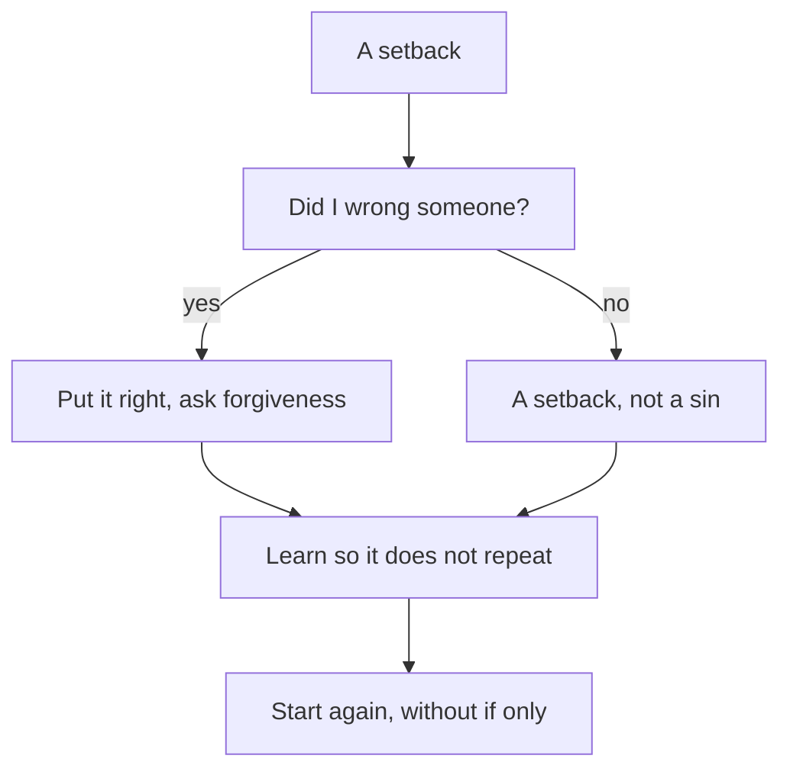

## A week later

A week after the study circle, Tariq has a new rhythm and a written intention. But he still thinks about the lost client every day. When he opens his laptop, he sees the travel agency's name in his old messages, and the two voices come back. "If only I had said no." "Maybe I should stop."

He has also started to wonder about something else. Is what happened a sin? Should he be asking Allah for forgiveness for losing a client? Or was it just bad luck, something to forget? He does not know which, and so he does neither. He just carries it.

This chapter gives Tariq, and you, a clear way through. It has a few steps, each from the Quran or the Sunnah. The first is to see clearly what kind of thing happened.

## Keep a setback and a wrong apart

Reem told Tariq in chapter 6.1 that losing a client is not a sin. Here is why that matters. A setback is a failure in your work or study: a lost client, a failed exam, a rejected application, a project that did not work. A setback is not a sin. It does not need repentance. It needs learning and a new start.

A wrong is different. It is something you did, or failed to do, that was not right: breaking a promise without a word, misleading someone, treating someone unfairly. A wrong needs to be put right with the person, and brought to Allah.

<Callout type="info" title="A setback is not a sin">
Losing a client, failing an exam or missing a target is not a sin. Use learning for setbacks, and turning back to Allah for wrongs. Many failures have no wrong in them at all.
</Callout>

In Tariq's month, there was one big setback and one wrong inside it. The setback was the late delivery and the lost client. The wrong was the silence: he knew he was late and said nothing, and when asked, he said "almost done" when it was not. Keeping these apart protects you from two mistakes. One is carrying heavy guilt over ordinary failures, as if every bad result were a sin. The other is calling a real wrong "just bad luck", and never putting it right.

## Name it honestly

The Quran teaches us the words of Adam and Hawwa, peace be upon them: our Lord, we have wronged ourselves. If You do not forgive us and have mercy on us, we will be among the losers (Quran 7:23).

> رَبَّنَا ظَلَمْنَا أَنفُسَنَا وَإِن لَّمْ تَغْفِرْ لَنَا وَتَرْحَمْنَا لَنَكُونَنَّ مِنَ الْخَاسِرِينَ

Meaning: our Lord, we have wronged ourselves; if You do not forgive us and have mercy on us, we will surely be among the losers (Quran 7:23).

Look at how plain these words are. There is no excuse in them, no blaming anyone else, and no insulting themselves either. Just the truth, and a request for mercy. That is the first step after any failure: say what happened in plain sentences. Not "the power cuts ruined everything", and not "I am useless". Just what happened.

## Put right what you can, with the person

Where a wrong touched another person, the next step goes to that person. An honest apology without excuses. An offer to fix what you can. If there is a cost you caused, an offer to share it. You cannot always undo the harm, and the person may not want anything from you. But you can offer, and you can be honest. Putting right with people and turning back to Allah go together; one does not replace the other.

## Learn so it does not happen twice

The Prophet, peace be upon him, said that a believer is not stung from the same hole twice (Sahih al-Bukhari 6133).

> لاَ يُلْدَغُ الْمُؤْمِنُ مِنْ جُحْرٍ وَاحِدٍ مَرَّتَيْنِ

Meaning: a believer is not stung from the same hole twice (Sahih al-Bukhari 6133).

This is the work for every setback, with or without a wrong in it. Ask what caused it, and change the cause. One cause you can change is worth more than many regrets.

```predict
prompt: "Muhannad failed his driving test because he did not check his mirror at one turn. Every night since, he tells himself 'if only I had looked'. He says this keeps the lesson fresh. Before you step through Tariq's steps: does repeating 'if only' help him avoid the same mistake?"
options:
  - id: regret-helps
    label: "Yes: regret keeps the lesson in his mind"
  - id: no-change
    label: "No: one change does that, not regret"
correctOptionId: no-change
explanation: "What stops a mistake happening twice is a change: for Muhannad, a habit of checking the mirror at every turn, practised with a teacher. Saying 'if only' every night adds pain but no change. Learning looks back once and ends in a change; 'if only' looks back again and again and ends where it began."
```

Step through Tariq's way from the setback to a fresh start below.

<InteractiveCanvas slug="starting-again-steps" />

The canvas showed "if only" as a loop that leaves Tariq exactly where he started, and the forward path as a set of plain steps. Naming it honestly kept the lost client and the silence apart. Putting it right went to the client first: an apology for the silence, and the fix for the two bugs, sent free. Learning changed three causes: at most two projects at once, three spare days in every estimate, and a message on the first day of any delay. Turning back to Allah was for the silence, not for the lost client. And starting again was as ordinary as reading his intention line and doing 45 minutes of practice the next morning.

## Leave "if only"

You met this teaching in chapter 1.4, and it matters most right here. The Prophet taught: if something befalls you, do not say "if only I had done this, it would have been that". Instead say "Allah decreed, and He did what He willed", for "if only" opens the door to Satan's work (Sahih Muslim 2664).

How is learning different from "if only"? Both look back. Learning looks back once, finds the cause and ends in a change. "If only" looks back again and again and ends nowhere. Tariq's "if only I had said no to the third project" becomes learning the moment he turns it into a rule: "two projects at most". After that, he does not need to say it again. He can say "Allah decreed, and He did what He willed", and take the next step.

## Turn back to Allah where you did wrong

For the wrong part of a failure, there is tawbah, the turning back you met in chapter 6.1. The Quran describes the believers who, when they do something wrong, remember Allah and ask forgiveness for their sins. And who forgives sins except Allah? And they do not knowingly persist in what they did (Quran 3:135). Remember, ask forgiveness, do not persist: three plain steps.

The Prophet also said that if people did not sin, Allah would replace them with people who sin, ask Allah's forgiveness, and are forgiven (Sahih Muslim 2749). This hadith does not encourage anyone to do wrong. It shows that people who make mistakes and turn back are what Allah expects of human beings. Allah's forgiveness is open to those who turn back. Your mistake is not too big for it. Allah tells His servants who have wronged themselves not to despair of His mercy (Quran 39:53).

Then you start again: with the intention from chapter 6.2 and the small daily habit from chapter 6.3.

## Worked example: Zuhair and the domain

Zuhair is 25 and builds websites for small businesses. Last year he set up a website for a sewing workshop, and he promised the owner that he would renew the web address, the domain, every year. This year he forgot. For three days the workshop's website did not open, and two customers who tried to order could not.

When the owner called, Zuhair panicked. He said the hosting company had made an error. That was not true. He had forgotten, and then he covered it with a story. The same evening he renewed the domain, and the site came back.

That night he cannot sleep. He works through the steps.

**Setback or wrong?** Forgetting the renewal was a setback: a mistake in his work. Telling the owner the hosting company had made an error was a wrong: it was not true, and it pushed the blame onto someone else. He keeps the two apart.

**Name it honestly.** He writes it plainly in his notebook: "I forgot the renewal. The site was down for three days. Then I told the owner something that was not true."

**Put it right with the person.** The next morning he calls the owner. He says that the hosting company did nothing wrong, that he forgot, and that he is sorry for both the mistake and the story. He pays this year's renewal fee himself, and offers a month of free updates to the site. The owner is quiet for a moment. Then she thanks him for telling the truth.

**Learn.** He finds the cause: renewal dates live only in his memory. He puts every client's renewal date in a calendar with two reminders, one month and one week before. He also sets each domain to renew by itself where the client agrees.

**Leave "if only".** When "if only I had remembered" comes back, he answers it: "Allah decreed, and He did what He willed. The calendar is set."

**Turn back to Allah.** For the untrue story, he asks Allah's forgiveness and resolves not to cover a mistake with a story again.

**Start again.** The next day he checks the renewal dates of all his other clients. Two are due next month. He renews them early.

Zuhair's case was different from Tariq's: a forgotten task, not overload, and a story instead of a silence. The steps were the same.

The diagram shows the one question that sorts any failure, and where each answer leads.



Zuhair's answer to the question was yes, so his path went through "put it right, ask forgiveness". A student who fails an exam after honest study answers no, and goes straight to learning. Both paths meet at the same two boxes. Every failure gets learning and a fresh start; only a wrong also needs tawbah and putting right with the person.

## Where it goes wrong

The first mistake is treating every failure as a sin. A student who failed an exam after honest study does not need to repent for it. Calling setbacks sins adds guilt and takes energy away from learning.

The second mistake is treating a real wrong as bad luck. "Things happen" is not an answer to a promise broken in silence. If someone was wronged, put it right with them.

The third mistake is an apology full of excuses. "Sorry, but the power cuts..." turns an apology into a defence. Name your part plainly.

The fourth mistake is calling "if only" learning. If you have already found the cause and changed it, and you still go over it every night, that is no longer learning. Say "Allah decreed, and He did what He willed", and take the next step.

The fifth mistake is giving up. Leaving your work after one failure turns a setback into a much bigger loss. Keep planting, as the seedling hadith in chapter 6.3 teaches.

If a failure leaves you feeling heavy for a long time, you do not have to carry it alone. If you feel overwhelmed for a long time, or you have thoughts of harming yourself, talk to your mentor or the fellowship coordinator today. Talk to a doctor or counsellor too, if you can. This course does not replace professional care.

## Check your understanding

```quiz
type: mcq
question: "Mutasim borrowed his cousin's laptop for a week and broke its charger by being careless with it. He has asked Allah's forgiveness many times. He has not told his cousin, because he feels ashamed. What fits this chapter?"
options:
  - "Allah's forgiveness is what matters, so he can keep this to himself"
  - "He should wait until his cousin notices, then apologise and replace it"
  - "He should stop asking forgiveness until he has settled it with him"
  - "He tells his cousin, offers to replace it, and keeps asking forgiveness"
correct: 3
explanations:
  - "Asking forgiveness is right, but the harm touched his cousin. Putting right with people and turning back to Allah go together; one does not replace the other."
  - "Replacing it is right, but waiting until he is found out is not honest naming. He can tell his cousin now."
  - "Turning back to Allah does not have to wait. He keeps asking forgiveness while he puts it right with his cousin."
  - "Right. The harm was to his cousin, so he puts it right with him, and he brings it to Allah as well (Quran 3:135)."
```

```quiz
type: mcq
question: "Lujain, a freelance designer, missed a client's deadline by three days. In her notebook she writes: 'I am useless and lazy, and I always ruin everything.' She wants to be honest about what happened. What fits the teaching?"
options:
  - "Keep those words, since being hard on herself is the honest way"
  - "Write the facts plainly, with the deadline, the delay and why"
  - "Leave it unwritten, so that the bad feeling can fade sooner"
  - "Blame the power cuts, since being kind to herself comes first"
correct: 1
explanations:
  - "Insults are not the same as honesty. The words of Adam and Hawwa name the wrong plainly, without excuses and without insults (Quran 7:23)."
  - "Right. Honest naming says what happened in plain sentences. It gives her something she can learn from, which 'I am useless' does not."
  - "Leaving it unnamed leaves nothing to learn from. A believer is not stung from the same hole twice (Sahih al-Bukhari 6133), and learning starts with naming."
  - "Being kind to herself is good, but an excuse is not the truth. Plain naming is kind and honest at the same time."
```

## This week

Think of one setback from the past year, small or large, or use Tariq's if you prefer. On paper, write it in three plain sentences, without excuses and without insulting yourself. Mark whether there was a wrong in it. If there was, write one step to put it right with the person, and take it if you can. Then write one change so it does not happen twice, and do the first part of that change this week.

**Next:** Five short cases to check intention, good work and starting again.
