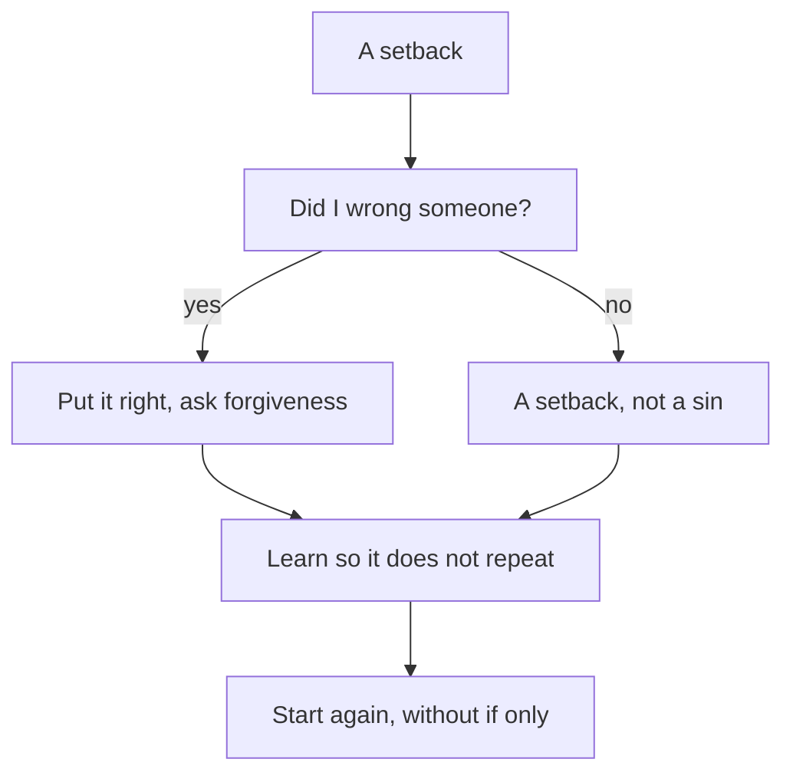

## A week later

A week after the study circle, Tariq has a new rhythm and a written intention. But he still thinks about the lost client every day. When he opens his laptop, he sees the travel agency's name in his old messages, and the two voices come back. "If only I had said no." "Maybe I should stop."

He has also started to wonder about something else. Is what happened a sin? Should he be asking Allah for forgiveness for losing a client? Or was it just bad luck, something to forget? He does not know which, and so he does neither. He just carries it.

This chapter gives Tariq, and you, a clear way through. It has a few steps, each from the Quran or the Sunnah. The first is to see clearly what kind of thing happened.

```predict
prompt: "Tariq lost a client after delivering nine days late, without telling the client while he was late. Before you read on: is losing the client itself a sin that Tariq must repent for?"
options:
  - id: sin
    label: "Yes: losing a client is a sin to repent for"
  - id: not-sin
    label: "No, but his silence needs putting right"
correctOptionId: not-sin
explanation: "Losing a client is a setback, not a sin: clients come and go for many reasons. But Tariq did do one wrong: he stayed silent while he knew he was late, and told the owner 'almost done' when it was not. That wrong is something to put right with the client and to bring to Allah. The two are different, and mixing them up helps nobody."
```

## Keep a setback and a wrong apart

A setback is a failure in your work or study: a lost client, a failed exam, a rejected application, a project that did not work. A setback is not a sin. It does not need repentance. It needs learning and a new start.

A wrong is different. It is something you did, or failed to do, that was not right: breaking a promise without a word, misleading someone, treating someone unfairly. A wrong needs to be put right with the person, and brought to Allah.

<Callout type="info" title="A setback is not a sin">
Losing a client, failing an exam or missing a target is not a sin. Use learning for setbacks, and turning back to Allah for wrongs. Many failures have no wrong in them at all.
</Callout>

In Tariq's month, there was one big setback and one wrong inside it. The setback was the late delivery and the lost client. The wrong was the silence: he knew he was late and said nothing, and when asked, he said "almost done" when it was not. Keeping these apart protects you from two mistakes. One is drowning in guilt over ordinary failures, as if every bad result were a sin. The other is brushing off a real wrong as "just bad luck", and never putting it right.

## Name it honestly

The Quran teaches us the words of Adam and Hawwa, peace be upon them: our Lord, we have wronged ourselves, and if You do not forgive us and have mercy on us, we will be among the losers (Quran 7:23).

> رَبَّنَا ظَلَمْنَا أَنفُسَنَا وَإِن لَّمْ تَغْفِرْ لَنَا وَتَرْحَمْنَا لَنَكُونَنَّ مِنَ الْخَاسِرِينَ

Meaning: our Lord, we have wronged ourselves; if You do not forgive us and have mercy on us, we will surely be among the losers (Quran 7:23).

Look at how plain these words are. There is no excuse in them, no blaming anyone else, and no insulting themselves either. Just the truth, and a request for mercy. That is the first step after any failure: say what happened in plain sentences. "I took three projects at once. I fell behind. I did not tell the client. I said 'almost done' when it was not." Not "the power cuts ruined everything", and not "I am useless". Just what happened.

## Put right what you can, with the person

Where a wrong touched another person, the next step goes to that person. An honest apology without excuses. An offer to fix what you can. If there is a cost you caused, an offer to share it. You cannot always undo the harm, and the person may not want anything from you. But you can offer, and you can be honest. Putting right with people and turning back to Allah go together; one does not replace the other.

## Learn so it does not happen twice

The Prophet, peace be upon him, said that a believer is not stung from the same hole twice (Sahih al-Bukhari 6133).

> لاَ يُلْدَغُ الْمُؤْمِنُ مِنْ جُحْرٍ وَاحِدٍ مَرَّتَيْنِ

Meaning: a believer is not stung from the same hole twice (Sahih al-Bukhari 6133).

This is the work for every setback, with or without a wrong in it. Ask what caused it, and change the cause. For Tariq, three causes stand out: he took on too much, his estimates had no spare days, and he hid the delay instead of telling the client. Each cause can be changed with a rule he can keep.

## Leave "if only"

You met this teaching in chapter 1.4, and it matters most right here. The Prophet taught: if something befalls you, do not say "if only I had done this, it would have been that", but say "Allah decreed, and He did what He willed", for "if only" opens the door to Satan's work (Sahih Muslim 2664).

How is learning different from "if only"? Both look back. Learning looks back once, finds the cause and ends in a change. "If only" looks back again and again and ends nowhere. Tariq's "if only I had said no to the third project" becomes learning the moment he turns it into a rule: "two projects at most". After that, he does not need to say it again. He can say "Allah decreed, and He did what He willed", and take the next step.

## Turn back to Allah where you did wrong

For the wrong part of a failure, there is tawbah, the turning back you met in chapter 6.1. The Quran describes the believers who, when they do something wrong, remember Allah and ask forgiveness for their sins, and who does forgive sins except Allah? And they do not knowingly persist in what they did (Quran 3:135). Remember, ask forgiveness, do not persist: three plain steps.

The Prophet also said that if people did not sin, Allah would replace them with people who sin, ask Allah's forgiveness, and are forgiven (Sahih Muslim 2749). This hadith does not encourage anyone to do wrong. It shows that people who make mistakes and turn back are what Allah expects of human beings, and that Allah's forgiveness is open to those who turn back. Your mistake is not too big for it. Allah tells His servants who have wronged themselves not to despair of His mercy (Quran 39:53).

Then you start again: with the intention from chapter 6.2 and the small daily habit from chapter 6.3.

Step through Tariq's way from the setback to a fresh start below. Before you begin, check your prediction from above.

<InteractiveCanvas slug="starting-again-steps" />

The canvas showed "if only" as a loop that goes round and leaves Tariq exactly where he started, and the forward path as a set of plain steps. Naming it honestly kept the lost client and the silence apart. Putting it right went to the client first. Learning changed three causes. Turning back to Allah was for the silence, not for the lost client. And starting again was as ordinary as reading his intention line and doing 45 minutes of practice the next morning.

## Worked example: Tariq's fresh start

**The honest page.** Tariq writes four sentences in his notebook: "I took three projects at once because I was afraid about money. I fell behind on the booking site. I did not tell the owner, and I said 'almost done' when it was not. I delivered nine days late with two bugs." Reading it is uncomfortable. It is also the first time the failure feels clear and limited, instead of a heavy worry with no shape.

**The message.** He writes to the travel agency's owner. He keeps it short and makes no excuses:

> I am sorry for the delay, and most of all for not telling you when I knew I was late. That was wrong of me. I have found the cause of the two booking form bugs. If it helps, I will send the fix to your new developer this week, at no cost. Thank you for your patience with me.

The owner replies the next day. He thanks Tariq for the message and accepts the fix. He does not offer new work, and Tariq does not ask.

**The lessons.** Tariq turns his causes into three rules: at most two projects at once; three spare days in every estimate; and a message to the client on the first day he sees a delay, with a new date. He writes them under his intention line, so he sees them every morning.

**Turning back.** That night, after his prayer, he asks Allah's forgiveness for the silence and for "almost done", and resolves not to hide a delay again. He uses the words of Adam and Hawwa, and then his own.

**Starting again.** The next morning he reads his intention, does his 45 minutes of testing practice, and opens the language school's project. When he sees that one page needs an extra day, he tells the school at once. They thank him for telling them early. Two weeks later, he delivers their landing page two days before the deadline. He did not get the travel agency back. He did not need to. He got something more useful: a way of working that should stop the same mistake from happening twice.

The diagram shows the question that sorts any failure, and where each answer leads.



What to notice: both answers, yes and no, lead to the same two boxes at the bottom: learn, and start again. The only difference is the extra step when a wrong was done: putting it right and asking forgiveness. The takeaway: every failure gets learning and a fresh start; only a wrong also needs tawbah.

## Where it goes wrong

The first mistake is treating every failure as a sin. A student who failed an exam after honest study does not need to repent for it. Calling setbacks sins adds guilt and takes energy away from learning.

The second mistake is treating a real wrong as bad luck. "Things happen" is not an answer to a promise broken in silence. If someone was wronged, put it right with them.

The third mistake is an apology full of excuses. "Sorry, but the power cuts..." turns an apology into a defence. Name your part plainly.

The fourth mistake is "if only" dressed up as learning. If you have already found the cause and changed it, and you are still going over it every night, that is no longer learning. Say "Allah decreed, and He did what He willed", and take the next step.

The fifth mistake is giving up. Leaving your work after one failure turns a setback into a much bigger loss. Keep planting, as the seedling hadith in chapter 6.3 teaches.

If a failure leaves you feeling heavy for a long time, you do not have to carry it alone. If you feel overwhelmed for a long time, or you have thoughts of harming yourself, talk to your mentor or the fellowship coordinator today, and to a doctor or counsellor if you can. This course does not replace professional care.

## Check your understanding

```quiz
type: mcq
question: "Mutasim, a final-year student who studies at the kitchen table at home, failed one exam after studying for it honestly for weeks. He tells his friend that he must repent, because failing is a sin. What does this chapter teach?"
options:
  - "Failing is a sin, so he must repent before he takes the retake"
  - "Failing is not a sin; he learns what to change and tries again"
  - "There is nothing to learn, since the result was written for him"
  - "He should hide the result, so that nobody thinks less of him"
correct: 1
explanations:
  - "A failed exam after honest study is a setback, not a sin. Repentance is for wrongs; a setback needs learning and a new start."
  - "Right. Keep a setback and a wrong apart. He finds what to change in how he studied (Sahih al-Bukhari 6133) and starts again, without 'if only'."
  - "Qadr never cancels learning. A believer is not stung from the same hole twice (Sahih al-Bukhari 6133): he can find what to change."
  - "Hiding it adds a burden and helps nothing. He can name it honestly, ask for help if he needs it, and start again."
```

```quiz
type: mcq
question: "Lujain, a freelance designer who works from her bedroom desk, lost a week of work when her laptop broke, because she had no backup of her files. She keeps saying, 'If only I had backed up my files.' A friend tells her that even thinking about backups now is just more 'if only'. What fits the teaching?"
options:
  - "Keep going over the loss each night, so that she never forgets it"
  - "Stop thinking about backups at all, since that is only 'if only'"
  - "Accept that planning is useless, since the loss was already decreed"
  - "Set up backups now, and say 'Allah decreed' about the lost week"
correct: 3
explanations:
  - "Going over the loss every night is the 'if only' the hadith warns about. Learning looks back once and ends in a change."
  - "Learning from the loss is not 'if only'. A believer is not stung from the same hole twice (Sahih al-Bukhari 6133): setting up backups is the lesson."
  - "Qadr is not a reason to stop planning. Be keen on what benefits you, and do not give up (Sahih Muslim 2664)."
  - "Right. She turns the regret into one change, backups, and leaves the lost week with Allah: 'Allah decreed, and He did what He willed' (Sahih Muslim 2664)."
```

## This week

Think of one setback from the past year, small or large, or use Tariq's if you prefer. On paper, write it in three plain sentences, without excuses and without insulting yourself. Mark whether there was a wrong in it. If there was, write one step to put it right with the person, and take it if you can. Then write one change so it does not happen twice, and do the first part of that change this week.

**Next:** Five short cases to check intention, good work and starting again.
