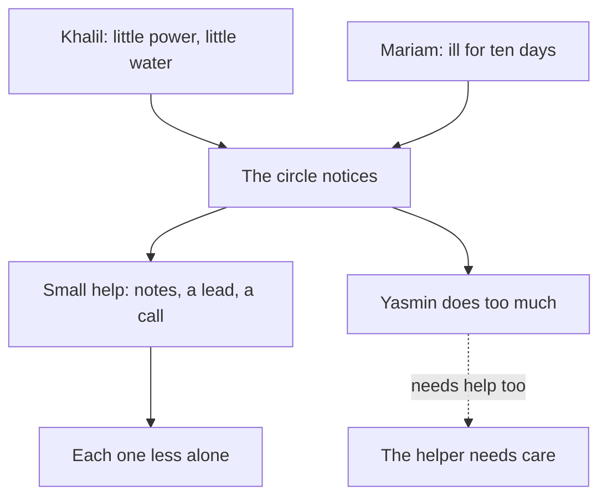

<BigWordAlert term="Steady plan" plainEnglish="A short written plan for one uncertain situation, in six parts, that joins what you believe to what you will do this week." whyItMatters="Belief that stays in your head does not carry you through a hard month. A plan puts trust, patience, advice, good work and other people into steps you can take." />

## A hard month for the circle

Every Saturday evening, six fellows meet online with their mentor, Reem. You have met each of them in this course. Yasmin builds websites for clients. Khalil is a software tester looking for remote work. Mariam studied English literature and is preparing for the next scholarship round. Ahmad is a graphic designer. Rania works with data. Tariq is rebuilding his freelance work after losing a client. The call is short, because data is expensive and the power can go at any time. They share one thing they learned that week, one thing they are stuck on, and one dua.

This month was hard for two of them. In Khalil's area, the power schedule has been worse than usual for three weeks. Some days the grid gives two hours, some days none. Water also comes less often, so the tanks on his building run dry. Most mornings, Khalil and his uncle carry water containers up the stairs. His laptop battery lasts about 3 hours, and he can charge it at his uncle's shop, which has a solar panel. But the shop is busy, and the walk takes time. Khalil missed two Saturday calls. He sent one short message: "Sorry. No power, no water. I am fine."

Mariam is ill. She caught a chest infection and has had a high fever for ten days. Her doctor told her to drink a lot and come back if the fever does not go down. Her mother and younger brother are looking after her. But Mariam is worried. She had planned to spend this month on her application essay for the next scholarship round, and she has written nothing. On the one call she joined, her voice was weak. She said, "I am falling behind. I will catch up next week." Then her connection dropped.

Nobody in the circle can fix the power or cure a fever. For a few days, each of them felt that there was nothing to do. Ahmad said it in the group chat: "I wish we could help, but what can we actually do from here?"

```predict
prompt: "Mariam has had a fever for ten days and has not written her essay. She says she will catch up next week. Before you read on, what do you think helps her most this week?"
options:
  - id: rest-and-help
    label: "Rest fully, and let friends help with small tasks"
  - id: push-alone
    label: "Work a little each night so she does not fall behind"
correctOptionId: rest-and-help
explanation: "Ten days of fever is a time to rest, and in this course rest is not laziness. The Prophet, peace be upon him, told a companion that his body had a right over him (Sahih al-Bukhari 5199), as chapter 7.3 shows. The essay deadline is months away. Working at night while ill would slow her recovery, and doing it alone would hide her need from people who want to help."
```

## One body

The Prophet, peace be upon him, gave a picture of how believers should be with each other. He said that in their mercy, love and kindness to each other, the believers are like one body. When one part of the body hurts, the whole body shares in it, with sleeplessness and fever (Sahih al-Bukhari 6011). The hadith was narrated by the companion an-Nu'man ibn Bashir, may Allah be pleased with him.

> تَرَى الْمُؤْمِنِينَ فِي تَرَاحُمِهِمْ وَتَوَادِّهِمْ وَتَعَاطُفِهِمْ كَمَثَلِ الْجَسَدِ إِذَا اشْتَكَى عُضْوًا تَدَاعَى لَهُ سَائِرُ جَسَدِهِ بِالسَّهَرِ وَالْحُمَّى

Meaning: You see the believers, in their mercy, love and kindness to each other, like one body. When one part hurts, the rest of the body shares its sleeplessness and fever (Sahih al-Bukhari 6011).

Think about what this picture says. A body does not wait for the sore hand to ask for help. The whole body feels it and responds. And the picture is not about strangers far away. It is about the people closest to you: a study circle, a family, neighbours on the same stairs, colleagues on the same project. When Khalil carries water every morning, he is one part of a body. The others are not meant to feel nothing.

The picture also works in the other direction. A body only knows that a hand hurts because the hand sends the message. Mariam's "I will catch up next week" and Khalil's "I am fine" made it harder for the others to respond. Neither of them did anything wrong. Many of us were raised to carry our problems quietly. But you saw in module 3 that sabr is not silence. In this module you will see that telling someone is part of being one body too.

The diagram shows what happened in the circle this month, and the one problem nobody noticed at first.



What to notice: both hard situations flow into one box, "the circle notices". Everything good that followed started there, with people paying attention. But one line leads somewhere else. Yasmin did so much helping that she became the next person who needed help. The takeaway: being one body means giving help and receiving it, and it includes the people who are doing the helping.

## What the circle did

After Ahmad's message, Reem asked a simple question on the next call: "Not what can we fix. What small thing can each of us do this week?" The answers were small and practical.

Rania had seen an advertisement for a remote software tester, so she sent it to Khalil with a short note about the deadline. Ahmad recorded the main points of the Saturday call as a two-minute voice message, which uses far less data than a video. Khalil could listen to it at his uncle's shop. Tariq offered to look after Mariam's part of a shared study task until she was well. Reem phoned Mariam's mother to ask how Mariam was, and told Mariam not to worry about the circle for two weeks.

None of these actions solved anything big. Khalil still carried water. Mariam still had a fever. But Khalil now had a job lead and the notes. Mariam knew her task was covered and that people had asked about her. Each of them was a little less alone. The Sunnah treats this kind of small help as part of faith, and the next chapter looks at it closely.

## What the circle missed

Yasmin wanted to help most of all. Her area gets grid power about six hours a day, and this month it came mostly at night. So she did her client work at night. In the day, she helped: she rewrote Khalil's CV, built a simple page for Tariq's new freelance profile, and phoned Mariam twice. After three weeks, she was sleeping four or five hours a night. She felt worried most of the day and could not concentrate. She told nobody, because, as she said later, "everyone else had real problems."

This is common, and it is worth seeing clearly. The person who helps everyone can be the last person anyone checks on, because they look strong. And that person often believes their own tiredness does not count. The Sunnah does not ask this of you. Your body has a right over you, and seeking help is taking the means. Chapter 7.3 teaches both from their sources.

If you feel overwhelmed for a long time, or you have thoughts of harming yourself, talk to your mentor or the fellowship coordinator today. Talk to a doctor or counsellor too, if you can. This course does not replace professional care.

## Why this matters for a steady life

Everything in this course so far has been about how one believer stands steady when the future is unclear. You learned what only Allah knows and what is yours to do. You learned to trust Allah and take the means, to wait well, to be grateful and hopeful, to decide with advice and istikhara, and to start again after a failure. All of that is true. But nobody does any of it alone.

Look at how often other people were part of the sources you studied. Hajar, peace be upon her, searched for water for her baby, and help came (Sahih al-Bukhari 3364). The Prophet planned the Hijra with Abu Bakr, may Allah be pleased with him, with Abu Bakr's children and with a hired guide (Sahih al-Bukhari 3905). He asked his wife Umm Salamah, may Allah be pleased with her, for advice and followed it (Sahih al-Bukhari 2731). These are not stories of people who managed alone. They are stories of people who trusted Allah, did their part, and worked with others.

So this module has two sides. The first is serving others: what you can give, even in a hard month, with very little. The second is receiving care: resting, seeking treatment, and telling a real person when things get heavy. Belief is paired with action in both. You serve because your faith asks it. You rest and ask for help because your faith allows it, and even asks for it.

## Your steady plan

At the end of this module, you will bring the whole course together in a capstone: your steady plan. You will choose one uncertain situation. It can be a real one from your own life, or one of three provided cases, so that nobody has to share anything personal. Then you will write a plan in six parts.

1. What only Allah knows, and what is yours to do
2. The means you will take, and a backup plan
3. How you will wait well, with the words and dua you will use
4. Who you will consult, and istikhara if there is a choice
5. Your intention and one small daily habit, and what you will do if it does not work out
6. Who you will serve, and who you will tell if it gets heavy

Each part comes from a module. You have already practised most of them in your gates. The capstone asks you to put them together for one situation, so that you can see how they support each other. Then you will walk your mentor through the plan in about five minutes and answer a few questions.

Before the capstone, chapter 7.4 gives you five fresh cases from across the course. For each one, you choose which teaching fits first. This is good practice, because real life does not tell you which module a problem belongs to.

<LearningObjectives items={["Explain the picture of believers as one body, and what it asks of you in a hard month", "Serve others in small, practical ways that fit the time and means you have", "Care for your body and mind as a trust, and see rest and treatment as taking the means", "Name a real person to tell when things get heavy, and when it is time to tell them", "Choose which teaching from the course fits a new situation first", "Build and defend a six-part steady plan for one uncertain situation"]} />

## Key words

| Word | Plain English |
|---|---|
| **One body** | The Prophet's picture of believers: when one hurts, the others feel it and respond |
| **Service** | Practical help you give to others, small or large, for the sake of Allah |
| **Counsellor** | A trained person you can talk to about worry, sadness or stress, who helps you find a way forward |
| **A right over you** | Something you owe; the Prophet said your body has a right over you, such as rest and sleep |
| **Defend a plan** | Explain your plan to a mentor and answer questions about why each part is there |

## What is in this module

| Chapter | You will practise |
|---|---|
| 7.2 | Serving others in small, practical ways, and passing help on |
| 7.3 | Caring for body and mind, and telling a real person when it gets heavy |
| 7.4 | Choosing which teaching fits five fresh cases from the whole course |
| 7.5 | Building your steady plan and defending it to your mentor |
| 7.6 | Final checks, your steady toolkit, and a look back at module 1 |

**Next:** Serving others: what the Sunnah says about helping, and what you can give even in a hard month.
