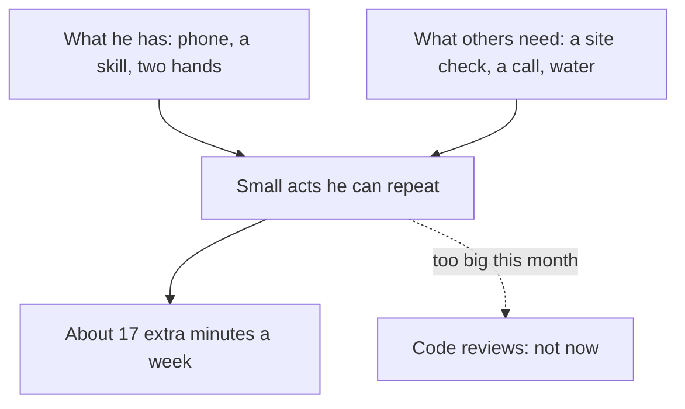

## "What can we actually do from here?"

Ahmad's question in chapter 7.1 is one many people ask. Khalil has little power and has to carry water up the stairs every morning. Mariam is ill. The others live in different areas, with their own power cuts and their own work. Nobody can send a generator or cure a fever. So what does serving others mean, when you have very little to give?

Khalil felt the same question from the other side. In the third week of the bad power schedule, he wrote in his notebook: "Everyone is helping me. I cannot help anyone. I have no power, no data and no money." He felt that service was for people with spare time and a full battery. For now, he thought, he could only receive.

This chapter answers both of them from the sources. It shows what the Sunnah says about helping others and how help passes around a group of people. It also shows why small help counts, how to console a friend, and how to plan service that fits the time and means you really have.

## What the Sunnah says about serving others

The Prophet, peace be upon him, spoke about helping others many times. Three hadith carry the main teaching of this chapter.

The first is the clearest. He said that whoever relieves a believer of one of the hardships of this world, Allah will relieve him of a hardship on the Day of Resurrection. Whoever makes things easy for someone in difficulty, Allah makes things easy for him in this world and the next. And Allah helps His servant as long as the servant is helping his brother (Sahih Muslim 2699).

> وَاللَّهُ فِي عَوْنِ الْعَبْدِ مَا كَانَ الْعَبْدُ فِي عَوْنِ أَخِيهِ

Meaning: Allah is helping the servant as long as the servant is helping his brother (Sahih Muslim 2699).

Notice the shape of that last sentence. It says Allah is helping you while you are helping. It does not say that the person you helped will pay you back. The help is Allah's, from where He wills, during the time you spend on someone else.

The second hadith says the same thing in other words. A Muslim is the brother of a Muslim: he does not wrong him, and he does not abandon him. Whoever meets his brother's need, Allah meets his need (Sahih al-Bukhari 2442). "Does not abandon him" matters for a study circle. When a friend goes quiet in a hard month, not abandoning them can be as simple as checking on them before they ask.

The third hadith is about the heart behind the help. None of you truly believes until he loves for his brother what he loves for himself (Sahih al-Bukhari 13). In daily life this is very practical. If you would want to hear about a job opening, tell your friend about one. If you would want someone to read your CV before you send it, offer to read theirs. Service starts with noticing what you would want, and giving it.

## How help passes on

In the weeks after the hard month, the circle's help did not stop with one act each. It moved from person to person. Before you step through it, think about Khalil.

```predict
prompt: "Khalil has about two hours of grid power on a good day, very little phone data and no money to spare this month. Can he still serve someone in the circle in a way that counts?"
options:
  - id: not-now
    label: "Not this month; for now he needs to receive help"
  - id: yes-small
    label: "Yes, a few minutes of his skill counts"
correctOptionId: yes-small
explanation: "Khalil is a software tester, and a short check on a friend's site is real help. The Sunnah counts even a smile and water poured from your bucket into your brother's as charity (Jami' at-Tirmidhi 1956, graded hasan). Service is measured by what you have, not by what you lack."
```

Now step through the canvas. At step 2, check your prediction about Khalil. Then watch where the help goes, and what happens to the one person who gets nothing back.

<InteractiveCanvas slug="help-passes-on" />

The canvas showed four small acts of help, each from one fellow to another. Rania sent Khalil a job lead. Khalil, charging his phone at his uncle's shop, tested Ahmad's portfolio site and found two broken links. Ahmad designed a clean layout for Mariam's CV once she was well. Mariam, who studied English literature, corrected the English in a report Rania was writing for a client.

Help reached Rania again, but not from Khalil, the person she had helped. And Ahmad, who helped Mariam, received nothing back that month. At the last step he helped again anyway: he sent Khalil the notes of the Saturday call. That is the pattern the hadith describe. The return is with Allah, and Muslim 2699 does not say how or from whom it will come. Sometimes it comes through another person. Sometimes you never see it at all, and the help is still not wasted.

## Small help counts

Khalil's first thought was that he had nothing to give. One hadith answers him directly. The Prophet said that your smile in the face of your brother is charity for you (Jami' at-Tirmidhi 1956, graded hasan). The full hadith counts more small acts as charity. Guiding a person who is lost is one. Helping someone whose sight is weak is another. So is removing a stone or a thorn from the road, and pouring water from your bucket into your brother's bucket.

> تَبَسُّمُكَ فِي وَجْهِ أَخِيكَ لَكَ صَدَقَةٌ

Meaning: Your smile in the face of your brother is charity for you (Jami' at-Tirmidhi 1956, graded hasan).

Look at that list again. A smile. Directions. A stone moved out of the way. Water poured from one bucket into another. None of these needs money or a laptop. Most of them take a minute or two. The Sunnah does not count big service alone. It counts the small help that fits into an ordinary, difficult day.

## Consoling is service too

One kind of service needs no skill and no money, only presence: being with a friend after a loss. The Sunnah shows how. When the Prophet's grandchild was dying, his daughter sent for him. He first sent her words of comfort. To Allah belongs what He took and what He gave, and everything with Him has an appointed time, so let her be patient and hope for reward. When she asked again, he went to her. He wept, and when he was asked about his tears, he said they were mercy that Allah has put in the hearts of His servants (Sahih al-Bukhari 1284).

So consoling a friend looks like this. Be there, in person or by phone. Listen more than you speak. Say those words, or the istirja, gently, if they fit the moment. Help with practical needs, such as food, a message to a teacher, or a lift. And do not explain the loss: the Prophet did not tell his daughter why it happened. Your tears with your friend are not weakness. They are the mercy the hadith describes.

## Worked example: Khalil's month of service

The canvas showed one act of Khalil's. Here is how he planned a whole month of service, step by step, in his notebook. You can use the same steps for your own week.

**Step 1: what do I really have?** He listed it honestly. His laptop battery lasts about 3 hours, and he needs that time for his own job search. That includes the application for the job lead Rania sent. His phone charges at his uncle's shop when he goes there. He has a skill: as a software tester, he notices when things on a screen do not work. And he climbs the stairs with water every morning anyway.

**Step 2: who around me needs something I have?** He thought of three people. Ahmad had asked the circle weeks ago if anyone could check his portfolio site on a phone. Mariam was ill and had not heard from many people. And the older man who lives below Khalil's family cannot carry water containers up the stairs any more.

**Step 3: choose small help I can keep up.** In module 6 you met the hadith that the deeds most beloved to Allah are the most consistent, even if small (Sahih al-Bukhari 6464). So Khalil chose small acts he could repeat. Once, at the shop, he would spend 30 minutes testing Ahmad's site on his phone. Every Saturday, he would send Mariam a short voice message asking how she was. And on most mornings, he would carry one container for his neighbour on the climb he already makes. A second container adds about 2 minutes to that climb.

**Step 4: check the intention.** In module 6 you learned that actions are by intentions (Sahih al-Bukhari 1). Khalil wrote one line: "For the sake of Allah, not so that people help me back." He wrote it because he had noticed something in himself. Part of him wanted to help so that he would feel less like a burden. That is human. Writing the intention down helped him aim at something better.

**Step 5: say what I will not do.** He did not offer to rewrite anyone's code or review long documents this month. He did not have the power for it. Saying no to big tasks was what made the small ones possible.

Now add up the extra time. The climb itself does not count, because he makes it anyway. In the first week, his service took about 47 minutes. That is 30 minutes on Ahmad's site, 5 minutes on a voice message, and 12 extra minutes on the stairs over six mornings. In the later weeks it took about 17 minutes, because the site was done. That is very little time. But each week now had a few real things he could do for someone else, in a month when he could not fix his own water.

The diagram shows how Khalil chose the size of his service.



Read it from the two boxes at the top. Service is where what you have meets what someone needs, so it starts from both lists, not from a feeling of guilt. The dotted line matters as much as the solid ones. Saying no to what does not fit this month keeps the small acts going for four weeks.

## Where people misunderstand service

**"I have nothing to give."** This is Khalil's first thought, and many sincere people share it. The Sunnah counts a smile, a direction, a stone moved off the road and water poured into a neighbour's bucket (Jami' at-Tirmidhi 1956, graded hasan). If you have a few minutes, a skill or a kind word, you have something to give. How to spot it: you measure service in money and hours alone.

**"Service means saying yes to everything."** Yasmin did this in chapter 7.1. She rewrote CVs, built pages and made calls until she slept four or five hours a night. Serving others does not cancel the rights of your own body, as chapter 7.3 shows. How to spot it: you help more and more, and you tell nobody that you are tired.

**"I help people so they will help me."** Help that is a trade stops when the other person cannot pay back. The hadith tie the return to Allah, not to the person you helped (Sahih Muslim 2699; Sahih al-Bukhari 2442). How to spot it: you feel cheated when someone you helped does not help you back.

<Callout type="info" title="Small and steady help">
One voice message every Saturday for a month reaches a friend four times. One long visit you keep putting off may never happen. Choose help you can keep up.
</Callout>

## Check your understanding

```quiz
type: mcq
question: "Fida's uncle, who raised her, has died. She cries in the university library, asks why it happened now, and says she does not want to be alone. Her friend Reham wants to help. What fits the Sunnah of consoling?"
options:
  - "Stay with her, listen, and offer to tell their lecturer she is away"
  - "Explain that hardship is a test, so the loss has a purpose for her"
  - "Remind her gently that sabr means she should try not to cry today"
  - "Give her time alone today, and visit with food once she feels calm"
correct: 0
explanations:
  - "Right. The Prophet went to his daughter, wept with her, and did not explain the loss (Sahih al-Bukhari 1284). Presence, listening and practical help, like a message to the lecturer, are the service a grieving friend needs."
  - "Life as a test is taught in the course, but the Sunnah of consoling does not explain a person's loss to them. The Prophet comforted and stayed; he did not give reasons (Sahih al-Bukhari 1284)."
  - "Tears are not a lack of sabr. The Prophet wept at his son's death and said the eye sheds tears and the heart grieves (Sahih al-Bukhari 1303)."
  - "Fida has said she does not want to be alone, so time alone misses what she needs now. The Prophet went to his daughter when she asked for him (Sahih al-Bukhari 1284). Fida is with Reham right now, and the first service is to stay."
```

```quiz
type: mcq
question: "Mazin, a junior developer, wants to help his neighbour's son prepare for job interviews. This month he has client work every evening, so he decides to wait until next month and give a full weekend, to do it properly. Which plan fits this chapter best?"
options:
  - "Wait for the full weekend, since good help is help done properly"
  - "Send the son a list of videos to watch, since time is short for both"
  - "Ask a friend with more free time to take over the help this month"
  - "Give 20 minutes this week on one question, and repeat it each week"
correct: 3
explanations:
  - "Doing a thing well matters, but the deeds most loved by Allah are the most consistent, even if small (Sahih al-Bukhari 6464). A full weekend that keeps moving to next month may not happen."
  - "A list can be useful, but the son needs practice with a person, and 20 minutes of Mazin's time is something he can give now. The Sunnah counts small acts as charity (Jami' at-Tirmidhi 1956, graded hasan)."
  - "Asking a friend can help, but Mazin can serve now in a small way. Allah helps His servant while he helps his brother (Sahih Muslim 2699), and that includes 20 minutes."
  - "Right. Small help kept up is counted, and the deeds most loved by Allah are the most consistent, even if small (Sahih al-Bukhari 6464). Twenty minutes a week for a month is more than a weekend that keeps being put off."
```

## This week

Choose one person and one small act you can repeat for the next four weeks. Use Khalil's steps: what you really have, who needs something you have, and what you will not take on. Write one line about your intention. It can be as small as a voice message every Saturday to a friend who has gone quiet, or carrying something for a neighbour. If your own week is very heavy, a smile and a sincere question to someone near you is enough to begin.

**Next:** Caring for your body and mind, and telling a real person when things get heavy.
