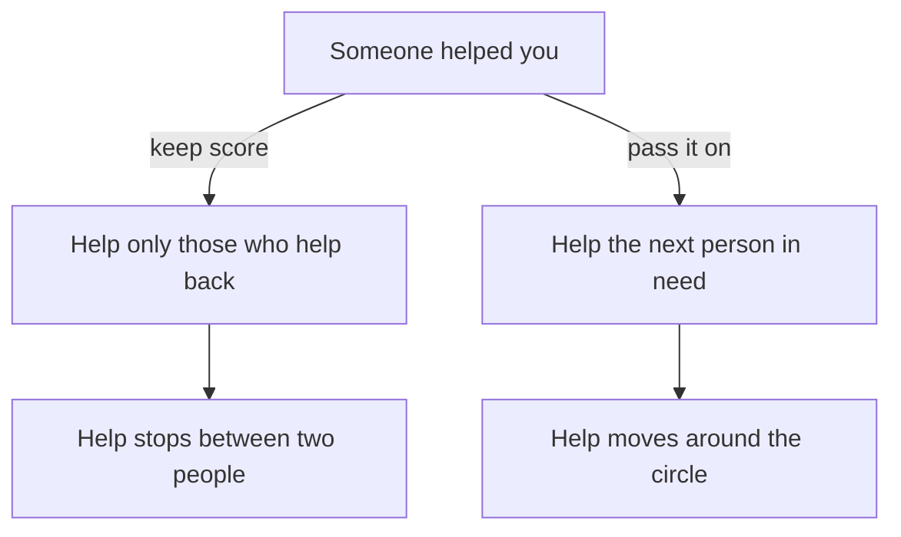

## "What can we actually do from here?"

Ahmad's question in chapter 7.1 is one many people ask. Khalil has little power and has to carry water up the stairs every morning. Mariam is ill. The others live in different areas, with their own power cuts and their own work. Nobody can send a generator or cure a fever. So what does serving others mean, when you have very little to give?

Khalil felt the same question from the other side. In the third week of the bad power schedule, he wrote in his notebook: "Everyone is helping me. I cannot help anyone. I have no power, no data and no money." He felt that service was for people with spare time and a full battery. For now, he thought, he could only receive.

This chapter answers both of them from the sources. It shows what the Sunnah says about helping others, why small help counts, how help passes around a group of people, and how to plan service that fits the time and means you really have.

```predict
prompt: "Khalil has about two hours of grid power on a good day, very little phone data and no money to spare this month. Before you read on, can he still serve the people around him in a way the Sunnah counts?"
options:
  - id: not-now
    label: "Not this month, he has no spare time or money"
  - id: yes-small
    label: "Yes, small help like a kind word counts"
correctOptionId: yes-small
explanation: "The Sunnah counts a smile, giving directions and pouring water from your bucket into your brother's as charity (Jami' at-Tirmidhi 1956, graded hasan). Service is measured by what you have, not by what you lack. Khalil cannot give money, but he can give a few minutes, a skill and a kind word."
```

## What the Sunnah says about serving others

The Prophet, peace be upon him, spoke about helping others many times. Four hadith carry the main teaching of this chapter.

The first is the clearest. He said that whoever relieves a believer of one of the hardships of this world, Allah will relieve him of a hardship on the Day of Resurrection. Whoever makes things easy for someone in difficulty, Allah makes things easy for him in this world and the next. And Allah helps His servant as long as the servant is helping his brother (Sahih Muslim 2699).

> وَاللَّهُ فِي عَوْنِ الْعَبْدِ مَا كَانَ الْعَبْدُ فِي عَوْنِ أَخِيهِ

Meaning: Allah is helping the servant as long as the servant is helping his brother (Sahih Muslim 2699).

Notice the shape of that last sentence. It says Allah is helping you while you are helping. It does not say that the person you helped will pay you back. The help is Allah's, from where He wills, during the time you spend on someone else.

The second hadith says the same thing in other words. A Muslim is the brother of a Muslim: he does not wrong him, and he does not abandon him. Whoever meets his brother's need, Allah meets his need (Sahih al-Bukhari 2442). "Does not abandon him" matters for a study circle. When a friend goes quiet in a hard month, not abandoning them can be as simple as checking on them before they ask.

The third hadith is about the heart behind the help. None of you truly believes until he loves for his brother what he loves for himself (Sahih al-Bukhari 13). In daily life this is very practical. If you would want to hear about a job opening, tell your friend about one. If you would want someone to read your CV before you send it, offer to read theirs. Service starts with noticing what you would want, and giving it.

The fourth hadith answers Khalil directly. The Prophet said that your smile in the face of your brother is charity for you (Jami' at-Tirmidhi 1956, graded hasan). The full hadith counts more small acts as charity: guiding a person who is lost, helping someone whose sight is weak, removing a stone or a thorn from the road, and pouring water from your bucket into your brother's bucket.

> تَبَسُّمُكَ فِي وَجْهِ أَخِيكَ لَكَ صَدَقَةٌ

Meaning: Your smile in the face of your brother is charity for you (Jami' at-Tirmidhi 1956, graded hasan).

Look at that list again. A smile. Directions. A stone moved out of the way. Water poured from one bucket into another. None of these needs money or a laptop. Most of them take a minute or two. The Sunnah does not only count big service. It counts the small help that fits into an ordinary, difficult day.

## How help passes on

In the weeks after the hard month, the circle's help did not stop with one act each. It moved from person to person. Step through the canvas below. At step 2, check your prediction about Khalil, and then watch where Rania's help to Khalil ends up.

<InteractiveCanvas slug="help-passes-on" />

The canvas showed four small acts of help, each from one fellow to another. Rania sent Khalil a job lead. Khalil, charging his phone at his uncle's shop, tested Ahmad's portfolio site and found two broken links. Ahmad designed a clean layout for Mariam's CV once she was well. Mariam, who studied English literature, corrected the English in a report Rania was writing for a client. Help reached Rania again, but not from Khalil, the person she had helped. It came from Mariam, whom she had not helped directly that month.

That is the pattern the hadith describe. Rania did not help Khalil so that Khalil would help her back. If she had been keeping score, she would have been disappointed, because Khalil had nothing he could give her that month. But help still came. Muslim 2699 does not say how or from whom Allah's help will come. In this example it came through another member of the circle. Sometimes it comes in a way you never see.

## Worked example: Khalil's service for one month

Khalil decided to answer his own question in his notebook. He used the steps below. You can use the same steps for your own week.

**Step 1: what do I really have?** He listed it honestly. His laptop battery lasts about 3 hours, and he needs that time for his own job search, including the application for the job lead Rania sent. His phone charges at his uncle's shop when he goes there. He has a skill: he is a software tester, so he notices when things on a screen do not work. And he has his own two hands, which carry water every morning anyway.

**Step 2: who around me needs something I have?** He thought of three people. Ahmad had asked the circle weeks ago if anyone could check his portfolio site on a phone. Mariam was ill and had not heard from many people. And the older man who lives below Khalil's family cannot carry water containers up the stairs any more.

**Step 3: choose small help I can keep up.** In module 6 you met the hadith that the deeds most beloved to Allah are the most consistent, even if small (Sahih al-Bukhari 6464). So Khalil chose small acts he could repeat. Once, at the shop, he would spend 30 minutes testing Ahmad's site on his phone. Every Saturday, he would send Mariam a short voice message asking how she was. And on most mornings, he would carry one container for his neighbour when he carried his own. The stairs take about 10 minutes, and he was climbing them anyway.

**Step 4: check the intention.** In module 6 you learned that actions are by intentions (Sahih al-Bukhari 1). Khalil wrote one line: "For the sake of Allah, not so that people help me back." He wrote it because he had noticed something in himself. Part of him wanted to help so that he would feel less like a burden. That is human. Writing the intention down helped him aim at something better.

**Step 5: say what I will not do.** He did not offer to rewrite anyone's code or review long documents this month. He did not have the power for it. Saying no to big tasks was what made the small ones possible.

Look at the result. In the first week, his service took about an hour and a half: 30 minutes on Ahmad's site, 5 minutes on a voice message, and about 60 minutes on the stairs over six mornings. In the later weeks it took about an hour and five minutes, because the site was done. That is not much time. But it changed how Khalil's month felt. He still could not fix the water. He still waited for power. But each week had a few things he could do for someone else, and each of them was real.

The diagram shows two ways people respond after someone helps them. Follow both roads from the top.



What to notice: both roads start from the same kind act. On the road on the left, help becomes a trade, and it stops when one person cannot pay back. On the road on the right, help moves on to whoever needs it next, the way it moved from Rania to Khalil, to Ahmad, to Mariam and back to Rania. The takeaway: you do not have to wait until you can repay someone. Help the next person, and leave the return to Allah.

## Where people misunderstand service

**"I have nothing to give."** This is Khalil's first thought, and many sincere people share it. The Sunnah counts a smile, a direction, a stone moved off the road and water poured into a neighbour's bucket (Jami' at-Tirmidhi 1956, graded hasan). If you have a few minutes, a skill or a kind word, you have something to give. How to spot it: you are measuring service in money and hours only.

**"Service means saying yes to everything."** Yasmin fell into this in chapter 7.1. She rewrote CVs, built pages and made calls until she slept four or five hours a night. Serving others does not cancel the rights of your own body, as chapter 7.3 shows. How to spot it: you are helping more and more, and you are telling nobody that you are tired.

**"I help people so they will help me."** Help that is a trade stops when the other person cannot pay, as the diagram showed. The hadith tie the return to Allah, not to the person you helped (Sahih Muslim 2699; Sahih al-Bukhari 2442). How to spot it: you feel cheated when someone you helped does not help you back.

<Callout type="info" title="Small and steady beats big and rare">
One voice message every Saturday for a month reaches a friend four times. One long visit you keep postponing may never happen. Choose help you can keep up.
</Callout>

## Check your understanding

```quiz
type: mcq
question: "Manar, a junior web developer, reviewed the CVs of three classmates from her university last month, in the evenings at her family's flat. None of them has helped her since. This week a neighbour's son asks her to check his CV. She has the time, but she says no, because help should go both ways. What does Sahih Muslim 2699 say that she has missed?"
options:
  - "That help is a fair trade, so stopping when nobody returns it is right"
  - "That only family should be helped, as they are the ones who return it"
  - "That Allah helps His servant while the servant is helping another"
  - "That helping others is only for people who have no work of their own"
correct: 2
explanations:
  - "Fairness matters, but this hadith does not describe help as a trade between two people. It ties the return to Allah, so a classmate who has not helped back does not cancel anything."
  - "Helping family is good, but the hadith speaks of helping a brother and anyone in difficulty. It does not limit help to people who can return it."
  - "Right. The hadith says Allah is helping the servant as long as the servant is helping his brother. The return does not have to come from the classmates she helped. It is Allah's help, from where He wills."
  - "The hadith does not limit service to people with free time. Manar does have the time here. Busy people help in small ways too, like the acts in Jami' at-Tirmidhi 1956."
```

```quiz
type: mcq
question: "Thaer, a mobile developer who works from a shared office in his town, sees an advertisement for a remote internship. It fits his friend Saleh's skills better than his own. Thaer thinks he might apply himself next year. Which response fits Sahih al-Bukhari 13?"
options:
  - "Keep it quiet, since telling Saleh may lower his own chances later"
  - "Send it to Saleh now, as Thaer would want to be told about it himself"
  - "Say nothing, since each person's provision is written and sharing changes nothing"
  - "Tell Saleh after the deadline, so that neither of them feels any pressure"
correct: 1
explanations:
  - "This is a common worry, but the hadith asks Thaer to love for his brother what he loves for himself. He would want to hear about a good opening, so he passes it on."
  - "Right. None of you truly believes until he loves for his brother what he loves for himself (Sahih al-Bukhari 13). Thaer would want to be told, so he tells Saleh."
  - "Provision is from Allah, but that is never a reason to hold back a good deed. In module 1 you saw that belief in qadr comes with action, not instead of it."
  - "Telling Saleh after the deadline helps nobody. Service means giving the help while it is still useful."
```

## This week

Choose one person and one small act you can repeat for the next four weeks. Use Khalil's steps: what you really have, who needs something you have, and what you will not take on. Write one line about your intention. It can be as small as a voice message every Saturday to a friend who has gone quiet, or carrying something for a neighbour. If your own week is very heavy, a smile and a sincere question to someone near you is enough to begin.

**Next:** Caring for your body and mind, and telling a real person when things get heavy.
