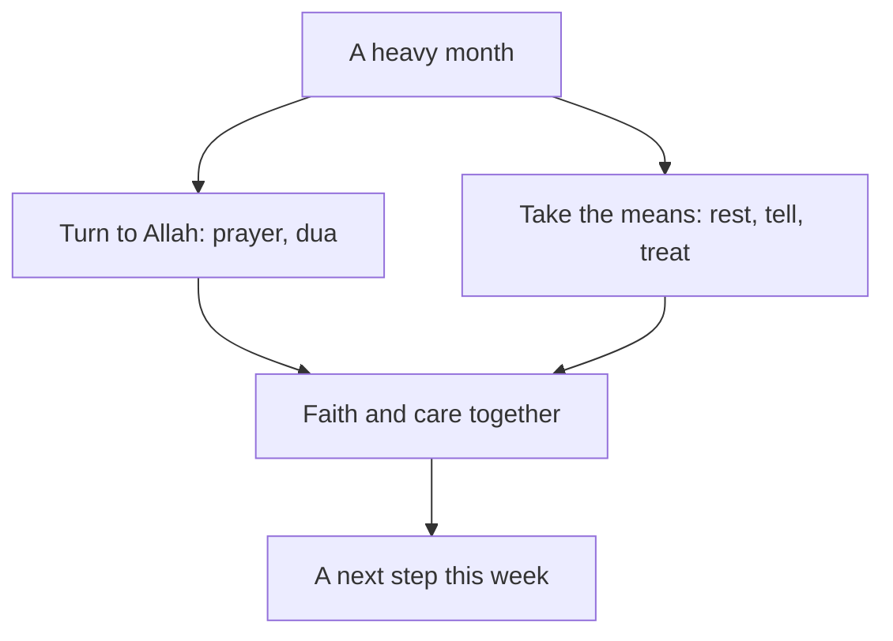

## "Everyone else has real problems"

In chapter 7.1, Yasmin was the one who helped everyone. For three weeks, the grid power in her area came mostly at night, so she did her client work at night. In the day she rewrote Khalil's CV, built a page for Tariq and phoned Mariam. She slept four or five hours a night.

By the end of the third week, some things had changed in her. She lay awake even when she had time to sleep. She felt worried most of the day, about clients, about money, about everything. Small tasks, like answering one email, felt very heavy. She stopped joining the Saturday call and told the circle she was busy.

She did not tell anyone how she felt. When she thought about it, three ideas stopped her. The first: "Everyone else has real problems. Khalil has no water. Mariam was ill. I just need to try harder." The second: "Resting now would be lazy. People are counting on me." The third was quieter: "If my trust in Allah were stronger, I would not feel like this."

All three ideas are common, and all three are sincere. This chapter looks at each of them in the light of the sources. It also gives you the signs that it is time to talk to someone, and a clear order for who to tell.

## Your body has a right over you

One of the companions, Abdullah ibn Amr ibn al-'As, may Allah be pleased with him, used to fast every day and pray all night. When the Prophet, peace be upon him, heard about it, he told him not to do that. He told him to fast some days and not others, and to pray at night and also sleep. Then he said that your body has a right over you, your eyes have a right over you, and your wife has a right over you (Sahih al-Bukhari 5199).

> فَإِنَّ لِجَسَدِكَ عَلَيْكَ حَقًّا

Meaning: For your body has a right over you (Sahih al-Bukhari 5199).

Think about who received this advice. Abdullah was not lazy. He was doing too much of something good: fasting and night prayer. And the Prophet still told him to stop and sleep. Rest was a right of the body for a man doing too much worship. So it is a right for a fellow doing too much client work and too many favours.

So rest is not laziness. Sleep is not wasted time. They are part of the religion, a right you owe to the body Allah gave you. When Yasmin says "resting now would be lazy", the hadith gives a clear answer: your body has a right over you, and so do your eyes.

## Seeking treatment is taking the means

The Prophet said that Allah has not sent down any illness without also sending down a cure for it (Sahih al-Bukhari 5678). In another hadith, some Bedouins asked him whether they should seek treatment. He answered yes, and told the servants of Allah to seek treatment. Allah has not made an illness without making a cure for it, he said, except one: old age (Jami' at-Tirmidhi 2038, graded sahih; also Sunan Abi Dawud 3855).

> نَعَمْ يَا عِبَادَ اللَّهِ تَدَاوَوْا

Meaning: Yes, servants of Allah, seek treatment (Jami' at-Tirmidhi 2038, graded sahih).

The question itself is worth noticing. The Bedouins asked "should we?" They seem to have wondered whether seeking treatment went against trusting Allah. The answer was not "trust Allah instead". It was yes. This is the same lesson you learned in module 2 with "tie it and trust" (Jami' at-Tirmidhi 2517, graded hasan). Seeing a doctor is tying the camel. The trust is in the heart; the treatment is the means.

This is true for the mind as well as the body. Seeking help from a doctor, a counsellor or a <GlossaryTerm term="psychologist" definition="A person trained in how people think and feel, who helps with worry, sadness and stress, mostly by talking with you." /> is taking the means, like tying the camel.

## Faith and professional care work together

Scholars have spoken about this clearly. In 2025, Egypt's Dar al-Ifta held a seminar on fatwa and mental health. There, a scholar of comparative fiqh from Al-Azhar said that psychological treatment and religious treatment complete and support each other. He added that the path to recovery is real treatment, not people who claim cures without knowledge. Another well-known fatwa answer says there is nothing wrong with seeing a psychiatrist or psychologist who is trustworthy and skilled. It also points to the hadith that Allah sent down no illness without a cure, and to the Prophet's answer that people should seek treatment.

These statements come from scholars of different backgrounds, and they agree on the plain point. Faith and professional care work together. Prayer, dua and remembering Allah are not replaced by care. And care is not a sign that your prayer has failed.

Two opposite mistakes are worth naming. One says "prayer is enough, so I do not need anyone". The other says "talking to a professional matters more than prayer". The course says neither. A believer can make dua at night, keep up the prayer, and also see a counsellor on Tuesday. That is not weak trust. It is trust with the means taken, the same pattern you have seen in every module.

## Who to tell, in order

Yasmin now knows that rest is a right and that treatment is allowed. But she is still carrying three heavy weeks by herself. Before you step through the canvas, decide what her next step should be.

```predict
prompt: "Yasmin now accepts that rest is a right and that treatment is allowed. She has slept badly and felt worried most days for three weeks, and she has told nobody. What should her first step be this week?"
options:
  - id: tell-someone
    label: "Tell one person she trusts how she has felt"
  - id: rest-first
    label: "Rest more, pray, and see if it passes first"
correctOptionId: tell-someone
explanation: "Rest and prayer both help, and she should keep them. But three weeks of poor sleep and daily worry is a sign to talk to a real person, not only to wait. When the Prophet, peace be upon him, was afraid, he told his wife Khadijah, may Allah be pleased with her, and she took him to someone with knowledge (Sahih al-Bukhari 3)."
```

The canvas follows Yasmin from the same heavy weeks down two roads. Check your prediction at step 3, then step through to the end.

<InteractiveCanvas slug="who-to-tell" />

On one road, Yasmin says nothing, and the weeks stay heavy. On the other, she tells one person she trusts, her friend Mariam. Then she tells her mentor, Reem, who helps her put down some favours for now and asks whether she has seen a doctor. The doctor checks her and suggests she also talk to a counsellor. That road ends in a plan with rest, treatment and her prayers all in it. The order matters less than the first step: tell one real person, this week.

## Telling someone: the Prophet and Khadijah

The clearest model of telling someone comes from the Prophet himself. After the first revelation, he came home trembling. He told his wife Khadijah, may Allah be pleased with her, what had happened, and he told her that he feared for himself (Sahih al-Bukhari 3). You met this hadith in module 5 as an example of consulting. Here, look at it as an example of telling someone you are afraid.

Look at what Khadijah did. First, she listened and comforted him. She reminded him of the good he did. He kept family ties, carried the burden of the weak, helped the poor, honoured guests and helped people in real hardship. She told him that Allah would never disgrace him. Then she did something practical: she took him to her cousin Waraqa ibn Nawfal, a man who knew the earlier scriptures.

So the pattern has three parts. The Prophet told the person closest to him how he felt. That person listened and reminded him of what was true. Then they went together to someone with the right knowledge. If the best of people told someone that he was afraid, then telling someone is not a weakness. It is following his example.

## When it is time to talk to someone

Everyone has bad days and hard weeks. Sadness, worry and tiredness are human, and they are not a sign of weak faith. You saw in module 3 that the Prophet wept when his son died (Sahih al-Bukhari 1303). He also asked Allah for protection from worry and grief (Sahih al-Bukhari 6369). But some signs mean it is time to talk to someone, not only to wait:

- You sleep badly most nights, for weeks rather than days
- Worry or sadness fills most of your day
- Small tasks feel too heavy to start
- You pull away from people you usually enjoy
- You stop eating properly or stop caring for yourself
- You feel that nothing you do helps

If you feel overwhelmed for a long time, or you have thoughts of harming yourself, talk to your mentor or the fellowship coordinator today. Talk to a doctor or counsellor too, if you can. This course does not replace professional care. A form, an app or a chat tool is not enough on its own: talk to a real person.

## Worked example: Ehab's month

The same steps work for a different person and a different kind of heavy month. Ehab is 26 and works as a junior accountant for a small firm, at a shared office in his town. His father's shop closed this year, and Ehab now pays most of the family's costs. For a month he has worked late every day. He has headaches most afternoons and sleeps about five hours. He snaps at his younger brothers, and then feels bad about it. He tells himself that a man should handle these things alone.

**Step 1: name what is happening, honestly.** One evening Ehab wrote down what he had noticed. A month of short sleep. Headaches most days. Being short-tempered at home. And a feeling that nothing he did was enough. When he compared it with the list of signs, three of them fitted, and they had lasted weeks, not days.

**Step 2: tell someone he trusts.** He chose his older cousin Osama, who had helped him find the job. He said only: "I have not been well for a month, and I do not know what to do." Osama did what Khadijah did. He listened first. Then he reminded Ehab of what was true: Ehab had kept the family going all year, and being tired was not failing.

**Step 3: tell his mentor.** Osama encouraged him to tell his fellowship mentor too. The mentor helped him look at his hours. Ehab had been staying late to finish work that his manager had never asked to be done the same day. The mentor also asked whether he had seen a doctor about the headaches.

**Step 4: see a doctor.** Ehab went to a clinic. The doctor checked him, asked about his sleep, his screen time and his worries, and gave him advice about breaks and sleep. The doctor also suggested he talk to a counsellor if the worry stayed. In his notebook, Ehab wrote the reference of the hadith about seeking treatment, Jami' at-Tirmidhi 2038, so he would remember why he went.

**Step 5: plan the rest.** He agreed with his manager to leave at 17:30 on four days a week. He set a sleep time of 23:00. He kept his prayers, and at night, when the worry about money came, he said the dua for refuge from worry and grief (Sahih al-Bukhari 6369). The dua did not replace the doctor, and the doctor did not replace the dua.

**Step 6: check again.** He agreed to tell Osama after two weeks how things were going. A plan with a check-in is stronger than a plan you keep alone.

The diagram shows where Ehab's plan came from.



Ehab's month had two sources of help, and both arrows land in the same box. His prayers and his dua sit on the left. Telling Osama, seeing the doctor and leaving at 17:30 sit on the right. He did not have to choose between trusting Allah and getting help, and a steady plan never asks you to.

## Where people misunderstand care

**"Rest is laziness."** The Prophet told a companion who was doing too much worship to sleep, because his body had a right over him (Sahih al-Bukhari 5199). How to spot it: you feel guilty every time you sleep or stop.

**"Seeing a doctor or counsellor shows weak trust."** People asked the Prophet this exact question, and he told them to seek treatment (Jami' at-Tirmidhi 2038, graded sahih). How to spot it: you wait for a problem to pass "if Allah wills", while doing nothing that Allah has made a means.

**"I should not burden people, because others have it worse."** Your pain does not need to be the biggest in the room to be real. The Prophet told Khadijah when he was afraid (Sahih al-Bukhari 3). How to spot it: you compare your problem with other people's before you decide whether you are allowed to speak.

<Callout type="info" title="Who to contact">
Your mentor or the fellowship coordinator. If you have thoughts of harming yourself, talk to one of them today, and to a doctor or counsellor if you can.
</Callout>

## Check your understanding

```quiz
type: mcq
question: "Wisam, a mobile developer, twisted his ankle playing football near his home two weeks ago. It is still swollen, and walking to his office hurts. His grandmother tells him to recite over it and wait, because healing comes from Allah. What fits the teaching of this chapter?"
options:
  - "Recite over it and wait another week, since healing comes from Allah"
  - "Go to a clinic this week, and keep making his dua for healing as well"
  - "Rest it at home for a few more days, since his body has a right over him"
  - "Go to a clinic if the pain gets worse, and until then keep working"
correct: 1
explanations:
  - "Healing does come from Allah, and reciting is good. But when people asked the Prophet whether to seek treatment, he said yes (Jami' at-Tirmidhi 2038, graded sahih). Two weeks of swelling is a reason to go."
  - "Right. Allah sent down no illness without a cure (Sahih al-Bukhari 5678), and the Prophet told people to seek treatment. The clinic is the means, and the dua goes with it."
  - "Rest is a right of the body, but rest alone has not helped for two weeks. The Sunnah also asks him to seek treatment (Jami' at-Tirmidhi 2038, graded sahih)."
  - "Waiting for it to get worse puts off the means he already needs. Two weeks of swelling and pain is enough reason to see someone now."
```

```quiz
type: mcq
question: "Muna, a junior designer, has slept about four hours a night for a week to finish her own client work at home. At 23:30 a friend messages her: could she check his portfolio before he sends it to an employer tomorrow at noon? What fits both her service and her body's right?"
options:
  - "Check it tonight, since Allah helps the one who is helping others"
  - "Turn down favours for the rest of the month so that she can recover"
  - "Sleep now, and offer to check it at 8:00 so he can still send it at noon"
  - "Check it tonight, and then sleep late tomorrow to make up the hours"
correct: 2
explanations:
  - "The hadith is true (Sahih Muslim 2699), but it does not ask her to give up sleep after a week of four-hour nights. Her body has a right over her (Sahih al-Bukhari 5199), and the help can still come in time."
  - "Her body's right matters, but this favour can fit after a night's sleep. Service is not cancelled by rest; it is planned around it."
  - "Right. Her body has a right over her (Sahih al-Bukhari 5199), and the friend still gets the help before his noon deadline. Service and rest fit together when the help is planned."
  - "Sleeping late does not give back a week of short nights, and tomorrow has its own client work. Her body's right is met by sleeping tonight (Sahih al-Bukhari 5199)."
```

## This week

Look at the list of signs in this chapter, and be honest about your last two weeks. If any of them fit you, tell one real person this week: someone you trust, and your mentor or the fellowship coordinator. If none fit, do one thing for your body's right: choose a sleep time for the next seven nights and keep it. Either way, write the name of one person you would tell if things got heavy, so that the name is ready before you need it.

**Next:** Five fresh cases from the whole course. For each one, choose which teaching fits first.
