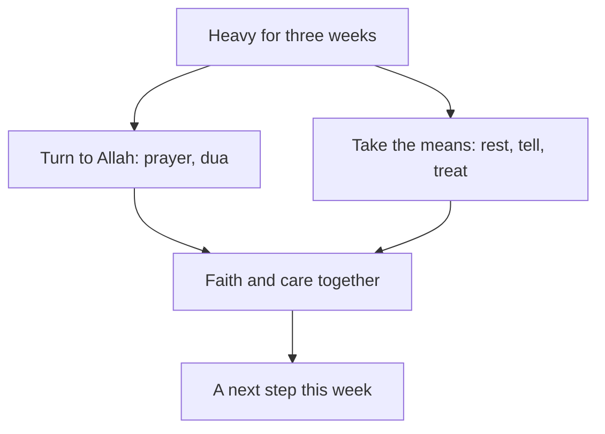

## "Everyone else has real problems"

In chapter 7.1, Yasmin was the one who helped everyone. For three weeks, the grid power in her area came mostly at night, so she did her client work at night. In the day she rewrote Khalil's CV, built a page for Tariq and phoned Mariam. She slept four or five hours a night.

By the end of the third week, some things had changed in her. She lay awake even when she had time to sleep. She felt worried most of the day, about clients, about money, about everything. Small tasks, like answering one email, felt very heavy. She stopped joining the Saturday call and told the circle she was busy.

She did not tell anyone how she felt. When she thought about it, three ideas stopped her. The first: "Everyone else has real problems. Khalil has no water. Mariam was ill. I just need to try harder." The second: "Resting now would be lazy. People are counting on me." The third was quieter: "If my trust in Allah were stronger, I would not feel like this."

All three ideas are common, and all three are sincere. This chapter looks at each of them in the light of the sources. It also gives you the signs that it is time to talk to someone, and a clear order for who to tell.

```predict
prompt: "Yasmin has slept badly and felt worried most days for three weeks, and she has told nobody. Before you read on, what should her first step be?"
options:
  - id: tell-someone
    label: "Tell one person she trusts how she feels, this week"
  - id: sort-it-alone
    label: "Say nothing until she has sorted it all out by herself"
correctOptionId: tell-someone
explanation: "Three weeks of poor sleep and daily worry is a sign to talk to someone, not to wait. When the Prophet, peace be upon him, was afraid after the first revelation, he went home and told his wife Khadijah, and she took him to someone with knowledge (Sahih al-Bukhari 3). Telling a real person is the first step; it does not mean weak trust."
```

## Your body has a right over you

One of the companions, Abdullah ibn Amr ibn al-'As, may Allah be pleased with him, used to fast every day and pray all night. When the Prophet, peace be upon him, heard about it, he told him not to do that. He said: fast some days and do not fast on others, pray at night and also sleep, for your body has a right over you, your eyes have a right over you, and your wife has a right over you (Sahih al-Bukhari 5199).

> فَإِنَّ لِجَسَدِكَ عَلَيْكَ حَقًّا

Meaning: For your body has a right over you (Sahih al-Bukhari 5199).

Think about who received this advice. Abdullah was not lazy. He was doing too much of something good: fasting and night prayer. And the Prophet still told him to stop and sleep. If rest was a right of the body for a man doing too much worship, it is certainly a right for a fellow doing too much client work and too many favours.

So rest is not laziness. Sleep is not wasted time. They are part of the religion, a right you owe to the body Allah gave you. When Yasmin says "resting now would be lazy", the hadith gives a clear answer: your body has a right over you, and so do your eyes.

## Seeking treatment is taking the means

The Prophet said that Allah has not sent down any illness without also sending down a cure for it (Sahih al-Bukhari 5678). In another hadith, some Bedouins asked him whether they should seek treatment. He answered yes, and told the servants of Allah to seek treatment, because Allah has not made an illness without making a cure for it, except one: old age (Jami' at-Tirmidhi 2038, graded sahih; also Sunan Abi Dawud 3855).

> نَعَمْ يَا عِبَادَ اللَّهِ تَدَاوَوْا

Meaning: Yes, servants of Allah, seek treatment (Jami' at-Tirmidhi 2038, graded sahih).

The question itself is worth noticing. The Bedouins asked "should we?" They seem to have wondered whether seeking treatment went against trusting Allah. The answer was not "trust Allah instead". It was "yes, seek treatment". This is the same lesson you learned in module 2 with "tie it and trust" (Jami' at-Tirmidhi 2517, graded hasan). Seeing a doctor is tying the camel. The trust is in the heart; the treatment is the means.

This is true for the mind as well as the body. Seeking help from a doctor, a counsellor or a <GlossaryTerm term="psychologist" definition="A person trained in how people think and feel, who helps with worry, sadness and stress, mostly by talking with you." /> is taking the means, like tying the camel.

## Faith and professional care work together

Scholars have spoken about this clearly. At a 2025 seminar on fatwa and mental health at Egypt's Dar al-Ifta, a scholar of comparative fiqh from Al-Azhar said that psychological treatment and religious treatment complete and support each other. He added that the path to recovery is real treatment, not people who claim cures without knowledge. Another well-known fatwa answer says there is nothing wrong with seeing a psychiatrist or psychologist who is trustworthy and skilled. It also points to the hadith that Allah sent down no illness without a cure, and to the Prophet's answer that people should seek treatment.

These statements come from scholars of different backgrounds, and they agree on the plain point. Faith and professional care work together. Prayer, dua and remembering Allah are not replaced by care. And care is not a sign that your prayer has failed.

Two opposite mistakes are worth naming. One says "prayer is enough, so I do not need anyone". The other says "talking to a professional matters more than prayer". The course says neither. A believer can make dua at night, keep up the prayer, and also see a counsellor on Tuesday. That is not weak trust. It is trust with the means taken, the same pattern you have seen in every module.

## Telling someone: the Prophet and Khadijah

The clearest model of telling someone comes from the Prophet himself. After the first revelation, he came home trembling. He told his wife Khadijah, may Allah be pleased with her, what had happened, and he told her that he feared for himself (Sahih al-Bukhari 3). You met this hadith in module 5 as an example of consulting. Here, look at it as an example of telling someone you are afraid.

Look at what Khadijah did. First, she listened and comforted him. She reminded him of the good he did: he kept family ties, carried the burden of the weak, helped the poor, honoured guests and helped people in real hardship. She told him that Allah would never disgrace him. Then she did something practical: she took him to her cousin Waraqa ibn Nawfal, a man who knew the earlier scriptures.

So the pattern has three parts. The Prophet told the person closest to him how he felt. That person listened and reminded him of what was true. Then they went together to someone with the right knowledge. If the best of people told someone that he was afraid, then telling someone is not a weakness. It is following his example.

## When it is time to talk to someone

Everyone has bad days and hard weeks. Sadness, worry and tiredness are human, and they are not a sign of weak faith. You saw in module 3 that the Prophet wept when his son died (Sahih al-Bukhari 1303), and that he asked Allah for protection from worry and grief (Sahih al-Bukhari 6369). But some signs mean it is time to talk to someone, not only to wait:

- You sleep badly most nights, for weeks rather than days
- Worry or sadness fills most of your day
- Small tasks feel too heavy to start
- You pull away from people you usually enjoy
- You stop eating properly or stop caring for yourself
- You feel that nothing you do helps

If you feel overwhelmed for a long time, or you have thoughts of harming yourself, talk to your mentor or the fellowship coordinator today, and to a doctor or counsellor if you can. This course does not replace professional care. A form, an app or a chat tool is not enough on its own: talk to a real person.

## Who to tell, in order

The canvas below follows Yasmin through the next steps, from carrying it alone to a plan with care in it. Check your prediction at step 3, then step through to the end.

<InteractiveCanvas slug="who-to-tell" />

The canvas showed two roads from the same heavy weeks. On one road, Yasmin says nothing, and it gets heavier. On the other, she tells one person she trusts, her friend Mariam. Then she tells her mentor, Reem, who helps her cut her load and asks whether she has seen a doctor. The doctor checks her and suggests she also talk to a counsellor. That road ends in a plan with rest, treatment and her prayers all in it. The order matters less than the first step: tell one real person, this week.

## Worked example: Yasmin's next two weeks

Here is how Yasmin turned the teaching into action, step by step.

**Step 1: name what is happening, honestly.** With Mariam's help, she wrote down what she had noticed: three weeks of poor sleep, worry most of the day, small tasks feeling heavy, and pulling away from the circle. Writing it down made it real. It also showed her that these were four of the signs, lasting weeks, not one bad day.

**Step 2: tell someone she trusts.** She chose Mariam, because Mariam had just been ill herself and would understand. She sent a voice message: "I have not been well for three weeks. I am not sleeping and I worry all day." Mariam called her back the same evening. Like Khadijah, she listened first, and then reminded Yasmin of what was true: she had helped four people this month, and she was allowed to be tired.

**Step 3: tell her mentor.** Mariam encouraged her to tell Reem. Reem did three things. She thanked Yasmin for telling her. She helped Yasmin decide which favours to hand back: Tariq's page could wait, and Khalil's CV was finished. And she asked whether Yasmin had seen a doctor, because the sleep problem had lasted weeks.

**Step 4: see a doctor.** Yasmin went to a clinic near her home. The doctor checked her, asked about her sleep and her worries, and suggested she also talk to a counsellor at a community centre. Yasmin booked a time. In her notebook she wrote the reference of the hadith about seeking treatment, Jami' at-Tirmidhi 2038, so she would remember why she went.

**Step 5: plan the rest.** She looked at her power hours again. Power usually came from 20:00 to 02:00. She decided to work from 20:00 to midnight while the power was on, charge her laptop and power bank, and finish the rest in the morning on battery. That gave her a sleep time of about 00:30 to 07:30, about 7 hours. She also kept one small act of service from 7.2, a Saturday message to Khalil, and dropped the rest for a month.

**Step 6: keep turning to Allah.** She kept her prayers. At night, when worry came, she said the dua the Prophet used for refuge from worry and grief (Sahih al-Bukhari 6369), which you learned in module 3. The dua did not replace the doctor, and the doctor did not replace the dua. Both were part of her plan.

**Step 7: check again.** She agreed to tell Reem on the next Saturday how the week had gone. A plan with a check-in is stronger than a plan you keep alone.

The diagram shows how the two sides of Yasmin's plan meet.



What to notice: neither side stands alone. The left road is faith: prayer and dua. The right road is the means: rest, telling a person, and treatment. Both lead into the same box before the next step. The takeaway: you do not have to choose between trusting Allah and getting help. A steady plan has both.

## Where people misunderstand care

**"Rest is laziness."** The Prophet told a companion who was doing too much worship to sleep, because his body had a right over him (Sahih al-Bukhari 5199). How to spot it: you feel guilty every time you sleep or stop.

**"Seeing a doctor or counsellor shows weak trust."** People asked the Prophet this exact question, and he told them to seek treatment (Jami' at-Tirmidhi 2038, graded sahih). How to spot it: you are waiting for a problem to pass "if Allah wills", while doing nothing that Allah has made a means.

**"I should not burden people, because others have it worse."** Your pain does not need to be the biggest in the room to be real. The Prophet told Khadijah when he was afraid (Sahih al-Bukhari 3). How to spot it: you compare your problem with other people's before deciding whether you are allowed to speak.

<Callout type="info" title="Who to contact">
Your mentor or the fellowship coordinator. If you have thoughts of harming yourself, talk to one of them today, and to a doctor or counsellor if you can.
</Callout>

## Check your understanding

```quiz
type: mcq
question: "Ghadeer, a freelance translator, works nights at her family's flat because that is when the power comes. For a month she has had headaches and has slept badly. Her aunt tells her that going to a doctor would show she does not trust Allah. What fits the teaching of this chapter?"
options:
  - "Pray more and avoid the doctor, as treatment weakens trust"
  - "See a doctor and keep up her dua; treatment is the means"
  - "Keep working nights, and rest once the contract has ended"
  - "Wait for the headaches to stop, then decide what to do next"
correct: 1
explanations:
  - "Prayer is good and should continue, but people asked the Prophet about this exact worry and were told to seek treatment (Jami' at-Tirmidhi 2038, graded sahih). Avoiding the doctor is not what the sources teach."
  - "Right. Allah sent down no illness without a cure (Sahih al-Bukhari 5678), and the Prophet told people to seek treatment. Seeing a doctor is taking the means, and her dua continues alongside it."
  - "Her body has a right over her (Sahih al-Bukhari 5199). A month of headaches and poor sleep is a reason to act now, not after the contract."
  - "Waiting is understandable, but a month is already a long time. The Prophet's answer to the people who asked about treatment points to acting, not waiting."
```

```quiz
type: mcq
question: "Sondos, a junior data analyst, has felt low and worried most days for five weeks while she works from home. She has told nobody, because her cousin's family has much bigger problems. Which next step fits this chapter?"
options:
  - "Tell nobody yet, and first try harder to be patient on her own"
  - "Fill in an online form so that nobody needs to know her name"
  - "Tell someone she trusts, then her mentor or the coordinator"
  - "Wait until her cousin's family is doing better, then speak up"
correct: 2
explanations:
  - "Sabr is not silence, as you saw in module 3. Five weeks of feeling low most days is a sign to talk to a real person now."
  - "A form can be a useful extra, but it is not a person. The course asks you to talk to a real person: someone you trust, and your mentor or the fellowship coordinator."
  - "Right. The Prophet told Khadijah when he was afraid (Sahih al-Bukhari 3). Sondos's first step is a real person she trusts, and then her mentor or the fellowship coordinator, who can help her find a doctor or counsellor."
  - "Her cousin's problems are real, but they do not make hers less real. Waiting for someone else's hardship to end can mean waiting a long time."
```

## This week

Look at the list of signs in this chapter, and be honest about your last two weeks. If any of them fit you, tell one real person this week: someone you trust, and your mentor or the fellowship coordinator. If none fit, do one thing for your body's right: choose a sleep time for the next seven nights and keep it. Either way, write the name of one person you would tell if things got heavy, so that the name is ready before you need it.

**Next:** Five fresh cases from the whole course. For each one, choose which teaching fits first.
