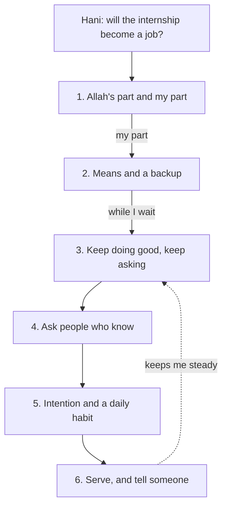

## Your turn

This is the capstone of the course. You will take one uncertain situation and build a steady plan for it, using what you learned in every module. You will not need anything new. You will use the teachings you already know, in order, on one situation, and write down what you will do.

You can choose a real situation from your own life: a wait, a choice, a loss of work, a problem with study. Or you can choose one of three provided cases further down this page. The provided cases are there so that nobody has to share anything personal. Choosing one is not an easier path. Each case has real facts, real people and a real decision, and a strong plan for it takes the same work as a plan for your own life.

Plan for about 90 minutes. You do not need to finish in one sitting. Read the worked example first, then choose your situation, then write the six parts one at a time. When you are done, you will walk your mentor through your plan in about five minutes.

## The six parts

1. **What only Allah knows, and what is mine to do** (chapters 1.2 to 1.4)
2. **The means and a backup plan** (chapters 2.2 to 2.4)
3. **How I will wait well**: what I keep doing, and the words or dua I will use (chapters 3.2 to 3.4)
4. **Who I will consult**, and istikhara if there is a choice (chapters 5.2 to 5.4)
5. **My intention and one small daily habit**, and what I will do if it does not work out (chapters 6.2 to 6.4)
6. **Who I will serve, and who I will tell if it gets heavy**, naming a real person (chapters 7.2 and 7.3)

Each part answers a different question. Part 1 separates what you cannot control from what you can. Part 2 turns your part into steps, with a plan for when the first plan fails. Part 3 is for the time in between, when you have done what you can and the answer has not come. Part 4 makes sure you are not deciding alone. Part 5 keeps you working, with the right aim, on good days and bad. Part 6 makes sure you are connected to people, as a helper and as someone who can be helped.

The order matters. If you skip part 1, your plan fills with worry about things that are not yours to carry. If you skip part 2, your trust has no means under it. If you skip part 6, the plan depends on you staying strong alone, and nobody can promise that.

## Worked example: Hani's steady plan

Hani is 25 and works as a back-end developer intern for a small software company abroad. The internship is remote and lasts six months, and it pays a stipend of 300 dollars a month in this example. Hani works on the server code of the company's booking app. He lives with his parents and two younger sisters. His father works in a small carpentry workshop, and his income goes up and down. Hani's stipend pays for the family's internet and part of the groceries. The grid power in his area comes about 8 hours a day, so he plans his work around it.

The internship ends in five weeks. There are four interns. In a team call, his supervisor said the company hopes to offer one or two of them a junior job, and will decide two weeks after the internship ends. Since that call, Hani lies awake thinking "what if they choose the others?". He has also stopped applying anywhere else. He feels that applying elsewhere would be disloyal to the company, and that it would show weak trust in Allah.

Here is the plan Hani wrote, part by part.

**Part 1: what only Allah knows, and what is mine to do.** Only Allah knows whether the company will offer him a job, what its budget will be next year, and what Hani will earn tomorrow (Quran 31:34). That is not his to carry. His part is clear. He can do excellent work in the last five weeks. He can ask his supervisor what the decision depends on. He can keep a short record of what he built, so he can show it to any employer. And he can keep other doors open. The Prophet, peace be upon him, told us to be keen on what benefits us, to seek Allah's help and not to give up (Sahih Muslim 2664). When the companions asked whether to stop and rely on what was written, his answer was "act" (Sahih al-Bukhari 4949).

**Part 2: the means and a backup plan.** The means: finish his two open tasks a week early, write a one-page handover note, and ask for a 20-minute feedback call in week 3. The backup: from this week, apply to two other remote junior jobs each week, which is 10 applications over the five weeks, and ask his supervisor for a reference letter, whatever the decision. If the backup also fails, he has a second backup: short paid tasks fixing websites for two local shops that his cousin knows. Applying elsewhere is not disloyal and not weak trust. It is tying the camel (Jami' at-Tirmidhi 2517, graded hasan). Hajar, peace be upon her, trusted Allah completely and still ran between Safa and Marwa seven times (Sahih al-Bukhari 3364).

**Part 3: how I will wait well.** For the seven weeks until the decision, Hani will keep doing good where he is: his work, his prayers, and helping his sisters with their homework in the evenings. Yusuf, peace be upon him, kept doing good while he waited, and Allah does not let the reward of those who do good be lost (Quran 12:90). At night, when the worry comes, he will say the dua for refuge from worry and grief (Sahih al-Bukhari 6369). If the answer is no, he will say the istirja, "we belong to Allah and to Him we return", with the dua taught in the hadith of Umm Salamah, may Allah be pleased with her (Quran 2:156; Sahih Muslim 918). And he will not decide that Allah has forgotten him.

**Part 4: who I will consult.** Hani will ask three people, each about what they know. He will ask his mentor which other roles fit his skills. He will ask a former intern, who now works at the company, how the decision was made last year. And he will ask his father what the family needs if the stipend stops, so that he knows how long the backup can take. The Quran praises believers whose affairs are by consultation (Quran 42:38). If a second offer comes before the decision, he will gather the facts, consult, and pray istikhara (Sahih al-Bukhari 1166), then go ahead with what seems best. He does not need a dream.

**Part 5: my intention and one small daily habit.** His intention: to provide for his family and to do work that benefits people, for the sake of Allah (Sahih al-Bukhari 1; Sahih al-Bukhari 56). His habit: 30 minutes every day on applications or learning, even on days with little power, on his phone if he must. The deeds most loved by Allah are the most consistent, even if small (Sahih al-Bukhari 6464). If it does not work out, he will not say "if only I had worked harder". He will say that Allah decreed and did what He willed (Sahih Muslim 2664), ask his supervisor what to improve, so he is not stung from the same hole twice (Sahih al-Bukhari 6133), and send the next application the following day.

**Part 6: who I will serve, and who I will tell.** Another intern, Fares, is also worried about the decision. Hani will review Fares's CV and share any job lead that fits Fares better than himself (Sahih al-Bukhari 13; Sahih Muslim 2699). He will tell his older cousin, whom he trusts, how the wait feels, and he will tell his mentor at their next meeting. If the worry keeps him awake for weeks, he will talk to his mentor or the fellowship coordinator, and to a doctor (chapter 7.3).

The diagram shows how the six parts of Hani's plan connect.



What to notice: part 1 decides what goes into part 2. Only "my part" becomes steps, so the plan does not waste effort on what only Allah decides. Parts 3 to 5 carry Hani through the wait. The dotted line shows that part 6 is not an extra at the end: serving Fares and telling his cousin help him wait well. The takeaway: the six parts are one plan, and each part leans on the others.

Look also at what changed for Hani. Before the plan, he had one door and a lot of worry. After the plan, he has the same hope for the internship, and also ten applications, a reference letter, a daily habit, three people to ask and two people to tell. His trust in Allah did not get smaller. It now has means under it.

## Choosing your situation

If you choose a real situation, pick one that is uncertain, that matters to you, and where some steps are yours to take. A wait for a result, a job search, a choice between two options, or a setback you are recovering from all work well. Change any names, and leave out private details about other people. You can describe your situation in two or three plain sentences. Nothing personal is graded: your mentor reads only the plan and its reasoning.

If you prefer, choose a provided case. Each one is written in full, so you can build a strong plan without sharing anything about yourself.

If you feel overwhelmed for a long time, or you have thoughts of harming yourself, talk to your mentor or the fellowship coordinator today, and to a doctor or counsellor if you can. This course does not replace professional care. If writing about your own situation feels too heavy today, choose a provided case.

## Provided case 1: Nadia's broken laptop

Nadia is 22 and in her final year of computer science. Her graduation project is a mobile app that helps a neighbourhood library keep track of the books it lends. The app and a 30-page report are due in 14 days. Last night, the power came back with a surge, and her laptop stopped turning on.

Her files are only partly backed up. Ten days ago she copied her code to a memory stick. The last ten days of code, and the 18 pages of her report that she has written so far, were only on the laptop. A repair shop near her home thinks the power board may be damaged. It will know in four days. The repair may cost between 150 and 300 shekels, and the shop cannot promise that the files will be saved.

Nadia has not told her supervisor yet, because she is afraid he will think she was careless. Her older brother has an old laptop that is slow, and he uses it for his own work in the evenings. Her classmate Tala has offered her own laptop on Mondays and Wednesdays from 16:00 to 20:00. Her mother has told her to rest and eat, because she has hardly slept since it happened. So far, Nadia has taken the laptop to the shop and written down from memory what she changed in the code over the last ten days. She has prayed and made dua many times. She does not know if the laptop or the files can be saved, if the deadline can move, or if she can finish in time.

## Provided case 2: Omar's lost client

Omar is 27 and works from home as a freelance translator between Arabic and English. Last week, his main client, an education company abroad, ended its contract with two weeks' notice. That client paid 600 dollars of his 1,200 dollars a month, half of his income in this example. His two smaller clients pay 600 dollars a month together.

Omar supports his parents. His father stopped working two years ago because of back pain, and his mother looks after the home. Omar has savings of 900 dollars, which would cover the missing 600 dollars for about one and a half months.

A translation office in his town has offered him a part-time job: four mornings a week, for 1,400 shekels a month, starting in three weeks. The office needs his answer in ten days. Both choices are permissible. The office job is steady, but it would leave him less time to look for a new freelance client. Freelance work pays more when it comes, but nobody knows when the next large client will come.

So far, Omar has messaged three former clients; one replied "maybe next month". He has updated his freelance profile. His friend Loay, who also translates, has offered to tell him about any large projects he hears of. Omar has not told his parents about the lost client, because he does not want them to worry. He is sleeping badly, and he keeps checking his messages late at night.

## Provided case 3: Lina's choice

Lina is 22 and in her last university term, studying business information systems. She has four courses and a final project, and the term ends in about 16 weeks. Her grade average is 84. She wants to keep it above 80, because she hopes to apply for a master's degree next year.

A small online shop abroad has offered her a part-time remote job answering customer messages. It is 20 hours a week, in evening shifts from 17:00 to 21:00, Sunday to Thursday, for 350 dollars a month. The company says the hours might become flexible after the first month, but it cannot promise that. It needs her answer within one week. Both choices are permissible.

Lina's father drives a taxi, and his income changes from week to week. Her younger brother and sister are in school, and the family's costs have gone up this year. Her mother said, "Your studies come first." Her father said the money would help, but that the choice is hers. The grid power in her area comes about 8 hours a day, and not always in the evening. Her power bank runs her laptop for about 2 hours. So far, Lina has asked the company about flexible hours and talked to both parents. She does not know if she can keep her grades with 20 hours of work, if the evenings will have power, or if the job will continue after she graduates.

## How your mentor will read it

Your mentor uses the table below, one line for each part. Each line has three levels. They are not looking for perfect English or long answers. They are looking for evidence that you used each teaching on your situation. The rubric grades your plan and its reasoning only. It never grades your faith, your feelings or your circumstances.

| Line | Met | Partly | Not yet |
|---|---|---|---|
| 1. Allah's part, my part | Names what only Allah knows and two or more steps that are yours, with a source | Both are named, but the steps are vague or no source is given | Only worry, or only "leave it to Allah" |
| 2. Means and backup | Means with times or numbers, a backup, and a step if the backup also fails | Means, but no backup, or a backup with no clear step | No means, or "trust is enough" |
| 3. Waiting well | What you keep doing, and words or a dua from the course with a reference and a time to use them | Doing without words, or words without a time | Only "be patient", with nothing to do or say |
| 4. Consulting | Two or more people by role, what you will ask each, and istikhara if there is a choice | People named but no questions, or istikhara used in place of facts | Nobody consulted, or waiting for a dream |
| 5. Intention and habit | An intention, a small daily habit with a time, and a step if it fails, with no "if only" | Two of these three | None of them, or a plan that ends in "if only" |
| 6. Serve and tell | One act of service, and a real person to tell by name or role, and when | Service or a person, but not both, or only "someone" | Nobody to tell |

To pass, lines 1, 2 and 6 must be Met, and no line can be Not yet. Line 6 must name a real person, by name or by role, such as "my mentor" or "my older sister". For a provided case, name someone from the case.

If your plan does not pass yet, your mentor replies with one or two short questions about the weakest line. You answer them in writing or in the walk-through, and your mentor reads the line again. One round of questions is normal. It is part of the work, not a failure.

## Your five-minute walk-through

After your mentor reads your plan, you will talk them through it in about five minutes. Spend a little under a minute on each part. Then your mentor will ask some of these questions. Prepare a short answer to each before you meet.

| Defence question | A good answer |
|---|---|
| Where in your plan is the trust, and where is the means? | Points to a sentence of trust and to the steps that are the means, and shows they sit together |
| What will you do if the backup also fails? | Gives one more concrete step, and says that it is not "if only" |
| Which source in the course is behind each part? | Names one verse or hadith for each part, with its reference |
| Who is the real person you will tell? | Gives a name or a role, and says when they would tell them |

The questions are not traps. They are the questions a kind and careful friend would ask before trusting that your plan will hold. If you cannot answer one yet, that tells you which part to strengthen.

## Submit your steady plan

Write the six parts in order, with a number or a short heading for each. Short sentences and lists are fine. If writing is hard today, you can add a voice note link and keep the written part shorter, as long as it still covers all six parts.

```openquestion
prompt: "Build a steady plan for one uncertain situation: your own situation, or provided case 1, 2 or 3 (say which). Write six parts. 1. What only Allah knows, and what is yours to do, with a source. 2. The means you will take, with times or numbers, a backup, and what you will do if the backup also fails. 3. How you will wait well: what you will keep doing, and the words or dua you will use, with its reference and when. 4. Who you will consult and what you will ask each person, and istikhara if there is a choice. 5. Your intention, one small daily habit with a time, and what you will do if it does not work out. 6. One person you will serve and how, and the real person you will tell if it gets heavy."
required: true
minWords: 250
allowSpeechInput: true
allowUrl: true
urlRequired: false
urlLabel: "Voice note link (optional)"
urlHint: "An audio link your mentor can open without signing in. Audio only is fine."
modelAnswer: "Mentor key for the provided cases. Case 1, Nadia. Part 1 Met: only Allah knows whether the laptop and files can be saved and whether the deadline can move; her part is to tell her supervisor, rebuild from the memory stick, and use every laptop hour she can get, with Muslim 2664 or Bukhari 4949. Part 2 Met: a time plan such as Tala's laptop on Mondays and Wednesdays 16:00 to 20:00 plus her brother's laptop when he is free, rebuilding the last ten days of code from her notes, writing the report in a phone document meanwhile; backup: ask the supervisor for a short extension or to submit the working parts first; if both fail, submit what works with an honest note. Common Partly: no step if the repair fails, or hiding the problem from the supervisor. Part 3 Met: keeps studying and resting, uses Bukhari 6369 at night or the dua of distress (Bukhari 6346). Part 4 Met: asks the supervisor about the deadline, the repair shop about recovering the files, a classmate about rebuilding; istikhara only if a real choice comes, such as repair or not. Partly: istikhara instead of asking the supervisor. Part 5 Met: an intention such as doing the work well for Allah and her family, a daily hour of rebuilding at a set time, and no 'if only I had backed up', but a backup habit from now on (Bukhari 6133). Part 6 Met: helps Tala or another classmate in return, for example testing her app; tells her mother or her mentor how heavy it feels. Case 2, Omar. Part 1 Met: only Allah knows when a new main client will come; his part is the search, the office decision and the family budget. Part 2 Met: numbers that work, for example savings of 900 dollars cover about one and a half months of the missing 600; a backup such as taking the office job if no large client by a set day; a step if both fail, such as smaller projects through Loay. Partly: no date or no numbers. Part 3 Met: keeps working for his two clients, stops checking messages late at night, uses Bukhari 6369 or the dua of Yunus (Tirmidhi 3505, graded sahih). Part 4 Met: asks Loay about the market, his parents about what they need, his mentor about the office job; prays istikhara about the office offer after the facts, with no dream. Partly: decides without telling his parents. Part 5 Met: intention to provide for his parents (Bukhari 56), a daily habit such as two applications at a set time, and no 'if only I had found more clients'. Part 6 Met: shares leads with Loay, and tells his parents and his mentor; the sleep problem is a reason to tell someone soon. Case 3, Lina. Part 1 Met: only Allah knows whether the job will last or how her grades will go; her part is the facts, the hours and the decision. Part 2 Met: a week plan with hours, for example 20 work hours, class and study hours, and a plan for evenings without power using the 2-hour power bank; a backup such as asking for fewer hours or leaving the job if her average drops below 80 by a set date. Partly: no check date. Part 3 Met: whatever she decides, keeps studying daily and uses a dua from module 3 when she worries. Part 4 Met: asks both parents, a lecturer or adviser about the workload, someone who has done a similar job; istikhara after the facts, then goes ahead with what seems best; scholars differ on the weight of a feeling, so no single feeling is required. Not yet: waiting for a dream. Part 5 Met: an intention such as helping her family and doing good work, a small daily study habit with a time, and a plan if it goes wrong without 'if only'. Part 6 Met: serves a classmate or her siblings, for example homework help, and names a person to tell. Sample answer for a different person: Raed, a junior designer, is waiting for a client to pay a delayed final payment of 350 dollars. 1. Only Allah knows when the client will pay; my part is to ask clearly and plan without the money (Muslim 2664). 2. I will send a polite reminder on Sunday and Thursday with the invoice attached; backup: take two small jobs this month; if both fail, ask my brother for a short loan and repay it from the next job. Tie it and trust (Tirmidhi 2517, graded hasan). 3. I will keep working on my portfolio every morning and say the dua for refuge from worry and grief at night (Bukhari 6369). 4. I will ask my mentor how to word the reminder, and a designer friend how she handles late payers. 5. Intention: to provide for my family for the sake of Allah (Bukhari 56); habit: one portfolio piece improved each day at 9:00; if the client never pays, I will say Allah decreed, learn to ask for half at the start (Bukhari 6133), and move on. 6. I will check my friend Rami's CV this week, and I will tell my mentor on Saturday how the wait is going."
```

**Next:** The course checklist, your steady toolkit, and a look back at the situation you sorted in module 1.
