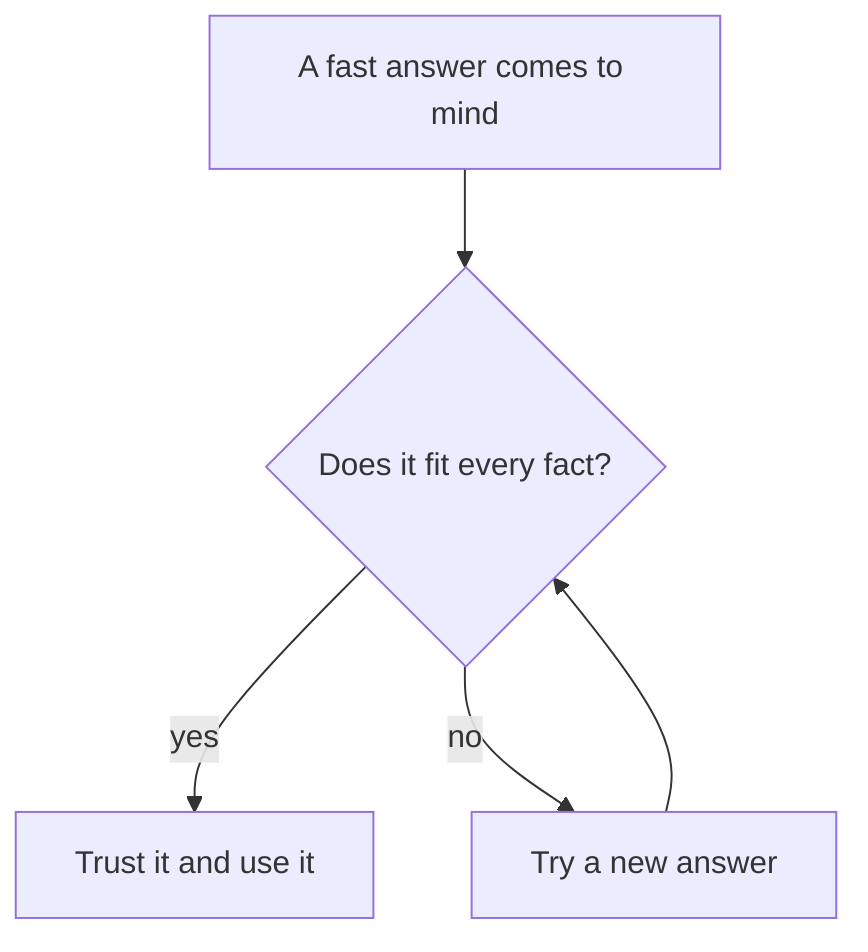

<BigWordAlert term="Logic" plainEnglish="Thinking in careful steps, so that each idea follows from the one before it." whyItMatters="Clear steps help you solve problems, explain your answers to other people, and check answers that come from people or from AI tools." />

## A puzzle at the stationery shop

Huda is buying things for her new course. At the stationery shop, the owner smiles and gives her a small puzzle.

"A notebook and a pen cost 11 shekels together. The notebook costs 10 shekels more than the pen. How much is the pen?"

Huda's first thought comes very fast: "1 shekel." It feels right. The numbers 11 and 10 seem to point straight at it.

Before you read on, make your own guess. There is no score for this one. It is only a warm-up.

```predict
prompt: "A notebook and a pen cost 11 shekels together. The notebook costs 10 shekels more than the pen. How much is the pen?"
options:
  - id: one
    label: "1 whole shekel"
  - id: half
    label: "Half a shekel"
correctOptionId: half
explanation: "If the pen is half a shekel, the notebook is 10.5 shekels. Together that is 11, and the difference is 10. If the pen were 1 shekel, the notebook would be 11 and the total would be 12."
```

## Check it, slowly

Let us test the fast answer. If the pen costs 1 shekel, the notebook costs 10 shekels more, so 11 shekels. Together that is 12 shekels, not 11. The fast answer fails its own test.

Now try half a shekel. The notebook is then 10.5 shekels. Together, 10.5 plus 0.5 is 11. The difference, 10.5 minus 0.5, is 10. Both facts fit.

If you said 1 shekel, good: now you know the trick. Most people give the fast answer first. The fast answer is not the problem. Not checking it is the problem. That small habit, checking before you trust, is what this course is about.

Here is that habit as a small chart. The check sits between a fast answer and trusting it.



Notice that the only way to "Trust it" goes through the check. Huda's 1 shekel took the no arrow, because the total came to 12. Half a shekel took the yes arrow, because both facts fit.

## How this course works

This course trains clear thinking, one small habit at a time. You will break tasks into steps, read rules carefully, find hidden guesses in a claim, make rough estimates, and spot weak arguments. AI tools can now give a fast answer to almost any question. So the skill that matters more and more is knowing which answers to check, and how to check them.

Here are four promises about how the course works:

- **No hard maths.** You only add, subtract, multiply, divide and make rough guesses.
- **No coding.** You use recipes, flowcharts and puzzles from daily life.
- **Mistakes are welcome.** Every quiz option is explained, so a wrong guess still teaches you something.
- **Each module ends with a gate.** A gate is a short checklist and a few notes about how you think. It helps you and your mentor see your progress.

So you do not need to be "good at maths" to do well here. You need to be curious and a little patient.

<Callout type="info" title="Being stuck is normal">
Every puzzle here is meant to make you think. If you feel stuck, it means you are learning. Chapter 1.4 gives you four moves to try.
</Callout>

## What you will practice

<LearningObjectives items={["Test a fast answer against every fact in a puzzle", "Read every word and say what a question really asks", "Tell when a fast answer is fine and when to stop and check", "Use four moves when you are stuck"]} />

## Key words

| Word | Plain English |
|---|---|
| **Logic** | Thinking in careful steps, so each idea follows from the one before |
| **Puzzle** | A small problem made for practice, with one clear answer |
| **Fast answer** | The first answer that comes to mind, before you check it |
| **Check** | Test an answer to see if it fits all the facts |
| **Learning log** | A few short notes about how you think and what you learned |
| **Gate** | The checklist at the end of each module |

## What is in this module

| Chapter | You will practice |
|---|---|
| 1.2 | Reading every word, so trick puzzles do not fool you |
| 1.3 | Knowing when a fast answer is fine and when to stop and check |
| 1.4 | Four moves to try when you are stuck |
| 1.5 | Your first checklist and learning log |

<ChapterRecap points={["A fast answer can feel right and still be wrong", "Test an answer against every fact in the question", "No hard maths, no coding, and mistakes are welcome", "Each module ends with a gate: a checklist and a learning log"]} />

**Next:** Puzzles that trick fast readers, and how reading slowly beats them.
