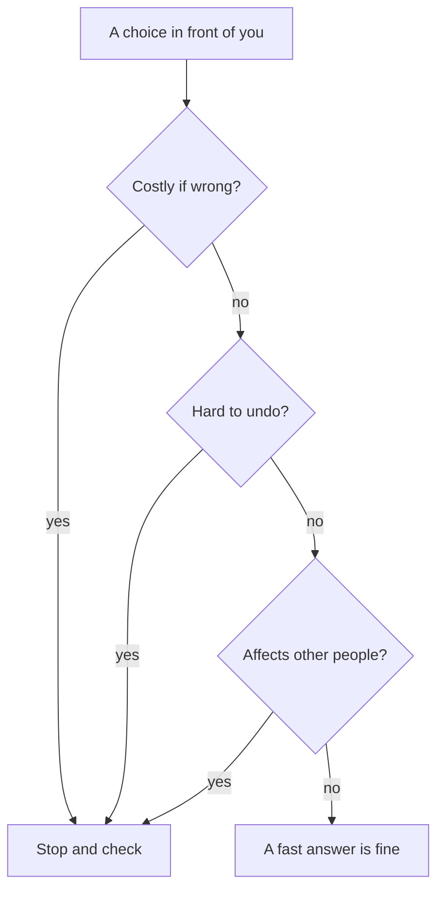

## Omar says yes too fast

Omar is a freelance designer. On Sunday morning he chooses a glass for his tea, picks a seat on the bus and replies to three friends. All fast, and all fine.

Then a client writes: "Can you finish the poster by tomorrow?" Omar types "Yes, no problem!" in two seconds. An hour later he remembers his exam tomorrow afternoon. He also remembers that the poster needs about six hours of work.

Omar is not careless. He used the same fast answer for the poster as for the tea. The poster needed a slow one.

## Two kinds of answer

Everyone has two ways to answer. A **fast answer** comes by itself, with no effort. It is your first thought. A **slow answer** takes effort: you stop, look at the facts and check.

Fast answers are not bad. Most of your day runs on them, and that is good. You cannot stop and check every glass of tea. The skill is knowing when a fast answer is fine and when it is time to slow down.

Before you read the three questions below, try a small puzzle. Answer it fast first, then slowly.

```predict
prompt: "Lina can pay for her phone bundle in two ways: 8 shekels each week, or 30 shekels a month. Which costs less over one month?"
options:
  - id: weekly
    label: "8 shekels each week"
  - id: monthly
    label: "30 shekels a month"
correctOptionId: monthly
explanation: "A month has a little more than 4 weeks. Just 4 weeks at 8 shekels is already 32 shekels, which is more than 30."
```

Notice what happened. The number 8 looks small, so the weekly plan feels cheap. Only a slow answer shows that it costs more. This choice is about money that you pay again every month, so it deserves the slow answer.

## Three questions that say "slow down"

When you are about to answer, ask yourself three quick questions. If the answer to any of them is yes, stop and check.

1. **Does it cost a lot if I am wrong?** Money, a deadline, your health, your marks, or your name with a client.
2. **Is it hard to undo?** A promise, a payment, or a message you cannot take back.
3. **Does it affect other people?** A client who plans around your date, a family that shares a budget, or a team that waits for your part.

You do not need all three to be yes. One yes is enough to slow down. If all three answers are no, a fast answer is fine. Choosing a tea glass costs nothing, is easy to change and affects no one.

The diagram below shows the same three questions as a picture. Start at the top and follow the arrows.



Notice that there are three ways to reach "Stop and check" and only one way to reach "A fast answer is fine". You need three no answers to go fast. In module 2 you will learn to draw pictures like this yourself.

## A worked example: Omar tries again

A week later, a new client asks Omar: "Can you finish a menu design by Thursday?" This time he asks the three questions before he replies.

- **Costly if wrong?** Yes. If he is late, he may lose the payment and get a bad <GlossaryTerm term="review" definition="A short public comment and score that a client leaves about your work." />.
- **Hard to undo?** Yes. Once he promises a date, changing it looks unprofessional.
- **Affects other people?** Yes. The client plans to print the menus on Friday.

So he stops and checks. The menu needs about 6 hours. He has an exam on Tuesday, so Monday and Tuesday are for study. He can work 3 hours on Wednesday and 3 hours on Thursday morning. That is exactly 6 hours, with no spare time if something goes wrong.

He replies: "I can send the design on Thursday evening. I can also send a first draft on Wednesday night, so you can check the direction." The check took him five minutes. The client knows what to expect, and Omar can keep his promise.

Notice that the slow answer was not a long one. Omar did not spend an hour worrying. He asked three questions, counted his hours and wrote two sentences. A slow answer means a checked answer, not a worried one.

## A common mistake

Some people learn this lesson and then slow down for everything. They spend twenty minutes choosing a pen. That is tiring, and it uses up the energy you need for the big choices. Save slow answers for the choices that pass the three questions.

The other common mistake is trusting a feeling of being sure. Feeling sure is not the same as being right. Omar felt sure about the poster. Lina's weekly plan felt cheaper. When a choice costs money, cannot be undone or affects others, check it even when you feel sure.

<Callout type="warning" title="'Answer now!' is a reason to slow down">
When a message pushes you to decide right away, that pressure is a signal. A fair client, shop or offer will usually give you a few minutes to check.
</Callout>

## Check your understanding

```quiz
type: mcq
question: "Nour has a busy day. Which of these choices most needs a slow, checked answer?"
options:
  - "Choosing which pen to use for her notes today"
  - "Picking which of two free bus seats to sit in"
  - "Lending 200 shekels to a friend of a friend"
  - "Choosing a song to play while she cooks dinner"
correct: 2
explanations:
  - "A pen is cheap and easy to change. Nothing much is lost if she picks the wrong one, so a fast answer is fine."
  - "She can move to the other seat in a moment. It costs nothing and is easy to undo."
  - "Right. It costs real money, it is hard to undo once the money is gone, and it involves other people. All three questions say slow down."
  - "If she does not like the song, she can change it. A fast answer is fine here."
```

```quiz
type: mcq
question: "Sami's client writes: 'Please confirm in the next 10 minutes that you can type 30 pages by tomorrow.' What should Sami do first?"
options:
  - "Confirm quickly, so the client does not pick someone else"
  - "Check his free hours and the work needed, then reply"
  - "Ignore it, because a good client would never rush him"
  - "Say no at once, because 30 pages sounds like a lot"
correct: 1
explanations:
  - "A promise of 30 pages by tomorrow is costly if wrong and hard to undo. Agreeing fast because of pressure is the risk here."
  - "Right. The choice is costly if wrong, hard to undo and affects the client. The 10 minute pressure is a reason to check, and a short check is enough for an honest reply."
  - "Ignoring a real client may lose the job. He should reply, but only after a short check."
  - "Saying no at once is also a fast answer. 30 pages might be possible. He needs to check before he knows."
```

**Next:** What to do when you are stuck: four moves that work.
