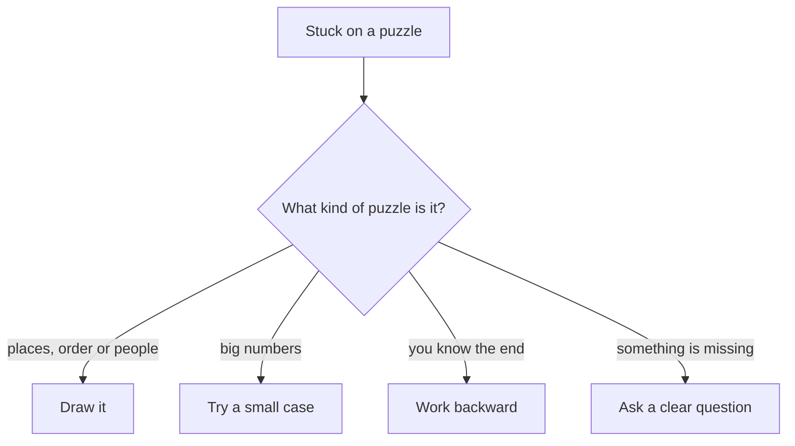

## Reading it again is not a move

Basel has a puzzle in front of him. He reads it, then reads it again, then again. Twenty minutes pass. He starts to think he is bad at puzzles, so he closes the page.

Basel is not bad at puzzles. He had only one move: read it again. When reading again stops helping, you need a different move. This chapter gives you four, with one puzzle for each.

<BigWordAlert term="Stuck" plainEnglish="When you do not know what to do next on a problem." whyItMatters="Being stuck is a normal part of thinking, not a sign that you are bad at it. What matters is what you try next." />

## Move 1: Draw it

When a puzzle is about places, order or people, draw it. A few lines on paper hold the facts, so your head does not have to.

**Puzzle:** Four friends sit on four chairs in a row: Lina, Omar, Huda and Sami. Omar sits at the left end. Huda sits next to Omar. Sami does not sit next to Huda. Who sits at the right end?

**Draw it.** Draw four boxes in a row and number them 1 to 4, from left to right. Omar takes box 1. Huda must be next to him, so she takes box 2. Sami cannot be next to Huda, so he cannot take box 3. He takes box 4, and Lina takes box 3. The answer is Sami.

**Check.** Omar is at the left end. Huda, in box 2, is next to Omar. Sami, in box 4, is not next to Huda. Every clue fits.

Without the drawing, you have to hold four names and three clues in your head at the same time. With it, each clue fills a box or blocks one, and the answer appears on the paper.

## Move 2: Try a small case

When a puzzle has big numbers, try the same puzzle with tiny numbers first. The small case shows you the pattern. Before you read the answer, try this one.

```predict
prompt: "Tamer puts 10 posts in a straight line for a garden fence. Each post is 2 metres from the next one. How far is it from the first post to the last?"
options:
  - id: eighteen
    label: "18 metres"
  - id: twenty
    label: "20 metres"
correctOptionId: eighteen
explanation: "Count the gaps, not the posts. 10 posts have 9 gaps between them, and 9 gaps of 2 metres make 18 metres."
```

**Try a small case.** With 2 posts, there is 1 gap. With 3 posts, there are 2 gaps. With 4 posts, there are 3 gaps. The pattern is clear: there is always one gap fewer than there are posts. So 10 posts have 9 gaps, and 9 times 2 metres is 18 metres.

The fast answer, 20 metres, multiplies the posts instead of the gaps. The small case shows the mistake in a few seconds, with no hard thinking.

## Move 3: Work backward

When you know how a story ends and want to know how it started, start at the end and undo each step.

**Puzzle:** Amal goes to the market. She spends half of her money on vegetables. Then she pays 6 shekels for the bus home. She has 14 shekels left. How much money did she start with?

**Work backward.** At the end she has 14 shekels. Before the bus she had 6 more: 14 plus 6 is 20. Before the vegetables she had twice that, because she spent half: 20 times 2 is 40. She started with 40 shekels.

**Check forward.** Start with 40. Half is 20, so 20 is left. Minus 6 for the bus leaves 14. It matches.

Notice that each step backward does the opposite of the story. The bus took away 6, so you add 6. Spending half cut her money in two, so you double it.

## Move 4: Ask a clear question

Sometimes you are stuck because something is missing, not because you are slow. Then the best move is a question. A good question is specific and easy to answer.

**Situation:** A client tells Yousef: "Make the logo bigger." Yousef does not know how much bigger. If he guesses, he may have to do the work twice.

A vague question, "What do you mean?", makes the client explain everything again. A clear question gives choices: "Do you want it about twice the size it is now, or wide enough to fill the top of the page?" The client can answer in a few words.

A clear question has three parts. Say what you understood, name the exact thing you are missing, and offer two or three choices when you can.

Asking is a skill, not a weakness. Good students, freelancers and team members ask early, before they spend hours on a guess. A clear question also shows the other person that you listened.

## A common mistake

The common mistake is staying with one move for too long. If drawing does not help after a few minutes, try a small case. If that does not help, work backward. If you still cannot move, ask someone a clear question. Changing moves is not giving up. It is using your tools.

The chart below shows which move to try first. Start from what kind of puzzle is in front of you.



Notice that "read it again" is not one of the arrows. If your first move does not help, come back to the top and pick another arrow. That is what Basel needed.

<Callout type="tip" title="Write down where you are stuck">
Before you change moves, write one line: "I am stuck because..." Often that line shows you which move to try next.
</Callout>

## Check your understanding

```quiz
type: mcq
question: "Yousef's puzzle: 'I think of a number. I double it, then add 3. I get 17.' Work backward. What was the number?"
options:
  - "14"
  - "7"
  - "37"
  - "5.5"
correct: 1
explanations:
  - "This undoes the 'add 3' but not the doubling. One more step back: 14 divided by 2."
  - "Right. Undo the last step first: 17 minus 3 is 14. Then undo the doubling: 14 divided by 2 is 7. Check: 7 doubled is 14, plus 3 is 17."
  - "This does the steps forward again: 17 doubled is 34, plus 3 is 37. Working backward means doing the opposite steps, in reverse order."
  - "This undoes the steps in the wrong order: 17 halved is 8.5, minus 3 is 5.5. Undo the last step first."
```

```quiz
type: mcq
question: "Huda is new in a class. The teacher says: 'Bring the usual things tomorrow.' Huda does not know what 'the usual things' are. Which question is the clearest?"
options:
  - "Could you please explain again what you meant by that?"
  - "Is it all right if I just bring whatever I have at home?"
  - "Do I bring the textbook, a notebook and a calculator?"
  - "Will you tell me tomorrow what I should have brought?"
correct: 2
explanations:
  - "This is polite, but it asks the teacher to explain everything again. It does not name what Huda is missing."
  - "This guesses instead of finding out. She may arrive without what she needs."
  - "Right. It names exactly what she is unsure about and gives the teacher a yes or no answer, with room to add anything she missed."
  - "Tomorrow is too late. She needs the answer before the class, not after it."
```

<ChapterRecap points={["Being stuck is normal: change moves instead of reading again and again", "Draw it when a puzzle is about places, order or people", "Try a small case when the numbers are big", "Work backward when you know the end", "Ask a clear question when something is missing"]} />

**Next:** The module 1 checklist and your first learning log.
