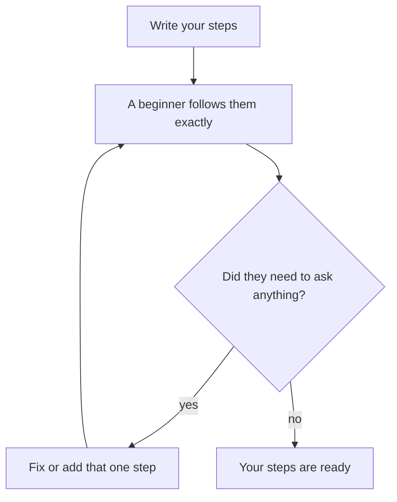

## The eggs with no water

Sami's mother leaves him a note: "Put 4 eggs in a pot. Put the pot on the fire. Wait 10 minutes. Take the eggs out." Sami follows it exactly. Ten minutes later, the kitchen smells of burnt eggs.

The note was missing one step: cover the eggs with water. Sami's mother did not write it because, to her, it is obvious. To a person who does exactly what the words say, that step did not exist.

## Steps someone else can follow

A recipe is a set of instructions. So is a job plan, a way to top up phone credit, or a note for a new helper at a shop. They all fail in the same few ways. Good steps pass four tests.

1. **Complete.** No step is missing, even the obvious ones.
2. **In order.** Each step comes after the steps it needs.
3. **Clear.** Each step is one action, with numbers where they matter: "2 glasses of water", not "some water".
4. **Has an end.** The person knows when they are finished.

A swapped step can be as bad as a missing one. Look at this note for tea: "Pour the tea into glasses. Boil the water. Add the tea leaves." Every step is there, but in this order you pour nothing into the glasses. Order is part of the meaning.

Then comes the big test: **could someone follow this without asking me?** Imagine a person who is clever but new to the task, and who does exactly what the words say. If they would need to ask "how much?", "which one?" or "what next?", that step needs more detail.

## A worked example: Yousef's first freelance job

Yousef just got his first freelance job. A small clothes shop wants 10 product descriptions, about 50 words each, for its online page. The pay is 30 dollars. His first plan has three steps: "Do the job. Send it. Get paid."

That plan is not wrong, but nobody could follow it, not even Yousef on a tired day. So he writes it out properly. Before you see his steps, make a guess about one of them.

```predict
prompt: "Yousef must write 10 product descriptions for the shop. Which way of working is safer?"
options:
  - id: sample
    label: "Send one sample first"
  - id: all-ten
    label: "Write all ten at once"
correctOptionId: sample
explanation: "A sample shows whether the style is right before he writes the rest. If the client wants changes, he fixes one description, not ten."
```

Here are his steps:

1. Read the whole job message and write down what is asked: 10 descriptions, about 50 words each, due on Thursday.
2. Ask the client one clear question: "Do you want a friendly style or a formal style?"
3. Agree on the price and the deadline in writing, in the same message thread.
4. Write one description and send it as a <GlossaryTerm term="sample" definition="One small piece of the work, sent early so the client can say if it is right." />.
5. Change the sample using the client's comments.
6. Write the other 9 descriptions in the same style.
7. Check each one against the list from step 1: number of words, style and product name.
8. Send all 10 in one message and ask the client to confirm they arrived.
9. Send the payment request.

Look at the order. Step 3 comes before any writing, so there is no surprise about money later. Step 4 comes before step 6, so a mistake in style is found early, when it is cheap to fix. Step 7 uses the list from step 1, so the end of the job connects back to the start. Each step is one action, and the plan has a clear end: the payment request is sent.

Now apply the test. Could a friend follow these steps without asking Yousef? Mostly, yes. A friend might ask, "Where are the product photos?" So Yousef adds a few words to step 1: "The photos are in the client's first message." That is the kind of small fix the test finds.

## A common mistake

The most common mistake is skipping steps that feel obvious to you. The better you know a task, the more steps you skip without noticing. Sami's mother has boiled eggs many hundreds of times, so "add water" is invisible to her.

There are two easy ways to catch this. Read your steps as if you know nothing, and do exactly what each line says. Or, better, give them to someone and watch them follow the steps without your help. Every question they ask shows you a missing or unclear step.

Here is that test as a small loop.



Notice that each question sends you back to fix one step, and then the test runs again. The steps are ready only when a beginner gets to the end with no questions.

This is also why instructions from experts are sometimes hard to follow. They know the task so well that they forget what a beginner does not know. When you write steps, write them for the beginner.

<Callout type="tip" title="One action per line">
If a step has the word "and" in it twice, it is probably two or three steps. Split it. Short steps are easier to follow and easier to check.
</Callout>

## Check your understanding

```quiz
type: mcq
question: "Rania writes steps for her brother to make rice: 1. Put 2 cups of rice in the pot. 2. Cook on low heat for 20 minutes. 3. Add 3 cups of water and a little salt. 4. Wash the rice. What is the main problem?"
options:
  - "The steps are in the wrong order"
  - "It should name which pot to use"
  - "There are too few steps for rice"
  - "It needs the exact amount of salt"
correct: 0
explanations:
  - "Right. Washing must come first, and the water must go in before cooking. In this order, he cooks dry rice and washes it at the end."
  - "Most pots will work. Naming the pot is a small detail. The order is what ruins the rice."
  - "Four steps can be enough for rice if they are in the right order. The problem is the order, not the number of steps."
  - "'A little salt' could be clearer, but it will not ruin the rice. Cooking before adding water will."
```

```quiz
type: mcq
question: "Omar leaves a note for a new helper at his phone repair stall: 'Open at the usual time. Put the phone cases out. If someone wants a screen fixed, tell them the price.' What would the helper most likely need to ask?"
options:
  - "Why do so many customers want their phone screens fixed?"
  - "Does Omar sell phone cases in more than one colour?"
  - "How many years has Omar been running this stall?"
  - "What is 'the usual time', and what is the price?"
correct: 3
explanations:
  - "This is interesting, but the helper does not need it to do the job."
  - "The colours do not matter for following the steps. The helper can put out whatever cases are there."
  - "This is about Omar's history, not the task. None of the steps depend on it."
  - "Right. 'The usual time' and 'the price' are known to Omar but not to a new helper. The note fails the test: could someone follow this without asking me?"
```

**Next:** Patterns and sequences: finding the rule and predicting what comes next.
