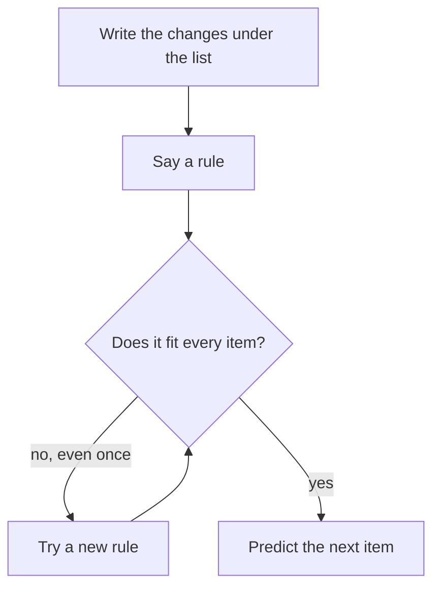

## Tomato prices

Khaled sells tomatoes at the market. Each morning he writes down the price of a kilo: Saturday 3 shekels, Sunday 4, Monday 6, Tuesday 9. His neighbour looks at the list and says: "It goes up by 1 each day, so tomorrow it will be 10."

Is the neighbour right? Look at each change. From 3 to 4 is up 1. From 4 to 6 is up 2. From 6 to 9 is up 3. The neighbour only looked at the first two prices. If the pattern goes on, tomorrow the price goes up by 4, to 13.

<BigWordAlert term="Sequence" plainEnglish="A list of things in order, such as numbers, shapes or days, often made by a rule." whyItMatters="If you can find the rule, you can predict what comes next, and you can notice when something changes." />

## Find the rule, then check it everywhere

A sequence is usually made by a <GlossaryTerm term="rule" definition="The instruction that turns each item in a sequence into the next one, such as 'add 3' or 'double it'." />. To find the rule, look at how each item changes into the next one. Three questions help.

1. **Does it go up or down by the same amount each time?** 5, 8, 11, 14: add 3 each time.
2. **Does the change itself change?** 3, 4, 6, 9: add 1, then 2, then 3.
3. **Does it repeat?** Morning, evening, morning, evening: the same two things again and again.

Some sequences multiply instead, such as 2, 4, 8, 16, where each number is double the one before. Start with the three questions, and try another idea if none of them fits.

Before you read on, try this one.

```predict
prompt: "Look at this sequence: 2, 4, 7, 11, 16. A fast reader sees 2 and 4 and says the rule is 'add 2'. What comes next?"
options:
  - id: add-two
    label: "18"
  - id: growing
    label: "22"
correctOptionId: growing
explanation: "'Add 2' fails at the third item: 4 plus 2 is 6, not 7. The real changes are 2, 3, 4 and 5, so the next change is 6. 16 plus 6 is 22."
```

The most important part comes after you find a rule. **Check it on every item, not just the first two.** Two items fit many rules. Only a rule that fits every item is worth trusting.

A simple way to see the changes is to write them under the list. For Khaled's tomatoes it looks like this:

- Prices: 3, 4, 6, 9
- Changes: up 1, up 2, up 3

Now the rule is easy to see: each change is one more than the change before. Writing the changes down takes a few seconds, and it stops you from guessing from the first two numbers.

Put together, finding a rule is a small loop.



Notice that there is only one way out of the loop: a rule that fits every item. A rule that fits only the first two items sends you back to try again. That is the step Khaled's neighbour missed.

## A worked example: Basel's phone cases

Basel sells phone cases at a small stall. He writes down how many he sells each week.

| Week | Cases sold | Change |
|---|---|---|
| 1 | 5 | start |
| 2 | 8 | up 3 |
| 3 | 11 | up 3 |
| 4 | 14 | up 3 |

**Step 1, look at the changes.** Each week is 3 more than the week before.

**Step 2, say the rule.** "Add 3 each week."

**Step 3, check every item.** 5 plus 3 is 8. 8 plus 3 is 11. 11 plus 3 is 14. The rule fits all four weeks.

**Step 4, predict.** Week 5 should be 14 plus 3, so 17 cases.

Now a different kind of pattern. In Basel's neighbourhood, the electricity comes on at times that repeat: Saturday morning, Sunday evening, Monday morning, Tuesday evening, and so on. When does it come on Friday? The rule is "morning, evening, morning, evening". Count on from Tuesday: Wednesday morning, Thursday evening, Friday morning.

One more kind. A small bakery takes orders by phone. Over four weeks it gets 3, 6, 12 and 24 orders. The changes are up 3, up 6 and up 12. They are not the same, and they do not grow by the same amount, so the first two questions do not fit. Try multiplying instead: each number is double the one before. Check every item: 3 doubled is 6, 6 doubled is 12, and 12 doubled is 24. The rule fits, so the next week should bring 48 orders.

## A common mistake

The first common mistake is stopping after two items, like Khaled's neighbour. The second is trusting a real-life pattern too far.

Look at Basel's next week. He expects to sell 17 cases, but he sells 9. Maybe it rained all week. Maybe a new stall opened nearby. A pattern in real life is a good guess, not a promise. When one item does not fit, do not hide it. Ask: is my rule wrong, or did something change?

So what should Basel do? He can keep "add 3" as a rough guide, but he writes down the surprise next to week 5. He watches the next two weeks before he buys 17 new cases from his supplier. A pattern helps him plan, and the check stops him from spending money on a guess.

Number puzzles are different. In a puzzle, the rule is fixed, so a rule that fails on even one item is simply the wrong rule.

<Callout type="info" title="Patterns are everywhere">
Bus times, prices, power hours and study habits all follow patterns. Spotting the rule helps you plan. Checking it helps you notice when the rule has changed.
</Callout>

## Check your understanding

```quiz
type: mcq
question: "A shop raises the price of a bag of rice the same way each month: 20, 22, 24, 26 shekels. If the pattern goes on, what is the price in month 7?"
options:
  - "28 shekels"
  - "30 shekels"
  - "32 shekels"
  - "34 shekels"
correct: 2
explanations:
  - "This is month 5. Keep counting: month 6 is 30 and month 7 is 32."
  - "This is month 6. One more month adds 2 more shekels."
  - "Right. The rule is 'add 2 each month'. Month 5 is 28, month 6 is 30 and month 7 is 32."
  - "This is month 8. Count the months carefully: 26 is month 4."
```

```quiz
type: mcq
question: "Maryam says the rule for 2, 4, 8, 16, 30 is 'double each time'. What is the best reply?"
options:
  - "It fits well, so the next number will be 60"
  - "It fails at the end: 16 doubled is 32, not 30"
  - "It fits the first two items, so it must be right"
  - "It is fine, since it fits most of the items"
correct: 1
explanations:
  - "Doubling fits the first four numbers but not the last one. A rule must be checked on every item."
  - "Right. Doubling works from 2 to 16, but 16 doubled is 32, and the list says 30. A rule that fails on one item is not the rule."
  - "Two items fit many rules. Only a rule that fits every item can be trusted."
  - "'Most of the items' is not enough in a puzzle. One item that does not fit means the rule is wrong."
```

**Next:** Sorting by hand: two ways to put a pile of exam papers in order.
