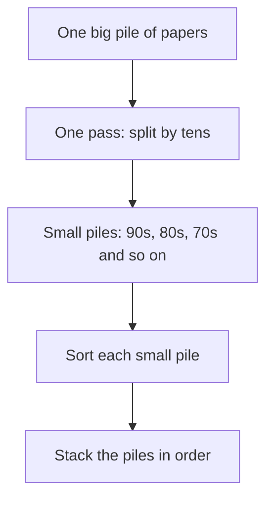

## Twenty papers to put in order

Amal teaches a class of 20 students. She has marked their exams, and now she wants the papers in order, from the highest mark to the lowest. It is late, and she wants to finish quickly.

Does it matter how she sorts them? Every way ends with the same neat pile. But some ways take far more work than others. In this chapter you count the work, so you can see the difference instead of guessing it.

## The slow way: find the highest, again and again

Here is the way most people start. Look through the whole pile and find the highest mark. Put that paper on the table. Then look through the rest to find the next highest. Repeat until the pile is empty.

We will count the work in **looks**. One look means reading the mark on one paper. To find the highest mark in a pile, you must look at every paper in it. Each trip through a pile is called a <GlossaryTerm term="pass" definition="One trip through a pile, looking at each paper in it once." />.

Try a small case first, with 8 papers. The marks are 72, 95, 58, 81, 64, 99, 77 and 53.

- First pass: look at all 8 papers and find 99. That is 8 looks.
- Second pass: look at the 7 papers left and find 95. That is 7 looks.
- Then 6 looks, 5, 4, 3, 2 and finally 1.

The total is 8 + 7 + 6 + 5 + 4 + 3 + 2 + 1 = 36 looks. A quick way to add a list like this is to pair the ends: 8 and 1 make 9, 7 and 2 make 9, 6 and 3 make 9, and 5 and 4 make 9. Four pairs of 9 make 36.

Now guess what happens when the pile grows.

```predict
prompt: "Sorting 8 papers the slow way takes 36 looks. If the pile has 16 papers, about how many looks does the slow way take?"
options:
  - id: more
    label: "About 136 looks"
  - id: double
    label: "About 72 looks, double"
correctOptionId: more
explanation: "16 + 15 + 14 and so on down to 1 makes 8 pairs of 17, which is 136. Twice the papers means nearly four times the looks, because every pass is longer and there are more passes."
```

That is the problem with the slow way. For Amal's 20 papers, the looks are 20 + 19 + 18 and so on down to 1. Pair the ends: 10 pairs of 21 make 210 looks. Every extra paper makes every pass longer.

## The faster way: split into piles first

Here is a different way. Go through the pile **once**, and put each paper on a small pile by its tens: one pile for marks in the 90s, one for the 80s, one for the 70s, and so on. Then sort each small pile the slow way. Finally, stack the small piles in order, with the 90s on top.



Notice where the searching happens. In the slow way, every search goes through the big pile. In the faster way, the big pile is only read once, and every search after that goes through a small pile.

Here is the count for the same 8 papers. The split pass takes 8 looks. Then each small pile is sorted the slow way: a pile of 2 papers takes 2 + 1 = 3 looks, and a pile of 1 paper takes 1 look.

| Pile | Papers | Looks to sort |
|---|---|---|
| 90s | 95, 99 | 3 |
| 80s | 81 | 1 |
| 70s | 72, 77 | 3 |
| 60s | 64 | 1 |
| 50s | 58, 53 | 3 |

Sorting the piles takes 3 + 1 + 3 + 1 + 3 = 11 looks. Add the 8 looks for the split pass, and the total is 19 looks, compared with 36 for the slow way.

Now Amal's 20 papers. Say that, in this example, the marks fall into five piles of four papers each. The split pass is 20 looks. Each pile of four takes 4 + 3 + 2 + 1 = 10 looks, so five piles take 50. The total is 70 looks instead of 210. That is a third of the work.

The gap grows as the pile grows. With 100 papers, the slow way needs 100 + 99 + 98 and so on down to 1. Pair the ends: 50 pairs of 101 make 5,050 looks. That is why the choice of method matters more for big piles than for small ones.

## A common mistake

Splitting only helps when the papers spread out across the piles. Imagine every student got a mark in the 70s. Then all 20 papers land on one pile. Amal spends 20 looks splitting, then 210 looks sorting that one pile anyway: 230 looks, which is worse than the slow way. The fix is to split by a smaller range that does spread them out, such as 70 to 74 and 75 to 79.

So the lesson is not "always split by tens". The lesson is: count the steps for a small case, and choose the way that keeps each search short. People who design computer programs think in the same way when they choose how to sort a long list.

<Callout type="tip" title="Try it with paper">
Write 8 marks on small pieces of paper and sort them both ways. Count your looks out loud. Your hands will remember the difference.
</Callout>

## Check your understanding

```quiz
type: mcq
question: "Khaled sorts 5 receipts from the highest amount to the lowest, the slow way: each time, he looks through every receipt left to find the highest. How many looks does it take?"
options:
  - "25"
  - "5"
  - "15"
  - "10"
correct: 2
explanations:
  - "This is 5 passes of 5 looks. But each pass is shorter than the one before, because one receipt is removed each time."
  - "This is only the first pass. After it, he still has 4 receipts to sort."
  - "Right. 5 + 4 + 3 + 2 + 1 = 15 looks. To check, pair the ends: 5 and 1 make 6, 4 and 2 make 6, and 3 is left. 6 + 6 + 3 = 15."
  - "This adds 4 + 3 + 2 + 1 and forgets the first pass, which looks at all 5 receipts."
```

```quiz
type: mcq
question: "Huda has 30 exam papers. Every mark is between 70 and 79. She plans to split them into piles by tens before she sorts them. What happens?"
options:
  - "They split into three piles of ten and save looks"
  - "They all land in one pile, so it saves nothing"
  - "Splitting by tens always halves the work"
  - "She must first sort them by name, then split"
correct: 1
explanations:
  - "Splitting by tens puts papers in piles by their tens: 70s, 80s and so on. Every mark is in the 70s, so they cannot form three piles."
  - "Right. Every paper goes on the 70s pile. She spends 30 looks splitting and still has one pile of 30 to sort. Splitting by smaller ranges, such as 70 to 74 and 75 to 79, would help."
  - "Splitting only saves work when the papers spread out across the piles. Here they do not."
  - "Names do not matter when sorting by mark. This adds a step that does not help."
```

**Next:** Flowcharts: drawing a decision with yes and no paths.
