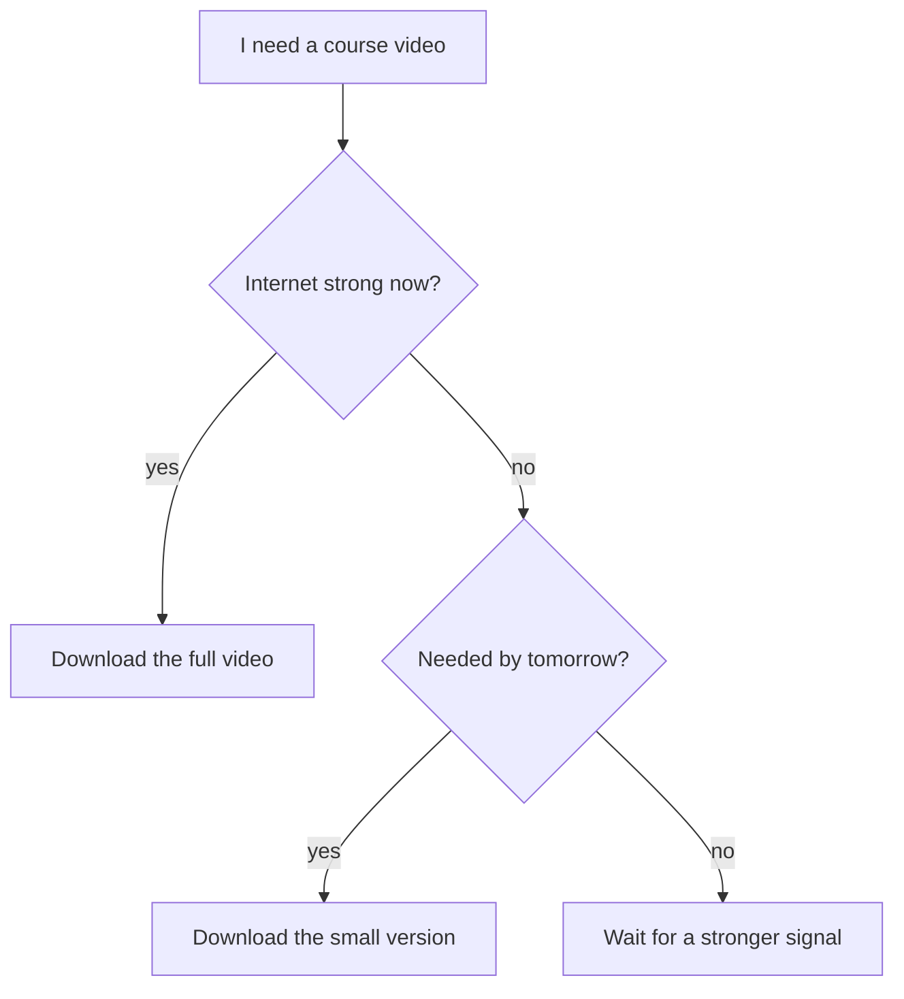

## The same offer, two answers

Lina is a freelance designer. On a good day, she answers new offers carefully. On a tired day, she says yes to everything and regrets it later. Same Lina, same kind of offer, different answers.

Lina wants her answer to depend on the facts, not on her mood. So she draws her decision on paper, as a flowchart.

<BigWordAlert term="Flowchart" plainEnglish="A drawing of a decision or a task: boxes for steps, questions with yes and no arrows, and an end." whyItMatters="Anyone who follows the same flowchart with the same facts reaches the same answer, and can explain every step of the way." />

## How a flowchart works

A flowchart has three kinds of box. A **step box** says what to do, such as "Ask for time". A **question box** asks something you can answer with yes or no, such as "Pay fair?". An **end box** says where the decision finishes, such as "Accept" or "Decline politely".

Arrows join the boxes. Each arrow that leaves a question has a label, usually "yes" or "no", so you always know which way to go. You start at the first box and follow one arrow at a time until you reach an end.

A good flowchart follows three rules:

1. Every question can be answered with yes or no, using facts.
2. Every question has both a yes arrow and a no arrow.
3. Every path reaches an end.

These rules keep a flowchart honest. If a question cannot be answered with facts, or a path goes nowhere, the chart will not help you decide.

## Lina's flowchart

Lina's flowchart has five boxes. It starts with the question "Deadline fits?": can she finish in her working hours? The second question is "Pay fair?": is the pay near her usual rate? If the deadline does not fit, she does not give up at once. She goes to a step box, "Ask for time", and sends one polite message. There are two ends: "Accept" and "Decline politely".

Here is the first offer. A bakery wants a logo for 40 dollars, ready in 2 days. Lina has electricity for about 4 hours each evening. A good logo takes her about 12 hours.

```predict
prompt: "A bakery wants a logo in 2 days. Lina works about 4 hours each evening, and a good logo takes her about 12 hours. Which arrow does she follow at 'Deadline fits?'"
options:
  - id: yes
    label: "The yes arrow"
  - id: no
    label: "The no arrow"
correctOptionId: no
explanation: "In 2 days she has about 8 hours of work time. The logo needs about 12, so the deadline does not fit. She follows the no arrow, to 'Ask for time'."
```

Step through Lina's flowchart below. The first step shows the offer arriving at "Deadline fits?". Before step 2, check your guess, then watch where each answer sends the offer.

<InteractiveCanvas slug="freelance-job-flowchart" />

## What the flowchart showed

The deadline did not fit: 2 days give Lina about 8 hours, and the logo needs about 12. So she followed the no arrow to "Ask for time". She wrote one polite message and asked for 4 days, which give her about 16 hours. The client agreed, so she followed the "agreed" arrow to the second question.

At "Pay fair?", she compared 40 dollars with her usual rate for a simple logo, 35 to 50 dollars. 40 is inside that range, so the answer was yes, and the offer ended at "Accept".

The last step showed a second offer: 5 dollars for a logo "with unlimited changes". The deadline fit, but at "Pay fair?" the answer was no, so it ended at "Decline politely". The chart does not get tired or tempted. Lina can explain every answer, to the client or to herself.

The flowchart also leaves things out. It does not ask whether Lina has the right skills, or whether she already has too much work. Every flowchart leaves something out. That is fine, as long as you know what you left out.

## A flowchart for a different decision

Flowcharts work for small daily choices too. Rania studies online. She needs to download a course video, but her internet is sometimes weak. Here is her flowchart.



Notice that each question has a yes arrow and a no arrow, and every path ends in a clear action. Also notice that the second question is only asked when the first answer is no. A flowchart asks only the questions it needs.

## A common mistake

The most common mistake is a question that is not really yes or no. "Is the pay okay?" or "Do I feel like it?" can get a different answer on a different day, which brings back the problem Lina wanted to solve. Turn it into a fact: "Is the pay at least 35 dollars?"

The second mistake is a question with only one arrow. If "Deadline fits?" had only a yes arrow, an offer with a short deadline would have nowhere to go. Before you use a flowchart, follow every arrow once with your finger.

<Callout type="tip" title="Start on paper">
Draw your first flowcharts by hand, with a pencil. Boxes, arrows and the words "yes" and "no" are all you need.
</Callout>

## Check your understanding

```quiz
type: mcq
question: "Using Lina's flowchart: a client offers 60 dollars for a logo due in 1 day. Lina asks for more time, and the client says no. Where does the offer end?"
options:
  - "Accept, because the pay is high"
  - "Decline politely"
  - "Accept after asking for time"
  - "Ask for time, and wait there"
correct: 1
explanations:
  - "The pay is high, but the flowchart never reaches the pay question. The deadline fails first, and the client refuses more time."
  - "Right. 1 day gives about 4 hours, but the logo needs about 12. The deadline does not fit, so she asks for time. The client says no, so the 'no more time' arrow leads to 'Decline politely'."
  - "'Ask for time' only leads on to 'Pay fair?' if the client agrees. Here the client said no."
  - "'Ask for time' is a step, not an end. Its two arrows lead on to 'Pay fair?' or to 'Decline politely'."
```

```quiz
type: mcq
question: "Basel draws a flowchart for taking new clients. One box asks: 'Is the client nice?', with a yes arrow and a no arrow. What is the main problem with this box?"
options:
  - "Two people could answer it differently for one client"
  - "A flowchart should never have more than one question"
  - "It should have a third arrow labelled 'maybe' as well"
  - "Questions about clients belong in a list, not a chart"
correct: 0
explanations:
  - "Right. 'Nice' is a feeling, not a fact. A better question uses facts, such as 'Did the client answer my questions clearly?'"
  - "Flowcharts can have many questions. Lina's has two, and it works well."
  - "A 'maybe' arrow makes it harder to decide. The fix is a question that facts can answer with yes or no."
  - "A flowchart can ask about clients. The problem is that this question has no clear yes or no answer."
```

**Next:** Test yourself on steps, patterns, sorting and flowcharts in the module quiz.
