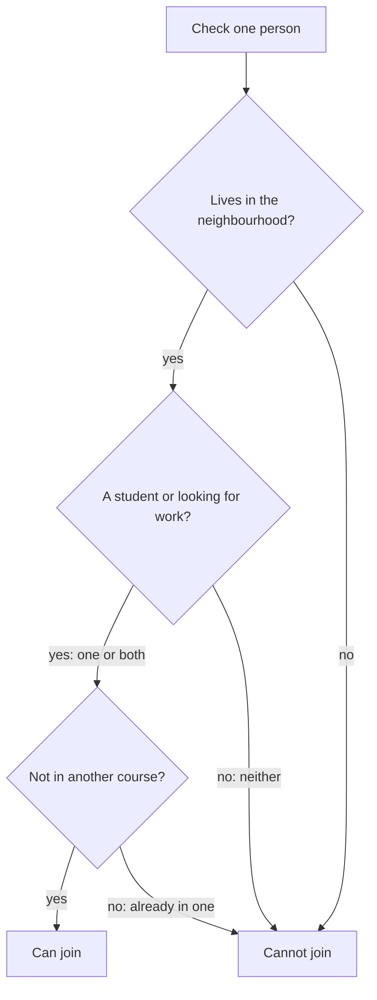

## Free delivery?

A shop near Amal's home has a sign: **"Free delivery if you spend 100 shekels or more and live in the city."** Amal spends 120 shekels. She lives in a village ten minutes outside the city. The shop asks her to pay for delivery, and she is surprised. She spent enough, so why?

The answer is in one small word: **and**. This chapter is about four small words that build almost every rule you meet.

## The four small words

An **if** rule has two halves. The if-part is the <GlossaryTerm term="condition" definition="Something that must be true for a rule to apply." />. The then-part is what happens when the condition is true. In the shop sign, the then-part is "free delivery". The if-part is "you spend 100 shekels or more and live in the city".

Inside the if-part, three more words join the pieces together:

- **And** means both pieces must be true. If even one is false, the whole condition is false.
- **Or** means at least one piece must be true. One is enough, and both is fine too.
- **Not** flips a piece. "Not a member" is true for everyone who is not a member.

So Amal's case is simple once you split it. She spent 100 shekels or more: true. She lives in the city: false. With "and", one false piece makes the whole condition false. No free delivery.

Now a question about "or". Before you read on, guess.

```predict
prompt: "A rule says: 'You can join if you are a student or you are looking for work.' Nour is a student, and she is also looking for work. Can she join?"
options:
  - id: no
    label: "No, only one is allowed"
  - id: yes
    label: "Yes, both is fine"
correctOptionId: yes
explanation: "In rules, 'or' means at least one piece is true. Nour has two true pieces, which is more than enough."
```

In daily talk, "or" sometimes means "only one". A waiter who says "tea or coffee" may expect you to choose one. But in rules, and in this course, "or" means **one or both**. If a rule is unclear about this, ask the person who wrote it.

## A worked example: the evening course

A community centre runs a free evening English course. Its rule has three parts, and all three must be true:

1. You live in the neighbourhood.
2. You are a student **or** you are looking for work.
3. You are **not** already in another course at the centre.

The trick is to check each part on its own, then join them. Here are five people.

| Person | Checks | Can join? |
|---|---|---|
| Rania | Lives here: yes. Student: yes. In another course: no | Yes |
| Khaled | Lives here: yes. Works full time, not a student, not looking for work | No: part 2 fails |
| Maryam | Lives in another town. Looking for work | No: part 1 fails |
| Tamer | Lives here: yes. Looking for work: yes. Already in the computer course | No: part 3 fails |
| Nour | Lives here: yes. Student and looking for work. No other course | Yes |

Look at how each "No" happened. For Khaled, part 2 is an "or", and both of its pieces are false, so the part fails. For Tamer, part 3 uses "not". He **is** in another course, so "not in another course" is false.

Notice that Maryam's "looking for work" did not help her. A true piece cannot rescue a part that fails somewhere else. With "and", every part has to pass.

Here is the same rule as a chart. Every person starts at the top.



Notice that every no arrow ends in the same box. One failed part is enough to stop a person, and only three yes answers reach "Can join". The middle question is the "or" part, so Rania with one true piece and Nour with two both pass it.

<Callout type="warning" title="Do not stop at the first yes">
The most common mistake is to check the first part, see "yes", and stop. Khaled lives in the neighbourhood, so a quick reader says he can join. Check every part, every time.
</Callout>

## A simple way to check any rule

When a rule looks long, slow down and do three things.

1. **Split it.** Write each part on its own line. Put "and" parts on separate lines, and keep "or" pieces together on one line.
2. **Mark each part.** Write yes or no next to each one for the person you are checking.
3. **Join them.** All lines must be yes. On an "or" line, one yes is enough.

Try it on the shop sign from the start of the chapter. Line 1: spend 100 shekels or more. Line 2: live in the city. For Amal, line 1 is yes and line 2 is no. Not every line is yes, so there is no free delivery. Now you can explain it to her in two short lines.

This takes a minute, and it stops most mistakes. It also helps you explain your answer to someone else, line by line. A form on a website does exactly this when it decides if you can sign up.

## Check your understanding

```quiz
type: mcq
question: "A shop sign says: 'You get a free bag if you spend 50 shekels or more, or if you bring your own box.' Who gets a free bag?"
options:
  - "Sami spends 30 shekels and brings no box"
  - "Huda spends 40 shekels and brings no box"
  - "Omar spends 20 shekels and brings a box"
  - "Lina spends 45 shekels and forgets her box"
correct: 2
explanations:
  - "Sami spends less than 50 shekels and has no box. Both pieces of the 'or' are false."
  - "Huda spends less than 50 shekels and has no box, so neither piece is true."
  - "Right. Omar spends only 20 shekels, but he brings his own box. With 'or', one true piece is enough."
  - "Lina is close to 50 shekels, but close is not enough, and she forgot her box. Neither piece is true."
```

```quiz
type: mcq
question: "A study room rule says: 'You can book the room if you are a member and you have not booked it already this week.' Who can book it today?"
options:
  - "Khaled, a member who booked it earlier this week"
  - "Amal, who is not a member and has never booked it"
  - "Yousef, a member who last booked it a month ago"
  - "Rania, who is not a member but uses a friend's card"
correct: 2
explanations:
  - "Khaled is a member, but he already booked this week. The 'not' part is false."
  - "Amal has never booked, but she is not a member. With 'and', both parts must be true."
  - "Right. Yousef is a member, and a month ago is not this week. Both parts are true."
  - "The rule asks if you are a member. A friend's card does not make Rania a member, so the first part is false."
```

<ChapterRecap points={["An if rule has a condition and a result", "With 'and', every part must be true", "With 'or', one true piece is enough, and both is fine", "'Not' flips a piece from true to false", "Split, mark and join: check every part, every time"]} />

**Next:** A rule goes one way. Learn what it proves, and what it does not.
