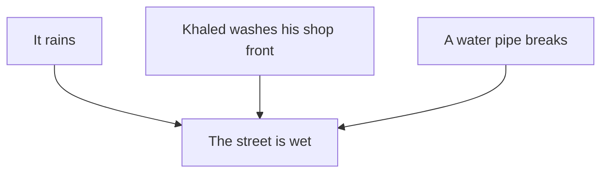

## The wet street

Basel knows a simple rule: **"If it rains, the street is wet."** One morning he opens the door and sees that the street is wet. "It rained in the night," he says. Then he sees his neighbour, Khaled, with a bucket. Khaled washed the front of his shop an hour ago.

Basel's rule is true. His conclusion was not. He read the rule backwards.

<BigWordAlert term="Conclusion" plainEnglish="What you can say for sure, using only the rule and the facts you have." whyItMatters="Many wrong answers, from people and from AI tools, sound right because they read a rule backwards. Knowing what really follows protects you from them." />

## A rule goes one way

A rule like "if it rains, the street is wet" is a one-way road. It goes from the if-part to the then-part. It tells you what happens **when it rains**. It does not tell you every way a street can get wet. Rain is one way. A bucket of water is another. A broken water pipe is a third.

Here is the wet street as a picture. Each arrow is one way the street can get wet.



Notice that all three arrows point into the same box. If you see rain, you can follow its arrow forward to a wet street. If you only see a wet street, three arrows lead to it, and the rule cannot tell you which one happened.

Here is a rule from a shop, to see this with money:

**"If you spend more than 200 shekels, you get free delivery."**

Suppose the shop always keeps this rule. Before you read on, guess.

```predict
prompt: "Omar got free delivery from this shop. Can you be sure he spent more than 200 shekels?"
options:
  - id: not-sure
    label: "No, not for sure"
  - id: sure
    label: "Yes, that is the rule"
correctOptionId: not-sure
explanation: "The rule says what happens to people who spend over 200 shekels. It does not say that this is the only way to get free delivery. Omar may live next door, or have a voucher."
```

## The four things you might know

With any if rule, there are four kinds of fact you might have. Two let you conclude something. Two do not. This table shows all four with the shop rule.

| What you know | What follows | Why |
|---|---|---|
| Huda spent 250 shekels | She gets free delivery | The if-part is true, so the then-part is true |
| Sami did not get free delivery | He did not spend over 200 | If he had, he would have got it |
| Omar got free delivery | Nothing for sure | There may be another way to get it |
| Lina spent 150 shekels | Nothing for sure | The rule says nothing about smaller orders |

Read the first two rows again. They are the safe moves.

The first row is the rule used forwards: the if-part happened, so the then-part happens.

The second row is a little harder, so think it through slowly. Sami did not get free delivery. Suppose he had spent over 200 shekels. Then the rule says he would have got free delivery. But he did not get it. So he cannot have spent over 200. This works because the rule is always kept. It is a good way to reason from a "no".

The last two rows are the traps. In the third row, the then-part is true, and people jump back to the if-part. That is reading the rule backwards, like Basel and the wet street. In the fourth row, the if-part is false, and people decide the then-part must be false too. But Lina may still get free delivery. Perhaps the shop has a second rule, such as free delivery on Fridays. This rule alone cannot tell us.

## A worked example in everyday life

Nour hears a teacher say: "If you study every day for a month, you will pass the exam." Nour wants to use this rule well. Here is how she checks four sentences she hears from classmates.

1. **"Maryam studied every day for a month, so she will pass."** This uses the rule forwards. It follows, if the teacher's rule is true.
2. **"Tamer passed, so he must have studied every day."** This reads the rule backwards. Tamer may have passed because he already knew the subject well. It does not follow.
3. **"Rania did not study every day, so she will fail."** This is the if-part false. The rule says nothing about people who studied less. It does not follow.
4. **"Yousef failed, so he did not study every day."** If the rule is always true, this follows. If he had studied every day, he would have passed.

Notice something about sentences 2 and 3. They sound reasonable. They might even be true. But the rule does not prove them. A sentence can sound right and still not follow.

<Callout type="tip" title="Ask: is there another way?">
When someone reasons from the then-part back to the if-part, ask one question: is there another way the then-part could happen? If you can think of one, the conclusion does not follow.
</Callout>

## Why this matters for AI answers

An AI tool can make this mistake too, and it says it in a very sure voice. For example: "People who get this scholarship have high marks. You have high marks, so you will get it." That is the rule read backwards. High marks may be needed, but many people with high marks still do not win. When an answer goes from a result back to a cause, stop and ask if there is another way.

## Check your understanding

```quiz
type: mcq
question: "A library rule says: 'If you return a book late, you pay 2 shekels.' Today, Maryam paid 2 shekels at the library desk. What can you say for sure?"
options:
  - "She returned a book late today"
  - "The rule does not tell us why"
  - "She will return books late again"
  - "She did not return a book late"
correct: 1
explanations:
  - "This reads the rule backwards. She may have paid 2 shekels for something else, such as printing."
  - "Right. The then-part (paying) is true, but there may be another reason to pay. The rule does not say."
  - "Nothing in the rule or the facts is about the future. This is a guess, not a conclusion."
  - "This goes too far the other way. She may have returned a book late. We simply cannot tell from the rule."
```

```quiz
type: mcq
question: "Tamer's building has a rule that always holds: 'If the power is on, the water pump works.' This morning the pump is not working. What can Tamer conclude?"
options:
  - "The power is off"
  - "The power is on, but the pump is broken"
  - "Nothing, because the rule cannot tell us"
  - "The pump will start working again soon"
correct: 0
explanations:
  - "Right. If the power were on, the pump would work. The pump does not work, so the power cannot be on."
  - "This breaks the rule. The rule says the pump always works when the power is on."
  - "The rule can tell us something here. When the then-part is false and the rule always holds, the if-part must be false too."
  - "Nothing in the rule says when the pump will work again. This is a hope, not a conclusion."
```

<ChapterRecap points={["A rule goes one way, from the if-part to the then-part", "If-part true: the then-part follows", "Then-part false: the if-part is false too", "Then-part true or if-part false: nothing for sure", "Ask: is there another way it could happen?"]} />

**Next:** Use what you know to solve a logic grid puzzle, one crossed-out box at a time.
