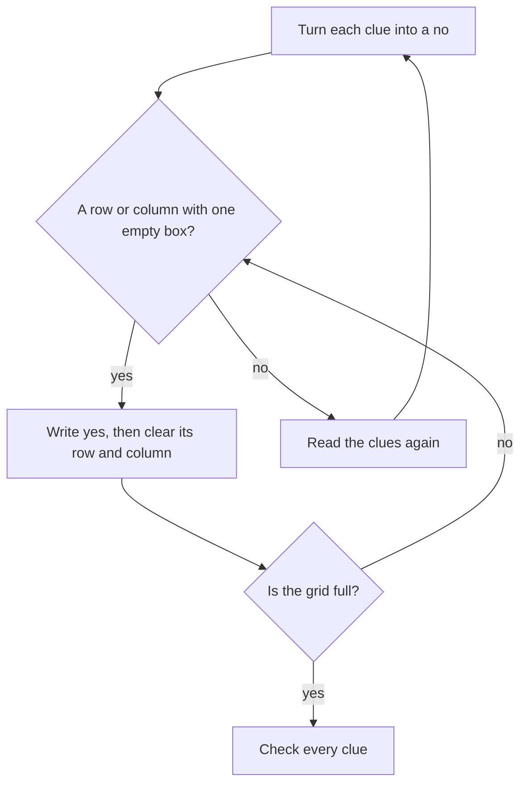

## Three friends at the market

Lina, Omar and Huda go to the market together. Each of them buys exactly one thing: bread, olives or tomatoes. No two of them buy the same thing. At home, they give you three clues and ask you to work out who bought what.

1. Huda did not buy the bread.
2. Omar did not buy the bread.
3. Huda did not buy the olives.

Try it in your head for a moment. If you feel lost, that is normal. Keeping three people and three items in your head at once is hard for everyone. The trick is to stop holding it in your head and put it on paper.

<BigWordAlert term="Logic grid" plainEnglish="A small table with people down one side and choices across the top, where you mark each box yes or no." whyItMatters="It turns a puzzle that feels too big for your head into small steps you can check one at a time." />

## Two facts hidden in the story

Before the clues, the story gives two facts that are easy to miss. They are the engine of every grid puzzle.

- **Each person buys exactly one thing.** So when one box in a person's row is yes, the other boxes in that row are no.
- **No two people buy the same thing.** So when one box in an item's column is yes, the other boxes in that column are no.

Together, these mean every row and every column ends with exactly one yes. If a row or a column has only one empty box left, that box must be yes.

## Step 1: draw the grid and mark the clues

Draw a table with the people down the side and the items across the top. Then turn each clue into a "no". Clue 1 puts a no in Huda's bread box. Clue 2 puts a no in Omar's bread box. Clue 3 puts a no in Huda's olives box.

| Person | Bread | Olives | Tomatoes |
|---|---|---|---|
| Lina | | | |
| Omar | no | | |
| Huda | no | no | |

## Step 2: find a column with one empty box

Look down the bread column. Omar is no. Huda is no. Only Lina's box is empty. Someone bought the bread, so it must be Lina. Write yes.

Now use the first hidden fact. Lina bought exactly one thing, so she did not buy olives or tomatoes. Write no in the rest of her row.

| Person | Bread | Olives | Tomatoes |
|---|---|---|---|
| Lina | YES | no | no |
| Omar | no | | |
| Huda | no | no | |

Look at the grid now, before you read on.

```predict
prompt: "Look at the olives column in the grid above. Who bought the olives?"
options:
  - id: unknown
    label: "We cannot tell yet"
  - id: omar
    label: "It must be Omar"
correctOptionId: omar
explanation: "The olives column has a no for Lina and a no for Huda. Someone bought the olives, so the only empty box, Omar's, must be yes."
```

## Step 3: the next column

In the olives column, Lina is no and Huda is no. Only Omar's box is empty, so Omar bought the olives. Omar bought exactly one thing, so his tomatoes box is no.

## Step 4: the last box fills itself

Huda's row now has no for bread and no for olives. Only tomatoes is left, so Huda bought the tomatoes.

| Person | Bread | Olives | Tomatoes |
|---|---|---|---|
| Lina | YES | no | no |
| Omar | no | YES | no |
| Huda | no | no | YES |

## Step 5: check every clue

A good solver never stops at the answer. Go back and test it against each clue.

1. Huda did not buy the bread. She bought tomatoes, so this is true.
2. Omar did not buy the bread. He bought olives, so this is true.
3. Huda did not buy the olives. True again.

Every clue fits, and every row and column has exactly one yes. You can also check that it is the only answer: at no step did we guess. Each yes was forced by the boxes around it.

The steps above make one loop. Here it is as a chart.



Notice that no arrow says "guess". When no box is forced, the chart sends you back to the clues, not to a guess.

<Callout type="tip" title="Never guess, always force">
If you get stuck and want to guess, look for a row or column with only one empty box first. If there is none, read the clues again: one clue often hides two facts.
</Callout>

## Common mistakes

The first mistake is forgetting the hidden facts. People write Lina's yes for bread and then stop, because no clue mentions Lina's olives. But "exactly one thing each" already tells you her olives box is no. The hidden facts do most of the work.

The second mistake is guessing early. A guess can look right and still be wrong, and then every step after it is wrong too. If you write only what is forced, you never have to undo anything.

The third mistake is not checking at the end. It takes one minute, and it catches a misread clue before you share the answer with anyone.

## Check your understanding

```quiz
type: mcq
question: "Sami, Rania and Tamer each take one freelance job: a logo, a website or a translation. No two take the same job. Clue 1: Rania takes neither the website nor the logo. Clue 2: Sami does not take the website. Who takes the logo?"
options:
  - "Sami"
  - "Rania"
  - "Tamer"
  - "We cannot tell"
correct: 0
explanations:
  - "Right. Clue 1 leaves Rania only the translation. The website is not Sami (clue 2) and not Rania, so it is Tamer. That leaves the logo for Sami."
  - "Clue 1 says Rania does not take the logo. Her only job left is the translation."
  - "Tamer must take the website, because Sami and Rania cannot. He takes exactly one job, so the logo is not his."
  - "The clues are enough. Mark Rania's row first, then the website column, and the last box fills itself."
```

**Next:** Rules also decide how things move from one state to another, like a job application.
