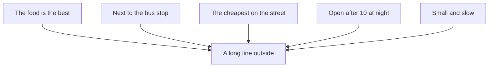

## The busiest shop on the street

Khaled and Yousef walk down the main street every evening. One shop always has a long line outside: a small sandwich shop next to the bus stop.

"That shop is always busy," Khaled says. "So its food must be the best on the street."

Yousef is not so sure. He starts to count other reasons the line could be long.

- The shop is right next to the bus stop. People waiting for the bus are hungry and close by.
- It is the cheapest shop on the street.
- It stays open later than the others, so it is the only choice after 10 at night.
- It is small and slow, so even a few customers make a line.

None of these reasons is about the taste of the food. The food might still be the best. But a long line does not prove it.

Draw Yousef's list as arrows, and the problem is easy to see.



Notice that Khaled's reason is only one of five arrows into the same box. The line tells you that something brings people. It does not tell you which arrow is doing it.

"So how would we know?" Khaled asks. Yousef thinks. "We could ask five people in the line why they chose it. Or we could try a sandwich there and one from the shop across the road, on the same night."

## What just happened

Khaled made a **claim**: the food is the best. He gave a reason: the shop is always busy. That sounds like evidence. But between the reason and the claim there is a gap. To get from "busy" to "best food", you must believe something he did not say: that people choose this shop **because of the food**. That unsaid belief is a **hidden assumption**.

Yousef did two useful things. He looked for other explanations, and he thought of a small, cheap way to check. That is the whole module in one evening walk.

<BigWordAlert term="Evidence" plainEnglish="The facts you can point to that support a claim, such as what you saw, counted or measured." whyItMatters="Many claims sound strong but rest on weak evidence. When you ask 'what is the evidence, and what else could explain it?', you are much harder to fool, by people and by AI tools." />

## Why this matters

You meet confident claims every day. A message says a study method "works for everyone". A seller says a phone is the best "because everyone buys it". An AI tool says one thing causes another. Most of these claims are not lies. They simply jump over a gap without noticing. In this module you learn to see the gap, and to check it calmly instead of arguing.

<LearningObjectives items={["Find the hidden assumption in a claim", "Say one small way to test an assumption", "Tell when two things only move together and when one causes the other", "Suggest a third factor that could explain both", "Spot charts and small samples that make a claim look stronger than it is"]} />

## Key words

| Word | Plain English |
|---|---|
| **Claim** | Something a person says is true |
| **Evidence** | Facts you can point to that support a claim |
| **Hidden assumption** | Something that must be true for the claim to work, but is not said |
| **Correlation** | Two things that tend to go up or down together |
| **Cause** | Something that makes another thing happen |
| **Sample** | The small group you looked at, used to guess about a bigger group |

## What is in this module

| Chapter | You will practice |
|---|---|
| 4.2 | Finding and testing hidden assumptions |
| 4.3 | Telling cause from coincidence |
| 4.4 | Reading charts and small samples honestly |
| 4.5 | A graded quiz, including an AI answer to check |
| 4.6 | Finding the assumption in a real claim |

## Before you continue

```openquestion
prompt: "Write down one confident claim you heard recently, from a friend, a seller or a message. What reason did the person give for it? If you prefer, use this example instead: 'This study app is the best, because all my classmates use it.' Two or three sentences is enough."
required: true
minWords: 25
allowSpeechInput: true
modelAnswer: "A man at the phone shop told Rania that one charger is the best because it is the most expensive. His reason was the price. But a high price does not show that the charger works better or lasts longer."
```

You can use this same claim in the module checklist at the end.

<ChapterRecap points={["A busy shop does not prove the food is the best", "Between a reason and a claim there is often a gap", "The unsaid belief in that gap is a hidden assumption", "Look for other explanations, then find a small way to check"]} />

**Next:** How to find the hidden assumption in a claim, and how to test it.
