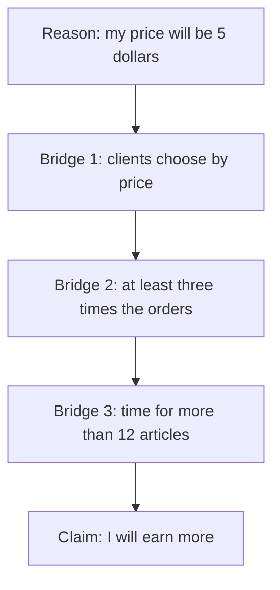

## Five dollars an article

Sami writes short articles for clients on a freelance website. He charges 15 dollars an article and gets about 4 orders a week. One evening he decides: "I will lower my price to 5 dollars. Then I will earn more." He feels sure. But his plan rests on things he has not said, and one of them could cost him a lot.

<BigWordAlert term="Hidden assumption" plainEnglish="Something that must be true for a claim to work, but that nobody says out loud." whyItMatters="When a plan fails, the cause is often an assumption nobody checked. Finding it early is cheap. Finding it late can cost money and time." />

## The gap between reason and claim

Most claims come with a reason. You can write them in one line: **reason, so claim**. Khaled's claim from chapter 4.1 becomes "The shop is always busy, so its food is the best."

Between the reason and the claim there is a gap. The hidden assumption is the bridge across that gap. To find it, ask one question: **what must also be true for this reason to lead to this claim?** For the busy shop, the bridge is "people choose this shop because of its food". Without that bridge, "busy" does not lead to "best food".

Here is a short one to try. Before you read on, guess.

```predict
prompt: "Rania says: 'All my reviews are five stars, so I can charge clients more.' Which is the hidden assumption?"
options:
  - id: stated
    label: "Rania's reviews really are five stars"
  - id: hidden
    label: "Clients pay more for good reviews"
correctOptionId: hidden
explanation: "Rania already said her reviews are five stars: that is her stated reason. The unsaid bridge is that clients will pay more because of good reviews."
```

## The flip test

How do you know you found the right assumption, and not just any doubt? Use the flip test. Imagine the assumption is false, and see what happens to the claim.

Suppose clients do **not** pay more for good reviews. Maybe they only look at price. Then Rania's five stars do not let her charge more. The claim falls. So "clients pay more for good reviews" really is the bridge.

Now flip something that is not the bridge. Suppose Rania's clients are mostly students. Does the claim fall? Not by itself. So that is a detail, not the hidden assumption.

<Callout type="tip" title="The flip test in one line">
Say "Suppose this is not true." If the claim falls apart, you have found a hidden assumption. If the claim still stands, look again.
</Callout>

## A worked example: Sami's price cut

Write Sami's plan as reason and claim: "My price will be lower, so I will earn more." Now look for the bridges, one at a time.

**Step 1: do the sum.** At 15 dollars and 4 orders, Sami earns 15 x 4 = 60 dollars a week. At 5 dollars an article, how many orders does he need to earn the same 60 dollars? 60 / 5 = 12 orders. To earn **more**, he needs more than 12 orders a week. That is three times his orders today.

**Step 2: name the assumptions.** For the plan to work, all of these must be true:

1. Clients choose writers mostly by price.
2. A lower price will bring at least three times as many orders.
3. Sami has time to write more than 12 articles a week.

**Step 3: flip each one.** If clients choose mostly by quality, the price cut brings few new orders and he earns less. If orders only double, he earns 5 x 8 = 40 dollars, less than now. If he cannot write 12 articles a week, he cannot take the orders anyway. Every one of them makes the plan fall. Assumption 2 is the riskiest, because tripling orders is a big jump.

Step 3 is easier to see as a chain. Sami's claim sits at the end of three bridges.



Notice that there is no way around any bridge. If one breaks, the path to the claim is cut. That is why one false assumption is enough to sink the whole plan.

**Step 4: test the riskiest one cheaply.** Sami does not need to change everything at once. He can lower the price on one small service for two weeks and count new orders. Or he can look at the profiles of writers who get many orders, and see if they are the cheapest. A small test costs little. Being wrong about all his prices for three months costs a lot.

This shows a useful pattern. An assumption is not bad just because it is unsaid. Everyone makes assumptions all the time. The skill is to find the one that matters most, and to check it before you bet on it.

## Common mistakes

The first mistake is naming the reason instead of the assumption. In the predict, "Rania's reviews are five stars" was already said. A hidden assumption is never the thing the person already told you.

The second mistake is calling every doubt an assumption. "Maybe the website will close" is a worry, but it is not a bridge between this reason and this claim. Use the flip test to check.

The third mistake is stopping after you name it. Naming the assumption is half the work. The other half is asking: how could I find out if it is true? Good tests are small and cheap: ask a few people, look at what already happened, or try a little first.

## Check your understanding

```quiz
type: mcq
question: "Huda says: 'This online course gives a certificate, so it will help me get a job.' What hidden assumption must be true for her claim to work?"
options:
  - "Employers she applies to value this certificate"
  - "The online course really does give a certificate"
  - "Courses that give certificates cost more money"
  - "Huda will finish the course in less than a month"
correct: 0
explanations:
  - "Right. This is the bridge from 'certificate' to 'job'. Flip it: if employers do not care about this certificate, the claim falls."
  - "This is her stated reason, not a hidden assumption. She already told us the course gives a certificate."
  - "Price is not part of the bridge from certificate to job. Flip it, and the claim still stands."
  - "Finishing quickly is not needed for her claim. Even a slow finish could help her get a job."
```

```quiz
type: mcq
question: "Basel sells honey at the market. He says: 'People look at my jars but do not buy, because my price is too high.' Which is the best small test of his assumption?"
options:
  - "Ask his family whether the price feels fair to them"
  - "Lower the price for a week and count jars sold"
  - "Put the honey in bigger jars at the same price"
  - "Move his table to a busier part of the market"
correct: 1
explanations:
  - "His family are not his customers, and they may be kind rather than honest. This does not test why customers walk away."
  - "Right. This changes only the price, for a short time, and counts the result. If sales rise a lot, his assumption looks right."
  - "This changes the jar and the price per gram at once, so he would not know which change made the difference."
  - "This may bring more people, but it does not test whether price is the reason people walk away."
```

<ChapterRecap points={["Write the claim as 'reason, so claim'", "The hidden assumption is the unsaid bridge between them", "Flip it: if the claim falls, you found it", "Find the riskiest assumption first", "Test it small and cheap before you bet on it"]} />

**Next:** Two things that happen together are not always cause and effect. Learn to spot the third factor.
