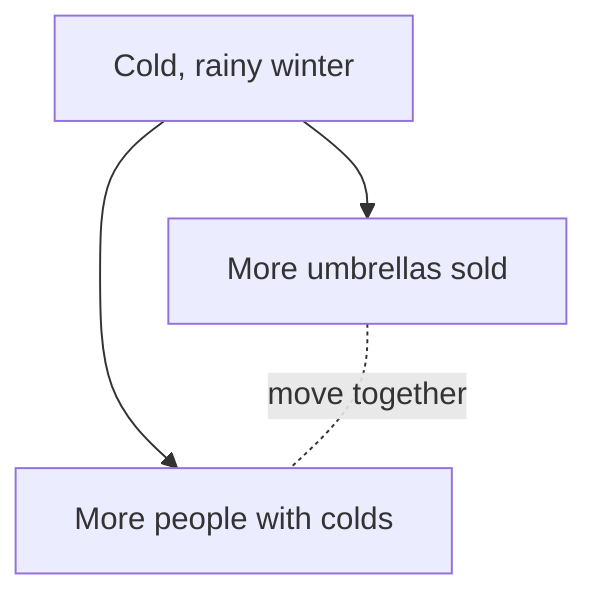

## Umbrellas and colds

Maryam helps in her uncle's shop. She notices a pattern. In the months when the shop sells the most umbrellas, more of her friends are at home with a cold. In summer, the shop sells almost no umbrellas, and almost nobody has a cold. She laughs and says, "Maybe umbrellas give people colds."

She is joking. But many serious claims make exactly the same jump.

<BigWordAlert term="Correlation" plainEnglish="Two things that tend to go up or down together. It shows a link, not a reason." whyItMatters="A correlation is a useful clue, but it is not proof that one thing causes the other. Mixing them up leads to wrong decisions and wasted money." />

## Moving together is not the same as causing

Umbrella sales and colds move together. That is a correlation. But a correlation alone does not tell you **why** they move together. Before you read on, guess.

```predict
prompt: "Umbrella sales and colds both rise in the same months. What is the best explanation?"
options:
  - id: winter
    label: "Winter causes both"
  - id: umbrellas
    label: "Umbrellas spread colds"
correctOptionId: winter
explanation: "Cold, rainy weather makes people buy umbrellas. The same season is when colds spread most. Neither one causes the other: winter is behind both."
```

The weather is a <GlossaryTerm term="third factor" definition="A hidden thing that causes two other things, so the two move together even though neither causes the other." />. It pushes both numbers up at the same time. This small diagram shows the idea. The solid arrows are causes. The dotted line only means "they move together".



Notice that there is no arrow between umbrellas and colds. Stopping umbrella sales would not stop a single cold.

## Three questions to ask

When someone says "A causes B" because the two move together, ask three questions.

1. **Is there a third factor?** Could something else cause both A and B?
2. **Could the cause go the other way?** Maybe B causes A. This is called <GlossaryTerm term="reverse cause" definition="When the thing you thought was the result is really the cause." />. For example: people who visit the clinic often are sicker than people who do not. The clinic does not make them sick. Being sick makes them visit.
3. **Could it be chance?** If you only looked at a few cases, the pattern might be luck. You will see more about this in chapter 4.4.

If you can answer all three, and the link still stands, a cause becomes more believable. It is still not certain, but it is a much stronger claim.

## A worked example: books and marks

Omar reads in a local report (in this example) that students with more books at home get higher marks at school. A bookseller says: "Buy more books, and your children's marks will go up." Let us check the claim with the three questions.

**Is it a correlation?** Yes. More books and higher marks go together. That is all the report shows.

**Is there a third factor?** Several are possible. Parents who read a lot may buy more books, and may also help with homework. A home with a quiet room to study may also have space for books. In each case, something about the home causes both the books and the marks.

**Could the cause go the other way?** Yes, partly. Children who already love reading and do well at school may ask for more books. Then good marks lead to more books, not the other way round.

**Could it be chance?** If the report looked at only a few students, it could. If it looked at many, chance is less likely, but the first two questions still matter.

So what can Omar say? Books may help a little. But the claim "buy books and marks will rise" jumps over the third factor and the reverse cause. A fairer test would start with two groups of similar students. One group gets books and the other does not. A year later, compare their marks. If only the books are different, a difference in marks is much better evidence.

Notice what Omar did not do. He did not call the bookseller a liar, and he did not decide that books are useless. He kept the clue, named what else could explain it, and thought of a fair way to check. That is the habit this chapter is about.

## Common mistakes

The first mistake is the one Maryam joked about: seeing two things move together and naming one as the cause. Ask the three questions before you believe it.

The second mistake goes the other way: "correlation means nothing". That is also wrong. A correlation is a real clue. Sometimes there really is a cause behind it. The point is to check, not to throw the clue away.

<Callout type="warning" title="Watch for this in AI answers">
AI tools often turn a link into a cause in one smooth sentence, such as "students who do X get higher marks, so X improves marks". When you see "so" between a link and a cause, ask the three questions.
</Callout>

## Check your understanding

```quiz
type: mcq
question: "Tamer runs a small café. He notices that on days when he plays music, he sells more tea. But he only plays music on Fridays and Saturdays. What is the most likely explanation?"
options:
  - "The music makes people feel thirsty, so they order more"
  - "Weekend days bring more customers, and music is on then"
  - "Selling more tea makes Tamer want to play more music"
  - "It is pure chance, so Tamer should not think about it"
correct: 1
explanations:
  - "This may be a little true, but it ignores what else is different on those days. Music days are also weekend days."
  - "Right. The weekend is a third factor. It brings more customers, and it is also when Tamer plays music."
  - "Tamer decides to play music before he sells anything, so the cause cannot run this way here."
  - "The pattern repeats every weekend, so it is not likely to be chance. There is a clear third factor to check."
```

```quiz
type: mcq
question: "A school finds that students who go to the extra help class have lower marks than students who do not. A parent says the help class lowers marks. What is the best reply?"
options:
  - "Maybe the class teacher is not very good at teaching"
  - "Maybe the class meets at a bad time of the day"
  - "Maybe the students in the class do not try hard enough"
  - "Maybe students with lower marks are sent to the class"
correct: 3
explanations:
  - "This still assumes the class causes the low marks. It does not question the direction of the cause."
  - "This also assumes the class is the cause. The more likely story is that low marks come first."
  - "This blames the students without evidence, and it misses who is sent to the class in the first place."
  - "Right. This is reverse cause. Low marks are the reason students join the class, not the result of it."
```

**Next:** Charts and small samples can make a weak claim look strong. Learn to read them honestly.
