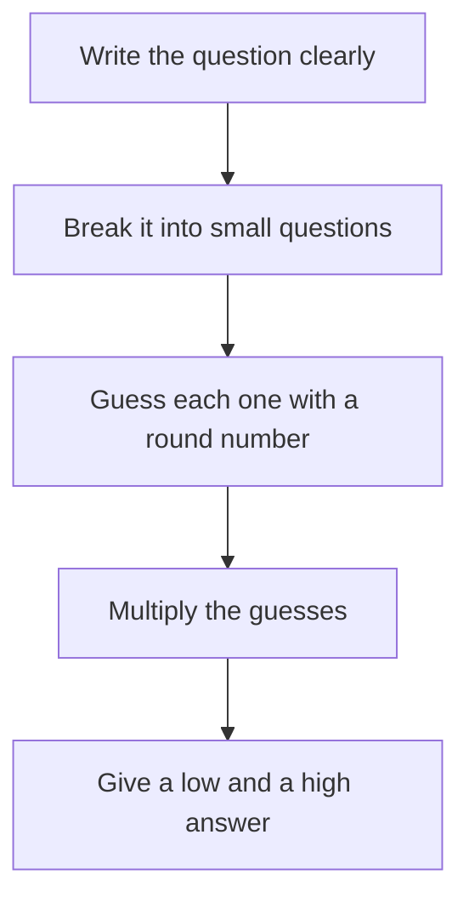

<BigWordAlert term="Fermi question" plainEnglish="A big number question you cannot count directly, so you answer it by breaking it into small guesses and multiplying them." whyItMatters="It turns 'I have no idea' into an answer you can explain, check and improve." />

## 200 sandwiches?

Khaled wants to sell falafel sandwiches at lunch outside a training centre. On his first day, he must decide how many to make. His cousin says, "There are lots of students. Make 200." Falafel does not keep well, so every sandwich he does not sell is money lost.

Khaled cannot count his future customers. But he can estimate them.

```predict
prompt: "About 200 students come to the training centre each day. Before you read on, guess: will Khaled sell close to 200 sandwiches on his first day?"
options:
  - id: about-200
    label: "About 200, one for each student"
  - id: far-fewer
    label: "Far fewer than 200 sandwiches"
correctOptionId: far-fewer
explanation: "Not every student buys lunch outside, and not every buyer chooses Khaled's stand. Each of those facts cuts the number down. The worked example below shows by how much."
```

## Five steps for a Fermi question

The name comes from a scientist who loved asking questions like "How many tailors work in this city?" He did not look up the answer. He broke the question into pieces he could guess. You can do the same with five steps.



Read the chart from top to bottom. Notice that the guessing happens in the middle, on small questions, not on the big question at the start.

1. **Write the question clearly.** Say what you are counting and over what time. "Sandwiches sold" is vague. "Sandwiches sold at my stand on one weekday lunch" is clear.
2. **Break it into small questions.** Each small question should be something you can picture or ask someone about.
3. **Guess each one with a round number.** Write each guess down as an <GlossaryTerm term="assumption" definition="One guess you treat as true for now, so you can keep going. You can test it or change it later." />.
4. **Multiply the guesses.** Use easy sums. Round as you go.
5. **Give a low and a high answer.** Each guess could be off, so give a range, and say which number is most likely.

The steps look simple, and they are. The power is in step 3: writing every guess down where others can see it.

## The worked example

Khaled writes his question: "How many falafel sandwiches will students buy from my stand on one weekday lunch?" Then he breaks it into small questions and guesses each one.

| Small question | Khaled's guess | Number so far |
|---|---|---|
| How many students come each day? | About 8 classrooms with about 25 students each | 8 x 25 = 200 |
| How many buy lunch outside? | About 1 in 4. Many bring food from home | 200 / 4 = 50 |
| How many choose my stand? | About half. There is another stand nearby | 50 / 2 = 25 |
| How many sandwiches each? | One each | 25 x 1 = 25 |

His best guess is about 25 sandwiches. Now he tries a low and a high version of the two guesses he is least sure about.

- **Low:** only 1 in 10 students buy outside. 200 / 10 = 20, and half of 20 is 10.
- **High:** 1 in 2 students buy outside. 200 / 2 = 100, and half of 100 is 50.

So his estimate is "between 10 and 50 sandwiches, most likely about 25." He decides to make 30. That is very different from 200. With his cousin's number, more than 150 sandwiches would have gone to waste.

Notice what made this work. No single guess was exact. But each guess was small enough to picture, and each one is written down. After the first day, Khaled can check his guesses. If 40 people bought from him, he knows to raise the "1 in 4" guess.

## A wide range is still useful

You may think "10 to 50" is too wide to help. But look at the decision Khaled had to make. Every number in his range is far below 200. So even with a wide range, he knows his cousin's number is wrong, and he knows roughly how much falafel to prepare. A range only needs to be narrow enough to choose. If your range is so wide that it fits two different choices, you need better guesses. If not, your estimate has done its job.

<Callout type="tip" title="Round as you go">
Rough numbers are easier to work with than exact ones. If you need 23 x 48, use 20 x 50 = 1,000. The real answer is 1,104, and 1,000 is close enough for an estimate.
</Callout>

## Common mistakes

Most mistakes with Fermi questions are not sum mistakes. They come from hiding or mixing up the guesses.

- **Pretending to be exact.** "I estimate 1,237 sandwiches" sounds clever but is not honest. Your guesses were rough, so your answer is rough too. Say "about 1,000" or give a range.
- **Hiding the guesses.** "About 25" alone cannot be checked. "About 25, from 200 students, 1 in 4 buying outside, half choosing me" can be checked and improved.
- **Mixing time units.** If one guess is per day and another is per week, the answer is wrong. Keep every guess in the same unit of time.

Each mistake makes your estimate harder to trust. Round numbers, guesses you can see, and one unit of time fix all three.

## Check your understanding

```quiz
type: mcq
question: "Lina wants to estimate how many notebooks a stationery shop sells at the start of the school year. She guesses: about 400 students live nearby, each buys about 3 notebooks, and about half of them buy from this shop. What is her estimate?"
options:
  - "1,200 notebooks"
  - "2,400 notebooks"
  - "600 notebooks"
  - "200 notebooks"
correct: 2
explanations:
  - "This is 400 x 3 = 1,200, which is all the notebooks the students need. It forgets that only half buy from this shop."
  - "This doubles 1,200 instead of halving it. Only half the students buy here, so the number gets smaller."
  - "Right. 400 students x 3 notebooks = 1,200. Half of them buy here, so 1,200 / 2 = 600."
  - "This takes half of 400 students but forgets that each buys 3 notebooks. 200 x 3 = 600."
```

```quiz
type: mcq
question: "Sami estimates how many people ride the minibus on his route each day. Which answer is the most useful estimate?"
options:
  - "About 600 a day: 40 trips with about 15 riders each"
  - "Exactly 587 a day, because it is the number I thought of"
  - "Lots of people, because the minibus always looks full"
  - "Nobody can say without counting every rider for a week"
correct: 0
explanations:
  - "Right. It gives a number and shows the two guesses behind it: 40 x 15 = 600. Anyone can check or improve each guess."
  - "An exact-looking number with no guesses behind it cannot be checked. It is less honest than a round one."
  - "This has no number at all, so Sami cannot plan with it or compare it with anything."
  - "Counting would give a better number, but a rough estimate today is still useful. A Fermi question works without counting."
```

**Next:** Sanity checks: use a rough number to catch a number that cannot be right.
