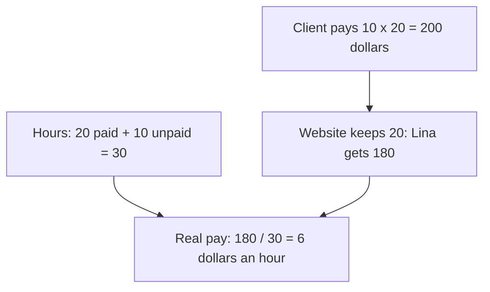

<BigWordAlert term="Average" plainEnglish="Add all the numbers, then divide by how many numbers there are. It is the total shared out equally." whyItMatters="Averages appear in adverts, offers and reports. One very big number can pull an average far from what most people really get." />

## A good month?

Five friends who freelance compare what they earned last month. The amounts are 200, 250, 300, 250 and 2,000 dollars. Omar adds them up and divides by five. "Our average is 600 dollars a month! Freelancing pays well."

But four of the five friends earned 300 dollars or less. Only Basel, who had one big client, earned more. Is 600 really a "normal" month? Hold that question. First, two everyday sums that use the same skills.

## A simple budget

A budget is a plan for money: what comes in, what goes out, and what is left. Huda helps her family write one for next month. In this example, the family expects 3,000 shekels to come in.

| Money going out | Shekels |
|---|---|
| Food | 1,500 |
| Transport | 300 |
| Phone and internet | 200 |
| School costs | 400 |
| Other | 300 |
| **Total going out** | **2,700** |

Money in is 3,000. Money out is 2,700. So 3,000 - 2,700 = 300 shekels are left.

Huda checks her sum a second way, adding in a different order: 1,500 + 400 = 1,900, and 300 + 300 + 200 = 800, and 1,900 + 800 = 2,700. Both ways give the same total, so she trusts it. A budget also lets her ask "what if?" If transport costs rise by 100 shekels, only 200 shekels are left.

A budget does not need to be perfect to help. Huda's numbers are her best guesses for next month, written down in one place. At the end of the month, the family can compare the plan with what really happened and improve the guesses for the month after. The "Other" line matters too. It is there for costs that do not come every month, such as a school trip or a phone repair.

## Pay after fees

Lina is a freelancer. She charges 10 dollars an hour on a freelance website. A client job takes 20 hours, so the client pays 10 x 20 = 200 dollars. But in this example, the website keeps 10 percent of every payment.

To find 10 percent, divide by 10. 10 percent of 200 is 20. So Lina receives 200 - 20 = 180 dollars.

There is one more step. Lina also spent 10 hours on messages, changes and waiting for replies. The client did not pay for those hours. So she really worked 20 + 10 = 30 hours for 180 dollars, and 180 / 30 = 6 dollars an hour. Her real pay is 6 dollars an hour, not 10.

The chart shows the two things her real pay depends on.



Notice that the 10 dollars she charges never reaches the bottom box. Two things pull it down: the fee on one path, and the unpaid hours on the other. Leave out either one, and her rate looks better than it is.

This does not mean the job was bad. It means Lina now knows her real rate. She can use it to set her prices or choose her next job. Before she accepts the next offer, she can do the same sum in advance: the price, minus the fee, divided by all the hours she expects to spend, paid or not.

## When an average misleads

Now back to the five friends. Before you read on, guess.

```predict
prompt: "The five amounts are 200, 250, 300, 250 and 2,000 dollars, and the average is 600. Is 600 a good picture of a normal month for these friends?"
options:
  - id: no
    label: "No, most earned 300 or less"
  - id: yes
    label: "Yes, that is what an average is for"
correctOptionId: no
explanation: "Four of the five earned between 200 and 300 dollars. One very large amount, 2,000, pulled the average far above what most of them earned."
```

Here is the sum. 200 + 250 + 300 + 250 + 2,000 = 3,000, and 3,000 / 5 = 600. The sum is correct. But 600 is at least double what each of the other four friends earned. One very big number pulled the average up.

There is another way to describe a normal amount. Put the numbers in order, from smallest to largest: 200, 250, 250, 300, 2,000. The number in the middle is 250. This is called the <GlossaryTerm term="median" definition="The middle value. Put the numbers in order from smallest to largest, and take the one in the middle." />. The 2,000 does not pull it, because the middle stays the middle however big the last number is.

So for these friends, 250 dollars is a truer picture of a normal month than 600.

<Callout type="info" title="Which one to use">
When the numbers are close together, the average and the middle value are close too, and either is fine. When one number is much bigger or smaller than the rest, the middle value usually describes a typical case better.
</Callout>

## Common mistake

The most common mistake is trusting an average in an offer without asking what is behind it. Imagine an advert: "Students from our course earn 1,000 dollars a month on average!" One student who earns 10,000 a month could pull that average up a lot, even if most earn little.

When you see an average that matters to you, ask two questions. What is the middle value? And what are the lowest and highest numbers? Those two answers show you what a normal person in the group really gets.

This links back to chapter 5.3. An average is a number like any other, so run a quick check on it. If an offer says the average is 1,000 dollars, ask how many people are in the group and what most of them earn. A big number with no details behind it is a reason to ask, not a reason to sign up.

## Check your understanding

```quiz
type: mcq
question: "Rania asks five shops the price of the same school bag. The prices are 40, 45, 50, 45 and 170 shekels. Which number best shows a normal price for this bag?"
options:
  - "70 shekels, the average price"
  - "170 shekels, the top price"
  - "45 shekels, the middle price"
  - "40 shekels, the lowest price"
correct: 2
explanations:
  - "The average is 350 / 5 = 70, but the one shop at 170 pulls it up. Four of the five shops charge 50 or less."
  - "One shop charges much more than the others. The top price is not a normal price."
  - "Right. In order, the prices are 40, 45, 45, 50, 170. The middle one is 45, and the 170 does not pull it."
  - "The lowest price is a good deal, not a normal price. Most shops charge a little more."
```

```quiz
type: mcq
question: "Omar charges 15 dollars an hour on a freelance website. The website keeps 10 percent of every payment. He works 10 hours for one client. How much does Omar receive?"
options:
  - "135 dollars"
  - "150 dollars"
  - "140 dollars"
  - "15 dollars"
correct: 0
explanations:
  - "Right. 15 x 10 = 150 dollars. 10 percent of 150 is 15. So he receives 150 - 15 = 135 dollars."
  - "This is what the client pays. It forgets the 10 percent the website keeps."
  - "This takes away 10 dollars, not 10 percent. 10 percent of 150 is 15 dollars."
  - "This is the fee the website keeps, not what Omar receives."
```

**Next:** A short graded quiz on estimates, sanity checks and averages.
