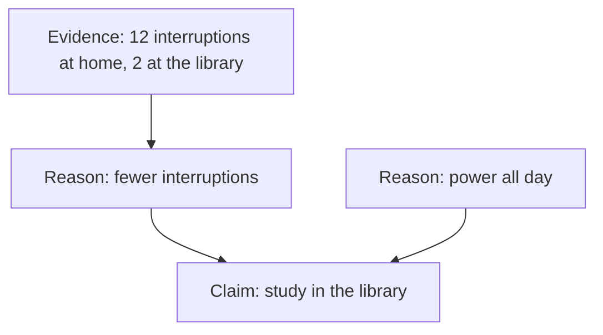

<BigWordAlert term="Evidence" plainEnglish="Facts you could check, such as a count, a price, a test result or a named source, that support a reason." whyItMatters="Anyone can give a reason. Evidence is what lets you check whether the reason is true." />

## Two messages, one choice

Sami and Omar both write to their study group about where to revise for the exam.

Sami writes: "The library is better. Trust me."

Omar writes: "We should study in the library, not at home. At home there are too many interruptions. Last week I counted: in two hours at home I was interrupted 12 times, and in two hours at the library only twice. Also, the library has power all day."

Both want the same thing. But only one gives you something to think with. To see why, you need the three parts of an argument.

## Claim, reasons and evidence

Try this first, on a different message. Rania writes: "This phone is the best buy for students, because its battery lasts two days. I used it for a week and charged it only three times."

```predict
prompt: "In Rania's message, which part is the claim: the thing she wants you to believe?"
options:
  - id: best-buy
    label: "This phone is the best buy"
  - id: battery
    label: "Its battery lasts two days"
correctOptionId: best-buy
explanation: "The claim is what she wants you to believe: the phone is the best buy for students. The battery is her reason, and her week of charging is her evidence."
```

Every argument has a claim. Most also give reasons, and the best give evidence.

- **The claim** is what the person wants you to believe or do. Ask: "What do they want from me?" For Rania, it is "this phone is the best buy for students".
- **A reason** says why the claim should be true. It often comes after "because". Rania's reason: the battery lasts two days.
- **Evidence** is something you could check that supports the reason. Rania's evidence: she used the phone for a week and charged it three times.

Small words help you find the parts. "Because" and "since" usually come before a reason. "So", "this means" and "we should" usually come before the claim. These <GlossaryTerm term="signal words" definition="Small words that show the parts of an argument, such as 'because', 'since', 'so' and 'this shows'." /> are not always there, but when they are, they help.

## The worked example

Now split Omar's message, one step at a time.

**Step 1: find the claim.** What does Omar want? "We should study in the library, not at home."

**Step 2: find the reasons.** Why does he say so? He gives two reasons: there are fewer interruptions in the library, and the library has power all day.

**Step 3: find the evidence for each reason.** For the first reason, he counted: 12 interruptions at home and 2 at the library, in two hours each. For the second reason, he gives no evidence. It may be true, but the group would need to check it, for example by asking the library about its hours.

The small chart below shows the shape of his argument. Read it from top to bottom.



Notice that one reason stands on evidence and one stands alone. That tells the group exactly what to check.

**Step 4: ask if the evidence is enough.** Omar's count is real evidence, but it is small. It is one person, in one week. Maybe last week his home was unusually busy. It is still much better than "trust me", and the group can add to it. Each of them could count their interruptions for one study session.

Sami's message has a claim and nothing else. It might even be true, but it gives you no way to know.

## Back to the gum message

The same four steps work on the forwarded message about mint gum from chapter 6.1. The claim: chew mint gum in your exam. The reason: a professor proved that students who chew gum score 40 percent higher. The evidence: one cousin who got full marks. Now you can see the problem clearly. The big reason has no evidence you can check: no name, no study, no "compared with what". The only evidence is one story about one person, and it does not even show the gum made the difference.

<Callout type="tip" title="Three questions for any evidence">
Can I check it? Is it about this claim? Is there enough of it? One person's story is a start, not proof.
</Callout>

## Common mistake

The most common mistake is treating things that feel convincing as evidence. A confident tone, a long message, strong words, many shares or "everyone knows" can make a claim feel true. None of them is something you can check. When you read a message, point to the evidence. If you cannot point to anything, there is none.

A second mistake goes the other way. A weak argument does not prove the claim is false. Sami may be right about the library. He just has not shown it yet. A weak argument means "not shown", not "wrong".

## Check your understanding

```quiz
type: mcq
question: "Basel writes: 'We should buy rice at the big shop, not the corner shop. It is cheaper there. Last week a 5 kilo bag cost 30 shekels at the big shop and 36 shekels at the corner shop.' Which part is the evidence?"
options:
  - "Buy rice at the big shop"
  - "The big shop is cheaper overall"
  - "The prices he saw last week"
  - "The corner shop is near home"
correct: 2
explanations:
  - "This is the claim: what Basel wants the family to do."
  - "This is close to his reason: why he says the big shop is better. A reason still needs something you could check."
  - "Right. The two prices from last week are facts the family could check. They support his reason that the big shop is cheaper."
  - "Basel does not say this. It might matter, but it is not part of his argument."
```

```quiz
type: mcq
question: "Sami writes: 'Everyone should use flashcards to study. Flashcards are the best way to study.' What does his argument most need?"
options:
  - "A reason, and evidence that he could check"
  - "More friends in the chat who agree with it"
  - "Nothing, because the claim is short and clear"
  - "A stronger claim, such as 'the only way'"
correct: 0
explanations:
  - "Right. His second sentence repeats the claim in new words. He needs a reason why flashcards help, and evidence such as test marks before and after using them."
  - "More people agreeing does not show the claim is true. Many people can believe the same weak claim."
  - "A clear claim is a good start, but it is only a claim. Without a reason and evidence, there is nothing to check."
  - "A stronger claim needs even more support. It does not add a reason or evidence."
```

<ChapterRecap points={["The claim is what someone wants you to believe or do", "A reason says why, and often follows 'because'", "Evidence is something you could check that supports a reason", "Point to the evidence: if you cannot, there is none", "A weak argument means 'not shown', not 'wrong'"]} />

**Next:** Six common traps: weak arguments that sound strong.
