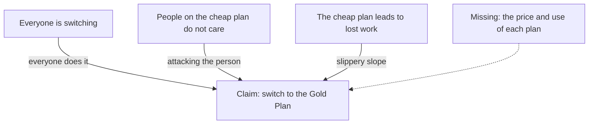

<BigWordAlert term="Argument trap" plainEnglish="A common kind of weak argument. It sounds strong, but it leaves out a real reason for the claim." whyItMatters="When you know the traps by name, you spot them in seconds, and you know which question to ask next." />

## Huda's advice

Huda suggests that her family cooks at home more often. She thinks it could save about 50 shekels a month. Her brother Tamer laughs: "Do not listen to Huda about saving money. She bought an expensive bag last year."

```predict
prompt: "Does Huda's expensive bag show that her advice about cooking at home is wrong?"
options:
  - id: yes
    label: "Yes: she does not follow it herself"
  - id: no
    label: "No: judge the advice on its own"
correctOptionId: no
explanation: "The bag says something about Huda, not about the advice. Cooking at home could save money whoever suggests it. Tamer has given no reason about the advice itself."
```

Tamer used a trap. It sounds like a reason, but it is about the person, not the idea. Here are six traps you will meet often. For each one, ask the same question: what is missing?

## The six traps

### 1. Attacking the person
The reply attacks the person who made the claim, instead of the claim. Tamer's reply about the bag is an example.

**What is missing:** a reason about the advice itself. Would cooking at home save money or not?

### 2. Only two choices
The speaker offers two options as if no others exist. "Either you study ten hours every day, or you will fail the exam."

**What is missing:** the other choices. You could study two focused hours a day, study with a group, or practice old exam papers.

### 3. Everyone does it
The claim is true or good because many people believe it or do it. "Everyone in our class is buying the expensive revision book, so it must be worth it."

**What is missing:** evidence that the book helps. Many people can make the same mistake, often because they copied each other.

### 4. Slippery slope
One small step will surely lead to a disaster, through a chain of steps. "If you lend your brother your phone for one call, soon he will take it every day, and you will never have it again."

**What is missing:** a reason why each step will really happen. One call does not have to lead to the next step.

### 5. An expert said so
An expert is named, but the expert is outside their own field, or the name is the only reason. "A famous football coach says this vitamin drink makes your memory stronger."

**What is missing:** an expert in this exact subject, and the evidence they used. A real expert who shows evidence is a good reason. A famous name alone is not.

### 6. Twisting their words
The reply argues against something the person never said, usually a bigger, sillier version. Nour says, "We could spend a little less on snacks each week." Omar replies, "So you want us to never enjoy anything and live on bread and water?"

**What is missing:** a reply to what Nour really said. Omar argues against a claim nobody made.

Six names can feel like a lot. You do not need to remember them perfectly. What matters is the habit: when an argument feels strong, look for the missing piece.

## The worked example

Here is a message forwarded in a neighbourhood group chat. The Gold Plan is a made-up phone plan.

> Everyone is switching to the Gold Plan. Only people who do not care about their families stay on the cheap plan. If you stay on it, you will run out of credit, miss a job call and lose your chance of work.

**Step 1: find the claim.** Switch to the Gold Plan.

**Step 2: list the reasons.** Everyone is switching. People on the cheap plan do not care about their families. The cheap plan leads to running out of credit, missing a call and losing work.

**Step 3: name the traps.** The first reason is "everyone does it". The second attacks the people who disagree, not the plan, so it is "attacking the person". The third is a slippery slope: three steps, with no reason why each will happen.

**Step 4: ask what a real reason would look like.** A real reason would compare the two plans: the price of each, what each gives you, and how much you really use. None of that is in the message. The Gold Plan might still be right for you, but this message does not show it.

Here is the message drawn the same way as in chapter 6.2, with the trap written on each arrow.



Notice that three arrows reach the claim, and each one is a trap. The dotted arrow is the kind of reason that would really count, and the message never gives it.

<Callout type="warning" title="A trap does not make the claim false">
Naming a trap tells you the reason is weak. It does not prove the claim is wrong. Use the name to ask a better question, not to win the argument or to make someone feel small.
</Callout>

## Common mistake

Once people learn these names, some start to see traps everywhere. Not every mention of an expert is a trap. A doctor talking about medicine, with evidence, is a good reason. Not every warning is a slippery slope. "If you miss three payments, the shop will stop your credit" is a stated rule, not a chain of guesses. Before you name a trap, check that the missing piece is really missing.

## Check your understanding

```quiz
type: mcq
question: "Rania suggests that the study group meets online once a week to save travel money. Sami replies: 'So you want us to stop meeting in person forever?' Which trap is Sami using?"
options:
  - "Attacking the person"
  - "Twisting their words"
  - "Only two choices"
  - "Everyone does it"
correct: 1
explanations:
  - "Sami does not say anything about Rania herself. He replies to an idea, just not to her idea."
  - "Right. Rania asked for one online meeting a week. Sami argues against 'stop meeting in person forever', which she never said."
  - "Sami does not offer two options. He changes what Rania said into something much bigger."
  - "Sami does not say that many people do or believe something. The problem is the claim he puts in her mouth."
```

```quiz
type: mcq
question: "An advert says: 'A famous singer says this study course will double your marks. Join today!' What is the main thing missing from this argument?"
options:
  - "The price of the course, and how long it takes"
  - "Evidence from someone who knows about studying"
  - "A promise that is even bigger than double marks"
  - "A second famous singer who says the same thing"
correct: 1
explanations:
  - "You do need the price before you join, but the price does not show that the course works. The weak point is the reason."
  - "Right. A singer is not an expert on study methods, and the advert shows no evidence. Marks of real students before and after the course would be a start."
  - "A bigger promise makes the claim harder to believe, not easier. It adds no evidence."
  - "Two singers outside their field are no better than one. The missing piece is an expert and some evidence."
```

**Next:** Too good to be true: checking job and scholarship offers for scam signs.
