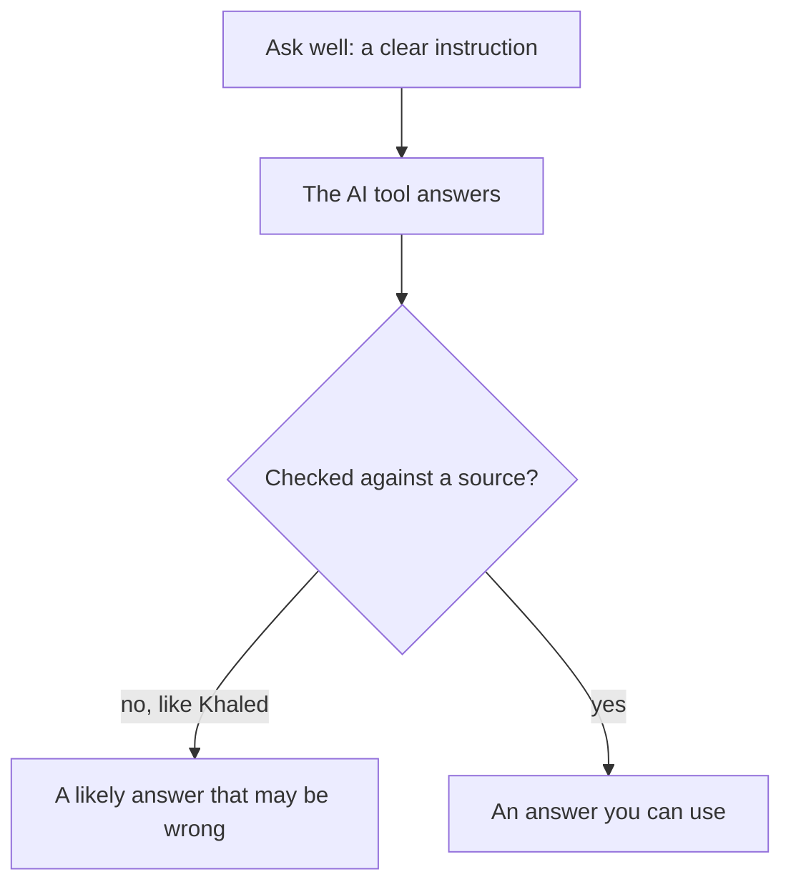

<BigWordAlert term="AI chat tool" plainEnglish="A computer program you type questions to. It writes answers in full sentences, like a person would." whyItMatters="It can save you a lot of time. It can also be wrong in a calm, sure voice, so you need to know how to ask well and how to check." />

## A warm-up sum

Here is a small puzzle before the story. Do not use a calculator. A rough answer in your head is enough.

```predict
prompt: "An AI chat tool says: 'You charge 12 dollars an hour and you worked 25 hours, so the client owes you 250 dollars.' Is the total right?"
options:
  - id: yes-right
    label: "Yes, 250 dollars is the right total"
  - id: no-more
    label: "No, the client owes more"
correctOptionId: no-more
explanation: "12 x 25 is 300. One quick way: 10 x 25 is 250, and 2 x 25 is 50, so 250 + 50 = 300. The answer sounded sure, but it missed 50 dollars."
```

If you said 250, good: now you know the trick. The answer used a number that looked right, and it said it calmly. That is exactly what this module is about.

## Khaled and the essay

Khaled is studying for an English exam. Part of the exam is a short essay. One evening the power comes back, and he has an hour of internet. He wants to use it well.

He types into an AI chat tool: "How many words do I need to write in the essay part of the exam?"

The answer comes in two seconds: "You need to write 250 words. This is the standard length for this kind of exam essay."

It sounds sure. There is no "maybe" and no "I think". So Khaled practices writing essays of 250 words, every day for two weeks.

On exam day, he opens the paper. It says: "Write at least 300 words." He writes fast, but he runs out of time. He loses marks.

What went wrong? The tool did not know his exam. It gave a common number that often appears in text about exams. The number was likely, but it was not true for him. The real answer was on the course page his teacher shared, and he never checked it.

Khaled is not foolish. He trusted a voice that sounded sure. Most of us do that.

## Why this matters for you

AI chat tools are useful. They can explain an idea in simpler words, draft a message, or give you ideas when you are stuck. You will likely meet them in your studies and in your work.

Using them well has two halves. The first half is **asking well**: giving a clear instruction, so you get a useful answer. The second half is **checking always**: testing the answer before you trust it, using the habits you built in this course. You already know how to check rough numbers, find hidden assumptions and spot weak arguments. Now you use them on AI answers.

The chart shows the two halves: one before the answer and one after it.



Notice that the sure voice does not change which box you end in. Only the check does. Khaled took the no arrow, and his likely answer was wrong for his exam.

This module does not try to make you love AI or fear it. It treats an AI chat tool like any other helper: useful, fast, and sometimes wrong.

<LearningObjectives items={["Explain in plain words why an AI can sound sure and still be wrong", "Write a clear instruction in five parts: goal, context, steps, format and how to check", "Check an AI answer three ways before you use it", "Know when not to use or trust an AI tool"]} />

## Key words

| Word | Plain English |
|---|---|
| **AI chat tool** | A program you type questions to that writes answers in sentences |
| **Instruction** | What you ask a person or a tool to do. For an AI tool, it is also called a prompt |
| **Source** | The place a fact really comes from, such as an official page or document |
| **Check** | Test an answer before you trust it or use it |
| **Private data** | Information about a person that others should not see without permission |

## What is in this module

| Chapter | You will practice |
|---|---|
| 7.2 | Saying what an AI tool is good and bad at |
| 7.3 | Writing clear instructions in five parts |
| 7.4 | Checking an AI answer three ways |
| 7.5 | Deciding when not to use AI |
| 7.6 | A graded quiz with short scenarios |
| 7.7 | Rewriting a vague instruction into a clear one |

**Next:** What an AI chat tool really does when it writes an answer, and why that makes it good at some jobs and bad at others.
