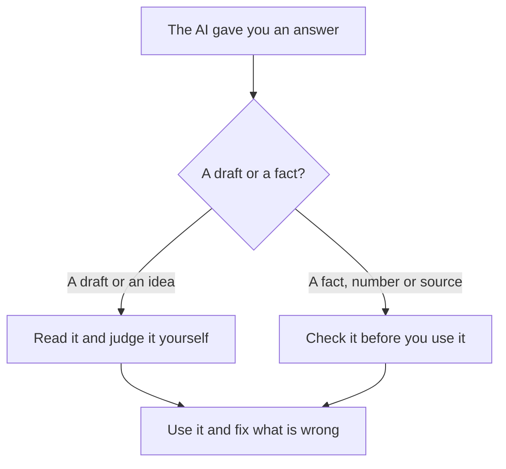

## Finish the sentence

Try this small game. Finish the sentence: "Can I have a cup of tea with no..." Most people say "sugar". You did not look it up. You did not think hard. You have heard sentences like it many times, so the next word came by itself.

Now try: "The bus to the university leaves at..." You probably thought of a time, maybe "8 o'clock". But you do not know the real time. You guessed a time that sounds normal. An AI chat tool does something like this, on a very large scale.

<BigWordAlert term="Predicting words" plainEnglish="An AI chat tool writes an answer by choosing, one small piece at a time, the words that are most likely to come next, based on patterns in a huge amount of text." whyItMatters="A likely sentence is not always a true sentence. This is why an AI can sound sure and still be wrong." />

## What happens when you ask

Before people can use an AI chat tool, it learns from a huge amount of written text. From that text, it learns <GlossaryTerm term="patterns" definition="Things that happen again and again in the same way, such as which words often come after other words." />: which words follow which, how a polite email sounds, how an explanation of a maths idea usually goes.

When you type a question, the tool does not open a book and read the answer. It writes a reply piece by piece. At each point it picks words that fit well after the words before. Some tools can also search the internet first. Even then, they can mix up two pages or copy a mistake.

This has one big effect. The tool is very good at writing text that **sounds** right. It writes in a calm, sure voice, because that is how most written answers sound. It does not feel doubt the way a person does. So it may not say "I am not sure" even when it should.

Before you read the lists below, make a guess.

```predict
prompt: "Rania asks an AI chat tool two things. Which answer is more likely to be wrong?"
options:
  - id: price
    label: "Today's price of flour in her market"
  - id: reword
    label: "Her client message, made more polite"
correctOptionId: price
explanation: "A local, recent price is an exact fact the tool may never have seen. A more polite message is a draft that Rania can read and judge herself."
```

## Good at, and risky for

Here is the same idea as a table. Read the "Why" column most carefully.

| Job | Usually | Why |
|---|---|---|
| Drafting a message or a plan | Good | You can read it and fix it |
| Explaining an idea in simpler words | Good | Common ideas appear in a lot of text |
| Giving ideas when you are stuck | Good | You choose which ideas to keep |
| Rewording or changing the tone | Good | You can see if the meaning stayed the same |
| Exact facts: names, dates, rules | Risky | A likely fact can still be false |
| Recent or local facts | Risky | It may never have seen them |
| Sums with many steps | Risky | It can slip on one step and not notice |
| Sources: books, pages, quotes | Risky | It can write a title that does not exist |

Notice the pattern. The tool is good at jobs where **you can judge the result yourself**. It is risky for jobs where **the answer must match the real world exactly**.

Here is the same rule as a small flowchart. Follow it from the top.



Both paths end with you using the answer. The difference is how much checking comes first. A draft needs your judgment. A fact needs a check.

## A worked example

Rania is a freelance translator. She is building her profile on a freelance website. She asks an AI chat tool for help with two things. Watch how she thinks about each one.

**Request 1:** "Rewrite my profile text so it sounds friendly and clear." She asks herself three questions:

- Is it a draft or a fact? A draft.
- Can I judge it myself? Yes. She reads English well enough to see if it still says what she means.
- What happens if it is wrong? Small harm. She can change any sentence.

So she uses the answer, but she reads every line. She changes one sentence that promised "24-hour delivery". She never offered that.

**Request 2:** "What fee does the freelance website keep from each job?" The tool says: "The website keeps 20 percent of each payment." She asks the same three questions:

- Is it a draft or a fact? A fact, and a number.
- Can I judge it myself? No. She does not know the fee.
- What happens if it is wrong? She could set her prices wrong for months.

So she opens the website's own help page. It says the fee is 10 percent in this example. The tool gave a number that sounded normal, but it was not true for this website.

Rania used the tool well both times. In the first case she used it fully. In the second case she used it only as a hint of what to check.

<Callout type="tip" title="Think of a well-read helper">
Imagine a helper who has read a great deal, writes fast, and never says "I do not know". You would let this helper draft a letter. You would not let them tell you a deadline without checking.
</Callout>

## A common mistake

There are two opposite mistakes, and both are common.

The first mistake is **"it sounded so sure, so it must be right"**. A calm voice is not evidence. In module 6 you met messages that sounded convincing without good reasons. The same is true when the confident voice comes from a computer.

The second mistake is **"AI is always wrong, so never use it"**. That throws away a useful helper. It also means you never practice checking, which is a skill you need anyway, for people and for websites too.

The healthy middle is simple: use it for the jobs it is good at, and check the jobs it is risky for.

## Check your understanding

```quiz
type: mcq
question: "Huda has four jobs for an AI chat tool. For which one can she most safely use the answer after a careful read, with no other check?"
options:
  - "Today's price of a kilo of tomatoes in her market"
  - "The exact date her exam timetable will come out"
  - "Making her short message to a client more polite"
  - "Adding up 14 prices from her shop's notebook"
correct: 2
explanations:
  - "A local price today is a recent, exact fact. The tool may never have seen it, so she needs to ask in the market."
  - "An exact date is a fact about the real world. It must come from her university's own notice."
  - "Right. This is a draft she can judge herself. She reads it, checks the meaning stayed the same, and fixes anything she does not like."
  - "A sum with many steps is risky. One slip can hide in the middle, so she should add the prices another way too."
```

```quiz
type: mcq
question: "Basel asks an AI chat tool for a book to quote in his report. It gives a title, an author and a year, all in a sure voice. What should he do?"
options:
  - "Find the book himself before he quotes it"
  - "Quote it, since the details are very exact"
  - "Ask the tool again, and quote it if it agrees"
  - "Quote it, and add that an AI tool found it"
correct: 0
explanations:
  - "Right. Sources are a risky job for an AI tool. It can write a title that sounds real but does not exist, so Basel must see the book first."
  - "Exact details can still be made up. A title, an author and a year are easy to write and hard to trust without a check."
  - "Asking the same tool again is not a real check. It can repeat the same made-up answer in the same sure voice."
  - "Saying where it came from is honest, but it does not make the book real. He still needs to find it."
```

<ChapterRecap points={["An AI chat tool writes by choosing likely words, not by looking up the truth", "That is why it can sound sure and still be wrong", "It is good at drafts, explanations, ideas and rewording", "It is risky for exact facts, recent facts, sums and sources", "A draft needs your judgment; a fact needs a check"]} />

**Next:** How to ask clearly, so the answer you get is useful from the start.
